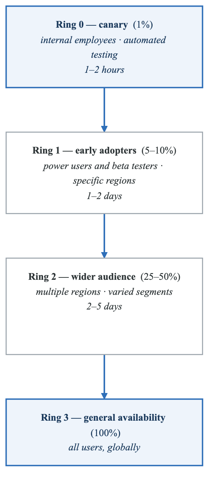
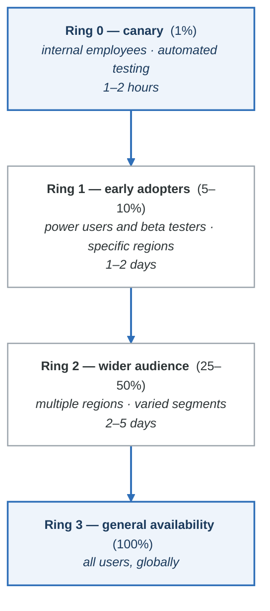

# Module 11: Feature Flags and Progressive Delivery

## Learning Objectives

By the end of this module, you will be able to:
- Understand feature flag types and use cases
- Implement feature flags in applications
- Design progressive rollout strategies
- Manage feature flag lifecycle
- Implement A/B testing and experimentation
- Integrate feature flags with CI/CD pipelines

## Introduction

Feature flags (also called feature toggles) are a powerful technique that allows teams to modify system behavior without changing code. They enable progressive delivery, where features are gradually released to users, reducing risk and enabling rapid experimentation.

## Feature Flag Types

### Categories of Feature Flags

**Feature flag types**

| Type | Purpose | Lifetime | Example |
|---|---|---|---|
| **Release** | Ship incomplete work safely; enables trunk-based development | Days to weeks | `new-checkout-flow` |
| **Experiment** | A/B and multivariate testing, for data-driven decisions | Weeks to months | `pricing-page-variant` |
| **Operational** | Circuit breakers and kill switches | Permanent | `rate-limiting-enabled` |
| **Permission** | Entitlements, subscription tiers | Permanent | `premium-features` |

The lifetime column is the operational one. Release and experiment flags are **temporary and must be
removed** — a release flag that outlives its feature is a branch in the code that nobody tests and
everybody has forgotten how to reason about. Put the removal ticket in the same pull request that
adds the flag, and treat flag count as a debt metric.

## Feature Flag Implementation

### Basic Implementation

```javascript
// Simple feature flag service
class FeatureFlagService {
  constructor(config) {
    this.flags = config.flags || {};
    this.defaultFlags = config.defaults || {};
  }

  isEnabled(flagName, context = {}) {
    const flag = this.flags[flagName];

    if (!flag) {
      return this.defaultFlags[flagName] || false;
    }

    // Check if globally disabled
    if (!flag.enabled) {
      return false;
    }

    // Check user allowlist
    if (flag.allowlist?.includes(context.userId)) {
      return true;
    }

    // Check user blocklist
    if (flag.blocklist?.includes(context.userId)) {
      return false;
    }

    // Check percentage rollout
    if (flag.percentage !== undefined) {
      const hash = this.hashUser(context.userId, flagName);
      return hash < flag.percentage;
    }

    // Check segment rules
    if (flag.rules) {
      return this.evaluateRules(flag.rules, context);
    }

    return flag.enabled;
  }

  hashUser(userId, flagName) {
    // Consistent hashing for deterministic rollout
    const hash = crypto
      .createHash('md5')
      .update(`${userId}-${flagName}`)
      .digest('hex');
    return parseInt(hash.slice(0, 8), 16) % 100;
  }

  evaluateRules(rules, context) {
    return rules.some(rule => {
      return Object.entries(rule.conditions).every(([key, value]) => {
        if (Array.isArray(value)) {
          return value.includes(context[key]);
        }
        return context[key] === value;
      });
    });
  }
}

// Usage
const featureFlags = new FeatureFlagService({
  flags: {
    'new-checkout': {
      enabled: true,
      percentage: 25,
      allowlist: ['user-123', 'user-456'],
    },
    'dark-mode': {
      enabled: true,
      rules: [
        { conditions: { plan: 'premium' } },
        { conditions: { country: ['US', 'CA'] } },
      ],
    },
  },
});

// Check flag
if (featureFlags.isEnabled('new-checkout', { userId: currentUser.id })) {
  renderNewCheckout();
} else {
  renderLegacyCheckout();
}
```

### LaunchDarkly Integration

```javascript
// LaunchDarkly SDK integration
const LaunchDarkly = require('launchdarkly-node-server-sdk');

class LaunchDarklyService {
  constructor(sdkKey) {
    this.client = LaunchDarkly.init(sdkKey);
  }

  async initialize() {
    await this.client.waitForInitialization();
  }

  async isEnabled(flagKey, user, defaultValue = false) {
    const ldUser = {
      key: user.id,
      email: user.email,
      name: user.name,
      custom: {
        plan: user.plan,
        company: user.company,
        signupDate: user.createdAt,
      },
    };

    return await this.client.variation(flagKey, ldUser, defaultValue);
  }

  async getVariation(flagKey, user, defaultValue) {
    const ldUser = this.buildUser(user);
    return await this.client.variation(flagKey, ldUser, defaultValue);
  }

  buildUser(user) {
    return {
      key: user.id,
      email: user.email,
      custom: user.attributes || {},
    };
  }

  close() {
    this.client.close();
  }
}

// Express middleware
const featureFlags = new LaunchDarklyService(process.env.LD_SDK_KEY);

app.use(async (req, res, next) => {
  req.featureFlags = {
    isEnabled: async (flag) =>
      featureFlags.isEnabled(flag, req.user),
    getVariation: async (flag, defaultValue) =>
      featureFlags.getVariation(flag, req.user, defaultValue),
  };
  next();
});

// Usage in route
app.get('/checkout', async (req, res) => {
  const useNewCheckout = await req.featureFlags.isEnabled('new-checkout');

  if (useNewCheckout) {
    return res.render('checkout-v2');
  }
  return res.render('checkout');
});
```

### React Feature Flag Component

```jsx
// Feature flag context and components
import React, { createContext, useContext, useState, useEffect } from 'react';
import { useLDClient, useFlags } from 'launchdarkly-react-client-sdk';

// Feature flag provider
export const FeatureFlagProvider = ({ children }) => {
  const flags = useFlags();
  const ldClient = useLDClient();

  return (
    <FeatureFlagContext.Provider value={{ flags, ldClient }}>
      {children}
    </FeatureFlagContext.Provider>
  );
};

// Hook for feature flags
export const useFeatureFlag = (flagKey, defaultValue = false) => {
  const { flags } = useContext(FeatureFlagContext);
  return flags[flagKey] ?? defaultValue;
};

// Conditional rendering component
export const Feature = ({ flag, children, fallback = null }) => {
  const isEnabled = useFeatureFlag(flag);
  return isEnabled ? children : fallback;
};

// Usage
function App() {
  return (
    <FeatureFlagProvider>
      <Feature flag="new-dashboard" fallback={<OldDashboard />}>
        <NewDashboard />
      </Feature>

      <Feature flag="beta-features">
        <BetaFeaturePanel />
      </Feature>
    </FeatureFlagProvider>
  );
}

// Variant component for A/B testing
export const Variant = ({ flag, variants, defaultVariant }) => {
  const variant = useFeatureFlag(flag, defaultVariant);

  const Component = variants[variant];
  if (!Component) {
    return variants[defaultVariant] || null;
  }

  return <Component />;
};

// Usage
<Variant
  flag="pricing-page-variant"
  defaultVariant="control"
  variants={{
    control: PricingPageA,
    variant_b: PricingPageB,
    variant_c: PricingPageC,
  }}
/>
```

## Progressive Delivery

### Percentage Rollout

```yaml
# Feature flag configuration
new-payment-system:
  enabled: true
  rollout:
    # Start with 1%
    - percentage: 1
      duration: "2d"
    # Increase to 5%
    - percentage: 5
      duration: "2d"
    # Increase to 25%
    - percentage: 25
      duration: "3d"
    # Increase to 50%
    - percentage: 50
      duration: "3d"
    # Increase to 100%
    - percentage: 100

  # Automatic rollback conditions
  rollback:
    conditions:
      - metric: error_rate
        threshold: 0.05
        operator: ">"
      - metric: p99_latency_ms
        threshold: 500
        operator: ">"
```

### Targeting Rules

```javascript
// Complex targeting configuration
const flagConfig = {
  'premium-features': {
    enabled: true,
    targeting: {
      rules: [
        {
          name: 'Premium users',
          priority: 1,
          conditions: [
            { attribute: 'plan', operator: 'in', values: ['premium', 'enterprise'] },
          ],
          variation: true,
        },
        {
          name: 'Beta testers',
          priority: 2,
          conditions: [
            { attribute: 'betaTester', operator: 'equals', values: [true] },
          ],
          variation: true,
        },
        {
          name: 'Internal users',
          priority: 3,
          conditions: [
            { attribute: 'email', operator: 'endsWith', values: ['@company.com'] },
          ],
          variation: true,
        },
        {
          name: 'Gradual rollout',
          priority: 4,
          conditions: [
            { attribute: 'country', operator: 'in', values: ['US', 'CA'] },
          ],
          percentage: 10,
        },
      ],
      defaultVariation: false,
    },
  },
};
```

### Ring-Based Deployment

<!-- figure: generated from the Mermaid below by _shared/diagrams/embed-figures.py — do not edit the image -->


<details>
<summary>Diagram source (Mermaid)</summary>



</details>

## A/B Testing

### Experiment Configuration

```javascript
// A/B test configuration
const experiments = {
  'pricing-page-test': {
    type: 'experiment',
    hypothesis: 'Showing annual pricing first increases conversions',
    metrics: ['conversion_rate', 'revenue_per_user'],
    variants: {
      control: {
        weight: 50,
        config: { showAnnualFirst: false },
      },
      treatment: {
        weight: 50,
        config: { showAnnualFirst: true },
      },
    },
    segmentation: {
      include: { country: ['US', 'CA', 'UK'] },
      exclude: { plan: ['enterprise'] },
    },
    startDate: '2024-01-15',
    endDate: '2024-02-15',
    sampleSize: 10000,
    minimumDetectableEffect: 0.05,
  },
};

// Track experiment exposure
function trackExperiment(userId, experimentId, variant) {
  analytics.track('Experiment Viewed', {
    userId,
    experimentId,
    variant,
    timestamp: new Date().toISOString(),
  });
}

// Track conversion
function trackConversion(userId, experimentId, metric, value) {
  analytics.track('Experiment Conversion', {
    userId,
    experimentId,
    metric,
    value,
    timestamp: new Date().toISOString(),
  });
}
```

### Statistical Analysis

```python
# A/B test analysis
import numpy as np
from scipy import stats

def analyze_experiment(control_data, treatment_data):
    """Analyze A/B test results"""

    control_conversions = control_data['conversions']
    control_visitors = control_data['visitors']
    treatment_conversions = treatment_data['conversions']
    treatment_visitors = treatment_data['visitors']

    # Conversion rates
    control_rate = control_conversions / control_visitors
    treatment_rate = treatment_conversions / treatment_visitors

    # Relative uplift
    relative_uplift = (treatment_rate - control_rate) / control_rate

    # Chi-squared test
    contingency_table = [
        [control_conversions, control_visitors - control_conversions],
        [treatment_conversions, treatment_visitors - treatment_conversions]
    ]
    chi2, p_value, dof, expected = stats.chi2_contingency(contingency_table)

    # Confidence interval
    se = np.sqrt(
        (control_rate * (1 - control_rate) / control_visitors) +
        (treatment_rate * (1 - treatment_rate) / treatment_visitors)
    )
    ci_95 = (
        (treatment_rate - control_rate) - 1.96 * se,
        (treatment_rate - control_rate) + 1.96 * se
    )

    return {
        'control_rate': control_rate,
        'treatment_rate': treatment_rate,
        'relative_uplift': relative_uplift,
        'p_value': p_value,
        'significant': p_value < 0.05,
        'confidence_interval': ci_95,
    }
```

## Feature Flag Lifecycle

### Flag Management

```yaml
# Feature flag metadata
new-checkout-flow:
  name: "New Checkout Flow"
  description: "Redesigned checkout with improved UX"
  owner: "checkout-team"
  created: "2024-01-10"
  tags: ["checkout", "ux", "q1-2024"]

  # Lifecycle state
  lifecycle:
    state: "gradual-rollout"  # development, testing, gradual-rollout, complete, deprecated
    staleAfter: "2024-04-10"  # Alert if still active

  # Rollout plan
  rollout:
    currentPercentage: 25
    schedule:
      - date: "2024-01-15"
        percentage: 5
      - date: "2024-01-22"
        percentage: 25
      - date: "2024-01-29"
        percentage: 50
      - date: "2024-02-05"
        percentage: 100

  # Dependencies
  dependencies:
    requires: ["new-payment-api"]
    conflicts: ["legacy-checkout"]

  # Cleanup
  cleanup:
    codeLocations:
      - "src/components/Checkout.tsx"
      - "src/api/checkout.ts"
    jiraTicket: "PROJ-1234"
```

### Stale Flag Detection

```javascript
// Detect and report stale flags
async function detectStaleFlags(flagService) {
  const flags = await flagService.getAllFlags();
  const now = new Date();
  const staleFlags = [];

  for (const flag of flags) {
    const metadata = flag.metadata || {};

    // Check if flag is at 100% for extended period
    if (flag.percentage === 100) {
      const fullRolloutDate = new Date(metadata.fullRolloutDate);
      const daysSinceFullRollout = (now - fullRolloutDate) / (1000 * 60 * 60 * 24);

      if (daysSinceFullRollout > 30) {
        staleFlags.push({
          flag: flag.key,
          reason: 'at_100_percent_for_30_days',
          daysSinceFullRollout,
          owner: metadata.owner,
        });
      }
    }

    // Check for flags past stale date
    if (metadata.staleAfter && new Date(metadata.staleAfter) < now) {
      staleFlags.push({
        flag: flag.key,
        reason: 'past_stale_date',
        staleAfter: metadata.staleAfter,
        owner: metadata.owner,
      });
    }

    // Check for unused flags (no evaluations in 30 days)
    const lastEvaluation = await flagService.getLastEvaluation(flag.key);
    if (lastEvaluation) {
      const daysSinceEval = (now - lastEvaluation) / (1000 * 60 * 60 * 24);
      if (daysSinceEval > 30) {
        staleFlags.push({
          flag: flag.key,
          reason: 'no_evaluations_in_30_days',
          lastEvaluation,
          owner: metadata.owner,
        });
      }
    }
  }

  return staleFlags;
}

// Report stale flags
async function reportStaleFlags() {
  const staleFlags = await detectStaleFlags(featureFlags);

  if (staleFlags.length > 0) {
    await slack.postMessage({
      channel: '#feature-flags',
      text: `Found ${staleFlags.length} stale feature flags`,
      attachments: staleFlags.map(f => ({
        title: f.flag,
        text: `Reason: ${f.reason}\nOwner: ${f.owner}`,
        color: 'warning',
      })),
    });
  }
}
```

## CI/CD Integration

### Pipeline Integration

```yaml
# Feature flag validation in CI
name: Feature Flag Validation

on:
  pull_request:
    paths:
      - 'config/feature-flags/**'

jobs:
  validate:
    runs-on: ubuntu-latest
    steps:
      - uses: actions/checkout@v4

      - name: Validate flag schema
        run: |
          npx ajv validate -s schemas/feature-flag.json -d config/feature-flags/*.yml

      - name: Check for conflicts
        run: |
          node scripts/check-flag-conflicts.js

      - name: Lint flag names
        run: |
          # Ensure flag names follow convention
          for file in config/feature-flags/*.yml; do
            name=$(yq '.name' $file)
            if [[ ! $name =~ ^[a-z]+(-[a-z]+)*$ ]]; then
              echo "Invalid flag name: $name"
              exit 1
            fi
          done

  sync:
    needs: validate
    runs-on: ubuntu-latest
    if: github.event_name == 'push' && github.ref == 'refs/heads/main'
    steps:
      - uses: actions/checkout@v4

      - name: Sync to LaunchDarkly
        env:
          LD_API_KEY: ${{ secrets.LD_API_KEY }}
        run: |
          node scripts/sync-flags-to-launchdarkly.js
```

### Deployment Gating

```yaml
# Gate deployment on flag state
deploy:
  runs-on: ubuntu-latest
  steps:
    - name: Check feature flag readiness
      env:
        LD_API_KEY: ${{ secrets.LD_API_KEY }}
      run: |
        # Ensure dependent flags are enabled
        FLAGS_READY=$(curl -s \
          -H "Authorization: $LD_API_KEY" \
          "https://app.launchdarkly.com/api/v2/flags/production?tag=deployment-dependency" \
          | jq '.items | all(.on == true)')

        if [ "$FLAGS_READY" != "true" ]; then
          echo "Not all dependency flags are enabled"
          exit 1
        fi

    - name: Deploy
      run: ./deploy.sh

    - name: Enable release flag
      env:
        LD_API_KEY: ${{ secrets.LD_API_KEY }}
      run: |
        curl -X PATCH \
          -H "Authorization: $LD_API_KEY" \
          -H "Content-Type: application/json" \
          "https://app.launchdarkly.com/api/v2/flags/production/new-feature" \
          -d '[{"op": "replace", "path": "/on", "value": true}]'
```

## Hands-On Exercise

### Exercise: Implement Feature Flags

1. Set up a feature flag service
2. Implement percentage-based rollout
3. Create A/B test with tracking
4. Implement stale flag detection
5. Integrate with CI/CD pipeline

## Summary

- Feature flags enable trunk-based development and progressive delivery
- Different flag types serve different purposes (release, experiment, operational, permission)
- Progressive rollout reduces risk through gradual exposure
- A/B testing enables data-driven decisions
- Flag lifecycle management prevents technical debt
- CI/CD integration enables automated flag management

## Additional Resources

- [LaunchDarkly Documentation](https://docs.launchdarkly.com/)
- [Feature Flags Best Practices](https://martinfowler.com/articles/feature-toggles.html)
- [Progressive Delivery](https://www.split.io/glossary/progressive-delivery/)
- [A/B Testing Statistics](https://www.evanmiller.org/ab-testing/)

## Next Steps

In the next module, we'll explore CI/CD best practices and patterns, consolidating our learning into actionable guidelines for building effective pipelines.

<!-- feynman-check -->

---

## Feynman check

Close the file. Blank page, no notes. Explain each of these to a competent engineer who has never
used this tool — **under five minutes, no jargon you can't define on the spot:**

- Feature Flag Types
- Feature Flag Implementation
- Progressive Delivery
- A/B Testing

**The gap is not what you forgot. It is where you used a word instead of a mechanism.**

| | |
|---|---|
| ✗ | *"The pipeline deploys the application."* |
| ✓ | *"CI writes a new image tag into a config repository and stops. A controller running *inside* the cluster polls that repo, diffs the rendered manifests against live state, and applies the difference — so nothing outside the cluster ever holds credentials to it."* |

**Trace it:** `git push` → the new version serving traffic, with nothing else typed. Name where the handoff between CI and CD happens, and what that handoff physically is.

Stop at the first component you cannot name. Reopen this file and read **only** that.

**Go deeper — only once the gap has a name:** the four [OpenGitOps principles](https://opengitops.dev/#principles) — then say which one a `kubectl apply` inside CI violates.
Full list per domain: [`SOURCES.md`](../SOURCES.md#cicd-gitops)

→ Protocol, the three levels of knowing, and worked examples: [`MASTERY.md`](../MASTERY.md)

<!-- /feynman-check -->
