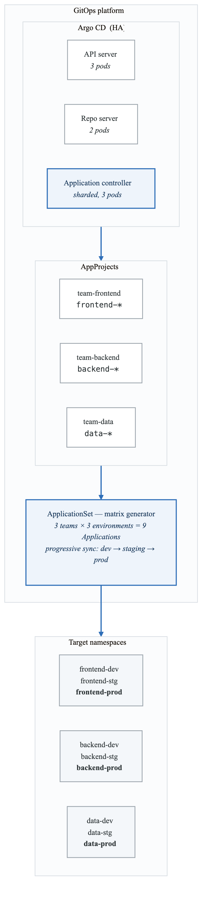
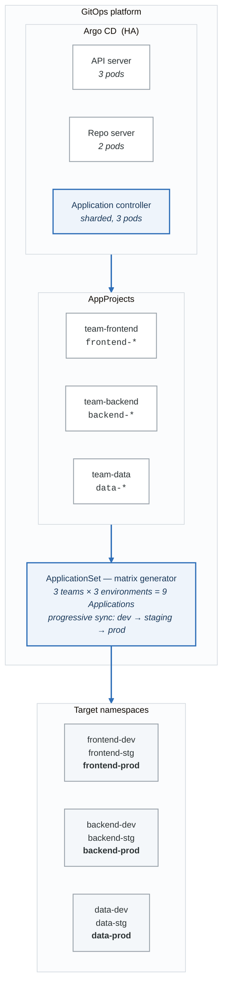

# Capstone Project: Multi-Team GitOps Platform

**Goal:** Build a production-ready GitOps platform that demonstrates mastery of all Argo CD concepts.

**Duration:** 4-6 hours

---

## Overview

This capstone project combines everything you've learned to build a complete multi-team GitOps platform. You'll implement:

- High availability Argo CD installation
- Multi-team project isolation
- Automatic application discovery
- Progressive deployment rollouts
- Observability and alerting
- Documentation and runbooks

---

## Architecture

<!-- figure: generated from the Mermaid below by _shared/diagrams/embed-figures.py — do not edit the image -->


<details>
<summary>Diagram source (Mermaid)</summary>



</details>

---

## Directory Structure

**`capstone/`**

- `README.md` — This file
- `docs/`
  - `architecture.md` — Architecture documentation
  - `onboarding.md` — Team onboarding guide
  - `runbook.md` — Operations runbook
- `projects/` — AppProject definitions
  - `team-frontend.yaml`
  - `team-backend.yaml`
  - `team-data.yaml`
- `applicationsets/`
  - `team-apps.yaml` — Matrix generator for all apps
- `apps/`
  - `frontend/`
    - `base/` — Common frontend resources
    - `overlays/`
      - `dev/`
      - `staging/`
      - `prod/`
  - `backend/`
    - `base/`
    - overlays/{dev,staging,prod}/
  - `data/`
    - `base/`
    - overlays/{dev,staging,prod}/
- `platform/` — (Optional) Platform components
  - `argocd/`
  - `monitoring/`
  - `bootstrap/`


---

## Tasks

### Task 1: Setup and Prerequisites

#### Step 1: Verify Your Cluster

```bash
# Ensure your lab cluster is running
kubectl cluster-info

# If not, recreate it
cd ../phase-0-prerequisites
./setup-cluster.sh
./install-argocd.sh
```

#### Step 2: Update Repository References

```bash
# Replace YOUR_USERNAME with your GitHub username
find . -name "*.yaml" -exec sed -i '' 's/YOUR_USERNAME/your-github-username/g' {} \;
```

#### Step 3: Push to Git

The ApplicationSets reference your Git repository, so you need to commit and push:

```bash
# From the capstone directory
cd /path/to/argocd-learning
git add .
git commit -m "Add capstone project configuration"
git push origin main
```

### Task 2: Create Team Projects

#### Step 1: Review Project Definitions

```bash
# Review each project
cat projects/team-frontend.yaml
cat projects/team-backend.yaml
cat projects/team-data.yaml
```

Each project defines:
- Allowed source repositories
- Allowed destination namespaces
- Resource whitelist
- Team roles

#### Step 2: Apply Projects

```bash
kubectl apply -f projects/
```

#### Step 3: Verify Projects

```bash
argocd proj list
argocd proj get team-frontend
```

### Task 3: Deploy ApplicationSet

#### Step 1: Review the ApplicationSet

```bash
cat applicationsets/team-apps.yaml
```

This uses a Matrix generator:
- 3 teams × 3 environments = 9 applications
- Progressive sync: dev → staging → prod

#### Step 2: Apply the ApplicationSet

```bash
kubectl apply -f applicationsets/team-apps.yaml
```

#### Step 3: Watch Applications Being Created

```bash
# Watch in CLI
argocd app list --watch

# Or check the UI at https://localhost:8080
```

You should see 9 applications:
- frontend-app-dev, frontend-app-staging, frontend-app-prod
- backend-app-dev, backend-app-staging, backend-app-prod
- data-app-dev, data-app-staging, data-app-prod

### Task 4: Verify Progressive Sync

#### Step 1: Make a Change

Edit `apps/frontend/base/deployment.yaml` and change the image tag:

```bash
# Edit the file
vi apps/frontend/base/deployment.yaml

# Change:
#   image: nginx:1.25
# To:
#   image: nginx:1.26
```

#### Step 2: Commit and Push

```bash
git add .
git commit -m "Update frontend image to 1.26"
git push
```

#### Step 3: Observe Progressive Rollout

```bash
# Watch the sync order
argocd app list --watch
```

The apps should sync in order:
1. All dev apps first
2. Then staging (after dev is healthy)
3. Then prod (one at a time)

### Task 5: Test Project Isolation

#### Step 1: Try to Create a Violating Application

```bash
# Create an app that violates project rules
cat <<EOF | kubectl apply -f -
apiVersion: argoproj.io/v1alpha1
kind: Application
metadata:
  name: violation-test
  namespace: argocd
spec:
  project: team-frontend
  source:
    repoURL: https://github.com/argoproj/argocd-example-apps.git
    path: guestbook
    targetRevision: HEAD
  destination:
    server: https://kubernetes.default.svc
    namespace: backend-dev  # VIOLATION: frontend project can't deploy here!
EOF
```

#### Step 2: Check the Error

```bash
argocd app get violation-test
```

You should see an error about destination not being allowed.

#### Step 3: Clean Up

```bash
kubectl delete application violation-test -n argocd
```

### Task 6: Verify Resources

#### Step 1: Check Deployed Resources

```bash
# List all namespaces
kubectl get namespaces | grep -E "(frontend|backend|data)"

# Check resources in each namespace
kubectl get all -n frontend-dev
kubectl get all -n backend-dev
kubectl get all -n data-dev
```

#### Step 2: Verify Kustomize Overlays

```bash
# Dev should have 1 replica
kubectl get deployment -n frontend-dev -o jsonpath='{.items[*].spec.replicas}'

# Staging should have 2 replicas
kubectl get deployment -n frontend-staging -o jsonpath='{.items[*].spec.replicas}'

# Prod should have 3 replicas
kubectl get deployment -n frontend-prod -o jsonpath='{.items[*].spec.replicas}'
```

### Task 7: Document Your Platform

#### Step 1: Review Documentation

```bash
cat docs/architecture.md
cat docs/onboarding.md
cat docs/runbook.md
```

#### Step 2: Update Documentation

Add your specific details:
- Your repository URL
- Your cluster details
- Any customizations you made

---

## Success Criteria

Complete these verification steps to confirm mastery:

### 1. High Availability (if using HA install)
- [ ] Kill an argocd-server pod
- [ ] Verify UI remains accessible
- [ ] Pod auto-restarts

### 2. Project Isolation
- [ ] Frontend project can't deploy to backend namespaces
- [ ] Backend project can't deploy to frontend namespaces
- [ ] Each team only sees their own apps in UI

### 3. Automatic Sync
- [ ] Push a Git change
- [ ] Apps auto-sync (if auto-sync enabled)
- [ ] Changes appear in cluster within 3 minutes

### 4. Progressive Sync
- [ ] Changes roll out dev → staging → prod
- [ ] Staging waits for dev to be healthy
- [ ] Prod deploys one app at a time

### 5. Self-Healing
- [ ] Manually change a deployment
- [ ] Argo CD reverts the change
- [ ] App returns to Synced state

### 6. Documentation
- [ ] Architecture diagram is accurate
- [ ] Onboarding guide is complete
- [ ] Runbook covers common scenarios

---

## Bonus Challenges

If you complete the main tasks, try these advanced challenges:

### Challenge 1: Add Notifications

Configure Slack notifications for:
- Sync succeeded
- Sync failed
- Health degraded

### Challenge 2: Add Monitoring

Deploy Prometheus and configure:
- ServiceMonitors for Argo CD
- Alerting rules
- Grafana dashboard

### Challenge 3: Add PR Previews

Create a Pull Request generator that:
- Creates preview environments for PRs
- Auto-cleans up when PR closes
- Deploys to preview-pr-{number} namespace

### Challenge 4: Multi-Cluster

- Add a second Kind cluster
- Register it with Argo CD
- Deploy apps to both clusters using Cluster generator

---

## Troubleshooting

### Apps Not Syncing

```bash
# Check app status
argocd app get <app-name>

# Check for errors
argocd app get <app-name> --show-operation

# Force refresh
argocd app get <app-name> --hard-refresh
```

### Project Violations

```bash
# Check project settings
argocd proj get <project-name>

# Verify destinations
argocd proj list-destinations <project-name>
```

### ApplicationSet Issues

```bash
# Check ApplicationSet status
kubectl get applicationset -n argocd

# Describe for events
kubectl describe applicationset team-applications -n argocd
```

---

## Clean Up

When you're done:

```bash
# Delete all applications
kubectl delete applicationset team-applications -n argocd

# Delete projects
kubectl delete -f projects/

# Or delete entire cluster
kind delete cluster --name argocd-lab
```

---

## Conclusion

Congratulations! By completing this capstone project, you have demonstrated:

- **Foundation**: Understanding Argo CD architecture and GitOps principles
- **Core Concepts**: Managing Applications, sync status, and health
- **Application Sources**: Using plain manifests, Kustomize, and Helm
- **Sync Lifecycle**: Implementing waves, hooks, and policies
- **ApplicationSets**: Generating applications with various generators
- **Multi-Tenancy**: Isolating teams with projects and RBAC
- **Security**: Managing credentials and access control
- **Observability**: Monitoring and alerting on Argo CD
- **Operations**: HA deployment and disaster recovery
- **Advanced Patterns**: App-of-apps and multi-cluster deployments

You are now ready to design and operate production GitOps platforms with Argo CD!

---

## Resources

- [Argo CD Documentation](https://argo-cd.readthedocs.io/)
- [Argo CD GitHub](https://github.com/argoproj/argo-cd)
- [GitOps Principles](https://opengitops.dev/)
- [CNCF GitOps Working Group](https://github.com/cncf/tag-app-delivery/tree/main/gitops-wg)

<!-- feynman-check -->

---

## Feynman check

Close the file. Blank page, no notes. Explain each of these to a competent engineer who has never
used this tool — **under five minutes, no jargon you can't define on the spot:**

- Clean Up
- Setup and Prerequisites
- Create Team Projects
- Deploy ApplicationSet

**The gap is not what you forgot. It is where you used a word instead of a mechanism.**

| | |
|---|---|
| ✗ | *"The pipeline deploys the application."* |
| ✓ | *"CI writes a new image tag into a config repository and stops. A controller running *inside* the cluster polls that repo, diffs the rendered manifests against live state, and applies the difference — so nothing outside the cluster ever holds credentials to it."* |

**Trace it:** `git push` → the new version serving traffic, with nothing else typed. Name where the handoff between CI and CD happens, and what that handoff physically is.

Stop at the first component you cannot name. Reopen this file and read **only** that.

**Go deeper — only once the gap has a name:** the four [OpenGitOps principles](https://opengitops.dev/#principles) — then say which one a `kubectl apply` inside CI violates.
Full list per domain: [`SOURCES.md`](../../SOURCES.md#cicd-gitops)

→ Protocol, the three levels of knowing, and worked examples: [`MASTERY.md`](../../MASTERY.md)

<!-- /feynman-check -->
