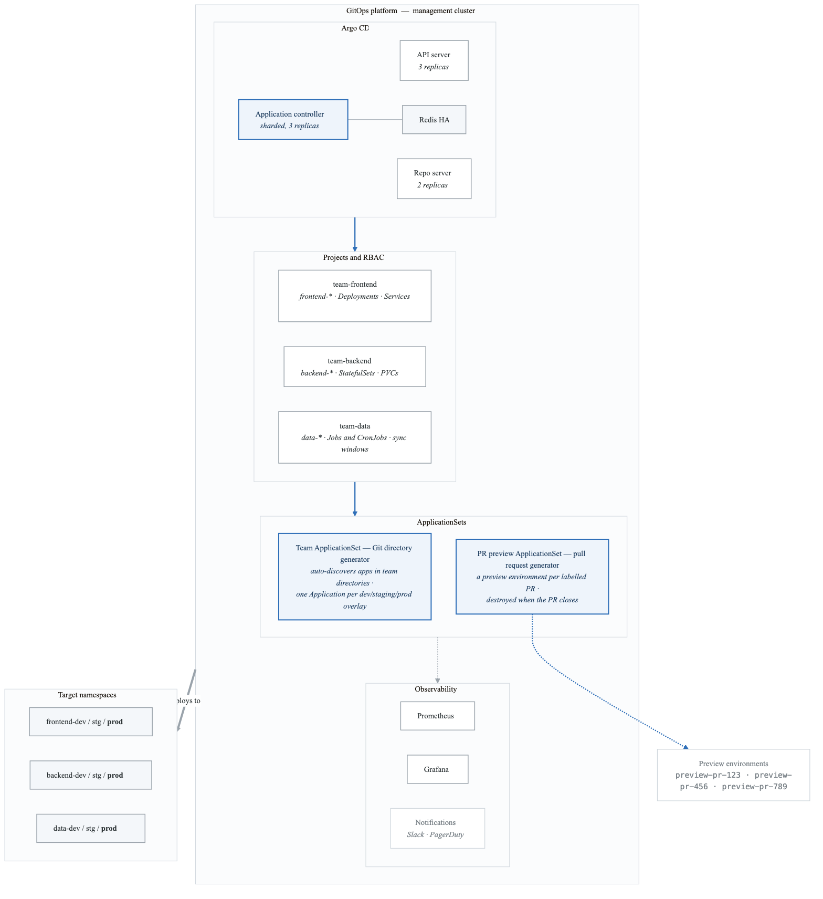
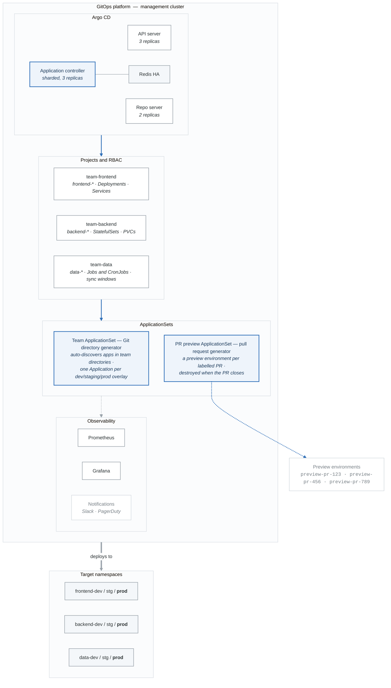

# Capstone Project: GitOps Platform Architecture

## Overview

This capstone project builds a production-ready multi-team GitOps platform using Argo CD.

## Architecture Diagram

<!-- figure: generated from the Mermaid below by _shared/diagrams/embed-figures.py — do not edit the image -->

Diagram source (Mermaid)

## Components

### 1. Argo CD HA Installation
- 3 API server replicas for zero-downtime
- 2 repo server replicas for manifest generation
- 3 application controller replicas with sharding
- Redis HA with Sentinel

### 2. Projects (Multi-Tenancy)
- **team-frontend**: Web applications, UI services
- **team-backend**: APIs, databases, services
- **team-data**: Analytics, pipelines (with sync windows)

### 3. ApplicationSets
- Git Directory Generator for automatic app discovery
- Pull Request Generator for preview environments
- Progressive sync for controlled rollouts

### 4. Observability
- Prometheus metrics collection
- Custom alerting rules
- Slack/webhook notifications

### 5. Security
- RBAC policies per team
- Repository credential templates
- Project-level restrictions

## Directory Structure

**`capstone/`**

- `platform/`
  - `argocd/` — HA Argo CD installation
  - `monitoring/` — Prometheus, Grafana
  - `bootstrap/` — Cluster bootstrap app
- `projects/` — AppProject definitions
- `applicationsets/` — ApplicationSet definitions
- `apps/`
  - `frontend/`
    - `base/`
    - overlays/{dev,staging,prod}/
  - `backend/`
    - `base/`
    - overlays/{dev,staging,prod}/
  - `data/`
    - `base/`
    - overlays/{dev,staging,prod}/
- `docs/`
  - `architecture.md`
  - `onboarding.md`
  - `runbook.md`

## Success Criteria

1. **HA Verification**: Kill an argocd-server pod, verify zero downtime
2. **Isolation**: Team A cannot deploy to Team B's namespace
3. **Auto-sync**: Push change, watch automatic deployment
4. **Alerting**: Cause sync failure, receive notification
5. **Progressive Sync**: Changes deploy dev → staging → prod

<!-- feynman-check -->

---

## Feynman check

Close the file. Blank page, no notes. Explain each of these to a competent engineer who has never
used this tool — **under five minutes, no jargon you can't define on the spot:**

- Components
- Argo CD HA Installation
- Projects (Multi-Tenancy)
- ApplicationSets

**The gap is not what you forgot. It is where you used a word instead of a mechanism.**

| | |
|---|---|
| ✗ | *"The pipeline deploys the application."* |
| ✓ | *"CI writes a new image tag into a config repository and stops. A controller running *inside* the cluster polls that repo, diffs the rendered manifests against live state, and applies the difference — so nothing outside the cluster ever holds credentials to it."* |

**Trace it:** `git push` → the new version serving traffic, with nothing else typed. Name where the handoff between CI and CD happens, and what that handoff physically is.

Stop at the first component you cannot name. Reopen this file and read **only** that.

**Go deeper — only once the gap has a name:** the four [OpenGitOps principles](https://opengitops.dev/#principles) — then say which one a `kubectl apply` inside CI violates.
Full list per domain: [`SOURCES.md`](../../SOURCES.md#cicd-gitops)

→ Protocol, the three levels of knowing, and worked examples: [`MASTERY.md`](../../MASTERY.md)

<!-- /feynman-check -->
