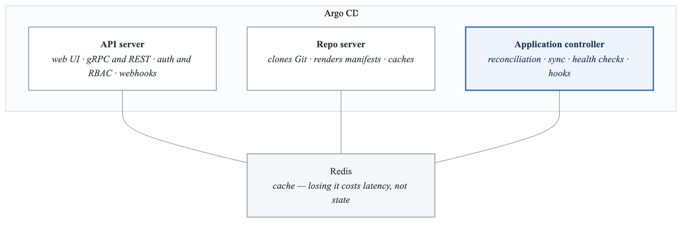
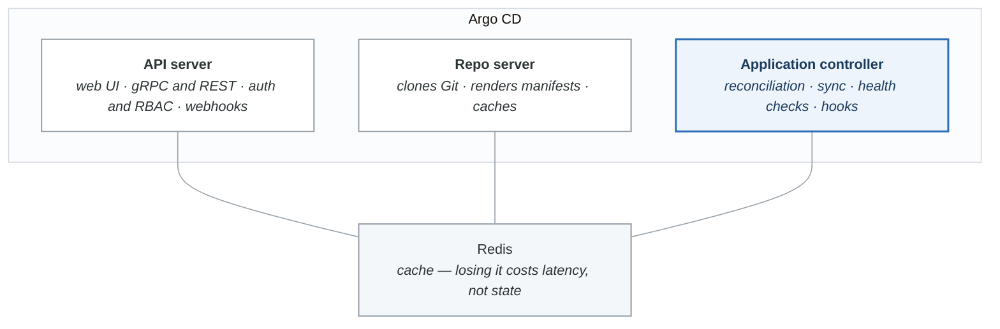
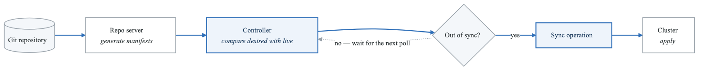

# Phase 1: Foundation & Architecture

**Goal:** Understand what Argo CD is, why it exists, and how it works internally.

**Duration:** 1-2 hours

---

## Overview

This phase covers:
- GitOps principles and philosophy
- Why Argo CD exists
- Argo CD architecture deep dive
- Component responsibilities
- The reconciliation loop

---

## Concepts

### What is GitOps?

GitOps is a set of practices where:

| Principle | Description |
|-----------|-------------|
| **Declarative** | The entire system is described declaratively |
| **Versioned** | The canonical desired state is stored in Git |
| **Automated** | Approved changes are automatically applied |
| **Auditable** | Git provides complete audit trail |

**Why GitOps matters:**
- Single source of truth for infrastructure
- Reproducible deployments
- Easy rollbacks via `git revert`
- Collaboration through pull requests
- Security through Git access controls

### Why Argo CD?

Argo CD is a **declarative, GitOps continuous delivery tool** for Kubernetes that:

- Continuously monitors running applications
- Compares live state against desired state in Git
- Visualizes differences and provides sync capabilities
- Supports multiple config management tools (Helm, Kustomize, etc.)

**Comparison with alternatives:**

| Feature | Argo CD | Flux | Jenkins |
|---------|---------|------|---------|
| GitOps Native | Yes | Yes | No (CI/CD) |
| Web UI | Rich | Limited | Plugin-based |
| Multi-cluster | Native | Native | Manual |
| RBAC | Built-in | Kubernetes | Plugin |
| Drift Detection | Real-time | Polling | None |

### Architecture Deep Dive

Argo CD consists of three core components:

<!-- figure: generated from the Mermaid below by _shared/diagrams/embed-figures.py — do not edit the image -->


<details>
<summary>Diagram source (Mermaid)</summary>



</details>

#### API Server
- Exposes gRPC/REST API for UI, CLI, and CI/CD integrations
- Handles authentication and RBAC enforcement
- Manages repository and cluster credentials
- Processes Git webhook events

#### Repository Server
- Clones Git repositories containing manifests
- Generates Kubernetes manifests using appropriate tools
- Caches repository data and generated manifests
- Stateless - can be scaled horizontally

#### Application Controller
- Kubernetes controller watching Application CRDs
- Continuously compares desired state (Git) vs live state (cluster)
- Identifies out-of-sync applications
- Executes sync operations and lifecycle hooks

#### Redis
- Caches data between components
- Stores generated manifests
- "Throw-away" cache - rebuilds without data loss

### The Reconciliation Loop

```mermaid
%%{init: {'theme':'base','themeVariables':{'fontFamily':'Helvetica, Arial, sans-serif','fontSize':'13px','primaryColor':'#ffffff','primaryTextColor':'#2d3436','primaryBorderColor':'#9aa3ab','lineColor':'#9aa3ab','textColor':'#2d3436','clusterBkg':'#fbfcfd','clusterBorder':'#d4dae0','edgeLabelBackground':'#ffffff','tertiaryColor':'#eef4fb'},'flowchart':{'curve':'basis','padding':14,'nodeSpacing':42,'rankSpacing':58}}}%%
flowchart LR
  classDef default fill:#ffffff,stroke:#9aa3ab,stroke-width:1.3px,color:#2d3436
  classDef n    fill:#ffffff,stroke:#9aa3ab,stroke-width:1.3px,color:#2d3436
  classDef crit fill:#eef4fb,stroke:#2f6fb8,stroke-width:1.8px,color:#1b3a5c
  classDef data fill:#f4f7fa,stroke:#9aa3ab,stroke-width:1.3px,color:#2d3436
  classDef mut  fill:#ffffff,stroke:#cfd6dc,stroke-width:1.1px,color:#7a8288
  classDef warn fill:#fdf0ec,stroke:#c0522d,stroke-width:1.6px,color:#8a3a1e
  G[("Git repository")]
  R["Repo server<br/><i>generate manifests</i>"]
  CT["Controller<br/><i>compare desired with live</i>"]
  Q{"Out of sync?"}
  S["Sync operation"]
  K["Cluster<br/><i>apply</i>"]
  G ==> R ==> CT ==> Q
  Q ==>|"yes"| S ==> K
  Q -.->|"no — wait for the next poll"| CT
  class G data
  class R n
  class CT crit
  class Q data
  class S crit
  class K n
  linkStyle 0,1,2,3,4 stroke:#2f6fb8,stroke-width:2px

%% This loop runs every three minutes by default, whether or not anything
%% changed. A webhook makes it faster; it does not make it necessary.
```

<!-- figure: generated from the Mermaid below by _shared/diagrams/embed-figures.py — do not edit the image -->


<details>
<summary>Diagram source (Mermaid)</summary>



</details>

**Default intervals:**
- Reconciliation: Every 3 minutes (configurable)
- Hard refresh: Every 24 hours
- Webhook-triggered: Immediate

---

## Labs

### Lab 1.1: Explore Argo CD Architecture

Run the exploration script:

```bash
./labs/lab-1.1-explore-architecture.sh
```

Or manually explore:

```bash
# View all Argo CD deployments and statefulsets
kubectl get deploy,statefulset -n argocd

# View all pods
kubectl get pods -n argocd -o wide

# View services
kubectl get svc -n argocd

# View Custom Resource Definitions
kubectl get crd | grep argo

# Explore Application CRD structure
kubectl explain application.spec
kubectl explain application.spec.source
kubectl explain application.spec.destination
kubectl explain application.spec.syncPolicy
```

**Questions to answer:**
1. How many pods are running for each component?
2. Which component is a StatefulSet? Why?
3. What CRDs did Argo CD install?

### Lab 1.2: Explore Configuration

```bash
# View main configuration
kubectl get configmap argocd-cm -n argocd -o yaml

# View RBAC configuration
kubectl get configmap argocd-rbac-cm -n argocd -o yaml

# View command parameters
kubectl get configmap argocd-cmd-params-cm -n argocd -o yaml

# List all secrets (don't view contents)
kubectl get secrets -n argocd
```

### Lab 1.3: CLI Basics

Run the CLI basics script:

```bash
./labs/lab-1.2-cli-basics.sh
```

Or explore manually:

```bash
# Check current user
argocd account get-user-info

# List clusters (should show in-cluster)
argocd cluster list

# List projects (should show 'default')
argocd proj list

# List applications (empty initially)
argocd app list

# List repositories (empty initially)
argocd repo list

# View CLI help
argocd --help
argocd app --help
```

### Lab 1.4: View Component Logs

```bash
# API Server logs
kubectl logs -n argocd -l app.kubernetes.io/name=argocd-server --tail=50

# Application Controller logs
kubectl logs -n argocd -l app.kubernetes.io/name=argocd-application-controller --tail=50

# Repo Server logs
kubectl logs -n argocd -l app.kubernetes.io/name=argocd-repo-server --tail=50

# Follow logs in real-time (Ctrl+C to stop)
kubectl logs -n argocd -l app.kubernetes.io/name=argocd-application-controller -f
```

### Lab 1.5: Explore the UI

1. Open https://localhost:8080 (ensure port-forward is running)
2. Navigate through:
   - **Applications** - Where your apps appear
   - **Settings > Clusters** - Registered clusters
   - **Settings > Projects** - AppProjects
   - **Settings > Repositories** - Git repos
   - **Settings > Accounts** - User management
   - **User Info** (top right) - Current user details

---

## Knowledge Check

Answer these questions before proceeding:

1. **Which component is responsible for generating Kubernetes manifests from Git?**
   <details>
   <summary>Answer</summary>
   The Repo Server clones repositories and generates manifests using Helm, Kustomize, or other tools.
   </details>

2. **What happens if Redis loses all its data?**
   <details>
   <summary>Answer</summary>
   Redis is a "throw-away" cache. Argo CD will rebuild the cache from Git and the cluster. No permanent data is lost.
   </details>

3. **How does Argo CD detect changes in Git without constant polling?**
   <details>
   <summary>Answer</summary>
   Argo CD can receive Git webhooks for immediate notification of changes. Without webhooks, it polls every 3 minutes by default.
   </details>

4. **What's the difference between the API Server and Application Controller?**
   <details>
   <summary>Answer</summary>
   The API Server handles user interactions (UI, CLI, webhooks), while the Application Controller watches Application resources and performs reconciliation/sync operations.
   </details>

5. **Why is the Application Controller a StatefulSet?**
   <details>
   <summary>Answer</summary>
   For sharding support in HA deployments. Each controller replica needs a stable identity to manage specific applications.
   </details>

---

## Common Mistakes

1. **Trying to use the CLI without port-forward** - The CLI needs to connect to the API server
2. **Confusing repo-server with API server** - Repo server handles Git, API server handles users
3. **Expecting instant sync** - Default polling is 3 minutes; use webhooks for faster sync

---

## Files in This Directory

| File | Purpose |
|------|---------|
| `labs/lab-1.1-explore-architecture.sh` | Explore Argo CD components |
| `labs/lab-1.2-cli-basics.sh` | CLI command exploration |

---

## What's Next?

Now that you understand how Argo CD works, proceed to **Phase 2: Core Concepts** to create your first application and learn the fundamental vocabulary.

```bash
cd ../phase-2-core-concepts
cat README.md
```

<!-- feynman-check -->

---

## Feynman check

Close the file. Blank page, no notes. Explain each of these to a competent engineer who has never
used this tool — **under five minutes, no jargon you can't define on the spot:**

- What is GitOps?
- Why Argo CD?
- Architecture Deep Dive
- The Reconciliation Loop

**The gap is not what you forgot. It is where you used a word instead of a mechanism.**

| | |
|---|---|
| ✗ | *"The pipeline deploys the application."* |
| ✓ | *"CI writes a new image tag into a config repository and stops. A controller running *inside* the cluster polls that repo, diffs the rendered manifests against live state, and applies the difference — so nothing outside the cluster ever holds credentials to it."* |

**Trace it:** `git push` → the new version serving traffic, with nothing else typed. Name where the handoff between CI and CD happens, and what that handoff physically is.

Stop at the first component you cannot name. Reopen this file and read **only** that.

**Go deeper — only once the gap has a name:** the four [OpenGitOps principles](https://opengitops.dev/#principles) — then say which one a `kubectl apply` inside CI violates.
Full list per domain: [`SOURCES.md`](../../SOURCES.md#cicd-gitops)

→ Protocol, the three levels of knowing, and worked examples: [`MASTERY.md`](../../MASTERY.md)

<!-- /feynman-check -->
