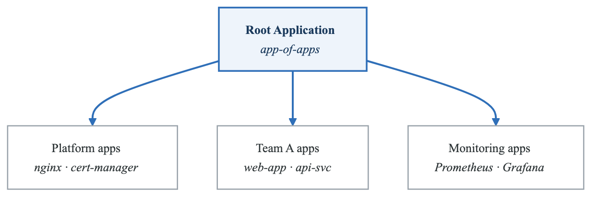
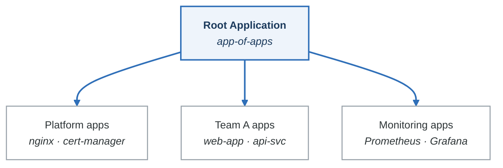
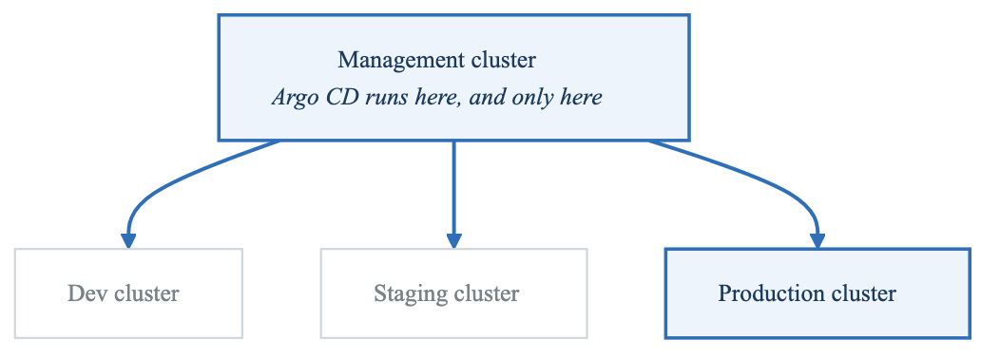
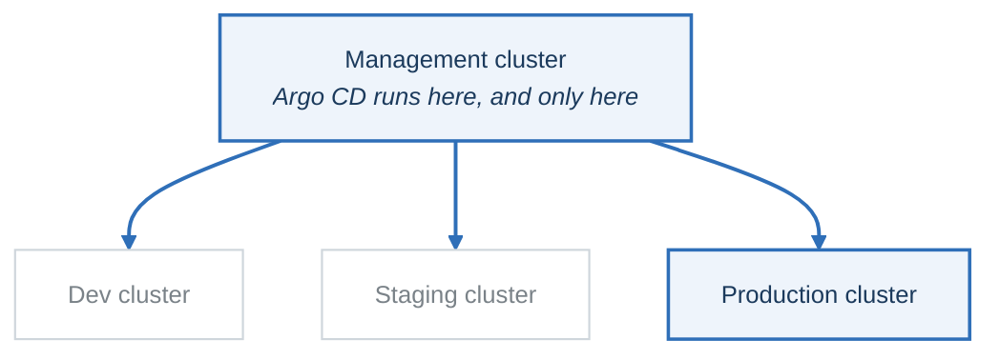
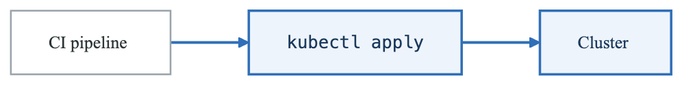
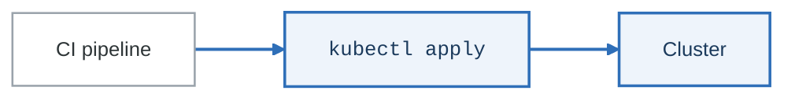
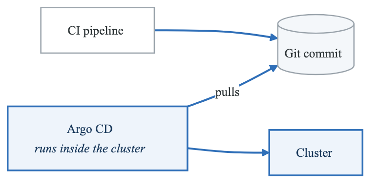
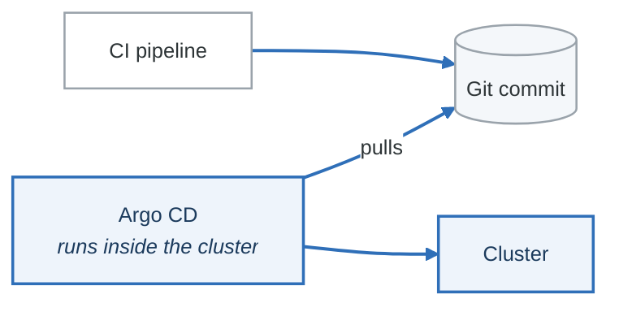

# Phase 10: Advanced Patterns

**Goal:** Master advanced Argo CD patterns including app-of-apps, multi-cluster deployments, and CI/CD integration.

**Duration:** 2-3 hours

---

## Overview

This phase covers:
- App-of-apps pattern (managing applications with applications)
- Multi-cluster deployments
- CI/CD pipeline integration
- GitOps workflow patterns

---

## Concepts

### App-of-Apps Pattern

A "root" application that manages child applications:

<!-- figure: generated from the Mermaid below by _shared/diagrams/embed-figures.py — do not edit the image -->


<details>
<summary>Diagram source (Mermaid)</summary>



</details>

**Benefits:**
- Single entry point for all apps
- Consistent structure
- Centralized configuration
- Version-controlled app definitions

**Implementation options:**
1. **Helm chart** - Template Applications from values
2. **Kustomize** - Overlay Applications
3. **Plain YAML** - Directory of Application manifests

### Multi-Cluster Architecture

<!-- figure: generated from the Mermaid below by _shared/diagrams/embed-figures.py — do not edit the image -->


<details>
<summary>Diagram source (Mermaid)</summary>



</details>

### CI/CD Integration Models

**Push vs Pull:**

**Push model** — traditional CI/CD

<!-- figure: generated from the Mermaid below by _shared/diagrams/embed-figures.py — do not edit the image -->


<details>
<summary>Diagram source (Mermaid)</summary>



</details>

**Pull model** — GitOps

<!-- figure: generated from the Mermaid below by _shared/diagrams/embed-figures.py — do not edit the image -->


<details>
<summary>Diagram source (Mermaid)</summary>



</details>

The arrows reverse, and with them the credentials. In the push model your CI system holds write
access to production; in the pull model nothing outside the cluster does.

**Integration patterns:**
1. **Image promoter** - CI updates image tags in Git
2. **Webhook trigger** - CI triggers Argo CD refresh
3. **Sync wait** - CI waits for Argo CD sync completion

---

## Labs

### Lab 10.1: App-of-Apps with Helm

#### Step 1: Explore the Helm Chart

```bash
# Chart definition
cat app-of-apps/Chart.yaml

# Values file with all apps defined
cat app-of-apps/values.yaml

# Template that generates Applications
cat app-of-apps/templates/platform-apps.yaml
cat app-of-apps/templates/team-apps.yaml
```

#### Step 2: Understand the Structure

The Helm chart generates Application resources:

```yaml
# values.yaml defines apps
platform:
  apps:
    - name: ingress-nginx
      chart: ingress-nginx
      ...

# template iterates and creates Applications
{{- range .Values.platform.apps }}
apiVersion: argoproj.io/v1alpha1
kind: Application
metadata:
  name: {{ .name }}
...
{{- end }}
```

#### Step 3: Preview Generated Applications

```bash
# Render the Helm chart locally
helm template app-of-apps ./app-of-apps

# See individual apps
helm template app-of-apps ./app-of-apps | grep "kind: Application" -A 20
```

#### Step 4: Deploy Root Application

```bash
# Update repo URL
sed -i '' 's/YOUR_USERNAME/your-github-username/g' app-of-apps-root.yaml

# Apply the root application
kubectl apply -f app-of-apps-root.yaml
```

#### Step 5: Watch Child Apps Created

```bash
# Watch applications being created
argocd app list --watch

# Or use kubectl
kubectl get applications -n argocd -w
```

#### Step 6: Manage Apps via Values

To add a new app, just add to values.yaml:

```yaml
teams:
  frontend:
    apps:
      - name: new-app           # Add this
        path: path/to/manifests
        namespace: frontend-new
```

Commit and push - Argo CD creates the new application automatically!

### Lab 10.2: Multi-Cluster Deployment

#### Step 1: Add a Second Cluster (Kind)

```bash
# Create second cluster
kind create cluster --name workload-cluster

# Verify both clusters
kubectl config get-contexts
```

#### Step 2: Register Cluster with Argo CD

```bash
# Switch to Argo CD cluster
kubectl config use-context kind-argocd-lab

# Add workload cluster
argocd cluster add kind-workload-cluster

# Verify registration
argocd cluster list
```

#### Step 3: Deploy Multi-Cluster ApplicationSet

```bash
cat multi-cluster/multi-cluster-appset.yaml

# Apply it
kubectl apply -f multi-cluster/multi-cluster-appset.yaml
```

#### Step 4: Verify Apps on Both Clusters

```bash
# List all apps
argocd app list

# Should see apps for each cluster:
# - demo-in-cluster
# - demo-workload-cluster
```

#### Step 5: Add Labels for Filtering

```bash
# Label clusters for selective deployment
argocd cluster set kind-workload-cluster \
  --label env=production \
  --label region=us-east
```

Update ApplicationSet to filter:

```yaml
generators:
  - clusters:
      selector:
        matchLabels:
          env: production
```

### Lab 10.3: CI/CD Integration

#### Step 1: Review GitHub Actions Workflow

```bash
cat ci-cd-integration/github-actions-workflow.yaml
```

The workflow:
1. Builds and pushes Docker image
2. Checks out GitOps repo
3. Updates image tag using Kustomize
4. Commits and pushes change
5. (Optional) Waits for Argo CD sync

#### Step 2: Set Up GitOps Repository

Create a repository structure:

**`gitops-repo/`**

- `apps/`
  - `my-app/`
    - `base/`
      - `deployment.yaml`
      - `service.yaml`
      - `kustomization.yaml`
    - `overlays/`
      - `dev/`
      - `staging/`
      - `prod/`
- `argocd/`
  - `my-app.yaml` — Application definition


#### Step 3: Create Required Secrets

In GitHub repository settings:

```bash
# Personal Access Token for GitOps repo access
GITOPS_PAT=ghp_xxxxx

# For optional sync wait
ARGOCD_SERVER=argocd.example.com
ARGOCD_AUTH_TOKEN=<argocd-token>
```

#### Step 4: Test the Pipeline

1. Push a change to application code
2. Watch GitHub Actions build image
3. See commit in GitOps repo
4. Watch Argo CD sync the change

#### Step 5: Alternative: Webhook Trigger

Instead of updating Git, trigger Argo CD directly:

```yaml
- name: Trigger Argo CD Refresh
  run: |
    curl -X POST \
      -H "Authorization: Bearer ${{ secrets.ARGOCD_AUTH_TOKEN }}" \
      "${{ secrets.ARGOCD_SERVER }}/api/v1/applications/my-app?refresh=hard"
```

---

## Pattern Comparison

### App-of-Apps vs ApplicationSets

| Feature | App-of-Apps | ApplicationSets |
|---------|-------------|-----------------|
| Complexity | More flexible | Simpler patterns |
| Templating | Full Helm/Kustomize | Go templates only |
| Use case | Complex hierarchies | Repetitive apps |
| Management | Single root app | Single resource |

**Use App-of-Apps when:**
- Complex value hierarchies
- Need Helm chart features
- Different app types

**Use ApplicationSets when:**
- Same app across environments
- Cluster-based deployment
- Simple templating needed

### CI/CD Integration Patterns

| Pattern | How It Works | Pros | Cons |
|---------|-------------|------|------|
| **Git commit** | CI updates Git, Argo syncs | Full GitOps | Extra commit |
| **Webhook** | CI triggers refresh | Fast | No audit trail |
| **Sync wait** | CI waits for sync | Verification | Slower pipeline |
| **Image updater** | Argo CD updates tags | Automated | Less control |

---

## Best Practices

### App-of-Apps

1. **Sync waves** - Platform apps (-1), then team apps (0)
2. **Separate charts** - Don't put everything in one chart
3. **Version lock** - Pin chart versions
4. **Enable/disable** - Use booleans to toggle app groups

### Multi-Cluster

1. **Central management** - One Argo CD manages all
2. **Label clusters** - Enable filtering and selection
3. **Cluster-specific values** - Use cluster generator values
4. **Network security** - Secure cluster credentials

### CI/CD Integration

1. **Never push to cluster** - Always go through Git
2. **Use image digests** - Not tags (immutable)
3. **Separate repos** - App code vs GitOps config
4. **Automate image updates** - Consider Argo CD Image Updater

---

## Knowledge Check

Answer these questions before proceeding:

1. **What makes app-of-apps different from ApplicationSets?**
   <details>
   <summary>Answer</summary>
   App-of-apps uses a Helm chart or Kustomize to generate Application resources, allowing complex templating. ApplicationSets use a simpler Go template approach with generators.
   </details>

2. **How do you add a new cluster to Argo CD?**
   <details>
   <summary>Answer</summary>
   Use `argocd cluster add <context-name>` which reads from kubeconfig. This creates a Secret in the argocd namespace with cluster credentials.
   </details>

3. **What's the GitOps way to update image tags?**
   <details>
   <summary>Answer</summary>
   CI pipeline updates the image tag in Git (via Kustomize edit or direct file change), commits, and pushes. Argo CD detects the change and syncs.
   </details>

4. **Why use sync waves in app-of-apps?**
   <details>
   <summary>Answer</summary>
   To ensure dependencies deploy first. Platform apps (ingress, cert-manager) should be healthy before team applications that depend on them.
   </details>

5. **When would you use the cluster generator?**
   <details>
   <summary>Answer</summary>
   When deploying the same application to multiple/all clusters. It auto-discovers clusters and creates an Application for each one.
   </details>

---

## Common Mistakes

1. **Circular dependencies** - App-of-apps depends on itself
2. **No sync waves** - Apps deploy in wrong order
3. **Pushing to cluster in CI** - Bypasses GitOps
4. **Using mutable tags** - `latest` changes without Git commit
5. **One giant chart** - Hard to manage and troubleshoot

---

## Files in This Directory

| File/Directory | Purpose |
|----------------|---------|
| `app-of-apps/` | Helm chart generating Applications |
| `app-of-apps/Chart.yaml` | Chart metadata |
| `app-of-apps/values.yaml` | App definitions |
| `app-of-apps/templates/` | Application templates |
| `app-of-apps-root.yaml` | Root Application |
| `multi-cluster/` | Multi-cluster examples |
| `multi-cluster/add-cluster.sh` | Cluster registration |
| `multi-cluster/multi-cluster-appset.yaml` | Cluster generator |
| `ci-cd-integration/` | CI/CD workflows |

---

## What's Next?

Congratulations! You've completed all the learning phases. Now proceed to the **Capstone Project** to build a complete multi-team GitOps platform that combines everything you've learned.

```bash
cd ../capstone
cat README.md
```

<!-- feynman-check -->

---

## Feynman check

Close the file. Blank page, no notes. Explain each of these to a competent engineer who has never
used this tool — **under five minutes, no jargon you can't define on the spot:**

- Pattern Comparison
- App-of-Apps Pattern
- Multi-Cluster Architecture
- CI/CD Integration Models

**The gap is not what you forgot. It is where you used a word instead of a mechanism.**

| | |
|---|---|
| ✗ | *"The pipeline deploys the application."* |
| ✓ | *"CI writes a new image tag into a config repository and stops. A controller running *inside* the cluster polls that repo, diffs the rendered manifests against live state, and applies the difference — so nothing outside the cluster ever holds credentials to it."* |

**Trace it:** `git push` → the new version serving traffic, with nothing else typed. Name where the handoff between CI and CD happens, and what that handoff physically is.

Stop at the first component you cannot name. Reopen this file and read **only** that.

**Go deeper — only once the gap has a name:** the four [OpenGitOps principles](https://opengitops.dev/#principles) — then say which one a `kubectl apply` inside CI violates.
Full list per domain: [`SOURCES.md`](../../SOURCES.md#cicd-gitops)

→ Protocol, the three levels of knowing, and worked examples: [`MASTERY.md`](../../MASTERY.md)

<!-- /feynman-check -->
