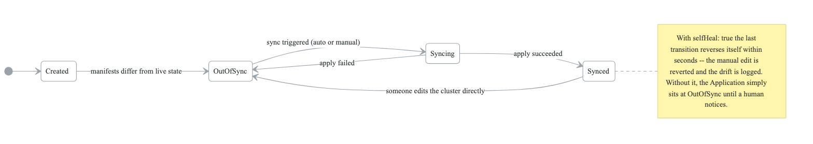
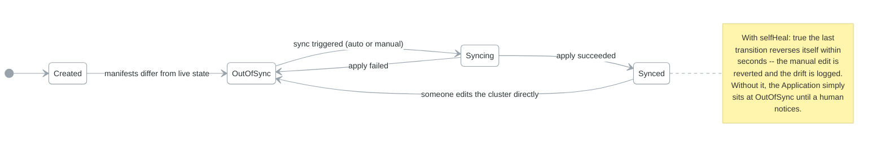

# Phase 2: Core Concepts

**Goal:** Create your first Argo CD Application and understand the fundamental vocabulary and operations.

**Duration:** 1-2 hours

---

## Overview

This phase covers:
- Application CRD structure
- Sync Status vs Health Status
- Refresh vs Sync operations
- The Application lifecycle

---

## Concepts

### The Application CRD

An Argo CD Application is a Kubernetes Custom Resource that defines:

```yaml
apiVersion: argoproj.io/v1alpha1
kind: Application
metadata:
  name: my-app
  namespace: argocd
spec:
  project: default           # Which project (RBAC)
  source:                    # WHERE to get manifests
    repoURL: https://github.com/...
    targetRevision: HEAD
    path: manifests/
  destination:               # WHERE to deploy
    server: https://kubernetes.default.svc
    namespace: my-namespace
  syncPolicy:                # HOW to sync
    automated: {}            # Optional: auto-sync
```

**Key fields:**

| Field | Purpose |
|-------|---------|
| `project` | AppProject for RBAC and restrictions |
| `source.repoURL` | Git repository URL |
| `source.targetRevision` | Branch, tag, or commit |
| `source.path` | Directory within repo |
| `destination.server` | Target cluster API URL |
| `destination.namespace` | Target namespace |
| `syncPolicy` | Automation settings |

### Sync Status vs Health Status

Argo CD tracks two independent statuses:

| Application Status |  |
|---|---|
| SYNC STATUS | HEALTH STATUS |
| Synced     - Git = Cluster | Healthy   - All good |
| OutOfSync  - Git ≠ Cluster | Degraded  - Errors present |
| Unknown    - Can't determine | Progressing - Still starting |
|  | Suspended - Paused |
|  | Missing   - Resource gone |
|  | Unknown   - Can't determine |


**Important distinction:**
- **Sync Status** = Does the cluster match Git?
- **Health Status** = Are the resources working?

An app can be:
- `Synced` + `Healthy` = Perfect state
- `Synced` + `Degraded` = Deployed but broken
- `OutOfSync` + `Healthy` = Working but drifted

### Refresh vs Sync

**Refresh and sync are not the same operation**

| | **Refresh** | **Sync** |
|---|---|---|
| Effect | Read-only | Makes changes |
| What it does | Re-reads Git, updates the Application's status | Applies the manifests to the cluster |
| Touches the cluster | No | Yes |
| Answers | *"What changed?"* | *"Apply it"* |

`argocd app get --refresh` is always safe to run. `argocd app sync` is a deployment. The UI puts both
behind buttons a few pixels apart, which is worth knowing before you are looking at production at
2am.

**Refresh** (read-only):
1. Pulls latest from Git
2. Compares to live cluster
3. Updates Application status
4. Does NOT change cluster

**Sync** (writes):
1. Performs a refresh first
2. Applies manifests to cluster
3. Changes cluster state
4. Updates sync status

### Application Lifecycle

<!-- figure: generated from the Mermaid below by _shared/diagrams/embed-figures.py — do not edit the image -->


<details>
<summary>Diagram source (Mermaid)</summary>



</details>

1. **Create**: Application CRD applied to cluster
2. **OutOfSync**: Desired state (Git) differs from live state
3. **Syncing**: Argo CD applying changes
4. **Synced**: Live state matches Git
5. **Drift**: Manual changes cause OutOfSync

---

## Labs

### Lab 2.1: Create Your First Application

Run the lab script:

```bash
./labs/lab-2.1-first-app.sh
```

Or follow manually:

#### Step 1: Review the Application Manifest

```bash
cat labs/guestbook-app.yaml
```

Key observations:
- Uses `argoproj/argocd-example-apps` repository
- Deploys to `guestbook` namespace
- Has `CreateNamespace=true` sync option
- Uses `resources-finalizer` for cleanup

#### Step 2: Create the Application

```bash
kubectl apply -f labs/guestbook-app.yaml
```

#### Step 3: Check the Status

```bash
argocd app get guestbook
```

Notice the app is `OutOfSync` - this is expected! Argo CD has detected what needs to be deployed but hasn't applied it yet.

#### Step 4: View the Diff

```bash
argocd app diff guestbook
```

This shows exactly what will be created when you sync.

#### Step 5: Sync the Application

```bash
argocd app sync guestbook
```

Watch the resources being created.

#### Step 6: Verify Deployment

```bash
# Check app status
argocd app get guestbook

# View deployed resources
kubectl get all -n guestbook
```

The app should now be `Synced` and `Healthy`.

#### Step 7: Explore in the UI

1. Open https://localhost:8080
2. Click on the `guestbook` application
3. Explore the resource tree visualization
4. Click on individual resources to see details

### Lab 2.2: Understand Sync vs Health

Run the lab script:

```bash
./labs/lab-2.2-sync-vs-health.sh
```

Or follow manually:

#### Step 1: Check Current State

```bash
argocd app get guestbook
```

Record both Sync Status and Health Status.

#### Step 2: Cause Drift (OutOfSync but Healthy)

```bash
# Manually change the replica count
kubectl scale deployment guestbook-ui -n guestbook --replicas=5
```

#### Step 3: Check Status Again

```bash
argocd app get guestbook
```

Notice:
- Sync Status = `OutOfSync` (cluster differs from Git)
- Health Status = `Healthy` (pods are running fine)

#### Step 4: Refresh to See Diff

```bash
argocd app diff guestbook
```

You'll see the replica count difference.

#### Step 5: Self-Heal (Sync Back)

```bash
argocd app sync guestbook
```

The replica count returns to what's defined in Git.

#### Step 6: Cause Unhealthy State

```bash
# Set an invalid image
kubectl set image deployment/guestbook-ui \
  guestbook-ui=invalid-image:notexist -n guestbook
```

#### Step 7: Observe Degraded Health

```bash
argocd app get guestbook
```

Notice:
- Sync Status = `OutOfSync`
- Health Status = `Degraded` (ImagePullBackOff)

#### Step 8: Fix by Syncing

```bash
argocd app sync guestbook
```

The correct image is restored from Git.

### Lab 2.3: Refresh vs Sync

Run the lab script:

```bash
./labs/lab-2.3-refresh-vs-sync.sh
```

Or follow manually:

#### Step 1: Make Manual Change

```bash
kubectl scale deployment guestbook-ui -n guestbook --replicas=3
```

#### Step 2: Check Status (Before Refresh)

```bash
argocd app get guestbook
```

Depending on timing, Argo CD might not have detected the change yet.

#### Step 3: Force Refresh

```bash
# Soft refresh - updates from cache
argocd app get guestbook --refresh

# Hard refresh - forces Git pull and full recompute
argocd app get guestbook --hard-refresh
```

Notice how refresh updates the status but doesn't change the cluster.

#### Step 4: View CLI Options

```bash
# List all apps
argocd app list

# Get detailed info
argocd app get guestbook -o yaml

# Watch app in real-time
argocd app get guestbook --watch
```

#### Step 5: Sync with Options

```bash
# Dry run - show what would happen
argocd app sync guestbook --dry-run

# Sync specific resources only
argocd app sync guestbook --resource apps:Deployment:guestbook-ui

# Prune - delete resources no longer in Git
argocd app sync guestbook --prune
```

### Lab 2.4: Application Deletion

```bash
# View what would be deleted
kubectl get all -n guestbook

# Delete the application
# The finalizer ensures deployed resources are also deleted
argocd app delete guestbook

# Confirm deletion
kubectl get all -n guestbook
# Should show: No resources found
```

**Note:** The `resources-finalizer.argocd.argoproj.io` finalizer ensures that when you delete an Application, the deployed resources are also cleaned up.

---

## CLI Reference

### Essential Commands

```bash
# Application operations
argocd app create NAME --repo URL --path PATH --dest-server SERVER --dest-namespace NS
argocd app get NAME
argocd app list
argocd app sync NAME
argocd app delete NAME

# Status checking
argocd app get NAME --refresh         # Soft refresh
argocd app get NAME --hard-refresh    # Hard refresh
argocd app diff NAME                  # Show drift

# Sync options
argocd app sync NAME --dry-run        # Preview changes
argocd app sync NAME --prune          # Remove orphaned resources
argocd app sync NAME --force          # Force sync even if healthy

# History
argocd app history NAME               # View sync history
argocd app rollback NAME REVISION     # Rollback to previous sync
```

### Output Formats

```bash
argocd app get NAME                   # Human readable
argocd app get NAME -o yaml           # Full YAML
argocd app get NAME -o json           # Full JSON
argocd app get NAME -o wide           # Extra columns
```

---

## Knowledge Check

Answer these questions before proceeding:

1. **What's the difference between Sync Status and Health Status?**
   <details>
   <summary>Answer</summary>
   Sync Status indicates whether the cluster state matches the Git state (Synced/OutOfSync). Health Status indicates whether the resources are functioning correctly (Healthy/Degraded/Progressing).
   </details>

2. **Can an application be Synced but Degraded?**
   <details>
   <summary>Answer</summary>
   Yes. This means the cluster matches Git (Synced), but the resources aren't working properly (Degraded). For example, if the image defined in Git doesn't exist.
   </details>

3. **What's the difference between Refresh and Sync?**
   <details>
   <summary>Answer</summary>
   Refresh is read-only - it updates the Application status by comparing Git to the cluster. Sync actually applies changes to make the cluster match Git.
   </details>

4. **What does the resources-finalizer do?**
   <details>
   <summary>Answer</summary>
   It ensures that when an Application is deleted, the deployed Kubernetes resources are also deleted from the cluster.
   </details>

5. **If you manually change a Deployment in the cluster, what happens?**
   <details>
   <summary>Answer</summary>
   The Application becomes OutOfSync. Argo CD detects drift from the desired state in Git. Syncing will revert your manual changes.
   </details>

---

## Common Mistakes

1. **Forgetting CreateNamespace=true** - If your namespace doesn't exist, the sync fails
2. **Confusing refresh with sync** - Refresh is read-only; sync makes changes
3. **Deleting deployed resources directly** - Argo CD will recreate them on next sync
4. **Not using finalizers** - Without them, deleting an app leaves orphaned resources

---

## Files in This Directory

| File | Purpose |
|------|---------|
| `labs/guestbook-app.yaml` | First application manifest |
| `labs/lab-2.1-first-app.sh` | Create first application |
| `labs/lab-2.2-sync-vs-health.sh` | Explore status types |
| `labs/lab-2.3-refresh-vs-sync.sh` | Understand operations |

---

## What's Next?

Now that you understand Applications, proceed to **Phase 3: Application Sources** to learn different ways to define your manifests (plain YAML, Kustomize, Helm).

```bash
cd ../phase-3-application-sources
cat README.md
```

<!-- feynman-check -->

---

## Feynman check

Close the file. Blank page, no notes. Explain each of these to a competent engineer who has never
used this tool — **under five minutes, no jargon you can't define on the spot:**

- CLI Reference
- The Application CRD
- Sync Status vs Health Status
- Refresh vs Sync

**The gap is not what you forgot. It is where you used a word instead of a mechanism.**

| | |
|---|---|
| ✗ | *"The pipeline deploys the application."* |
| ✓ | *"CI writes a new image tag into a config repository and stops. A controller running *inside* the cluster polls that repo, diffs the rendered manifests against live state, and applies the difference — so nothing outside the cluster ever holds credentials to it."* |

**Trace it:** `git push` → the new version serving traffic, with nothing else typed. Name where the handoff between CI and CD happens, and what that handoff physically is.

Stop at the first component you cannot name. Reopen this file and read **only** that.

**Go deeper — only once the gap has a name:** the four [OpenGitOps principles](https://opengitops.dev/#principles) — then say which one a `kubectl apply` inside CI violates.
Full list per domain: [`SOURCES.md`](../../SOURCES.md#cicd-gitops)

→ Protocol, the three levels of knowing, and worked examples: [`MASTERY.md`](../../MASTERY.md)

<!-- /feynman-check -->
