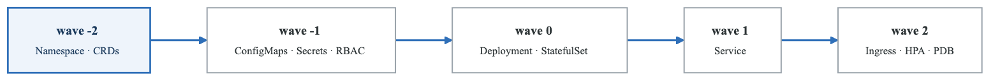

# Phase 4: Sync Lifecycle

**Goal:** Master sync waves, resource hooks, sync policies, and controlling the order and behavior of deployments.

**Duration:** 2-3 hours

---

## Overview

This phase covers:
- Sync waves for ordering resources
- Resource hooks (PreSync, PostSync, SyncFail)
- Automated sync policies
- Ignoring differences
- Sync windows

---

## Concepts

### Sync Waves

Sync waves control the **order** in which resources are applied:

```mermaid
%%{init: {'theme':'base','themeVariables':{'fontFamily':'Helvetica, Arial, sans-serif','fontSize':'13px','primaryColor':'#ffffff','primaryTextColor':'#2d3436','primaryBorderColor':'#9aa3ab','lineColor':'#9aa3ab','textColor':'#2d3436','clusterBkg':'#fbfcfd','clusterBorder':'#d4dae0','edgeLabelBackground':'#ffffff','tertiaryColor':'#eef4fb'},'flowchart':{'curve':'basis','padding':14,'nodeSpacing':42,'rankSpacing':58}}}%%
flowchart LR
  classDef default fill:#ffffff,stroke:#9aa3ab,stroke-width:1.3px,color:#2d3436
  classDef n    fill:#ffffff,stroke:#9aa3ab,stroke-width:1.3px,color:#2d3436
  classDef crit fill:#eef4fb,stroke:#2f6fb8,stroke-width:1.8px,color:#1b3a5c
  classDef data fill:#f4f7fa,stroke:#9aa3ab,stroke-width:1.3px,color:#2d3436
  classDef mut  fill:#ffffff,stroke:#cfd6dc,stroke-width:1.1px,color:#7a8288
  classDef warn fill:#fdf0ec,stroke:#c0522d,stroke-width:1.6px,color:#8a3a1e
  W1["<b>wave -2</b><br/><small>Namespace · CRDs</small>"]:::crit
  W2["<b>wave -1</b><br/><small>ConfigMaps · Secrets · RBAC</small>"]:::n
  W3["<b>wave 0</b><br/><small>Deployment · StatefulSet</small>"]:::n
  W4["<b>wave 1</b><br/><small>Service</small>"]:::n
  W5["<b>wave 2</b><br/><small>Ingress · HPA · PDB</small>"]:::n

  W1 --> W2 --> W3 --> W4 --> W5

  linkStyle 0,1,2,3 stroke:#2f6fb8,stroke-width:2px
```

<!-- figure: generated from the Mermaid below by _shared/diagrams/embed-figures.py — do not edit the image -->


<details>
<summary>Diagram source (Mermaid)</summary>



</details>

**How it works:**
1. Resources are grouped by wave number
2. Waves are processed in order (-2, -1, 0, 1, 2, ...)
3. All resources in a wave must be healthy before next wave
4. Default wave is 0 if not specified

**Setting a wave:**

```yaml
apiVersion: apps/v1
kind: Deployment
metadata:
  name: my-app
  annotations:
    argocd.argoproj.io/sync-wave: "0"  # Wave number as string
```

### Resource Hooks

Hooks are special resources that run at specific points in the sync lifecycle:

| Sync Lifecycle |  |  |  |  |
|---|---|---|---|---|
| PreSync | Sync | Skip | PostSync | SyncFail |
| Hooks | (waves) | Resources | Hooks | Hooks |
| DB migrate | Apply all | Resources | Run tests | Send alert |
| Schema | manifests | with Skip | Notify | Rollback |
| check | by wave | annotation | Cache warm |  |


**Hook types:**

| Hook | When it Runs |
|------|--------------|
| `PreSync` | Before any manifests are applied |
| `Sync` | During sync (same as regular resource) |
| `PostSync` | After all resources are synced and healthy |
| `SyncFail` | When sync fails |
| `Skip` | Never applied (documentation only) |

**Hook example:**

```yaml
apiVersion: batch/v1
kind: Job
metadata:
  name: db-migration
  annotations:
    argocd.argoproj.io/hook: PreSync
    argocd.argoproj.io/hook-delete-policy: BeforeHookCreation
spec:
  template:
    spec:
      containers:
        - name: migrate
          image: my-db-migrator
          command: ["./migrate.sh"]
      restartPolicy: Never
```

### Hook Delete Policies

Control what happens to hook resources after they run:

| Policy | Behavior |
|--------|----------|
| `HookSucceeded` | Delete after successful completion |
| `HookFailed` | Delete after failure |
| `BeforeHookCreation` | Delete before creating new hook (default) |

```yaml
annotations:
  argocd.argoproj.io/hook-delete-policy: BeforeHookCreation,HookSucceeded
```

### Sync Policies

Control how and when syncs happen:

```yaml
syncPolicy:
  automated:              # Enable auto-sync
    prune: true           # Delete removed resources
    selfHeal: true        # Revert manual changes
    allowEmpty: false     # Prevent sync if no resources

  retry:                  # Retry on failure
    limit: 5
    backoff:
      duration: 5s
      factor: 2
      maxDuration: 3m

  syncOptions:
    - CreateNamespace=true
    - ApplyOutOfSyncOnly=true
    - PruneLast=true
    - RespectIgnoreDifferences=true
```

**Sync options explained:**

| Option | Purpose |
|--------|---------|
| `CreateNamespace=true` | Auto-create target namespace |
| `ApplyOutOfSyncOnly=true` | Only apply changed resources |
| `PruneLast=true` | Delete after applying updates |
| `RespectIgnoreDifferences=true` | Honor ignoreDifferences during sync |
| `PrunePropagationPolicy=foreground` | Wait for dependent deletion |
| `Replace=true` | Replace instead of apply (destructive) |
| `ServerSideApply=true` | Use server-side apply |

### Ignore Differences

Prevent certain fields from causing OutOfSync status:

```yaml
ignoreDifferences:
  # By JSON pointer
  - group: apps
    kind: Deployment
    jsonPointers:
      - /spec/replicas       # Ignore HPA-managed replicas

  # By jq expression (more powerful)
  - group: apps
    kind: Deployment
    jqPathExpressions:
      - .spec.template.spec.containers[].resources

  # By managing controller
  - group: apps
    kind: Deployment
    managedFieldsManagers:
      - kube-controller-manager
```

**Common use cases:**
- HPA-managed replica counts
- Auto-assigned ClusterIPs
- Sidecar-injected containers (Istio, Linkerd)
- Controller-added annotations

---

## Labs

### Lab 4.1: Sync Waves

#### Step 1: Explore the Sync Waves Demo

```bash
# View all resources in order
ls -la sync-waves-demo/

# Check namespace (wave -2)
cat sync-waves-demo/01-namespace.yaml

# Check configmap (wave -1)
cat sync-waves-demo/02-configmap.yaml

# Check deployment (wave 0)
cat sync-waves-demo/03-deployment.yaml

# Check service (wave 1)
cat sync-waves-demo/04-service.yaml

# Check ingress (wave 2)
cat sync-waves-demo/05-ingress.yaml
```

Notice the `argocd.argoproj.io/sync-wave` annotations on each resource.

#### Step 2: Deploy the Application

```bash
# Update repository URL
sed -i '' 's/YOUR_USERNAME/your-github-username/g' sync-waves-app.yaml

# Apply and watch the sync
kubectl apply -f sync-waves-app.yaml
argocd app sync sync-waves-demo --watch
```

#### Step 3: Observe Wave Ordering

Watch in the UI (https://localhost:8080) as resources are created:
1. Namespace appears first (wave -2)
2. ConfigMap appears (wave -1)
3. Deployment starts (wave 0)
4. Service created after deployment healthy (wave 1)
5. Ingress created last (wave 2)

#### Step 4: Verify Order in Logs

```bash
kubectl logs -n argocd -l app.kubernetes.io/name=argocd-application-controller \
  --tail=100 | grep -i "sync-waves"
```

### Lab 4.2: Resource Hooks

#### Step 1: Explore the Hooks Demo

```bash
# PreSync hook - database migration
cat hooks-demo/pre-sync-job.yaml

# The main deployment
cat hooks-demo/deployment.yaml

# PostSync hook - smoke tests
cat hooks-demo/post-sync-job.yaml

# SyncFail hook - alerting
cat hooks-demo/sync-fail-job.yaml
```

#### Step 2: Understand Hook Annotations

```yaml
# PreSync hook runs first
argocd.argoproj.io/hook: PreSync
argocd.argoproj.io/hook-delete-policy: BeforeHookCreation

# PostSync runs after everything is healthy
argocd.argoproj.io/hook: PostSync
argocd.argoproj.io/hook-delete-policy: HookSucceeded

# SyncFail only runs on failure
argocd.argoproj.io/hook: SyncFail
argocd.argoproj.io/hook-delete-policy: HookSucceeded
```

#### Step 3: Deploy Hooks Demo

```bash
# Update repository URL
sed -i '' 's/YOUR_USERNAME/your-github-username/g' hooks-app.yaml

# Apply
kubectl apply -f hooks-app.yaml

# Sync and watch
argocd app sync hooks-demo
```

#### Step 4: View Hook Execution

```bash
# Watch jobs
kubectl get jobs -n hooks-demo -w

# View PreSync job logs
kubectl logs -n hooks-demo job/db-migration

# View PostSync job logs (after sync completes)
kubectl logs -n hooks-demo job/smoke-tests
```

#### Step 5: Trigger SyncFail Hook

Intentionally break the deployment to see the SyncFail hook:

```bash
# Edit deployment to use invalid image
kubectl patch deployment web-app -n hooks-demo \
  --patch '{"spec":{"template":{"spec":{"containers":[{"name":"app","image":"invalid:notexist"}]}}}}'

# Force sync
argocd app sync hooks-demo --force

# The SyncFail hook should run
kubectl logs -n hooks-demo job/sync-failed-notification
```

### Lab 4.3: Auto-Sync Policies

#### Step 1: Review Auto-Sync Configuration

```bash
cat sync-policies/auto-sync-app.yaml
```

Key settings:
- `automated.prune: true` - Remove deleted resources
- `automated.selfHeal: true` - Revert manual changes
- `retry` - Automatic retry on failure

#### Step 2: Deploy Auto-Sync App

```bash
kubectl apply -f sync-policies/auto-sync-app.yaml
```

Notice it syncs automatically without manual intervention.

#### Step 3: Test Self-Heal

```bash
# Make a manual change
kubectl scale deployment guestbook-ui -n auto-sync-demo --replicas=5

# Wait a few seconds...
kubectl get deployment guestbook-ui -n auto-sync-demo

# Argo CD will revert it back to 1 replica (from Git)
```

#### Step 4: Test Prune

```bash
# Manually create a resource
kubectl create configmap manual-config -n auto-sync-demo --from-literal=key=value

# Refresh the app
argocd app get auto-sync-demo --refresh

# The manual ConfigMap will be pruned (deleted)
kubectl get configmap manual-config -n auto-sync-demo
# Should show: not found
```

### Lab 4.4: Ignore Differences

#### Step 1: Review IgnoreDifferences

```bash
cat sync-policies/ignore-diff-app.yaml
```

Key patterns:
- `/spec/replicas` - For HPA-managed deployments
- `/spec/clusterIP` - Auto-assigned by Kubernetes
- jqPathExpressions for complex matching

#### Step 2: Deploy and Test

```bash
kubectl apply -f sync-policies/ignore-diff-app.yaml
argocd app sync ignore-diff-demo
```

#### Step 3: Scale Without Drift

```bash
# Scale deployment manually
kubectl scale deployment guestbook-ui -n ignore-diff-demo --replicas=5

# Check app status - should still be Synced!
argocd app get ignore-diff-demo

# The replica change is ignored
argocd app diff ignore-diff-demo
# Should show no differences (replicas is ignored)
```

---

## Sync Windows

Restrict when syncs can occur:

```yaml
apiVersion: argoproj.io/v1alpha1
kind: AppProject
metadata:
  name: production
  namespace: argocd
spec:
  syncWindows:
    # Allow syncs only during maintenance windows
    - kind: allow
      schedule: "0 2 * * 1-5"  # 2 AM weekdays
      duration: 2h
      applications:
        - "*"

    # Block syncs during business hours
    - kind: deny
      schedule: "0 9 * * 1-5"  # 9 AM weekdays
      duration: 10h
      applications:
        - "prod-*"

    # Manual override always allowed
      manualSync: true
```

**Window types:**
- `allow` - Syncs only permitted during this window
- `deny` - Syncs blocked during this window

---

## Best Practices

### Sync Waves

1. **Use negative waves for prerequisites** - Namespaces, CRDs in -1, -2
2. **Keep application deployments at 0** - The "main" resources
3. **Use positive waves for dependents** - Services, Ingresses in 1, 2
4. **Don't over-complicate** - Only use waves when needed

### Hooks

1. **Keep hooks idempotent** - They may run multiple times
2. **Use BeforeHookCreation** - Prevents accumulating old hooks
3. **Set appropriate timeouts** - Jobs should complete reasonably
4. **Use SyncFail for alerting** - Not for rollback (that's manual)

### Auto-Sync

1. **Start with manual sync** - Until you trust the config
2. **Enable prune carefully** - Could delete important resources
3. **Self-heal for production** - Prevents configuration drift
4. **Configure retry for flaky syncs** - Network issues, etc.

### Ignore Differences

1. **Be specific** - Don't ignore broad patterns
2. **Document why** - Future maintainers need context
3. **Use for external controllers** - HPA, cert-manager, etc.
4. **Test thoroughly** - Ensure drift is truly intentional

---

## Knowledge Check

Answer these questions before proceeding:

1. **What order do sync waves execute in?**
   <details>
   <summary>Answer</summary>
   Numerically from lowest to highest (-2, -1, 0, 1, 2, ...). Resources in each wave must be healthy before the next wave starts.
   </details>

2. **When does a PreSync hook run?**
   <details>
   <summary>Answer</summary>
   Before any manifests are applied. Common uses: database migrations, pre-flight checks, cache clearing.
   </details>

3. **What does `selfHeal: true` do?**
   <details>
   <summary>Answer</summary>
   Automatically reverts manual changes made to the cluster. If someone modifies a resource directly, Argo CD syncs it back to match Git.
   </details>

4. **When would you use ignoreDifferences?**
   <details>
   <summary>Answer</summary>
   When external controllers manage certain fields (HPA managing replicas, cert-manager managing certificates), or for auto-assigned values like ClusterIP.
   </details>

5. **What's the difference between PreSync and wave -1?**
   <details>
   <summary>Answer</summary>
   PreSync hooks run before ANY resources. Wave -1 runs after hooks but before wave 0. PreSync is for setup tasks (migrations), waves are for ordering resources.
   </details>

---

## Common Mistakes

1. **String vs number for waves** - Must be a string: `"0"` not `0`
2. **Forgetting hook-delete-policy** - Jobs accumulate without it
3. **Using hooks for rollback** - Hooks can't control rollback logic
4. **Over-using sync waves** - Adds complexity without benefit
5. **Ignoring too much** - Hides real configuration drift

---

## Files in This Directory

| File/Directory | Purpose |
|----------------|---------|
| `sync-waves-demo/` | Ordered resources with wave annotations |
| `sync-waves-app.yaml` | Application for sync waves demo |
| `hooks-demo/` | PreSync, PostSync, SyncFail hooks |
| `hooks-app.yaml` | Application for hooks demo |
| `sync-policies/` | Auto-sync and ignore-diff examples |

---

## What's Next?

Now that you understand the sync lifecycle, proceed to **Phase 5: ApplicationSets** to learn how to generate multiple applications from templates.

```bash
cd ../phase-5-applicationsets
cat README.md
```

<!-- feynman-check -->

---

## Feynman check

Close the file. Blank page, no notes. Explain each of these to a competent engineer who has never
used this tool — **under five minutes, no jargon you can't define on the spot:**

- Sync Windows
- Sync Waves
- Resource Hooks
- Hook Delete Policies

**The gap is not what you forgot. It is where you used a word instead of a mechanism.**

| | |
|---|---|
| ✗ | *"The pipeline deploys the application."* |
| ✓ | *"CI writes a new image tag into a config repository and stops. A controller running *inside* the cluster polls that repo, diffs the rendered manifests against live state, and applies the difference — so nothing outside the cluster ever holds credentials to it."* |

**Trace it:** `git push` → the new version serving traffic, with nothing else typed. Name where the handoff between CI and CD happens, and what that handoff physically is.

Stop at the first component you cannot name. Reopen this file and read **only** that.

**Go deeper — only once the gap has a name:** the four [OpenGitOps principles](https://opengitops.dev/#principles) — then say which one a `kubectl apply` inside CI violates.
Full list per domain: [`SOURCES.md`](../../SOURCES.md#cicd-gitops)

→ Protocol, the three levels of knowing, and worked examples: [`MASTERY.md`](../../MASTERY.md)

<!-- /feynman-check -->
