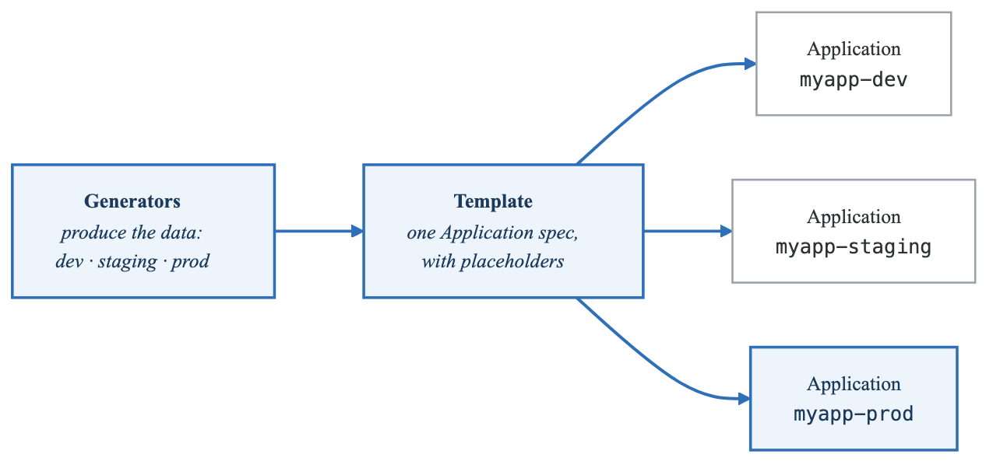
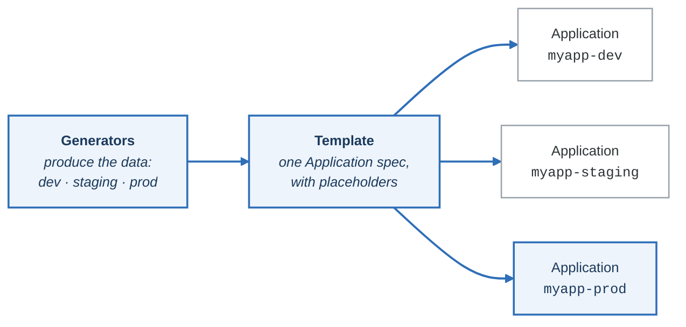

# Phase 5: ApplicationSets

**Goal:** Master ApplicationSets to generate multiple applications from templates using various generators.

**Duration:** 2-3 hours

---

## Overview

This phase covers:
- What ApplicationSets are and why they matter
- All generator types (List, Cluster, Git, Matrix, Merge)
- Template syntax and parameters
- Progressive sync strategies
- Pull request generators for preview environments

---

## Concepts

### What is an ApplicationSet?

An ApplicationSet is a template that generates multiple Argo CD Applications:

<!-- figure: generated from the Mermaid below by _shared/diagrams/embed-figures.py — do not edit the image -->


<details>
<summary>Diagram source (Mermaid)</summary>



</details>

**Benefits:**
- DRY (Don't Repeat Yourself) - One template, many apps
- Automatic scaling - Add cluster/env, get new app
- Consistent configuration across environments
- Easier management and auditing

### Generator Types

| Generator | Source of Data | Use Case |
|-----------|----------------|----------|
| **List** | Static list in YAML | Small, fixed set of environments |
| **Cluster** | Registered Argo CD clusters | Multi-cluster deployments |
| **Git Directory** | Directories in a repo | Each app in its own folder |
| **Git File** | JSON/YAML files in repo | Config-driven deployments |
| **Matrix** | Cartesian product | Envs × Apps combinations |
| **Merge** | Merged with overrides | Base config + overrides |
| **Pull Request** | Open PRs in repo | Preview environments |
| **SCM Provider** | GitHub/GitLab orgs | Deploy across org repos |

### Template Syntax

Templates use Go template syntax:

```yaml
template:
  metadata:
    name: '{{.app}}-{{.env}}'           # String interpolation
    labels:
      env: '{{.env}}'
  spec:
    source:
      targetRevision: '{{.revision}}'
      helm:
        values: |
          replicas: {{.replicas}}       # In YAML blocks
    destination:
      namespace: '{{.namespace}}'
```

**Available variables depend on the generator:**
- List: Keys from the `elements` list
- Cluster: `.name`, `.server`, `.metadata.labels.*`
- Git Directory: `.path.path`, `.path.basename`, `.path.basenameNormalized`
- Git File: All keys from the JSON/YAML file

---

## Generator Details

### List Generator

Static list of elements with explicit values:

```yaml
generators:
  - list:
      elements:
        - env: dev
          replicas: "1"
          namespace: app-dev
        - env: staging
          replicas: "2"
          namespace: app-staging
        - env: prod
          replicas: "3"
          namespace: app-prod
```

**Best for:**
- Small, fixed number of environments
- Simple configurations
- Quick prototyping

### Cluster Generator

Auto-discovers clusters registered in Argo CD:

```yaml
generators:
  - clusters:
      selector:
        matchLabels:
          env: production      # Filter clusters by label
      values:
        revision: main         # Add custom values
```

**Available variables:**
- `.name` - Cluster name
- `.server` - Cluster API URL
- `.metadata.labels.*` - Cluster labels
- `.values.*` - Custom values you define

**Best for:**
- Multi-cluster deployments
- Dynamic cluster discovery
- Platform teams

### Git Directory Generator

Creates apps from directory structure:

```yaml
generators:
  - git:
      repoURL: https://github.com/org/apps.git
      revision: HEAD
      directories:
        - path: 'apps/*'           # Include pattern
        - path: 'apps/excluded'    # Exclude pattern
          exclude: true
```

**Available variables:**
- `.path.path` - Full path (e.g., `apps/frontend`)
- `.path.basename` - Directory name (e.g., `frontend`)
- `.path.basenameNormalized` - DNS-safe name

**Best for:**
- Monorepos with multiple apps
- Self-service app deployment
- Microservices architectures

### Git File Generator

Reads parameters from JSON/YAML files:

```yaml
generators:
  - git:
      repoURL: https://github.com/org/config.git
      revision: HEAD
      files:
        - path: "clusters/*/config.json"
```

**Example config.json:**
```json
{
  "cluster": "us-east",
  "region": "us-east-1",
  "replicas": "3",
  "env": "production"
}
```

All JSON keys become template variables.

**Best for:**
- Config-driven deployments
- Complex per-environment settings
- Non-technical config management

### Matrix Generator

Cartesian product of two generators:

```yaml
generators:
  - matrix:
      generators:
        # Generator 1: Environments
        - list:
            elements:
              - env: dev
              - env: staging
              - env: prod
        # Generator 2: Applications
        - list:
            elements:
              - app: frontend
              - app: backend
```

**Result:** 6 applications (3 envs × 2 apps)
- frontend-dev, frontend-staging, frontend-prod
- backend-dev, backend-staging, backend-prod

**Best for:**
- Deploy same apps across all environments
- Multi-tenant deployments
- Consistent infrastructure stacks

### Merge Generator

Combines generators with override capability:

```yaml
generators:
  - merge:
      mergeKeys:
        - env          # Key to match on
      generators:
        # Base configuration
        - list:
            elements:
              - env: dev
                replicas: "1"
                memory: "128Mi"
              - env: prod
                replicas: "3"
                memory: "512Mi"
        # Overrides
        - list:
            elements:
              - env: prod
                replicas: "5"   # Override just replicas
                # memory inherited from base
```

**Best for:**
- Default configs with exceptions
- Environment-specific overrides
- Reducing duplication

### Pull Request Generator

Creates apps for open pull requests:

```yaml
generators:
  - pullRequest:
      github:
        owner: myorg
        repo: myapp
        tokenRef:
          secretName: github-token
          key: token
      filters:
        - branchMatch: "feature-.*"
```

**Available variables:**
- `.number` - PR number
- `.branch` - Source branch
- `.head_sha` - Commit SHA

**Best for:**
- Preview environments
- PR validation
- Feature branch testing

---

## Labs

### Lab 5.1: List Generator

#### Step 1: Review the Configuration

```bash
cat generators/list-generator.yaml
```

Notice:
- Three environments defined: dev, staging, prod
- Each has different replica counts
- Template uses `{{.env}}`, `{{.replicas}}`, etc.

#### Step 2: Apply the ApplicationSet

```bash
kubectl apply -f generators/list-generator.yaml
```

#### Step 3: Observe Generated Applications

```bash
# List all apps - should see three
argocd app list

# Check specific apps
argocd app get nginx-dev
argocd app get nginx-staging
argocd app get nginx-prod
```

#### Step 4: Verify in UI

Open https://localhost:8080 and see:
- Three applications with "list" label
- Different replica counts per environment

### Lab 5.2: Cluster Generator

#### Step 1: Check Registered Clusters

```bash
argocd cluster list
```

You should see at least `in-cluster` (the local cluster).

#### Step 2: Review and Apply

```bash
cat generators/cluster-generator.yaml
kubectl apply -f generators/cluster-generator.yaml
```

#### Step 3: See Generated Apps

```bash
argocd app list | grep platform
```

One app is created per registered cluster.

### Lab 5.3: Git Directory Generator

#### Step 1: Understand the Pattern

```bash
cat generators/git-directory-generator.yaml
```

This scans the `argocd-example-apps` repo and creates an app for each directory.

#### Step 2: Apply and Observe

```bash
kubectl apply -f generators/git-directory-generator.yaml

# Wait for discovery
sleep 5

# See all generated apps
argocd app list | grep git-dir
```

#### Step 3: Add New App by Adding Directory

If using your own repo:
1. Create a new directory with manifests
2. Commit and push
3. ApplicationSet auto-creates the new app

### Lab 5.4: Git File Generator

#### Step 1: Explore Config Files

```bash
cat config/us-east/config.json
cat config/us-west/config.json
cat config/eu-central/config.json
```

Each file defines parameters for a regional deployment.

#### Step 2: Review the Generator

```bash
cat generators/git-file-generator.yaml
```

Notice:
- `files.path` uses glob pattern
- JSON keys become template variables

#### Step 3: Deploy (After Repo Setup)

```bash
# Update with your repo
sed -i '' 's/YOUR_USERNAME/your-github-username/g' generators/git-file-generator.yaml

kubectl apply -f generators/git-file-generator.yaml
```

### Lab 5.5: Matrix Generator

#### Step 1: Understand Cartesian Product

```bash
cat generators/matrix-generator.yaml
```

This combines:
- 3 environments (dev, staging, prod)
- 2 applications (redis, postgresql)
= 6 total applications

#### Step 2: Apply and Verify

```bash
kubectl apply -f generators/matrix-generator.yaml

# Should see 6 apps
argocd app list | grep -E "redis|postgresql"
```

### Lab 5.6: Merge Generator

#### Step 1: Review Override Pattern

```bash
cat generators/merge-generator.yaml
```

Notice:
- Base config defines all environments
- Override only specifies prod replicas
- Other prod values inherited from base

#### Step 2: Apply and Compare

```bash
kubectl apply -f generators/merge-generator.yaml

# Compare prod app (should have 5 replicas, not 3)
argocd app get merged-app-prod -o yaml | grep replicas
```

### Lab 5.7: Progressive Sync

#### Step 1: Understand Rolling Strategy

```bash
cat progressive-sync/progressive-rollout.yaml
```

The strategy section defines:
1. Sync dev first
2. Wait for healthy, then staging
3. Canary one at a time
4. Prod one at a time

#### Step 2: Apply and Watch

```bash
kubectl apply -f progressive-sync/progressive-rollout.yaml

# Watch the rollout
argocd app list --watch
```

Apps sync in order: dev → staging → prod-canary → prod

---

## Best Practices

### Generator Selection

1. **Start simple** - Use List generator until you need more
2. **Use Cluster for multi-cluster** - Don't hardcode cluster URLs
3. **Git Directory for monorepos** - Self-service app deployment
4. **Matrix sparingly** - Combinatorial explosion is real

### Template Design

1. **Use basenameNormalized** - Ensures DNS-compliant names
2. **Consistent labeling** - Include generator type label
3. **Namespace per app** - Avoid collisions
4. **Pin versions** - Don't use `latest` in templates

### Management

1. **One ApplicationSet per concern** - Don't combine unrelated apps
2. **Version your generators** - Git history for audit
3. **Test in dev first** - Matrix can create many apps quickly
4. **Monitor app count** - Set alerts for unexpected growth

---

## Knowledge Check

Answer these questions before proceeding:

1. **What's the difference between Matrix and Merge generators?**
   <details>
   <summary>Answer</summary>
   Matrix creates a cartesian product (all combinations). Merge combines generators with override capability based on merge keys.
   </details>

2. **How does Git Directory generator discover apps?**
   <details>
   <summary>Answer</summary>
   It scans directories matching the path pattern in the specified repo. Each matching directory becomes parameters for one Application.
   </details>

3. **What variables are available in the Cluster generator?**
   <details>
   <summary>Answer</summary>
   `.name` (cluster name), `.server` (API URL), `.metadata.labels.*` (cluster labels), and any custom `.values.*` you define.
   </details>

4. **When would you use Pull Request generator?**
   <details>
   <summary>Answer</summary>
   For preview/ephemeral environments. Each open PR gets its own deployment for testing before merge.
   </details>

5. **What does progressive sync do?**
   <details>
   <summary>Answer</summary>
   It defines the order in which generated apps are synced. Apps must be healthy before the next step proceeds, enabling staged rollouts.
   </details>

---

## Common Mistakes

1. **Forgetting to quote numbers** - Use `"1"` not `1` in YAML for template strings
2. **Wrong template syntax** - Use `{{.field}}` not `{{ .field }}` (no spaces)
3. **Not using basenameNormalized** - Regular basename may have invalid DNS chars
4. **Too many Matrix combinations** - 10 × 10 = 100 apps suddenly
5. **Missing selector on Cluster generator** - Creates apps for ALL clusters

---

## Files in This Directory

| File/Directory | Purpose |
|----------------|---------|
| `generators/list-generator.yaml` | List generator example |
| `generators/cluster-generator.yaml` | Cluster generator example |
| `generators/git-directory-generator.yaml` | Git directory generator |
| `generators/git-file-generator.yaml` | Git file generator |
| `generators/matrix-generator.yaml` | Matrix generator |
| `generators/merge-generator.yaml` | Merge generator |
| `generators/pull-request-generator.yaml` | PR generator |
| `config/` | Config files for git-file generator |
| `progressive-sync/` | Progressive sync strategy example |

---

## What's Next?

Now that you can generate multiple applications, proceed to **Phase 6: Projects & Multi-Tenancy** to learn how to isolate teams and enforce policies.

```bash
cd ../phase-6-projects-multitenancy
cat README.md
```

<!-- feynman-check -->

---

## Feynman check

Close the file. Blank page, no notes. Explain each of these to a competent engineer who has never
used this tool — **under five minutes, no jargon you can't define on the spot:**

- Generator Details
- What is an ApplicationSet?
- Generator Types
- Template Syntax

**The gap is not what you forgot. It is where you used a word instead of a mechanism.**

| | |
|---|---|
| ✗ | *"The pipeline deploys the application."* |
| ✓ | *"CI writes a new image tag into a config repository and stops. A controller running *inside* the cluster polls that repo, diffs the rendered manifests against live state, and applies the difference — so nothing outside the cluster ever holds credentials to it."* |

**Trace it:** `git push` → the new version serving traffic, with nothing else typed. Name where the handoff between CI and CD happens, and what that handoff physically is.

Stop at the first component you cannot name. Reopen this file and read **only** that.

**Go deeper — only once the gap has a name:** the four [OpenGitOps principles](https://opengitops.dev/#principles) — then say which one a `kubectl apply` inside CI violates.
Full list per domain: [`SOURCES.md`](../../SOURCES.md#cicd-gitops)

→ Protocol, the three levels of knowing, and worked examples: [`MASTERY.md`](../../MASTERY.md)

<!-- /feynman-check -->
