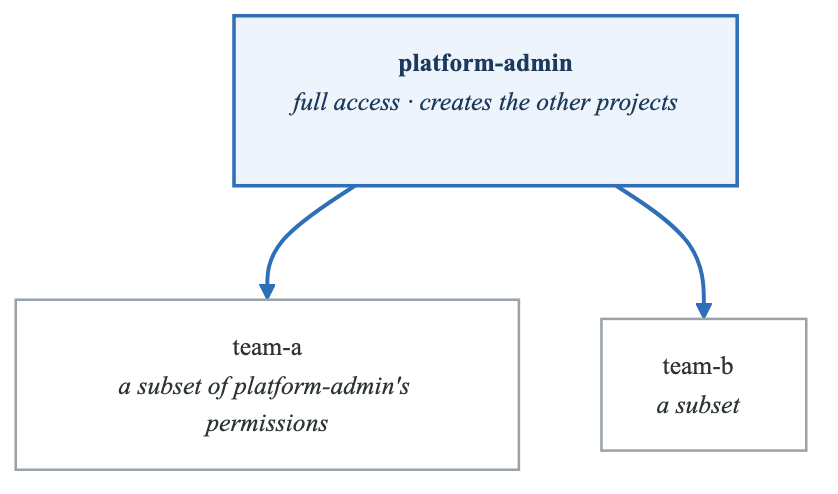
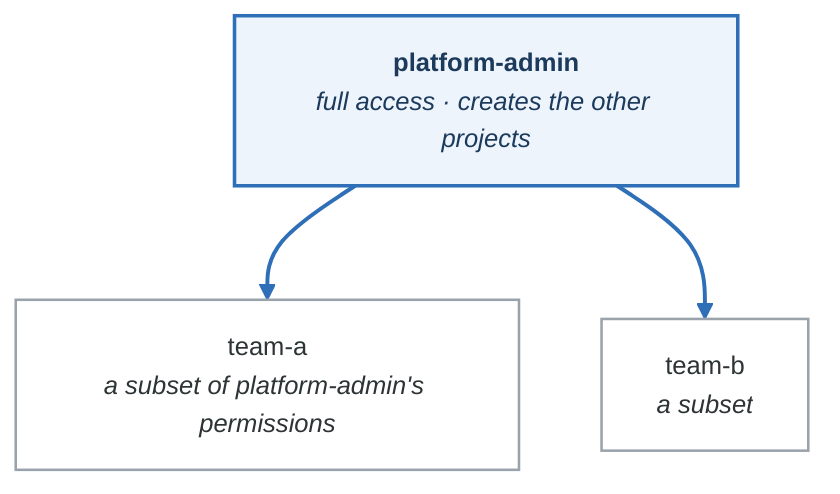

# Phase 6: Projects & Multi-Tenancy

**Goal:** Master AppProjects for team isolation, access control, and deployment policies.

**Duration:** 2-3 hours

---

## Overview

This phase covers:
- What AppProjects are and why they matter
- Source and destination restrictions
- Cluster and namespace resource controls
- Sync windows for deployment timing
- Project roles for team access
- Orphaned resource monitoring

---

## Concepts

### What is an AppProject?

An AppProject provides logical grouping and access control for Applications:

**AppProjects are the tenancy boundary**

| | `team-frontend` | `team-backend` | `team-data` |
|---|---|---|---|
| **Allowed sources** | `frontend/*` | `backend/*` | `data/*` |
| **Allowed destinations** | `frontend-*` namespaces | `backend-*` namespaces | `data-*` namespaces |
| **Applications** | `web-ui`, `assets-cdn` | `api-server`, `auth-svc` | `pipeline`, `analytics` |

A project restricts three things: which **repositories** an Application may deploy from, which
**cluster and namespace** it may deploy to, and which **resource kinds** it may create. Without
projects every Application lives in `default`, which permits everything everywhere — so one team's
misconfigured Application can deploy into another team's namespace, and Argo CD will happily do it.

**The `default` project:**
- Created automatically
- Allows all sources and destinations
- No restrictions
- Use for learning; avoid in production

### Project Controls

| Control | Purpose |
|---------|---------|
| **sourceRepos** | Which Git repos/Helm registries are allowed |
| **destinations** | Which clusters/namespaces can be deployed to |
| **clusterResourceWhitelist** | Cluster-scoped resources allowed |
| **namespaceResourceWhitelist** | Namespace-scoped resources allowed |
| **namespaceResourceBlacklist** | Namespace-scoped resources denied |
| **syncWindows** | When syncs are allowed/denied |
| **roles** | Project-specific RBAC |
| **orphanedResources** | Monitor unmanaged resources |

### Source Restrictions

Control where manifests can come from:

```yaml
sourceRepos:
  # Exact match
  - 'https://github.com/myorg/myrepo.git'

  # Wildcard - any repo in org
  - 'https://github.com/myorg/*'

  # Helm repository
  - 'https://charts.bitnami.com/*'

  # All repos (not recommended for prod)
  - '*'
```

### Destination Restrictions

Control where apps can be deployed:

```yaml
destinations:
  # Specific namespace on specific cluster
  - namespace: 'production'
    server: 'https://prod-cluster.example.com'

  # Wildcard namespace on default cluster
  - namespace: 'team-*'
    server: 'https://kubernetes.default.svc'

  # Any namespace on any cluster (dangerous!)
  - namespace: '*'
    server: '*'
```

### Resource Restrictions

Control which Kubernetes resources can be created:

```yaml
# Cluster-scoped resources allowed
clusterResourceWhitelist:
  - group: ''
    kind: Namespace
  - group: 'rbac.authorization.k8s.io'
    kind: ClusterRole

# Namespace resources NOT allowed (blacklist)
namespaceResourceBlacklist:
  - group: ''
    kind: ResourceQuota
  - group: 'networking.k8s.io'
    kind: NetworkPolicy

# Namespace resources allowed (whitelist)
# If specified, ONLY these are allowed
namespaceResourceWhitelist:
  - group: 'apps'
    kind: Deployment
  - group: ''
    kind: Service
```

**Logic:**
1. If `namespaceResourceWhitelist` is set, only listed resources are allowed
2. If not set, all resources except `namespaceResourceBlacklist` are allowed
3. `clusterResourceWhitelist` must explicitly allow cluster-scoped resources

### Sync Windows

Control when deployments can happen:

```yaml
syncWindows:
  # Allow syncs only during maintenance window
  - kind: allow
    schedule: '0 2 * * 0'     # 2 AM Sundays (cron format)
    duration: 4h               # 4 hour window
    applications:
      - '*'                    # All apps in project
    clusters:
      - '*'                    # All clusters
    namespaces:
      - '*'                    # All namespaces
    manualSync: true           # Also block manual syncs

  # Deny syncs during business hours
  - kind: deny
    schedule: '0 9 * * 1-5'   # 9 AM weekdays
    duration: 10h              # Until 7 PM
    applications:
      - 'prod-*'              # Only prod apps
    manualSync: false          # Allow manual emergency syncs
```

**Window behavior:**
- `allow` - Syncs ONLY permitted during this window
- `deny` - Syncs blocked during this window
- Multiple windows are evaluated (deny takes precedence)

### Project Roles

Define project-specific access:

```yaml
roles:
  - name: developer
    description: "Team developers"
    policies:
      # Format: p, SUBJECT, RESOURCE, ACTION, PROJECT/APP, allow/deny
      - p, proj:team-frontend:developer, applications, get, team-frontend/*, allow
      - p, proj:team-frontend:developer, applications, sync, team-frontend/*, allow
      - p, proj:team-frontend:developer, logs, get, team-frontend/*, allow
    groups:
      # OIDC/SSO groups that get this role
      - frontend-developers
```

**Actions:**
- `get` - View applications
- `sync` - Trigger syncs
- `create` - Create applications
- `update` - Update applications
- `delete` - Delete applications
- `override` - Override sync window
- `*` - All actions

### Orphaned Resources

Monitor resources not managed by any Application:

```yaml
orphanedResources:
  warn: true          # Show warnings for orphaned resources
  ignore:             # Resources to ignore
    - group: ''
      kind: ConfigMap
      name: kube-root-ca.crt
```

---

## Labs

### Lab 6.1: Create Team Projects

#### Step 1: Review Project Definitions

```bash
# Frontend team project
cat projects/team-frontend.yaml

# Backend team project
cat projects/team-backend.yaml

# Data team project (with sync windows)
cat projects/team-data.yaml
```

Notice the differences:
- Frontend: Limited to frontend-* namespaces
- Backend: Limited to backend-* namespaces
- Data: Has sync windows restricting when deployments can occur

#### Step 2: Update Repository URLs

```bash
# Replace with your GitHub username
sed -i '' 's/YOUR_USERNAME/your-github-username/g' projects/*.yaml
```

#### Step 3: Create Projects

```bash
kubectl apply -f projects/

# Verify projects created
argocd proj list
```

#### Step 4: Examine a Project

```bash
argocd proj get team-frontend
```

Notice:
- Allowed source repos
- Allowed destinations
- Resource whitelist/blacklist
- Defined roles

### Lab 6.2: Deploy to Team Projects

#### Step 1: Deploy a Valid Application

```bash
cat team-apps/frontend-app.yaml
```

This app:
- Uses `project: team-frontend`
- Deploys to `frontend-dev` namespace
- Uses an allowed source repo

```bash
kubectl apply -f team-apps/frontend-app.yaml
argocd app sync frontend-webui
```

#### Step 2: Try a Violation

```bash
cat team-apps/violation-test.yaml
```

This app tries to:
- Use `project: team-frontend`
- Deploy to `backend-dev` namespace (not allowed!)

```bash
kubectl apply -f team-apps/violation-test.yaml
```

Check the error:

```bash
argocd app get frontend-violation-test
```

You should see an error about destination not being allowed.

#### Step 3: Clean Up Violation

```bash
kubectl delete -f team-apps/violation-test.yaml
```

### Lab 6.3: Test Sync Windows

#### Step 1: Review Data Project Windows

```bash
cat projects/team-data.yaml | grep -A 20 syncWindows
```

Windows defined:
- Allow: 9 AM - 5 PM weekdays
- Deny: Weekends
- Deny: 2 AM - 6 AM (data processing)

#### Step 2: Check Active Windows

```bash
# See current sync window status
argocd proj windows list team-data
```

#### Step 3: Test Window Enforcement

If you're outside the allowed window:

```bash
# This should fail if outside sync window
kubectl apply -f team-apps/backend-database.yaml
argocd app sync backend-database
```

You'll see a message about sync being denied by sync window.

#### Step 4: Override Window (Admin)

```bash
# Override sync window (requires override permission)
argocd app sync backend-database --force
```

### Lab 6.4: Project Roles

#### Step 1: View Role Definitions

```bash
argocd proj role list team-frontend
```

Roles defined:
- `developer` - Can get and sync apps
- `lead` - Full application access

#### Step 2: Test Role Access (Simulated)

Without SSO/OIDC, we can test with tokens:

```bash
# Create a token for developer role
argocd proj role create-token team-frontend developer

# Use the token (set ARGOCD_AUTH_TOKEN env var)
# Then test access
```

#### Step 3: View Role Policies

```bash
argocd proj role get team-frontend developer
```

---

## Multi-Tenancy Patterns

### Pattern 1: Namespace per Environment

```yaml
destinations:
  - namespace: 'myapp-dev'
    server: https://kubernetes.default.svc
  - namespace: 'myapp-staging'
    server: https://kubernetes.default.svc
  - namespace: 'myapp-prod'
    server: https://kubernetes.default.svc
```

### Pattern 2: Namespace Prefix per Team

```yaml
destinations:
  - namespace: 'team-frontend-*'
    server: '*'
```

### Pattern 3: Cluster per Environment

```yaml
destinations:
  - namespace: '*'
    server: https://dev-cluster.example.com
  - namespace: '*'
    server: https://staging-cluster.example.com
  # No prod cluster access for this project
```

### Pattern 4: Hierarchical Projects

<!-- figure: generated from the Mermaid below by _shared/diagrams/embed-figures.py — do not edit the image -->


<details>
<summary>Diagram source (Mermaid)</summary>



</details>

---

## Best Practices

### Project Design

1. **One project per team** - Clear ownership boundaries
2. **Least privilege** - Start restrictive, expand as needed
3. **Use wildcards carefully** - Prefer explicit listings
4. **Separate prod access** - Different project for production

### Source Control

1. **Limit source repos** - Only team's repos allowed
2. **Approve Helm repos** - Whitelist trusted registries
3. **Avoid `*` in production** - Be explicit about sources

### Destinations

1. **Namespace prefixes** - `team-*` patterns for isolation
2. **Cluster separation** - Different clusters for prod
3. **No cross-team access** - Teams stay in their lanes

### Sync Windows

1. **Business hours for prod** - Avoid off-hours surprises
2. **Allow manual override** - For emergencies
3. **Document windows** - Teams should know the schedule

---

## Knowledge Check

Answer these questions before proceeding:

1. **What happens if both whitelist and blacklist are defined for namespace resources?**
   <details>
   <summary>Answer</summary>
   If namespaceResourceWhitelist is set, only those resources are allowed. The blacklist is ignored because whitelist takes precedence.
   </details>

2. **Can an Application deploy to a namespace not in its project's destinations?**
   <details>
   <summary>Answer</summary>
   No. Argo CD will reject the Application with an error about the destination not being allowed.
   </details>

3. **What's the difference between `allow` and `deny` sync windows?**
   <details>
   <summary>Answer</summary>
   `allow` means syncs are ONLY permitted during that window. `deny` means syncs are blocked during that window. Deny takes precedence if windows overlap.
   </details>

4. **How do project roles differ from global RBAC?**
   <details>
   <summary>Answer</summary>
   Project roles only apply within that project. They can be assigned to OIDC groups and allow project-specific access without global admin rights.
   </details>

5. **What does orphanedResources.warn do?**
   <details>
   <summary>Answer</summary>
   It shows warnings for resources in project namespaces that aren't managed by any Application. Helps identify manually-created resources.
   </details>

---

## Common Mistakes

1. **Using `default` project in production** - No restrictions, security risk
2. **Overly broad wildcards** - `*` for sources or destinations
3. **Forgetting cluster resources** - Namespaces require explicit whitelist
4. **Conflicting sync windows** - Deny always wins
5. **Not testing role policies** - Policies can be tricky to get right

---

## Files in This Directory

| File/Directory | Purpose |
|----------------|---------|
| `projects/team-frontend.yaml` | Frontend team project |
| `projects/team-backend.yaml` | Backend team project |
| `projects/team-data.yaml` | Data team project with sync windows |
| `team-apps/frontend-app.yaml` | Valid application for frontend |
| `team-apps/backend-database.yaml` | Backend application |
| `team-apps/violation-test.yaml` | Application that violates project rules |

---

## What's Next?

Now that you understand multi-tenancy, proceed to **Phase 7: Security & Access Control** to learn about RBAC, secrets, and repository credentials.

```bash
cd ../phase-7-security
cat README.md
```

<!-- feynman-check -->

---

## Feynman check

Close the file. Blank page, no notes. Explain each of these to a competent engineer who has never
used this tool — **under five minutes, no jargon you can't define on the spot:**

- Multi-Tenancy Patterns
- What is an AppProject?
- Project Controls
- Source Restrictions

**The gap is not what you forgot. It is where you used a word instead of a mechanism.**

| | |
|---|---|
| ✗ | *"The pipeline deploys the application."* |
| ✓ | *"CI writes a new image tag into a config repository and stops. A controller running *inside* the cluster polls that repo, diffs the rendered manifests against live state, and applies the difference — so nothing outside the cluster ever holds credentials to it."* |

**Trace it:** `git push` → the new version serving traffic, with nothing else typed. Name where the handoff between CI and CD happens, and what that handoff physically is.

Stop at the first component you cannot name. Reopen this file and read **only** that.

**Go deeper — only once the gap has a name:** the four [OpenGitOps principles](https://opengitops.dev/#principles) — then say which one a `kubectl apply` inside CI violates.
Full list per domain: [`SOURCES.md`](../../SOURCES.md#cicd-gitops)

→ Protocol, the three levels of knowing, and worked examples: [`MASTERY.md`](../../MASTERY.md)

<!-- /feynman-check -->
