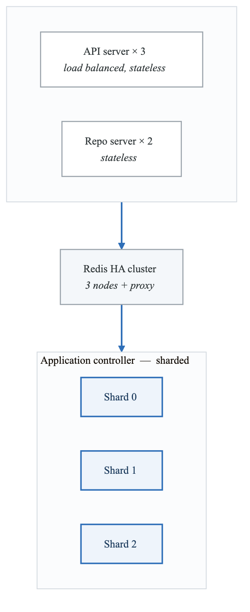
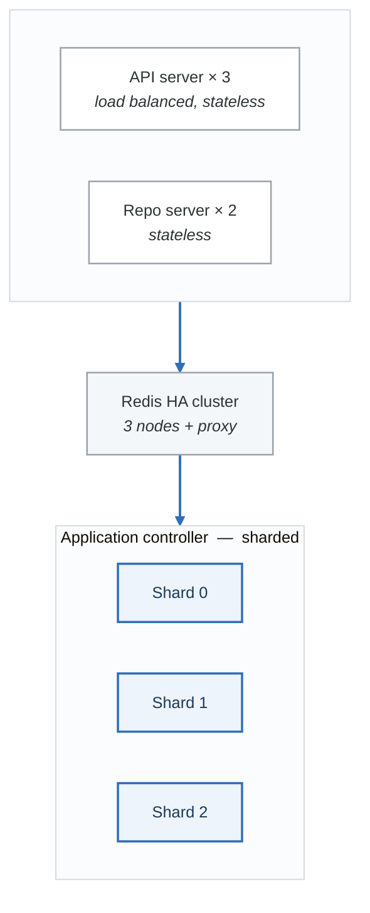
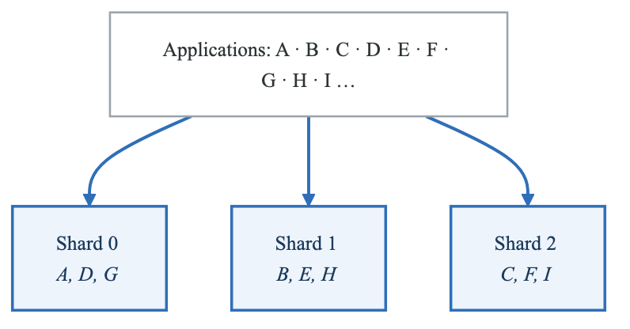
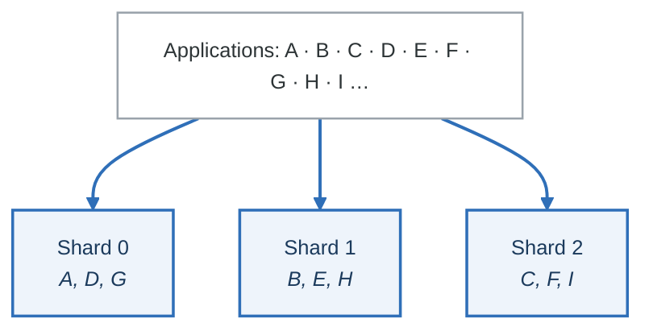

# Phase 9: High Availability & Disaster Recovery

**Goal:** Master Argo CD high availability deployment, performance tuning, and disaster recovery procedures.

**Duration:** 2-3 hours

---

## Overview

This phase covers:
- High availability installation
- Controller sharding for scale
- Performance tuning
- Backup and restore procedures
- Disaster recovery planning

---

## Concepts

### HA Architecture

<!-- figure: generated from the Mermaid below by _shared/diagrams/embed-figures.py — do not edit the image -->


<details>
<summary>Diagram source (Mermaid)</summary>



</details>

### HA Components

| Component | Non-HA | HA | Notes |
|-----------|--------|----|----|
| API Server | 1 | 3+ | Load balanced |
| Repo Server | 1 | 2+ | Stateless |
| Controller | 1 | 1-N | Sharded |
| Redis | 1 | 3 + HAProxy | Sentinel mode |

### Controller Sharding

For 500+ applications, shard the controller:

<!-- figure: generated from the Mermaid below by _shared/diagrams/embed-figures.py — do not edit the image -->


<details>
<summary>Diagram source (Mermaid)</summary>



</details>

**Sharding algorithms:**
- `legacy` - Original algorithm
- `round-robin` - Even distribution, reshards on scale
- `consistent-hashing` - Minimal resharding (recommended)

### Performance Parameters

| Parameter | Default | Tuned | Purpose |
|-----------|---------|-------|---------|
| `status.processors` | 20 | 50-100 | Status monitoring threads |
| `operation.processors` | 10 | 25-50 | Sync operation threads |
| `reposerver.parallelism.limit` | 0 | 10-20 | Concurrent manifest generation |
| `reconciliation.timeout` | 180s | 300s | App reconciliation timeout |

### Backup Strategy

**What to backup:**
1. Applications (CRDs)
2. ApplicationSets (CRDs)
3. AppProjects (CRDs)
4. Repository credentials (Secrets)
5. Cluster credentials (Secrets)
6. Configuration (ConfigMaps)

**What NOT to backup:**
- Redis data (cache, rebuilds automatically)
- Application status (live state, rebuilds)

---

## Labs

### Lab 9.1: HA Installation

#### Step 1: Review HA Installation Script

```bash
cat ha-install/install-ha.sh
```

Key points:
- Uses HA manifests from Argo CD repo
- Installs Redis HA cluster
- Multiple replicas for API and Repo servers

#### Step 2: Install HA Mode

```bash
chmod +x ha-install/install-ha.sh
./ha-install/install-ha.sh
```

Or manually:

```bash
kubectl apply -n argocd -f https://raw.githubusercontent.com/argoproj/argo-cd/stable/manifests/ha/install.yaml
```

#### Step 3: Verify HA Components

```bash
# Check pods
kubectl get pods -n argocd

# Expected:
# - argocd-application-controller-0
# - argocd-server-xxx (multiple)
# - argocd-repo-server-xxx (multiple)
# - argocd-redis-ha-server-0,1,2
# - argocd-redis-ha-haproxy-xxx
```

#### Step 4: Check Redis HA

```bash
# Check Redis cluster
kubectl exec -n argocd argocd-redis-ha-server-0 -- redis-cli info replication
```

### Lab 9.2: Performance Tuning

#### Step 1: Review Performance Configuration

```bash
cat performance/argocd-cmd-params-cm.yaml
```

Key settings:
- Increased status/operation processors
- Parallelism limits for repo server
- gRPC message size for large deployments

#### Step 2: Apply Performance Tuning

```bash
kubectl apply -f performance/argocd-cmd-params-cm.yaml

# Restart components to pick up changes
kubectl rollout restart deployment argocd-server -n argocd
kubectl rollout restart deployment argocd-repo-server -n argocd
kubectl rollout restart statefulset argocd-application-controller -n argocd
```

#### Step 3: Monitor Performance

```bash
# Check controller reconciliation time
kubectl logs -n argocd -l app.kubernetes.io/name=argocd-application-controller | grep "Reconciliation"

# Check for queue backup
kubectl logs -n argocd -l app.kubernetes.io/name=argocd-application-controller | grep "queue"
```

### Lab 9.3: Controller Sharding

#### Step 1: Review Sharding Configuration

```bash
cat performance/controller-sharding.yaml
```

Key settings:
- `replicas: 3` - Number of controller instances
- `ARGOCD_CONTROLLER_REPLICAS: "3"` - Must match replicas
- `ARGOCD_APPLICATION_CONTROLLER_SHARD_ALGORITHM: "consistent-hashing"`

#### Step 2: Apply Sharding

```bash
kubectl apply -f performance/controller-sharding.yaml
```

#### Step 3: Verify Sharding

```bash
# Check all controller replicas
kubectl get pods -n argocd -l app.kubernetes.io/name=argocd-application-controller

# Check which shard each app belongs to
kubectl logs -n argocd argocd-application-controller-0 | grep "Processing"
kubectl logs -n argocd argocd-application-controller-1 | grep "Processing"
kubectl logs -n argocd argocd-application-controller-2 | grep "Processing"
```

#### Step 4: Monitor Shard Distribution

```bash
# Check apps per shard (via metrics)
curl -s http://localhost:8082/metrics | grep argocd_cluster_events_total
```

### Lab 9.4: Backup Argo CD

#### Step 1: Review Backup Script

```bash
cat backup-restore/backup.sh
```

The script backs up:
- All Applications
- All ApplicationSets
- All AppProjects
- Repository secrets
- Cluster secrets
- ConfigMaps

#### Step 2: Run Backup

```bash
chmod +x backup-restore/backup.sh
./backup-restore/backup.sh
```

#### Step 3: Verify Backup

```bash
# List backup files
ls -la backups/

# Inspect contents
cat backups/applications-*.yaml | head -50
```

### Lab 9.5: Restore Argo CD

#### Step 1: Review Restore Script

```bash
cat backup-restore/restore.sh
```

#### Step 2: Simulate Disaster

```bash
# Delete an application (simulate loss)
argocd app delete guestbook --cascade=false

# Verify it's gone
argocd app list
```

#### Step 3: Restore from Backup

```bash
chmod +x backup-restore/restore.sh
./backup-restore/restore.sh backups/argocd-backup-*.yaml
```

#### Step 4: Verify Restore

```bash
# Check application is back
argocd app list
argocd app get guestbook
```

---

## Disaster Recovery Plan

### Prevention

1. **Regular backups** - Daily automated backups
2. **Store backups externally** - S3, GCS, not just local
3. **Test restores** - Monthly restore drills
4. **GitOps for config** - Argo CD config in Git

### Recovery Levels

| Level | Scenario | Recovery |
|-------|----------|----------|
| 1 | Single component failure | Kubernetes restarts pod |
| 2 | Node failure | Pods reschedule (HA) |
| 3 | Cluster failure | Restore from backup |
| 4 | Complete loss | Reinstall + restore |

### Recovery Procedure

1. **Install Argo CD** (fresh or HA)
2. **Restore secrets first** (credentials)
3. **Restore projects** (RBAC)
4. **Restore applications** (last)
5. **Verify connections** (repos, clusters)
6. **Sync applications** (if not auto-sync)

---

## Scaling Guidelines

| Applications | Controller | Status Proc | Op Proc | Redis |
|-------------|------------|-------------|---------|-------|
| < 100 | 1 | 20 | 10 | Single |
| 100-500 | 1 | 50 | 25 | Single |
| 500-1000 | 2-3 | 50 per | 25 per | HA |
| 1000+ | 3+ | 100 per | 50 per | HA |

### Memory Guidelines

| Applications | Controller | Repo Server |
|-------------|------------|-------------|
| < 100 | 256Mi | 256Mi |
| 100-500 | 512Mi | 512Mi |
| 500-1000 | 1Gi | 1Gi |
| 1000+ | 2Gi+ | 2Gi+ |

---

## Best Practices

### High Availability

1. **3+ nodes** - For pod anti-affinity
2. **PodDisruptionBudgets** - Prevent accidental downtime
3. **Resource limits** - Prevent OOM
4. **Health checks** - Monitor all components

### Performance

1. **Start with defaults** - Tune only if needed
2. **Monitor first** - Use metrics to identify bottlenecks
3. **Incremental changes** - One parameter at a time
4. **Load test** - Simulate production load

### Backup

1. **Automate** - CronJob for daily backups
2. **Test restores** - Backup is worthless without restore
3. **Multiple copies** - Local + remote storage
4. **Version backups** - Keep last N backups

---

## Knowledge Check

Answer these questions before proceeding:

1. **What's the difference between HA and sharding?**
   <details>
   <summary>Answer</summary>
   HA provides redundancy (multiple replicas for failover). Sharding distributes workload (each controller handles subset of apps for scale).
   </details>

2. **Why is consistent-hashing recommended for sharding?**
   <details>
   <summary>Answer</summary>
   It minimizes resharding when controllers are added/removed. Only apps from one shard move, instead of all apps being rebalanced.
   </details>

3. **What gets rebuilt automatically without backup?**
   <details>
   <summary>Answer</summary>
   Redis cache (manifest cache), application status (live state from cluster), and resource cache. These are derived from source and cluster.
   </details>

4. **When should you increase status processors?**
   <details>
   <summary>Answer</summary>
   When you see reconciliation queue backup or slow status updates. Monitor the queue length and reconciliation duration metrics.
   </details>

5. **What's the restore order for disaster recovery?**
   <details>
   <summary>Answer</summary>
   1) Secrets (credentials), 2) AppProjects (RBAC), 3) Applications. Secrets first because apps need repo access.
   </details>

---

## Common Mistakes

1. **Not matching replicas env var** - `ARGOCD_CONTROLLER_REPLICAS` must equal actual replicas
2. **Forgetting to backup secrets** - Applications won't sync without credentials
3. **Over-tuning** - Start with defaults, increase only when needed
4. **Single-node HA** - Anti-affinity can't work with one node
5. **Not testing restore** - Backups fail silently

---

## Files in This Directory

| File/Directory | Purpose |
|----------------|---------|
| `ha-install/install-ha.sh` | HA installation script |
| `performance/argocd-cmd-params-cm.yaml` | Performance tuning |
| `performance/controller-sharding.yaml` | Controller sharding config |
| `backup-restore/backup.sh` | Backup script |
| `backup-restore/restore.sh` | Restore script |

---

## What's Next?

Now that you understand HA and DR, proceed to **Phase 10: Advanced Patterns** to learn app-of-apps, multi-cluster, and CI/CD integration.

```bash
cd ../phase-10-advanced
cat README.md
```

<!-- feynman-check -->

---

## Feynman check

Close the file. Blank page, no notes. Explain each of these to a competent engineer who has never
used this tool — **under five minutes, no jargon you can't define on the spot:**

- Disaster Recovery Plan
- Scaling Guidelines
- HA Architecture
- HA Components

**The gap is not what you forgot. It is where you used a word instead of a mechanism.**

| | |
|---|---|
| ✗ | *"The pipeline deploys the application."* |
| ✓ | *"CI writes a new image tag into a config repository and stops. A controller running *inside* the cluster polls that repo, diffs the rendered manifests against live state, and applies the difference — so nothing outside the cluster ever holds credentials to it."* |

**Trace it:** `git push` → the new version serving traffic, with nothing else typed. Name where the handoff between CI and CD happens, and what that handoff physically is.

Stop at the first component you cannot name. Reopen this file and read **only** that.

**Go deeper — only once the gap has a name:** the four [OpenGitOps principles](https://opengitops.dev/#principles) — then say which one a `kubectl apply` inside CI violates.
Full list per domain: [`SOURCES.md`](../../SOURCES.md#cicd-gitops)

→ Protocol, the three levels of knowing, and worked examples: [`MASTERY.md`](../../MASTERY.md)

<!-- /feynman-check -->
