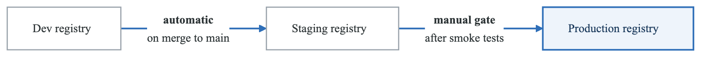

# Lab 08: Artifact Management

## Overview

In this lab, you'll implement comprehensive artifact management including container registries, package repositories, and artifact promotion strategies. You'll learn to manage artifacts across environments with proper versioning and lifecycle policies.

**Duration**: 2-3 hours
**Difficulty**: Intermediate

## Prerequisites

- Docker installed
- kubectl configured
- Helm 3.x installed
- Basic understanding of CI/CD concepts

## Learning Objectives

- Set up and manage container registries
- Configure package repositories (npm, Maven, PyPI)
- Implement artifact promotion strategies
- Configure lifecycle and retention policies
- Implement artifact caching for faster builds

## Lab Environment Setup

```bash
# Create lab directory
mkdir -p ~/artifact-lab && cd ~/artifact-lab

# Start local registry
docker run -d -p 5000:5000 --name registry registry:2

# Create directory structure
mkdir -p packages/{npm,python,docker}
mkdir -p promotion/{dev,staging,prod}

# Create sample applications
# Node.js package
cat > packages/npm/package.json << 'EOF'
{
  "name": "@myorg/shared-utils",
  "version": "1.0.0",
  "description": "Shared utility functions",
  "main": "index.js",
  "scripts": {
    "test": "jest",
    "build": "tsc",
    "publish": "npm publish"
  },
  "publishConfig": {
    "registry": "http://localhost:4873"
  }
}
EOF

cat > packages/npm/index.js << 'EOF'
/**
 * Format a date string
 * @param {Date} date - The date to format
 * @returns {string} Formatted date string
 */
function formatDate(date) {
  return date.toISOString().split('T')[0];
}

/**
 * Generate a unique ID
 * @returns {string} Unique identifier
 */
function generateId() {
  return Math.random().toString(36).substr(2, 9);
}

module.exports = { formatDate, generateId };
EOF

# Python package
cat > packages/python/setup.py << 'EOF'
from setuptools import setup, find_packages

setup(
    name="myorg-utils",
    version="1.0.0",
    packages=find_packages(),
    install_requires=[],
    author="DevOps Team",
    description="Shared utility functions"
)
EOF

mkdir -p packages/python/myorg_utils
cat > packages/python/myorg_utils/__init__.py << 'EOF'
from datetime import datetime
import uuid

def format_date(date: datetime) -> str:
    """Format a date string."""
    return date.strftime("%Y-%m-%d")

def generate_id() -> str:
    """Generate a unique ID."""
    return str(uuid.uuid4())[:8]
EOF
```

---

## Part 1: Guided Exercise - Container Registry Management

### Step 1: Deploy Harbor Registry

```bash
# Add Harbor Helm repo
helm repo add harbor https://helm.goharbor.io
helm repo update

# Create namespace
kubectl create namespace harbor

# Install Harbor
helm install harbor harbor/harbor \
  --namespace harbor \
  --set expose.type=nodePort \
  --set expose.nodePort.ports.https.nodePort=30003 \
  --set externalURL=https://harbor.local:30003 \
  --set harborAdminPassword=Harbor12345

# Wait for pods
kubectl wait --for=condition=ready pod -l app=harbor -n harbor --timeout=300s

# Get Harbor URL (minikube)
minikube service harbor-portal -n harbor --url

# Or for local testing, use Docker registry
docker run -d \
  -p 5000:5000 \
  --restart=always \
  --name registry \
  -v registry-data:/var/lib/registry \
  registry:2
```

### Step 2: Configure Image Lifecycle Policies

```bash
# Harbor retention policy via API
cat > retention-policy.json << 'EOF'
{
  "algorithm": "or",
  "rules": [
    {
      "action": "retain",
      "template": "latestPushedK",
      "params": {
        "latestPushedK": 10
      },
      "tag_selectors": [
        {
          "kind": "doublestar",
          "pattern": "**"
        }
      ],
      "scope_selectors": {
        "repository": [
          {
            "kind": "doublestar",
            "pattern": "**"
          }
        ]
      }
    },
    {
      "action": "retain",
      "template": "nDaysSinceLastPush",
      "params": {
        "nDaysSinceLastPush": 30
      },
      "tag_selectors": [
        {
          "kind": "doublestar",
          "pattern": "release-*"
        }
      ]
    }
  ],
  "trigger": {
    "kind": "Schedule",
    "settings": {
      "cron": "0 0 * * *"
    }
  }
}
EOF

# Apply via Harbor API
curl -X POST "https://harbor.local/api/v2.0/retentions" \
  -H "Content-Type: application/json" \
  -u "admin:Harbor12345" \
  -d @retention-policy.json
```

### Step 3: Push and Pull Images

```bash
# Create sample Dockerfile
cat > Dockerfile << 'EOF'
FROM alpine:3.19
RUN apk add --no-cache curl
CMD ["echo", "Hello from artifact lab!"]
EOF

# Build and tag for local registry
docker build -t localhost:5000/demo-app:v1.0.0 .

# Push to registry
docker push localhost:5000/demo-app:v1.0.0

# List images in registry
curl -s http://localhost:5000/v2/_catalog | jq

# List tags for an image
curl -s http://localhost:5000/v2/demo-app/tags/list | jq

# Pull image
docker pull localhost:5000/demo-app:v1.0.0
```

### Step 4: Configure GitHub Actions for Registry

```yaml
# .github/workflows/publish-image.yml
name: Build and Publish Image

on:
  push:
    branches: [main]
    tags: ['v*']

env:
  REGISTRY: ghcr.io
  IMAGE_NAME: ${{ github.repository }}

jobs:
  build-and-push:
    runs-on: ubuntu-latest
    permissions:
      contents: read
      packages: write

    steps:
      - name: Checkout
        uses: actions/checkout@v4

      - name: Set up QEMU
        uses: docker/setup-qemu-action@v3

      - name: Set up Docker Buildx
        uses: docker/setup-buildx-action@v3

      - name: Login to GHCR
        uses: docker/login-action@v3
        with:
          registry: ${{ env.REGISTRY }}
          username: ${{ github.actor }}
          password: ${{ secrets.GITHUB_TOKEN }}

      - name: Extract metadata
        id: meta
        uses: docker/metadata-action@v5
        with:
          images: ${{ env.REGISTRY }}/${{ env.IMAGE_NAME }}
          tags: |
            type=ref,event=branch
            type=ref,event=pr
            type=semver,pattern={{version}}
            type=semver,pattern={{major}}.{{minor}}
            type=sha,prefix=

      - name: Build and push
        uses: docker/build-push-action@v5
        with:
          context: .
          platforms: linux/amd64,linux/arm64
          push: ${{ github.event_name != 'pull_request' }}
          tags: ${{ steps.meta.outputs.tags }}
          labels: ${{ steps.meta.outputs.labels }}
          cache-from: type=gha
          cache-to: type=gha,mode=max
```

---

## Part 2: Semi-Guided Exercise - Package Repository Setup

### Objective

Set up private package repositories for:
- npm packages
- Python packages
- Implement versioning and publishing workflows

### Requirements

1. **Deploy Verdaccio for npm**

<details>
<summary>Click for Verdaccio setup hint</summary>

```bash
# Deploy Verdaccio
docker run -d \
  --name verdaccio \
  -p 4873:4873 \
  -v verdaccio-storage:/verdaccio/storage \
  -v verdaccio-conf:/verdaccio/conf \
  verdaccio/verdaccio

# Configure npm to use local registry
npm config set registry http://localhost:4873/

# Create user
npm adduser --registry http://localhost:4873

# Publish package
cd packages/npm
npm publish --registry http://localhost:4873
```
</details>

2. **Deploy PyPI server**

<details>
<summary>Click for PyPI setup hint</summary>

```bash
# Deploy devpi or pypiserver
docker run -d \
  --name pypi \
  -p 8080:8080 \
  -v pypi-packages:/data/packages \
  pypiserver/pypiserver:latest \
  run -P . -a . /data/packages

# Configure pip
pip config set global.index-url http://localhost:8080/simple/
pip config set global.trusted-host localhost

# Upload package
pip install twine
cd packages/python
python setup.py sdist
twine upload --repository-url http://localhost:8080 dist/*
```
</details>

3. **Create publishing workflow**

<details>
<summary>Click for workflow hint</summary>

```yaml
name: Publish Package

on:
  release:
    types: [published]

jobs:
  publish-npm:
    runs-on: ubuntu-latest
    steps:
      - uses: actions/checkout@v4
      - uses: actions/setup-node@v4
        with:
          node-version: '20'
          registry-url: 'https://npm.pkg.github.com'
      - run: npm ci
      - run: npm publish
        env:
          NODE_AUTH_TOKEN: ${{ secrets.GITHUB_TOKEN }}
```
</details>

### Tasks

1. Deploy Verdaccio npm registry
2. Deploy PyPI server for Python packages
3. Configure authentication for both registries
4. Create CI/CD workflow for automatic publishing
5. Set up scoped packages (@org/package-name)

### Validation

```bash
# Test npm registry
npm search --registry http://localhost:4873 myorg

# Test PyPI server
pip search --index http://localhost:8080 myorg

# Verify package can be installed
npm install @myorg/shared-utils --registry http://localhost:4873
pip install myorg-utils --index-url http://localhost:8080/simple/
```

---

## Part 3: Challenge - Artifact Promotion Pipeline

### Objective

Implement a complete artifact promotion strategy:
- Multi-environment promotion (dev → staging → prod)
- Immutable artifacts with promotion metadata
- Automated and manual promotion gates
- Rollback capability

### Requirements

1. **Design promotion workflow**

```mermaid
%%{init: {'theme':'base','themeVariables':{'fontFamily':'Helvetica, Arial, sans-serif','fontSize':'13px','primaryColor':'#ffffff','primaryTextColor':'#2d3436','primaryBorderColor':'#9aa3ab','lineColor':'#9aa3ab','textColor':'#2d3436','clusterBkg':'#fbfcfd','clusterBorder':'#d4dae0','edgeLabelBackground':'#ffffff','tertiaryColor':'#eef4fb'},'flowchart':{'curve':'basis','padding':14,'nodeSpacing':42,'rankSpacing':58}}}%%
flowchart LR
  classDef default fill:#ffffff,stroke:#9aa3ab,stroke-width:1.3px,color:#2d3436
  classDef n    fill:#ffffff,stroke:#9aa3ab,stroke-width:1.3px,color:#2d3436
  classDef crit fill:#eef4fb,stroke:#2f6fb8,stroke-width:1.8px,color:#1b3a5c
  classDef data fill:#f4f7fa,stroke:#9aa3ab,stroke-width:1.3px,color:#2d3436
  classDef mut  fill:#ffffff,stroke:#cfd6dc,stroke-width:1.1px,color:#7a8288
  classDef warn fill:#fdf0ec,stroke:#c0522d,stroke-width:1.6px,color:#8a3a1e
  D["Dev registry"]
  S["Staging registry"]
  P["Production registry"]
  D ==>|"<b>automatic</b><br/>on merge to main"| S
  S ==>|"<b>manual gate</b><br/>after smoke tests"| P
  class D n
  class S n
  class P crit
  linkStyle 0,1 stroke:#2f6fb8,stroke-width:2px

%% Separate registries, not separate tags in one registry. The production
%% registry can then have different credentials, different retention, and a
%% policy that only the promotion job may push to it -- none of which a tag
%% convention can enforce.
```

<!-- figure: generated from the Mermaid below by _shared/diagrams/embed-figures.py — do not edit the image -->


<details>
<summary>Diagram source (Mermaid)</summary>



</details>

2. **Implement promotion scripts**

3. **Configure promotion metadata**

4. **Set up promotion tracking**

### Success Criteria

- [ ] Artifacts promoted without rebuild
- [ ] Promotion metadata attached to images
- [ ] Manual approval gates work
- [ ] Rollback to previous version works
- [ ] Audit trail of all promotions
- [ ] Promotion notifications configured

### Starting Point - Promotion Script

```bash
#!/bin/bash
# promote-artifact.sh

set -e

SOURCE_REGISTRY="dev-registry.example.com"
TARGET_REGISTRY="staging-registry.example.com"
IMAGE_NAME=$1
SOURCE_TAG=$2
TARGET_TAG=${3:-$SOURCE_TAG}

echo "Promoting $IMAGE_NAME:$SOURCE_TAG to $TARGET_REGISTRY:$TARGET_TAG"

# Pull from source
docker pull "$SOURCE_REGISTRY/$IMAGE_NAME:$SOURCE_TAG"

# Get image digest for immutability
DIGEST=$(docker inspect --format='{{index .RepoDigests 0}}' "$SOURCE_REGISTRY/$IMAGE_NAME:$SOURCE_TAG" | cut -d'@' -f2)

# Tag for target registry
docker tag "$SOURCE_REGISTRY/$IMAGE_NAME:$SOURCE_TAG" "$TARGET_REGISTRY/$IMAGE_NAME:$TARGET_TAG"

# Add promotion metadata
docker tag "$SOURCE_REGISTRY/$IMAGE_NAME:$SOURCE_TAG" "$TARGET_REGISTRY/$IMAGE_NAME:$DIGEST"

# Push to target
docker push "$TARGET_REGISTRY/$IMAGE_NAME:$TARGET_TAG"
docker push "$TARGET_REGISTRY/$IMAGE_NAME:$DIGEST"

# Record promotion
cat >> promotions.log << EOF
$(date -Iseconds) | $IMAGE_NAME | $SOURCE_TAG | $TARGET_TAG | $DIGEST | $(whoami)
EOF

echo "Promotion complete!"
echo "Image: $TARGET_REGISTRY/$IMAGE_NAME:$TARGET_TAG"
echo "Digest: $DIGEST"
```

### Starting Point - GitHub Actions Promotion

```yaml
# .github/workflows/promote.yml
name: Promote Artifact

on:
  workflow_dispatch:
    inputs:
      image_tag:
        description: 'Image tag to promote'
        required: true
      source_env:
        description: 'Source environment'
        required: true
        type: choice
        options:
          - dev
          - staging
      target_env:
        description: 'Target environment'
        required: true
        type: choice
        options:
          - staging
          - production

env:
  REGISTRIES:
    dev: ghcr.io/${{ github.repository }}/dev
    staging: ghcr.io/${{ github.repository }}/staging
    production: ghcr.io/${{ github.repository }}/prod

jobs:
  validate:
    runs-on: ubuntu-latest
    outputs:
      digest: ${{ steps.get-digest.outputs.digest }}
    steps:
      - name: Validate promotion path
        run: |
          if [[ "${{ inputs.source_env }}" == "dev" && "${{ inputs.target_env }}" == "production" ]]; then
            echo "Cannot promote directly from dev to production!"
            exit 1
          fi

      - name: Login to registry
        uses: docker/login-action@v3
        with:
          registry: ghcr.io
          username: ${{ github.actor }}
          password: ${{ secrets.GITHUB_TOKEN }}

      - name: Get image digest
        id: get-digest
        run: |
          SOURCE_IMAGE="ghcr.io/${{ github.repository }}/${{ inputs.source_env }}:${{ inputs.image_tag }}"
          docker pull $SOURCE_IMAGE
          DIGEST=$(docker inspect --format='{{index .RepoDigests 0}}' $SOURCE_IMAGE | cut -d'@' -f2)
          echo "digest=$DIGEST" >> $GITHUB_OUTPUT

  approval:
    needs: validate
    runs-on: ubuntu-latest
    environment: ${{ inputs.target_env }}
    steps:
      - name: Approval granted
        run: echo "Promotion to ${{ inputs.target_env }} approved"

  promote:
    needs: [validate, approval]
    runs-on: ubuntu-latest
    steps:
      - name: Login to registry
        uses: docker/login-action@v3
        with:
          registry: ghcr.io
          username: ${{ github.actor }}
          password: ${{ secrets.GITHUB_TOKEN }}

      - name: Promote image
        run: |
          SOURCE="ghcr.io/${{ github.repository }}/${{ inputs.source_env }}:${{ inputs.image_tag }}"
          TARGET="ghcr.io/${{ github.repository }}/${{ inputs.target_env }}:${{ inputs.image_tag }}"

          docker pull $SOURCE
          docker tag $SOURCE $TARGET
          docker push $TARGET

      - name: Record promotion
        run: |
          echo "Promoted ${{ inputs.image_tag }} from ${{ inputs.source_env }} to ${{ inputs.target_env }}"
          echo "Digest: ${{ needs.validate.outputs.digest }}"
          echo "Promoted by: ${{ github.actor }}"
          echo "Timestamp: $(date -Iseconds)"

      - name: Create promotion record
        uses: actions/github-script@v7
        with:
          script: |
            await github.rest.repos.createCommitComment({
              owner: context.repo.owner,
              repo: context.repo.repo,
              commit_sha: context.sha,
              body: `🚀 Image promoted to ${{ inputs.target_env }}\n\nTag: ${{ inputs.image_tag }}\nDigest: ${{ needs.validate.outputs.digest }}\nBy: ${{ github.actor }}`
            })
```

### Starting Point - Kubernetes Deployment with Promotion

```yaml
# k8s/deployment.yaml
apiVersion: apps/v1
kind: Deployment
metadata:
  name: demo-app
  annotations:
    artifact/promoted-from: "${SOURCE_ENV}"
    artifact/promoted-at: "${PROMOTION_TIMESTAMP}"
    artifact/promoted-by: "${PROMOTED_BY}"
    artifact/digest: "${IMAGE_DIGEST}"
spec:
  replicas: 3
  selector:
    matchLabels:
      app: demo-app
  template:
    metadata:
      labels:
        app: demo-app
    spec:
      containers:
        - name: app
          image: "${REGISTRY}/${IMAGE_NAME}@${IMAGE_DIGEST}"
          # Using digest ensures immutability
```

### Validation Script

```bash
#!/bin/bash
# validate-artifact-management.sh

echo "Validating Artifact Management..."

# Check local registry
if curl -s http://localhost:5000/v2/_catalog | jq -e '.repositories | length > 0' > /dev/null; then
    IMAGES=$(curl -s http://localhost:5000/v2/_catalog | jq '.repositories | length')
    echo "✓ Local registry has $IMAGES images"
else
    echo "⚠ Local registry empty or unavailable"
fi

# Check Verdaccio (npm)
if curl -s http://localhost:4873/-/all 2>/dev/null | jq -e 'keys | length > 0' > /dev/null; then
    PACKAGES=$(curl -s http://localhost:4873/-/all | jq 'keys | length')
    echo "✓ Verdaccio has $PACKAGES packages"
else
    echo "⚠ Verdaccio unavailable"
fi

# Check PyPI server
if curl -s http://localhost:8080/simple/ 2>/dev/null | grep -q "href"; then
    echo "✓ PyPI server running"
else
    echo "⚠ PyPI server unavailable"
fi

# Check promotion log
if [ -f "promotions.log" ]; then
    PROMOTIONS=$(wc -l < promotions.log)
    echo "✓ $PROMOTIONS promotions recorded"
else
    echo "⚠ No promotion log found"
fi

# Verify image signatures (if cosign available)
if command -v cosign &> /dev/null; then
    echo "✓ Cosign available for signature verification"
fi

echo "Validation complete!"
```

---

## Cleanup

```bash
# Stop and remove containers
docker stop registry verdaccio pypi
docker rm registry verdaccio pypi

# Remove volumes
docker volume rm registry-data verdaccio-storage verdaccio-conf pypi-packages

# Remove Harbor (if installed)
helm uninstall harbor -n harbor
kubectl delete namespace harbor

# Remove lab files
cd ~
rm -rf artifact-lab
```

## Summary

In this lab, you learned:
- Setting up and managing container registries
- Configuring private package repositories
- Implementing lifecycle and retention policies
- Building artifact promotion pipelines
- Ensuring artifact immutability with digests
- Tracking promotions with audit trails

## Next Steps

- Implement OCI artifacts for non-container content
- Set up artifact replication across regions
- Configure vulnerability scanning with automatic blocking
- Implement artifact signing and verification

<!-- feynman-check -->

---

## Feynman check

Close the file. Blank page, no notes. Explain each of these to a competent engineer who has never
used this tool — **under five minutes, no jargon you can't define on the spot:**

- Challenge - Artifact Promotion Pipeline
- Deploy Harbor Registry
- Configure Image Lifecycle Policies
- Push and Pull Images

**The gap is not what you forgot. It is where you used a word instead of a mechanism.**

| | |
|---|---|
| ✗ | *"The pipeline deploys the application."* |
| ✓ | *"CI writes a new image tag into a config repository and stops. A controller running *inside* the cluster polls that repo, diffs the rendered manifests against live state, and applies the difference — so nothing outside the cluster ever holds credentials to it."* |

**Trace it:** `git push` → the new version serving traffic, with nothing else typed. Name where the handoff between CI and CD happens, and what that handoff physically is.

Stop at the first component you cannot name. Reopen this file and read **only** that.

**Go deeper — only once the gap has a name:** the four [OpenGitOps principles](https://opengitops.dev/#principles) — then say which one a `kubectl apply` inside CI violates.
Full list per domain: [`SOURCES.md`](../../SOURCES.md#cicd-gitops)

→ Protocol, the three levels of knowing, and worked examples: [`MASTERY.md`](../../MASTERY.md)

<!-- /feynman-check -->
