# Container Concepts

## Introduction

Containers have revolutionized software deployment by providing a lightweight, consistent way to package and run applications. Understanding the fundamentals of containerization is essential for modern DevOps practices.

## What Are Containers?

Containers are a method of operating system virtualization that allows you to run applications and their dependencies in isolated processes.

<!-- figure: generated from the Mermaid below by _shared/diagrams/embed-figures.py — do not edit the image -->
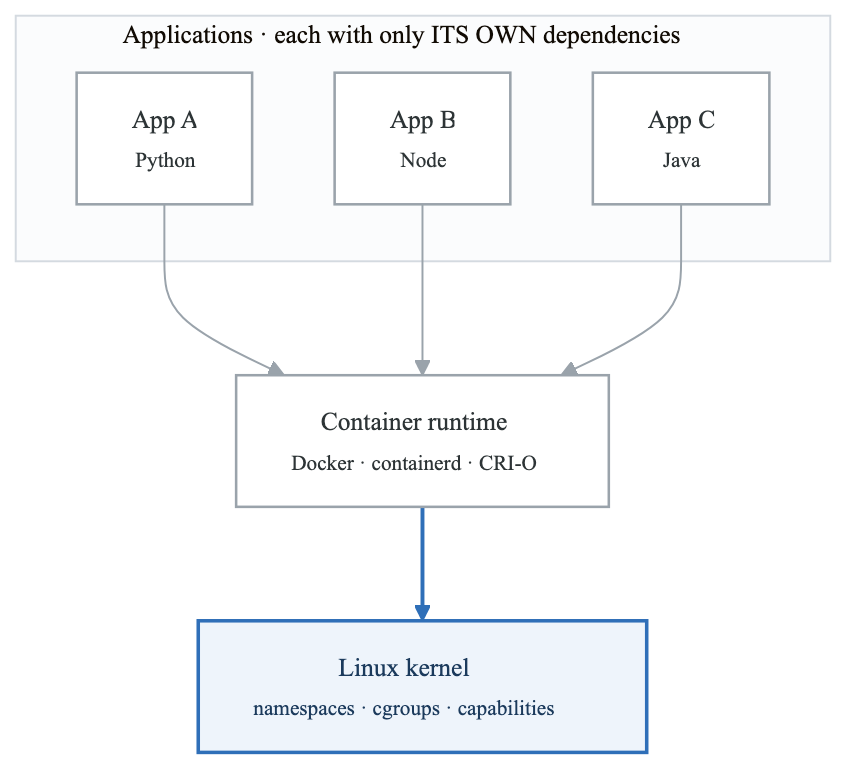

<details>
<summary>Diagram source (Mermaid)</summary>

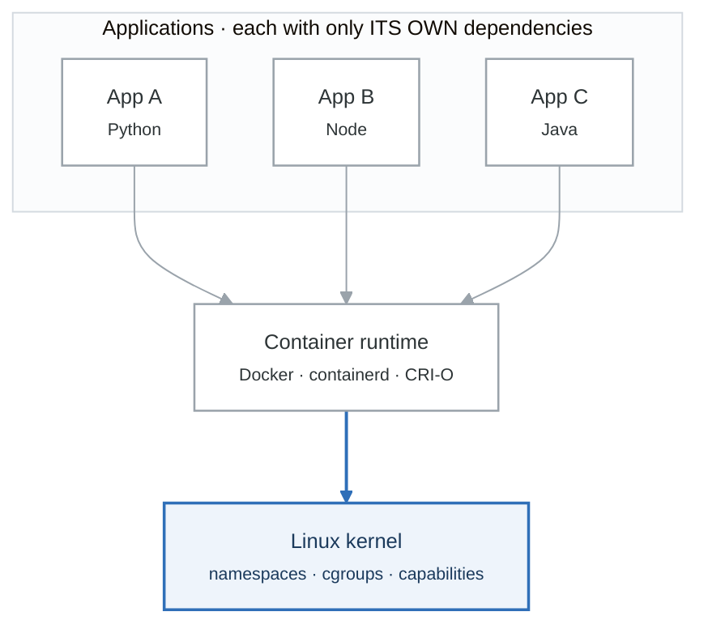

</details>

## Containers vs Virtual Machines

### Virtual Machines

<!-- figure: generated from the Mermaid below by _shared/diagrams/embed-figures.py — do not edit the image -->
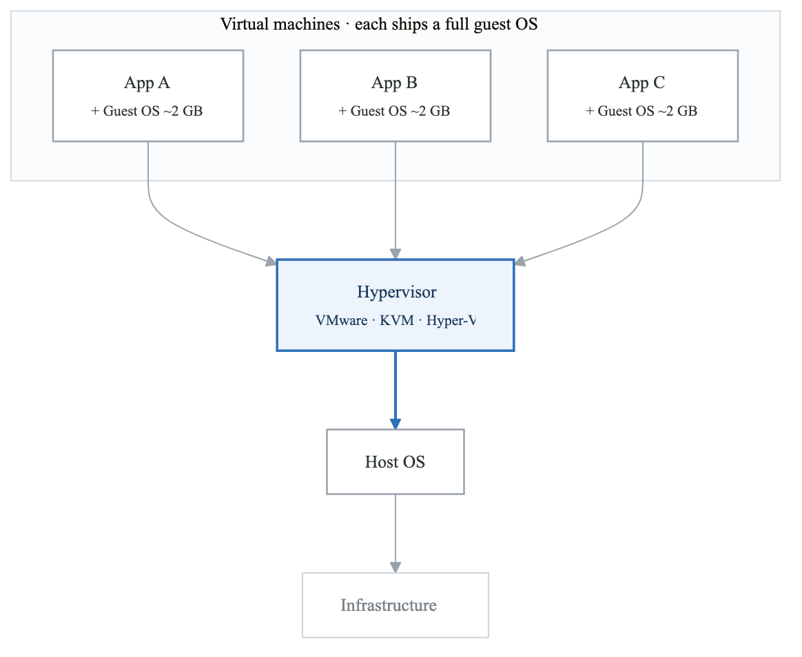

<details>
<summary>Diagram source (Mermaid)</summary>

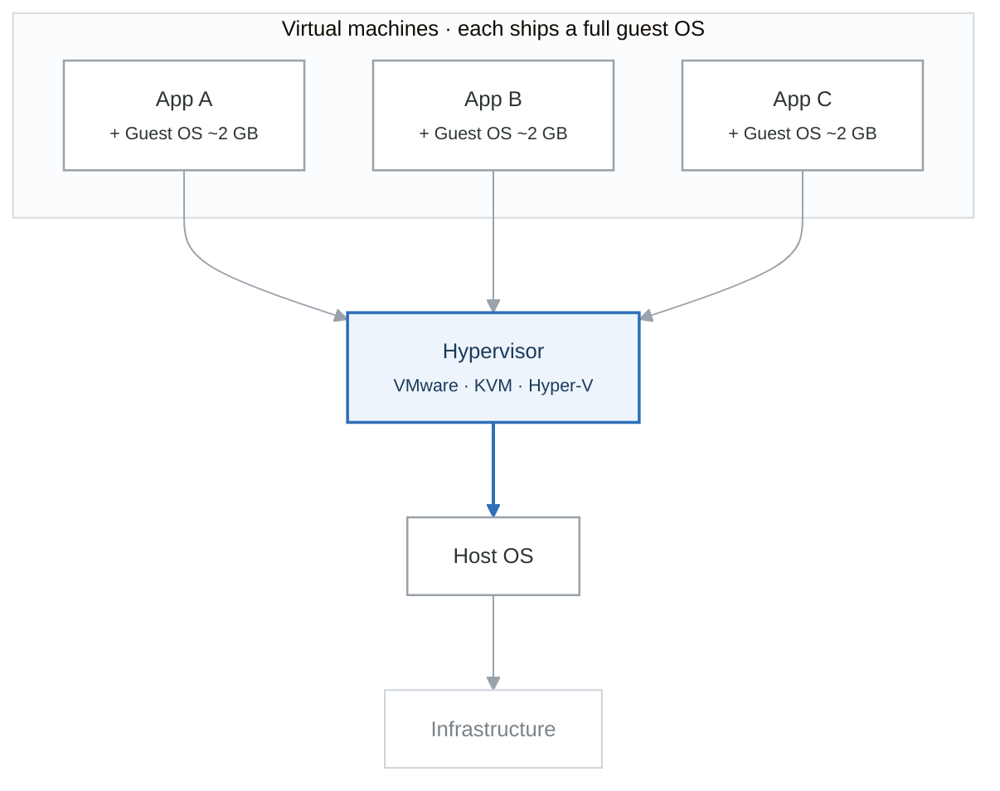

</details>

### Containers

<!-- figure: generated from the Mermaid below by _shared/diagrams/embed-figures.py — do not edit the image -->
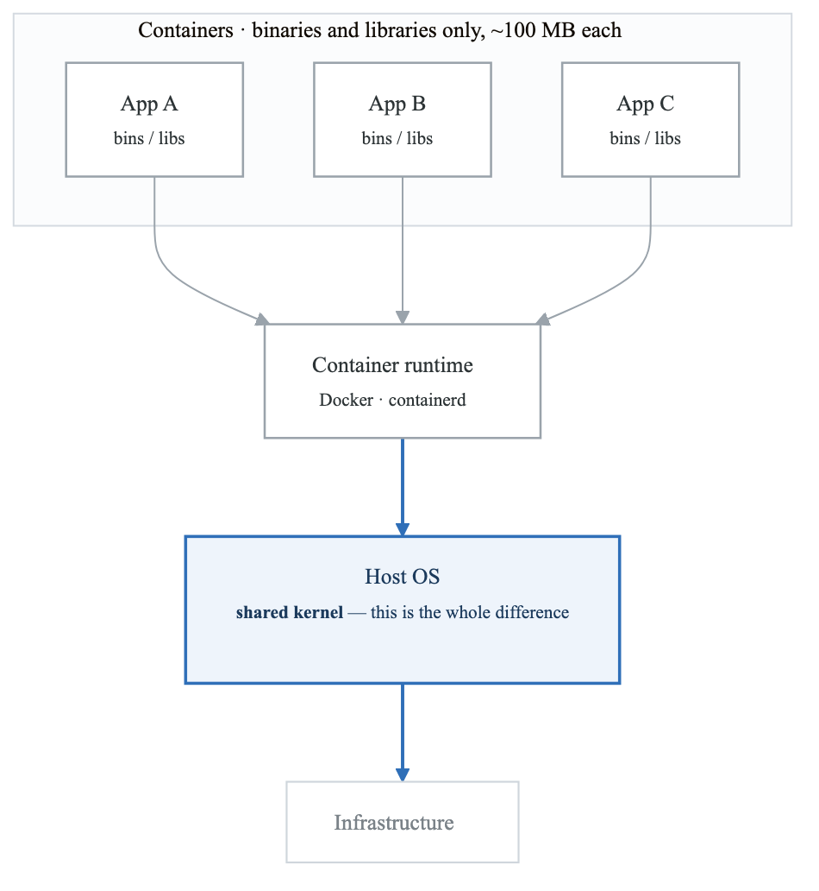

<details>
<summary>Diagram source (Mermaid)</summary>

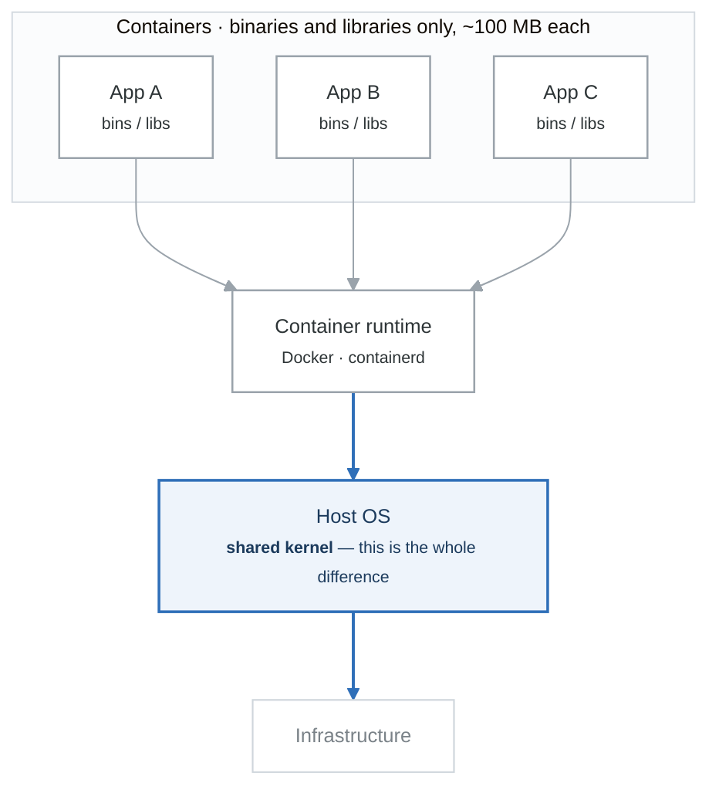

</details>

### Comparison

| Aspect | Virtual Machines | Containers |
|--------|-----------------|------------|
| **Isolation** | Strong (hardware-level) | Process-level (kernel-level) |
| **Size** | GBs (includes full OS) | MBs (shared kernel) |
| **Boot Time** | Minutes | Seconds |
| **Resource Overhead** | High (full OS per VM) | Low (shared kernel) |
| **Density** | 10-100 per host | 100-1000 per host |
| **Portability** | Less portable | Highly portable |
| **Use Cases** | Different OSes, legacy apps | Microservices, CI/CD |

## Linux Kernel Features

Containers rely on three key Linux kernel features:

### 1. Namespaces

Namespaces isolate system resources so each container has its own view.

| Namespace | Flag | Isolates |
|-----------|------|----------|
| pid | CLONE_NEWPID | Process IDs |
| net | CLONE_NEWNET | Network interfaces, routing, firewall |
| mnt | CLONE_NEWNS | Filesystem mounts |
| uts | CLONE_NEWUTS | Hostname and domain name |
| ipc | CLONE_NEWIPC | Inter-process communication |
| user | CLONE_NEWUSER | User and group IDs |
| cgroup | CLONE_NEWCGROUP | Cgroup root directory |

```bash
# View namespaces of a process
ls -la /proc/$$/ns/

# Create new namespace (example: network)
sudo unshare --net bash

# Inside new namespace
ip addr  # No network interfaces!
```

### 2. Control Groups (cgroups)

Cgroups limit and account for resource usage.

```bash
# View cgroup hierarchy
ls /sys/fs/cgroup/

# Key controllers:
# - cpu: CPU time allocation
# - memory: Memory limits
# - blkio: Block I/O limits
# - pids: Process count limits

# Example: Create memory-limited cgroup
sudo mkdir /sys/fs/cgroup/mygroup
echo 100M > /sys/fs/cgroup/mygroup/memory.max
echo $$ > /sys/fs/cgroup/mygroup/cgroup.procs
```

### 3. Union Filesystems

Union filesystems enable layered image storage.

**Container Layer**

```
        (Read-Write)
[Container's file changes]
        Image Layer 3
        (Read-Only)
[Application code: /app]
        Image Layer 2
        (Read-Only)
[Dependencies: /usr/lib]
        Image Layer 1
        (Read-Only)
[Base OS: ubuntu:22.04]
```


## Container Images

A container image is a read-only template containing:
- Application code
- Runtime environment
- System tools
- Libraries
- Configuration

### Image Layers

```bash
# View image layers
docker history nginx:latest

# Each instruction in Dockerfile creates a layer:
# FROM ubuntu:22.04     -> Layer 1 (base)
# RUN apt update        -> Layer 2 (package lists)
# RUN apt install nginx -> Layer 3 (nginx)
# COPY app/ /app        -> Layer 4 (application)
```

### Image Registries

**Image Registry**

**Public Registries:**

- Docker Hub (docker.io)
- GitHub Container Registry (ghcr.io)
- Google Container Registry (gcr.io)

**Private Registries:**

- AWS ECR
- Azure ACR
- Harbor (self-hosted)
- JFrog Artifactory


## Container Runtime Interface (CRI)

The CRI standardizes how container orchestrators interact with container runtimes.

<!-- figure: generated from the Mermaid below by _shared/diagrams/embed-figures.py — do not edit the image -->
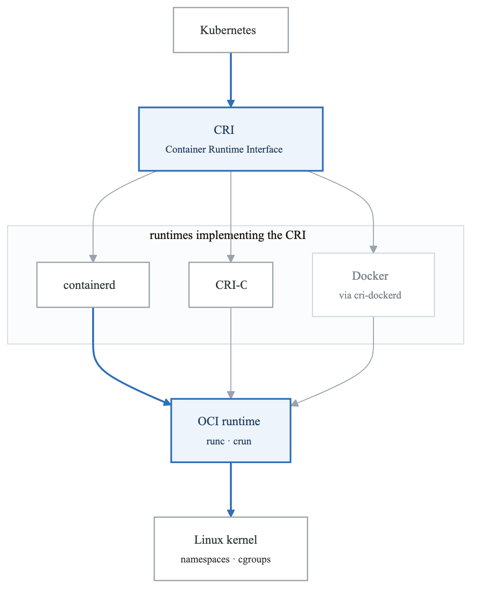

<details>
<summary>Diagram source (Mermaid)</summary>

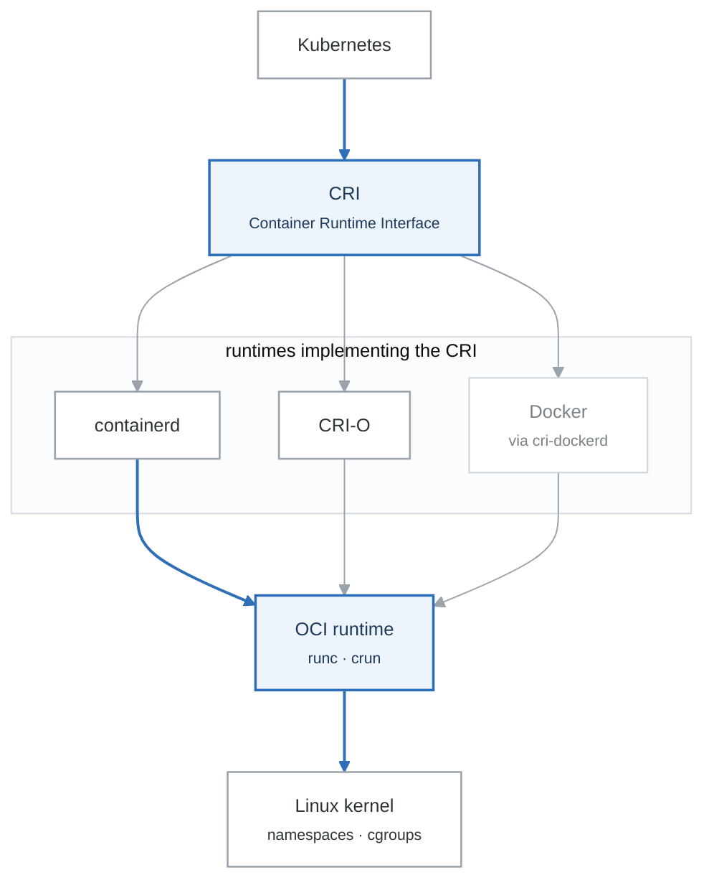

</details>

## Container Lifecycle

<!-- figure: generated from the Mermaid below by _shared/diagrams/embed-figures.py — do not edit the image -->
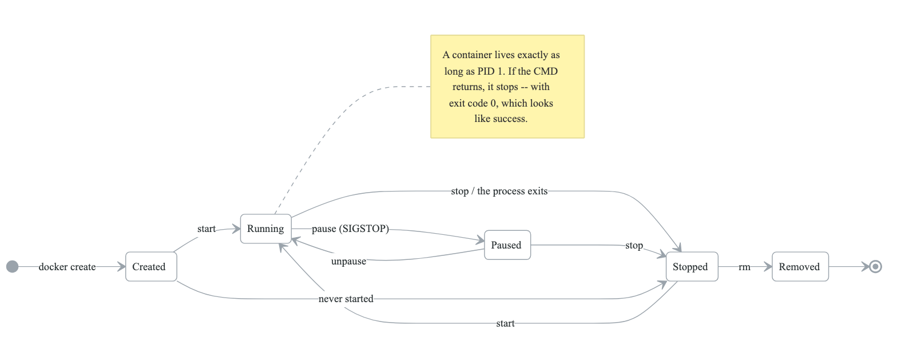

<details>
<summary>Diagram source (Mermaid)</summary>

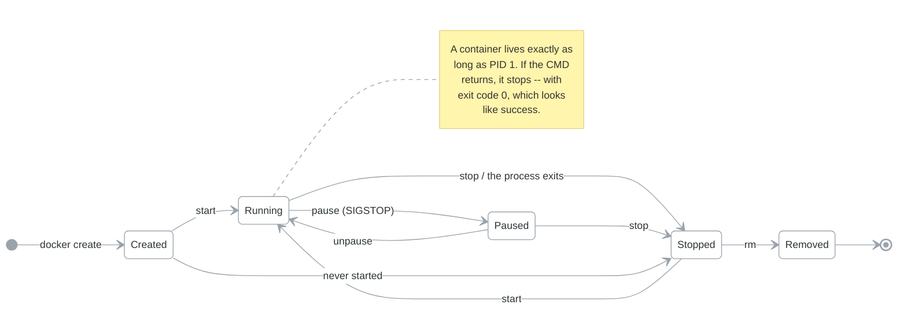

</details>

## Use Cases for Containers

### 1. Microservices Architecture

<!-- figure: generated from the Mermaid below by _shared/diagrams/embed-figures.py — do not edit the image -->
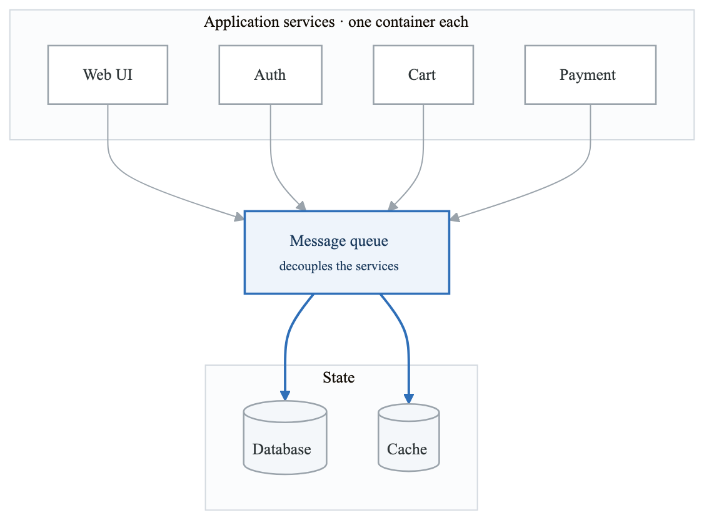

<details>
<summary>Diagram source (Mermaid)</summary>

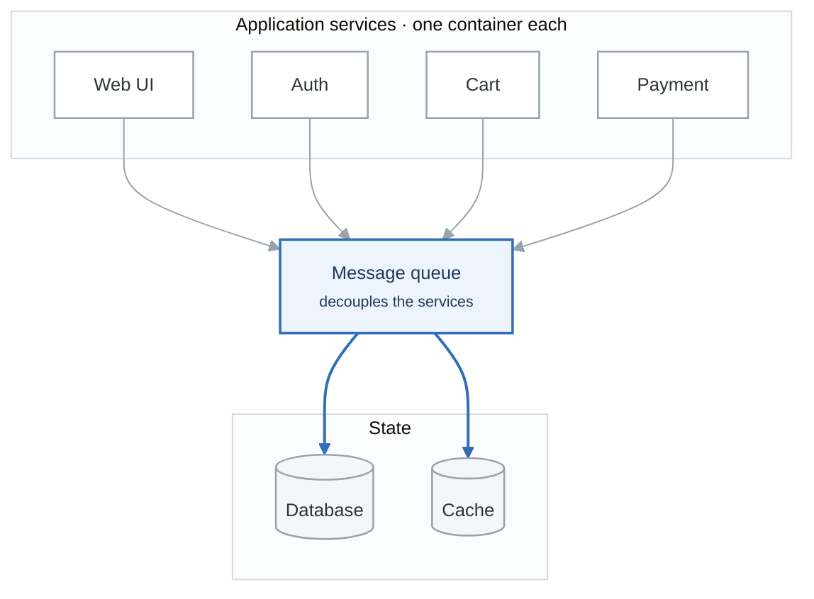

</details>

### 2. CI/CD Pipelines

```bash
# Each stage runs in a container
stages:
  - build:
      image: node:18-alpine
      script: npm install && npm run build

  - test:
      image: node:18-alpine
      script: npm test

  - security-scan:
      image: aquasec/trivy
      script: trivy image myapp:latest

  - deploy:
      image: kubectl:latest
      script: kubectl apply -f deployment.yaml
```

### 3. Local Development

```yaml
# docker-compose.yml for development
version: '3.8'
services:
  app:
    build: .
    volumes:
      - .:/app
    ports:
      - "3000:3000"
    environment:
      - DATABASE_URL=postgres://db:5432/mydb

  db:
    image: postgres:15
    volumes:
      - pgdata:/var/lib/postgresql/data

  redis:
    image: redis:7-alpine

volumes:
  pgdata:
```

## Benefits of Containerization

### 1. Consistency
- Same environment in development, testing, and production
- "Works on my machine" becomes "Works everywhere"

### 2. Isolation
- Applications don't interfere with each other
- Security boundaries between workloads

### 3. Efficiency
- Shared kernel reduces overhead
- Higher density than VMs
- Faster startup times

### 4. Portability
- Run anywhere Docker/containers are supported
- Cloud-agnostic deployments

### 5. Scalability
- Easy horizontal scaling
- Orchestration platforms manage thousands of containers

## Container Security Considerations

### Risks

1. **Shared Kernel**: Container escape vulnerabilities
2. **Image Security**: Vulnerabilities in base images
3. **Runtime Security**: Malicious container activity
4. **Network Security**: Container-to-container attacks

### Mitigations

```bash
# Run as non-root user
USER nobody

# Drop capabilities
docker run --cap-drop=ALL --cap-add=NET_BIND_SERVICE myapp

# Read-only filesystem
docker run --read-only myapp

# Resource limits
docker run --memory=256m --cpus=0.5 myapp

# Security scanning
trivy image myapp:latest
```

## Summary

Containers provide:
- Lightweight process isolation
- Consistent packaging and deployment
- Efficient resource utilization
- Foundation for modern architectures

Key concepts:
- Namespaces for isolation
- Cgroups for resource control
- Union filesystems for layered images
- Container runtime interface for orchestration

## Practice Exercises

1. Create a namespace isolation demo
2. Explore cgroup resource limits
3. Examine image layers
4. Compare container vs VM resource usage

## Next Module

Continue to [Docker Architecture](./02-docker-architecture.md) to learn about the Docker platform components.

<!-- feynman-check -->

---

## Feynman check

Close the file. Blank page, no notes. Explain each of these to a competent engineer who has never
used this tool — **under five minutes, no jargon you can't define on the spot:**

- What Are Containers?
- Containers vs Virtual Machines
- Linux Kernel Features
- Container Images

**The gap is not what you forgot. It is where you used a word instead of a mechanism.**

| | |
|---|---|
| ✗ | *"A container isolates the application."* |
| ✓ | *"A container is an ordinary Linux process started with namespaces (what it can see), cgroups (what it can use) and usually seccomp (what it may ask the kernel). There is no container object in the kernel — only a process with those features switched on."* |

**Trace it:** `docker run` → an isolated process. Name the namespaces in the order they are created, and which component actually calls `clone()`.

Stop at the first component you cannot name. Reopen this file and read **only** that.

**Go deeper — only once the gap has a name:** the [LWN namespaces series](https://lwn.net/Articles/531114/) — seven parts by the man-pages maintainer, and the reason containers stop being magic.
Full list per domain: [`SOURCES.md`](../SOURCES.md#containers)

→ Protocol, the three levels of knowing, and worked examples: [`MASTERY.md`](../MASTERY.md)

<!-- /feynman-check -->
