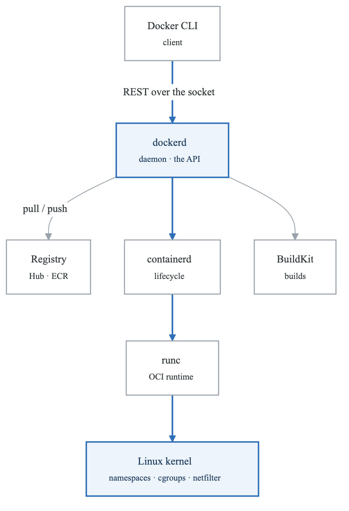
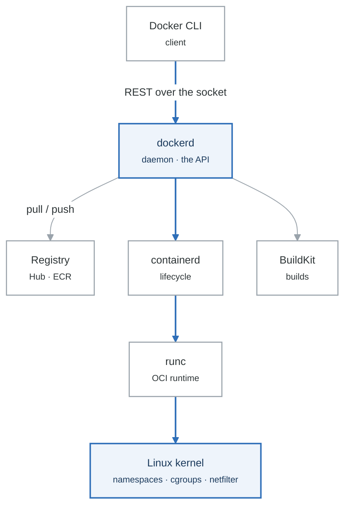
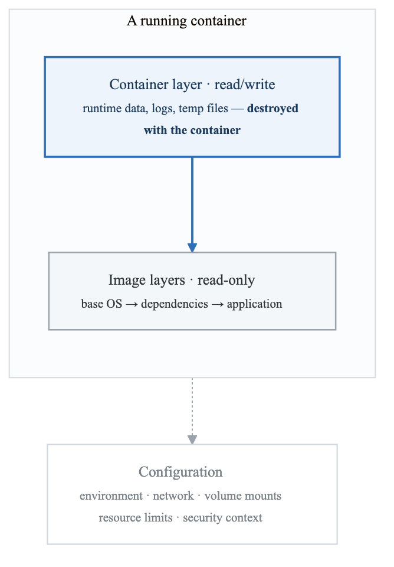
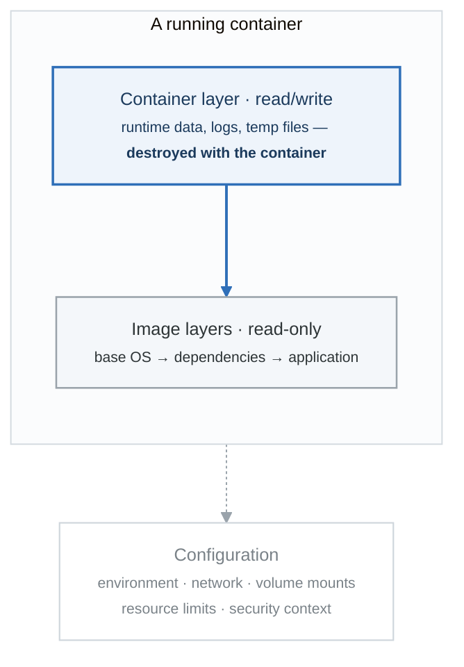
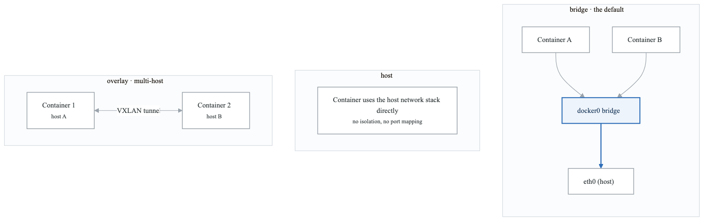
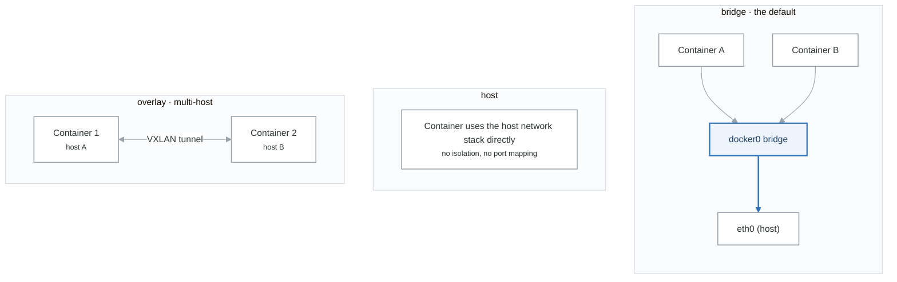
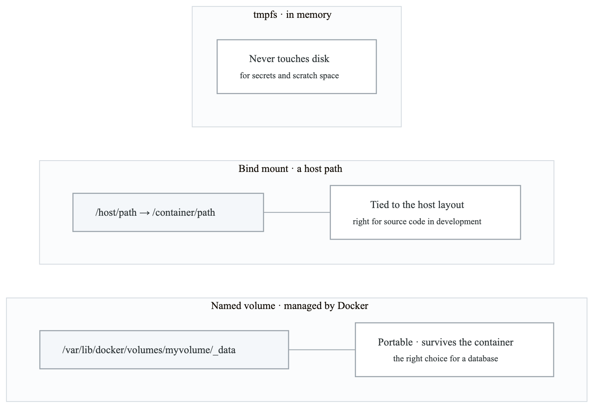
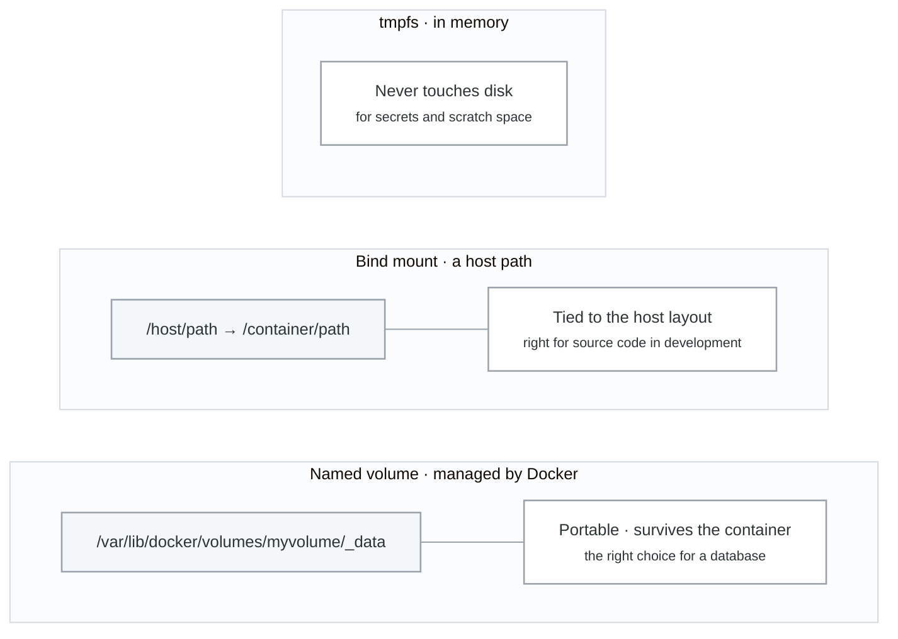

# Docker Architecture

## Introduction

Docker is a platform for developing, shipping, and running applications in containers. Understanding its architecture is essential for effective container management.

## Docker Platform Overview

<!-- figure: generated from the Mermaid below by _shared/diagrams/embed-figures.py — do not edit the image -->


<details>
<summary>Diagram source (Mermaid)</summary>



</details>

## Core Components

### 1. Docker Client (CLI)

The Docker client is the primary interface for users to interact with Docker.

```bash
# Docker client communicates via REST API
docker version
docker info

# Client commands translate to API calls
docker run nginx
# Becomes: POST /containers/create + POST /containers/{id}/start

# Environment variables
export DOCKER_HOST=tcp://remote-host:2375
export DOCKER_TLS_VERIFY=1
export DOCKER_CERT_PATH=/path/to/certs
```

### 2. Docker Daemon (dockerd)

The daemon manages Docker objects (images, containers, networks, volumes).

```bash
# Start Docker daemon
sudo systemctl start docker

# Daemon configuration
cat /etc/docker/daemon.json
{
  "storage-driver": "overlay2",
  "log-driver": "json-file",
  "log-opts": {
    "max-size": "10m",
    "max-file": "3"
  },
  "default-address-pools": [
    {"base": "172.17.0.0/16", "size": 24}
  ],
  "live-restore": true,
  "userland-proxy": false
}

# Reload configuration
sudo systemctl reload docker
```

### 3. containerd

The high-level container runtime that manages container lifecycle.

```bash
# containerd manages:
# - Image pulling/pushing
# - Container execution
# - Storage (snapshots)
# - Networking (CNI)

# View containerd status
sudo ctr version
sudo ctr namespaces list
sudo ctr containers list

# containerd is daemon-independent
# Containers can survive dockerd restarts with live-restore
```

### 4. runc

The low-level OCI-compliant container runtime.

```bash
# runc creates containers from OCI bundles
# Components of OCI bundle:
# - config.json (runtime specification)
# - rootfs/ (filesystem)

# Example: Create container with runc
mkdir -p mycontainer/rootfs
docker export $(docker create alpine) | tar -C mycontainer/rootfs -xf -
runc spec -b mycontainer/
runc run -b mycontainer/ mycontainer1
```

## Docker Objects

### Images

**Docker Image**

**Manifest (metadata)**

- Config (environment, cmd, entrypoint)
- Layer digests

**Layers (content-addressable)**

- Layer 1: base OS files
- Layer 2: package installations
- Layer 3: application code
- Layer N: configuration


```bash
# Image commands
docker images                    # List images
docker pull nginx:latest         # Pull image
docker push myrepo/myimage:tag   # Push image
docker build -t myapp:1.0 .      # Build image
docker tag myapp:1.0 myapp:latest # Tag image
docker rmi myapp:1.0             # Remove image
docker image prune               # Remove unused images

# Image inspection
docker inspect nginx:latest
docker history nginx:latest
docker manifest inspect nginx:latest
```

### Containers

<!-- figure: generated from the Mermaid below by _shared/diagrams/embed-figures.py — do not edit the image -->


<details>
<summary>Diagram source (Mermaid)</summary>



</details>

```bash
# Container lifecycle
docker create nginx              # Create container
docker start container_id        # Start container
docker run -d nginx              # Create and start
docker stop container_id         # Stop gracefully
docker kill container_id         # Force stop
docker rm container_id           # Remove container

# Container operations
docker exec -it container bash   # Execute command
docker logs container            # View logs
docker stats                     # Resource usage
docker top container             # Process list
docker inspect container         # Detailed info
```

### Networks

<!-- figure: generated from the Mermaid below by _shared/diagrams/embed-figures.py — do not edit the image -->


<details>
<summary>Diagram source (Mermaid)</summary>



</details>

```bash
# Network commands
docker network ls                           # List networks
docker network create mynetwork             # Create network
docker network connect mynetwork container  # Connect container
docker network disconnect mynetwork container
docker network inspect mynetwork
docker network rm mynetwork

# Create with options
docker network create \
  --driver bridge \
  --subnet 172.28.0.0/16 \
  --ip-range 172.28.5.0/24 \
  --gateway 172.28.5.254 \
  mynetwork
```

### Volumes

<!-- figure: generated from the Mermaid below by _shared/diagrams/embed-figures.py — do not edit the image -->


<details>
<summary>Diagram source (Mermaid)</summary>



</details>

```bash
# Volume commands
docker volume ls                    # List volumes
docker volume create myvolume       # Create volume
docker volume inspect myvolume      # Inspect volume
docker volume rm myvolume           # Remove volume
docker volume prune                 # Remove unused

# Mount options
docker run -v myvolume:/data nginx  # Named volume
docker run -v /host/path:/container/path nginx  # Bind mount
docker run --tmpfs /tmp nginx       # tmpfs mount
docker run --mount type=volume,source=myvolume,target=/data nginx
```

## Docker Storage Drivers

Storage drivers handle how images and containers are stored.

**Storage Drivers**

**overlay2 (recommended)**

- Best performance on modern kernels
- Uses OverlayFS
- Default on most systems

**devicemapper**

- Block-level storage
- Good for RHEL/CentOS
- Requires configuration

**`btrfs/zfs`**

- Advanced features
- Snapshots, compression
- Requires filesystem support


```bash
# Check storage driver
docker info | grep "Storage Driver"

# Configure storage driver
cat > /etc/docker/daemon.json << EOF
{
  "storage-driver": "overlay2",
  "storage-opts": [
    "overlay2.override_kernel_check=true"
  ]
}
EOF
```

## Docker Registry

Registries store and distribute Docker images.

**Docker Registry**

Image Reference Format:
[registry/][namespace/]repository[:tag|@digest]

**Examples:**

- nginx — (docker.io/library/nginx:latest)
- nginx:1.21 — (docker.io/library/nginx:1.21)
- myuser/myapp:v1.0
- gcr.io/project/image:tag
- `123456789.dkr.ecr.us-east-1.amazonaws.com/myapp`


```bash
# Registry operations
docker login                         # Login to Docker Hub
docker login gcr.io                  # Login to GCR
docker login 123456789.dkr.ecr.us-east-1.amazonaws.com

# Push/Pull
docker pull nginx
docker tag nginx myregistry.com/nginx:v1
docker push myregistry.com/nginx:v1

# Run local registry
docker run -d -p 5000:5000 registry:2
docker tag myapp localhost:5000/myapp
docker push localhost:5000/myapp
```

## BuildKit

Modern image builder with advanced features.

```bash
# Enable BuildKit
export DOCKER_BUILDKIT=1

# BuildKit features:
# - Parallel builds
# - Build caching
# - Secret mounting
# - SSH forwarding

# Build with BuildKit
docker build --secret id=mysecret,src=secret.txt .

# Dockerfile with secrets
RUN --mount=type=secret,id=mysecret cat /run/secrets/mysecret

# Multi-platform builds
docker buildx create --use
docker buildx build --platform linux/amd64,linux/arm64 -t myapp:multi .
```

## Docker API

Docker exposes a REST API for programmatic access.

```bash
# Enable remote API
cat > /etc/docker/daemon.json << EOF
{
  "hosts": ["unix:///var/run/docker.sock", "tcp://0.0.0.0:2375"]
}
EOF

# API examples (using curl)
# List containers
curl --unix-socket /var/run/docker.sock http://localhost/containers/json

# Create container
curl --unix-socket /var/run/docker.sock \
  -H "Content-Type: application/json" \
  -d '{"Image": "nginx"}' \
  http://localhost/containers/create

# Start container
curl --unix-socket /var/run/docker.sock \
  -X POST \
  http://localhost/containers/{id}/start
```

## Security Considerations

### Docker Daemon Security

```bash
# Run daemon rootless (experimental)
dockerd-rootless-setuptool.sh install

# Use TLS for remote access
dockerd \
  --tlsverify \
  --tlscacert=ca.pem \
  --tlscert=server-cert.pem \
  --tlskey=server-key.pem \
  -H tcp://0.0.0.0:2376

# Client with TLS
docker --tlsverify \
  --tlscacert=ca.pem \
  --tlscert=client-cert.pem \
  --tlskey=client-key.pem \
  -H tcp://host:2376 version
```

### Container Security

```bash
# Run as non-root
docker run --user 1000:1000 myapp

# Read-only filesystem
docker run --read-only myapp

# Drop capabilities
docker run --cap-drop=ALL --cap-add=NET_BIND_SERVICE myapp

# Security options
docker run --security-opt=no-new-privileges myapp
docker run --security-opt=seccomp=profile.json myapp
```

## Summary

Docker architecture consists of:
- **Client**: User interface (CLI, API)
- **Daemon**: Manages Docker objects
- **containerd**: High-level runtime
- **runc**: Low-level OCI runtime
- **Registry**: Image distribution

Key objects:
- Images: Read-only templates
- Containers: Running instances
- Networks: Container connectivity
- Volumes: Persistent storage

## Practice Exercises

1. Explore Docker daemon configuration
2. Use Docker API directly
3. Set up a private registry
4. Configure BuildKit features

## Next Module

Continue to [Working with Images](./03-docker-images.md) to learn about building and managing Docker images.

<!-- feynman-check -->

---

## Feynman check

Close the file. Blank page, no notes. Explain each of these to a competent engineer who has never
used this tool — **under five minutes, no jargon you can't define on the spot:**

- Docker Platform Overview
- Core Components
- Docker Objects
- Docker Storage Drivers

**The gap is not what you forgot. It is where you used a word instead of a mechanism.**

| | |
|---|---|
| ✗ | *"A container isolates the application."* |
| ✓ | *"A container is an ordinary Linux process started with namespaces (what it can see), cgroups (what it can use) and usually seccomp (what it may ask the kernel). There is no container object in the kernel — only a process with those features switched on."* |

**Trace it:** `docker run` → an isolated process. Name the namespaces in the order they are created, and which component actually calls `clone()`.

Stop at the first component you cannot name. Reopen this file and read **only** that.

**Go deeper — only once the gap has a name:** the [LWN namespaces series](https://lwn.net/Articles/531114/) — seven parts by the man-pages maintainer, and the reason containers stop being magic.
Full list per domain: [`SOURCES.md`](../SOURCES.md#containers)

→ Protocol, the three levels of knowing, and worked examples: [`MASTERY.md`](../MASTERY.md)

<!-- /feynman-check -->
