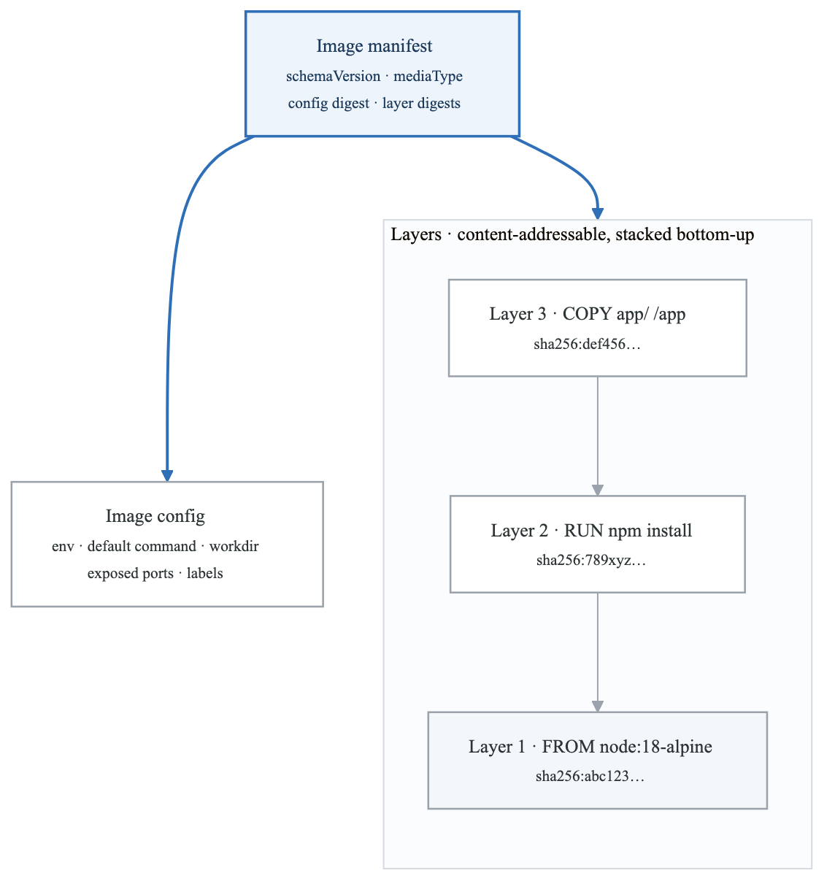
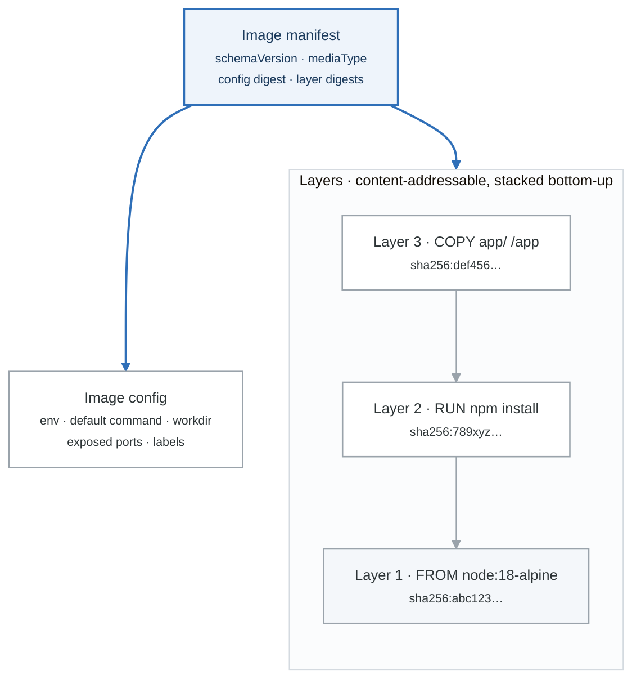

# Working with Docker Images

## Introduction

Docker images are the foundation of containers. Understanding how to build, manage, and optimize images is crucial for efficient container deployments.

## Image Basics

### Image Structure

<!-- figure: generated from the Mermaid below by _shared/diagrams/embed-figures.py — do not edit the image -->


<details>
<summary>Diagram source (Mermaid)</summary>



</details>

### Image Naming Convention

**[registry/][namespace/]repository[:tag|@digest]**

| Item | What it is |
|---|---|
| nginx | Docker Hub official |
| nginx:1.21-alpine | With tag |
| myuser/myapp:v1.0 | User namespace |
| gcr.io/project/image:latest | Google Container Registry |
| 123456789.dkr.ecr.us-east-1.amazonaws.com/myapp:v1 | AWS ECR |
| nginx@sha256:abc123... | With digest (immutable) |


## Pulling Images

```bash
# Pull from Docker Hub
docker pull nginx
docker pull nginx:1.21
docker pull nginx:1.21-alpine

# Pull from other registries
docker pull gcr.io/google-samples/hello-app:1.0
docker pull quay.io/prometheus/prometheus:latest

# Pull by digest (immutable reference)
docker pull nginx@sha256:abc123def456...

# Pull all tags
docker pull -a nginx

# Check if image exists
docker manifest inspect nginx:latest
```

## Building Images

### Dockerfile Basics

```dockerfile
# Basic Dockerfile structure
FROM ubuntu:22.04

# Set metadata
LABEL maintainer="developer@example.com"
LABEL version="1.0"

# Set environment variables
ENV APP_HOME=/app
ENV NODE_ENV=production

# Set working directory
WORKDIR $APP_HOME

# Copy files
COPY package*.json ./

# Run commands
RUN apt-get update && \
    apt-get install -y nodejs npm && \
    npm install && \
    apt-get clean && \
    rm -rf /var/lib/apt/lists/*

# Copy application code
COPY . .

# Expose port
EXPOSE 3000

# Set user
USER node

# Define default command
CMD ["node", "server.js"]
```

### Build Commands

```bash
# Basic build
docker build -t myapp:1.0 .

# Build with specific Dockerfile
docker build -f Dockerfile.prod -t myapp:prod .

# Build with build arguments
docker build --build-arg VERSION=1.0 -t myapp:1.0 .

# Build without cache
docker build --no-cache -t myapp:1.0 .

# Build with target stage (multi-stage)
docker build --target builder -t myapp:builder .

# Build and push
docker build -t myregistry.com/myapp:1.0 . && \
docker push myregistry.com/myapp:1.0
```

### Multi-Stage Builds

```dockerfile
# Multi-stage build for smaller images
# Stage 1: Build
FROM node:18 AS builder
WORKDIR /app
COPY package*.json ./
RUN npm ci
COPY . .
RUN npm run build

# Stage 2: Production
FROM node:18-alpine AS production
WORKDIR /app
COPY --from=builder /app/dist ./dist
COPY --from=builder /app/node_modules ./node_modules
COPY package*.json ./
USER node
EXPOSE 3000
CMD ["node", "dist/server.js"]

# Stage 3: Development
FROM node:18 AS development
WORKDIR /app
COPY package*.json ./
RUN npm install
COPY . .
EXPOSE 3000
CMD ["npm", "run", "dev"]
```

```bash
# Build specific stage
docker build --target production -t myapp:prod .
docker build --target development -t myapp:dev .
```

## Image Layers

### Understanding Layers

```bash
# View layer history
docker history nginx:latest

# Example output:
IMAGE          CREATED       CREATED BY                                      SIZE
a8758716bb6a   2 weeks ago   /bin/sh -c #(nop)  CMD ["nginx" "-g" "daemon…   0B
<missing>      2 weeks ago   /bin/sh -c #(nop)  STOPSIGNAL SIGQUIT           0B
<missing>      2 weeks ago   /bin/sh -c #(nop)  EXPOSE 80                    0B
<missing>      2 weeks ago   /bin/sh -c #(nop)  ENTRYPOINT ["/docker-ent…    0B
<missing>      2 weeks ago   /bin/sh -c set -x     && addgroup --system …    89.4MB
<missing>      2 weeks ago   /bin/sh -c #(nop)  ENV NGINX_VERSION=1.23.2     0B
<missing>      2 weeks ago   /bin/sh -c #(nop)  LABEL maintainer=NGINX D…   0B
<missing>      2 weeks ago   /bin/sh -c #(nop)  CMD ["bash"]                 0B
<missing>      2 weeks ago   /bin/sh -c #(nop) ADD file:45f5dfa59f6b0e5f…    80.4MB
```

### Layer Caching

```dockerfile
# Bad: Cache invalidated frequently
COPY . .
RUN npm install

# Good: Dependencies cached separately
COPY package*.json ./
RUN npm install
COPY . .
```

**Layer cache behaviour, by what changed**

| Step | no changes | code changed | `package.json` changed |
|---|---|---|---|
| `FROM node:18` | cache | cache | cache |
| `COPY package.json` | cache | cache | **rebuild** |
| `RUN npm install` | cache | cache | **rebuild** |
| `COPY . .` | cache | **rebuild** | **rebuild** |

A layer invalidates every layer below it. That is the whole argument for copying
the dependency manifest before the source: a code change should not reinstall
your dependencies.

## Image Management

### Listing and Inspecting

```bash
# List images
docker images
docker images --filter "dangling=true"
docker images --format "{{.Repository}}:{{.Tag}} {{.Size}}"

# Inspect image
docker inspect nginx:latest
docker inspect --format='{{.Config.Env}}' nginx:latest
docker inspect --format='{{.RootFS.Layers}}' nginx:latest

# View image size details
docker system df
docker system df -v
```

### Tagging Images

```bash
# Tag image
docker tag myapp:latest myapp:v1.0
docker tag myapp:latest myregistry.com/myapp:v1.0
docker tag myapp:latest myregistry.com/myapp:latest

# Retag image
docker tag myapp:latest myapp:stable
```

### Removing Images

```bash
# Remove specific image
docker rmi myapp:v1.0

# Remove multiple images
docker rmi myapp:v1.0 myapp:v2.0

# Force remove (even if containers exist)
docker rmi -f myapp:v1.0

# Remove dangling images
docker image prune

# Remove all unused images
docker image prune -a

# Remove images by filter
docker image prune -a --filter "until=24h"
```

## Pushing Images

```bash
# Login to registry
docker login
docker login gcr.io
docker login 123456789.dkr.ecr.us-east-1.amazonaws.com

# Push image
docker push myuser/myapp:v1.0
docker push gcr.io/myproject/myapp:v1.0

# Push all tags
docker push myuser/myapp --all-tags
```

## Image Optimization

### Reduce Image Size

```dockerfile
# 1. Use smaller base images
FROM node:18-alpine  # Instead of node:18

# 2. Multi-stage builds
FROM node:18 AS builder
RUN npm run build

FROM node:18-alpine
COPY --from=builder /app/dist ./dist

# 3. Minimize layers
RUN apt-get update && \
    apt-get install -y package1 package2 && \
    apt-get clean && \
    rm -rf /var/lib/apt/lists/*

# 4. Use .dockerignore
# .dockerignore file:
node_modules
.git
*.md
tests/
```

### Security Best Practices

```dockerfile
# 1. Use specific tags (not :latest)
FROM node:18.12.1-alpine3.17

# 2. Run as non-root
RUN addgroup -g 1001 appgroup && \
    adduser -u 1001 -G appgroup -D appuser
USER appuser

# 3. Scan for vulnerabilities
# docker scan myapp:v1.0

# 4. Use trusted base images
FROM cgr.dev/chainguard/node:latest

# 5. Don't store secrets in images
# Use build secrets instead
RUN --mount=type=secret,id=api_key \
    cat /run/secrets/api_key
```

## Image Scanning

```bash
# Scan with Docker
docker scan myapp:v1.0

# Scan with Trivy
trivy image myapp:v1.0

# Scan with Grype
grype myapp:v1.0

# Scan with Snyk
snyk container test myapp:v1.0

# Example: Integrate in CI/CD
#!/bin/bash
docker build -t myapp:$CI_COMMIT_SHA .
trivy image --exit-code 1 --severity HIGH,CRITICAL myapp:$CI_COMMIT_SHA
docker push myapp:$CI_COMMIT_SHA
```

## Image Distribution

### Save and Load

```bash
# Save image to tar file
docker save -o myapp.tar myapp:v1.0
docker save myapp:v1.0 | gzip > myapp.tar.gz

# Load image from tar file
docker load -i myapp.tar
docker load < myapp.tar.gz

# Transfer between hosts
docker save myapp:v1.0 | ssh user@host docker load
```

### Export and Import

```bash
# Export container filesystem
docker export container_id > container.tar

# Import as image
docker import container.tar myimage:v1.0

# Note: import loses metadata (env, cmd, etc.)
```

## Summary

Key concepts:
- Images are layered, read-only templates
- Use multi-stage builds for optimization
- Layer caching improves build speed
- Security scanning is essential
- Proper tagging enables versioning

Best practices:
- Use specific base image tags
- Optimize layer ordering for caching
- Minimize image size
- Run as non-root user
- Scan for vulnerabilities

## Practice Exercises

1. Build a multi-stage image
2. Optimize an image for size
3. Set up a local registry
4. Scan images for vulnerabilities

## Next Module

Continue to [Dockerfile Best Practices](./04-dockerfile-best-practices.md) for advanced image building techniques.

<!-- feynman-check -->

---

## Feynman check

Close the file. Blank page, no notes. Explain each of these to a competent engineer who has never
used this tool — **under five minutes, no jargon you can't define on the spot:**

- Image Basics
- Pulling Images
- Building Images
- Image Layers

**The gap is not what you forgot. It is where you used a word instead of a mechanism.**

| | |
|---|---|
| ✗ | *"A container isolates the application."* |
| ✓ | *"A container is an ordinary Linux process started with namespaces (what it can see), cgroups (what it can use) and usually seccomp (what it may ask the kernel). There is no container object in the kernel — only a process with those features switched on."* |

**Trace it:** `docker run` → an isolated process. Name the namespaces in the order they are created, and which component actually calls `clone()`.

Stop at the first component you cannot name. Reopen this file and read **only** that.

**Go deeper — only once the gap has a name:** the [LWN namespaces series](https://lwn.net/Articles/531114/) — seven parts by the man-pages maintainer, and the reason containers stop being magic.
Full list per domain: [`SOURCES.md`](../SOURCES.md#containers)

→ Protocol, the three levels of knowing, and worked examples: [`MASTERY.md`](../MASTERY.md)

<!-- /feynman-check -->
