# Container Networking

## Introduction

Understanding Docker networking is essential for building distributed applications. This module covers Docker's networking model, network drivers, and best practices for container communication.

## Docker Network Model

### Overview

<!-- figure: generated from the Mermaid below by _shared/diagrams/embed-figures.py — do not edit the image -->
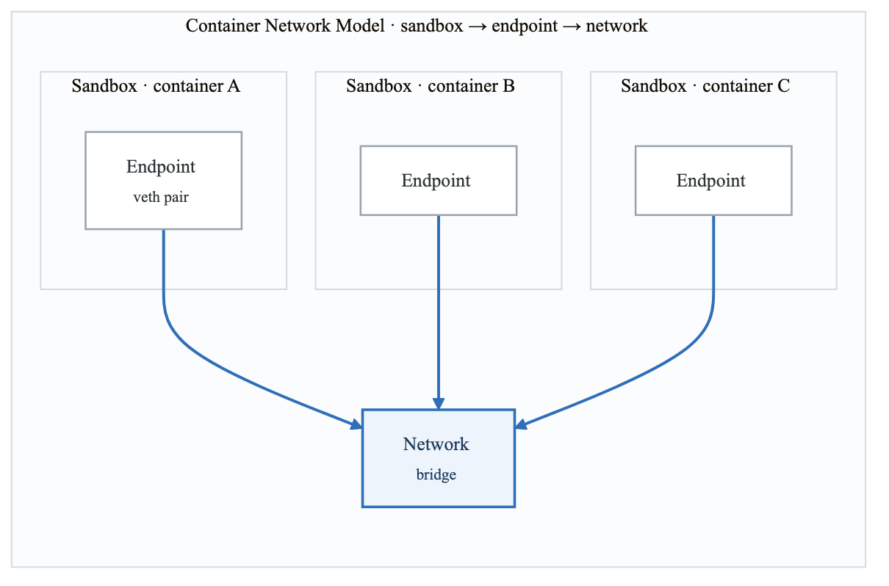

<details>
<summary>Diagram source (Mermaid)</summary>

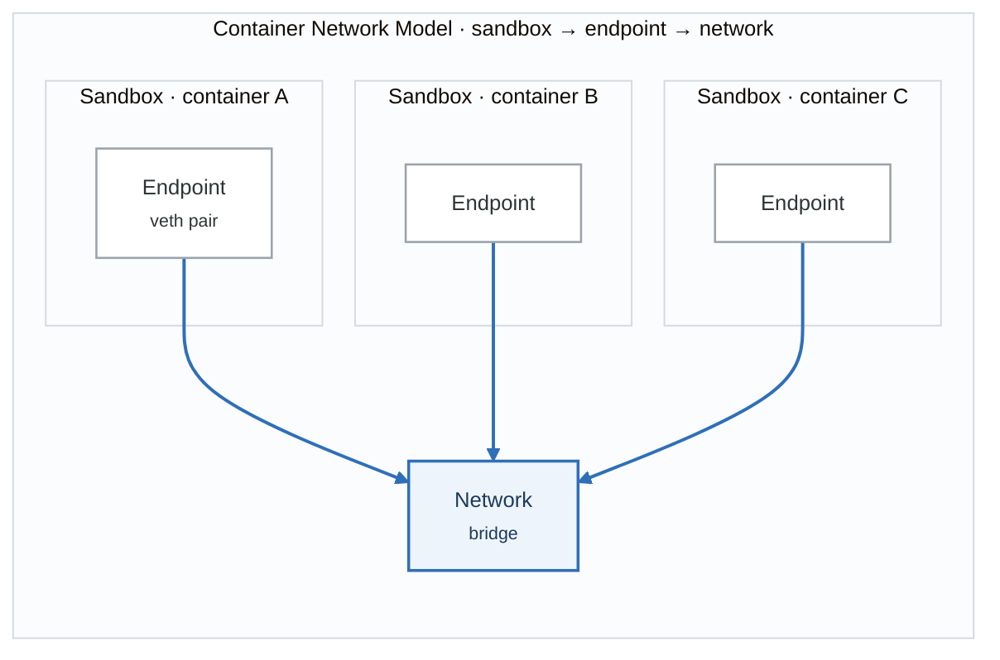

</details>

## Network Drivers

### Driver Overview

| Network Drivers |  |  |
|---|---|---|
| Driver | Scope | Use Case |
| bridge | local | Default, containers on same host |
| host | local | No isolation, use host network |
| none | local | No networking |
| overlay | swarm | Multi-host networking |
| macvlan | local | Assign MAC address to container |
| ipvlan | local | Assign IP from host subnet |


### Bridge Network (Default)

<!-- figure: generated from the Mermaid below by _shared/diagrams/embed-figures.py — do not edit the image -->
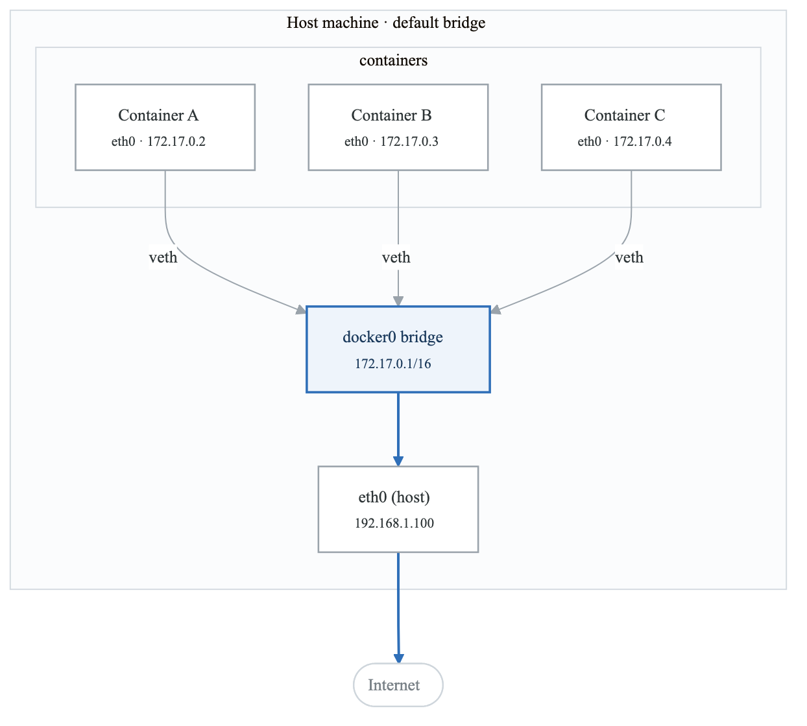

<details>
<summary>Diagram source (Mermaid)</summary>

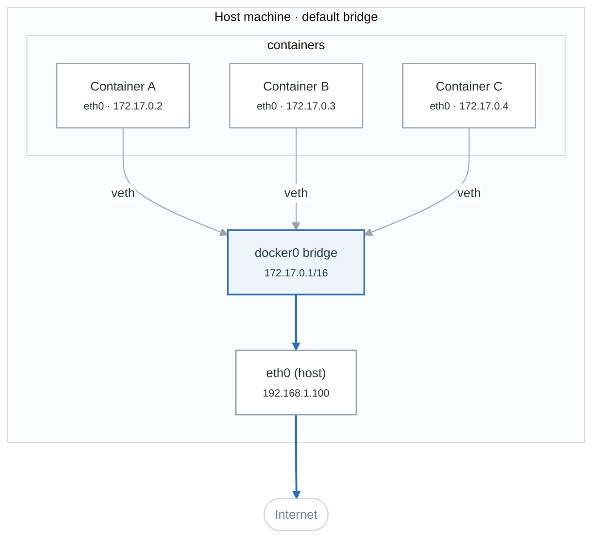

</details>

```bash
# View default bridge network
docker network inspect bridge

# Create containers on default bridge
docker run -d --name web nginx
docker run -d --name app python:3.11

# Containers can communicate via IP (not names on default bridge)
docker exec app ping 172.17.0.2
```

### User-Defined Bridge Networks

```bash
# Create custom bridge network
docker network create mynetwork

# Create with options
docker network create \
  --driver bridge \
  --subnet 172.28.0.0/16 \
  --ip-range 172.28.5.0/24 \
  --gateway 172.28.5.254 \
  --opt com.docker.network.bridge.name=mybridge \
  mynetwork

# Run containers on custom network
docker run -d --name web --network mynetwork nginx
docker run -d --name app --network mynetwork python:3.11

# Automatic DNS resolution by container name
docker exec app ping web
docker exec app curl http://web

# Connect existing container to network
docker network connect mynetwork existing_container

# Disconnect from network
docker network disconnect mynetwork container_name
```

### User-Defined vs Default Bridge

| User-Defined vs Default Bridge |  |  |
|---|---|---|
| Feature | Default Bridge | User-Defined Bridge |
| DNS resolution | IP only | Container names ✓ |
| Auto container links | Yes (legacy) | Not needed |
| Network isolation | Less control | Better isolation ✓ |
| Connect/disconnect | Restart needed | Live connect ✓ |
| Environment vars | Shared | Isolated ✓ |
| Recommendation: Always use user-defined networks! |  |  |


### Host Network

<!-- figure: generated from the Mermaid below by _shared/diagrams/embed-figures.py — do not edit the image -->
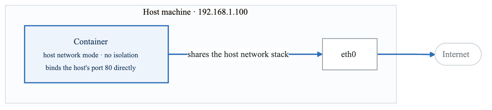

<details>
<summary>Diagram source (Mermaid)</summary>

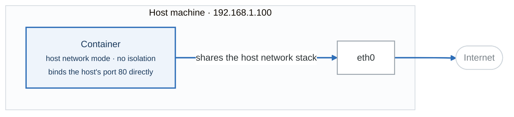

</details>

```bash
# Run with host network
docker run -d --network host nginx

# No port mapping needed - container uses host ports directly
# Best for performance-critical applications
# Note: Not available on Docker Desktop for Mac/Windows
```

### None Network

```bash
# Container with no network
docker run -d --network none alpine

# Only loopback interface available
docker exec container_name ip addr
# lo: 127.0.0.1/8
```

### Overlay Network (Multi-Host)

<!-- figure: generated from the Mermaid below by _shared/diagrams/embed-figures.py — do not edit the image -->
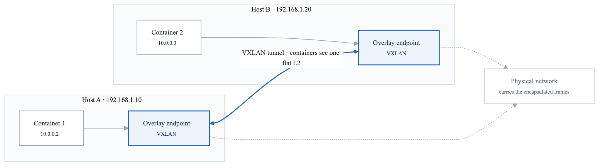

<details>
<summary>Diagram source (Mermaid)</summary>

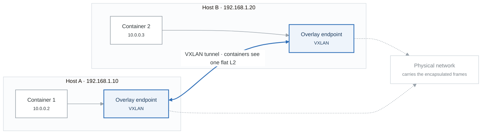

</details>

```bash
# Initialize Docker Swarm (required for overlay)
docker swarm init

# Create overlay network
docker network create \
  --driver overlay \
  --attachable \
  --subnet 10.0.0.0/24 \
  my-overlay

# Create service on overlay network
docker service create \
  --name web \
  --network my-overlay \
  --replicas 3 \
  nginx

# Attachable allows standalone containers to join
docker run -d --network my-overlay --name standalone alpine
```

### Macvlan Network

<!-- figure: generated from the Mermaid below by _shared/diagrams/embed-figures.py — do not edit the image -->
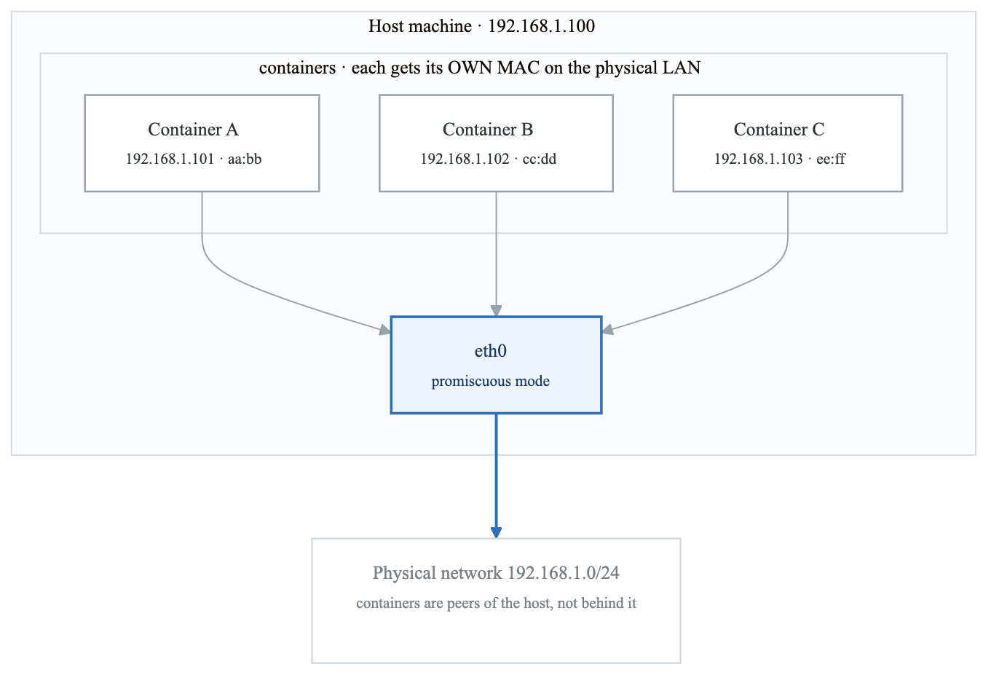

<details>
<summary>Diagram source (Mermaid)</summary>

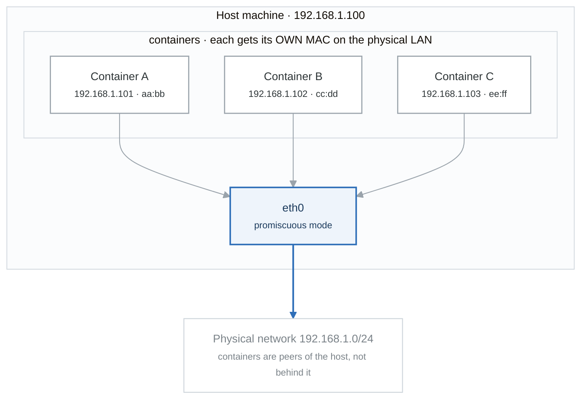

</details>

```bash
# Create macvlan network
docker network create \
  --driver macvlan \
  --subnet 192.168.1.0/24 \
  --gateway 192.168.1.1 \
  --opt parent=eth0 \
  macvlan-net

# Run container with specific IP
docker run -d \
  --network macvlan-net \
  --ip 192.168.1.101 \
  --name web \
  nginx

# Containers get IPs on physical network
# Direct layer 2 connectivity
```

## Port Publishing

### Port Mapping Options

```bash
# Publish specific port
docker run -d -p 8080:80 nginx
# Host:8080 → Container:80

# Publish to specific interface
docker run -d -p 127.0.0.1:8080:80 nginx
# Only localhost:8080 → Container:80

# Publish random port
docker run -d -p 80 nginx
# Random host port → Container:80

# Publish all exposed ports
docker run -d -P nginx
# Random ports for all EXPOSE ports

# UDP ports
docker run -d -p 53:53/udp dns-server

# Multiple ports
docker run -d \
  -p 80:80 \
  -p 443:443 \
  -p 8080:8080 \
  nginx

# View port mappings
docker port container_name
```

### Port Publishing Internals

<!-- figure: generated from the Mermaid below by _shared/diagrams/embed-figures.py — do not edit the image -->
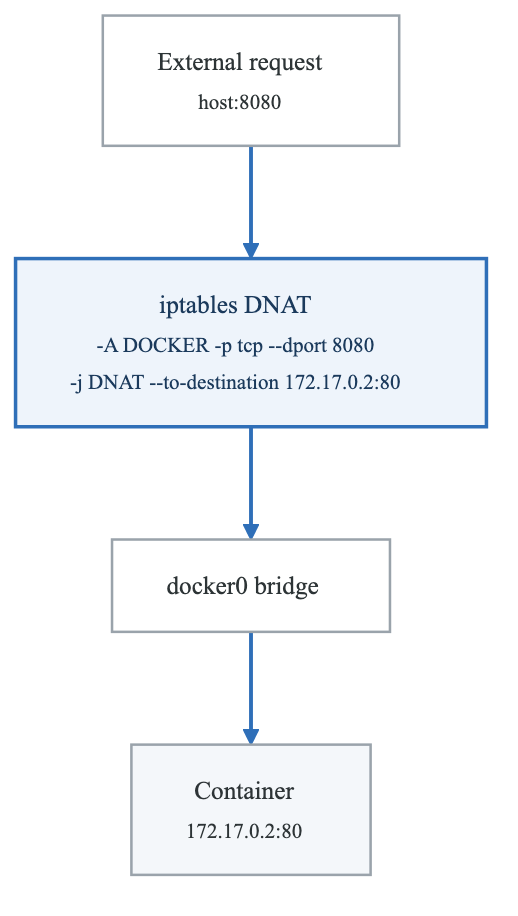

<details>
<summary>Diagram source (Mermaid)</summary>

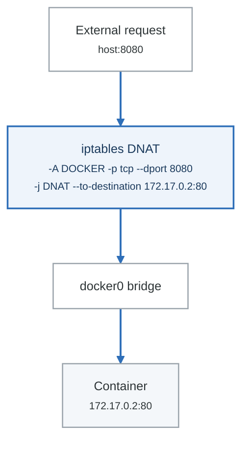

</details>

```bash
# View iptables rules created by Docker
sudo iptables -t nat -L -n -v

# Docker creates rules in DOCKER chain
# PREROUTING → DOCKER chain for port forwarding
```

## DNS and Service Discovery

### Docker DNS

<!-- figure: generated from the Mermaid below by _shared/diagrams/embed-figures.py — do not edit the image -->
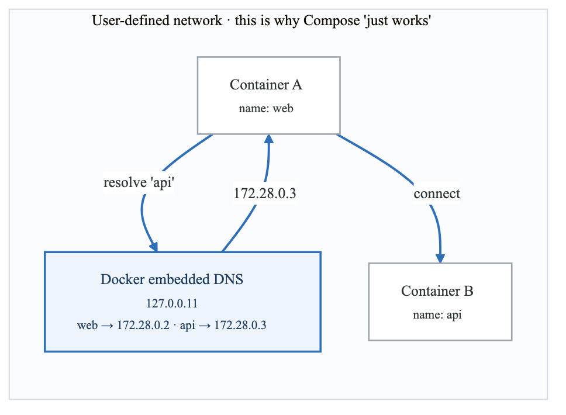

<details>
<summary>Diagram source (Mermaid)</summary>

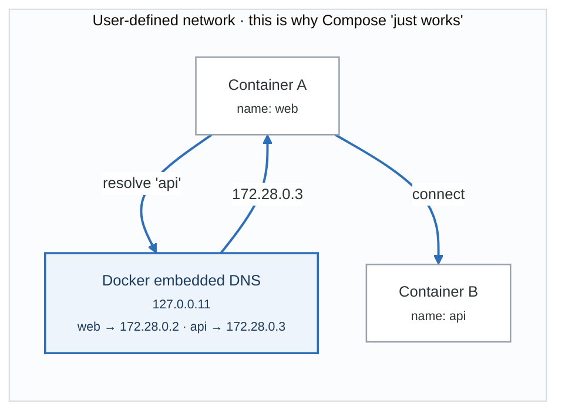

</details>

```bash
# DNS resolution by container name
docker network create mynet
docker run -d --name web --network mynet nginx
docker run -d --name api --network mynet python:3.11

# From api container
docker exec api nslookup web
# web.mynet → 172.28.0.2

docker exec api ping web
docker exec api curl http://web
```

### Network Aliases

```bash
# Create container with alias
docker run -d \
  --name web1 \
  --network mynet \
  --network-alias webserver \
  nginx

docker run -d \
  --name web2 \
  --network mynet \
  --network-alias webserver \
  nginx

# Both containers respond to "webserver"
docker run --rm --network mynet alpine nslookup webserver
# Returns both IPs (round-robin DNS)
```

### Custom DNS Configuration

```bash
# Custom DNS servers
docker run -d \
  --dns 8.8.8.8 \
  --dns 8.8.4.4 \
  nginx

# DNS search domains
docker run -d \
  --dns-search example.com \
  --dns-search test.local \
  nginx

# Custom hostname
docker run -d \
  --hostname mycontainer.local \
  nginx

# Add hosts entries
docker run -d \
  --add-host database:192.168.1.100 \
  --add-host cache:192.168.1.101 \
  myapp
```

## Network Security

### Network Isolation

```bash
# Containers on different networks are isolated
docker network create frontend
docker network create backend

docker run -d --name web --network frontend nginx
docker run -d --name api --network backend python:3.11
docker run -d --name db --network backend postgres

# web cannot reach db (different networks)
# api can reach db (same network)

# Connect container to multiple networks
docker network connect frontend api
# Now api can reach both web and db
```

### Internal Networks

```bash
# Create internal network (no external access)
docker network create \
  --internal \
  internal-net

# Containers can communicate with each other
# But cannot access external network
docker run -d --name internal-app --network internal-net alpine

# This will fail:
docker exec internal-app ping 8.8.8.8
```

### Encrypted Overlay Networks

```bash
# Create encrypted overlay network
docker network create \
  --driver overlay \
  --opt encrypted \
  secure-overlay

# All traffic between nodes is encrypted
# Uses IPsec with automatic key rotation
```

## Container-to-Container Communication

### Same Host Communication

```bash
# Method 1: User-defined network (recommended)
docker network create app-net
docker run -d --name web --network app-net nginx
docker run -d --name api --network app-net myapi

# Method 2: Linking (legacy, not recommended)
docker run -d --name db postgres
docker run -d --name app --link db myapp

# Method 3: Shared network namespace
docker run -d --name web nginx
docker run -d --network container:web sidecar
# sidecar shares web's network namespace
```

### Communication Patterns

<!-- figure: generated from the Mermaid below by _shared/diagrams/embed-figures.py — do not edit the image -->
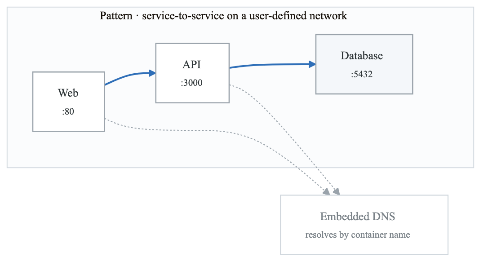

<details>
<summary>Diagram source (Mermaid)</summary>

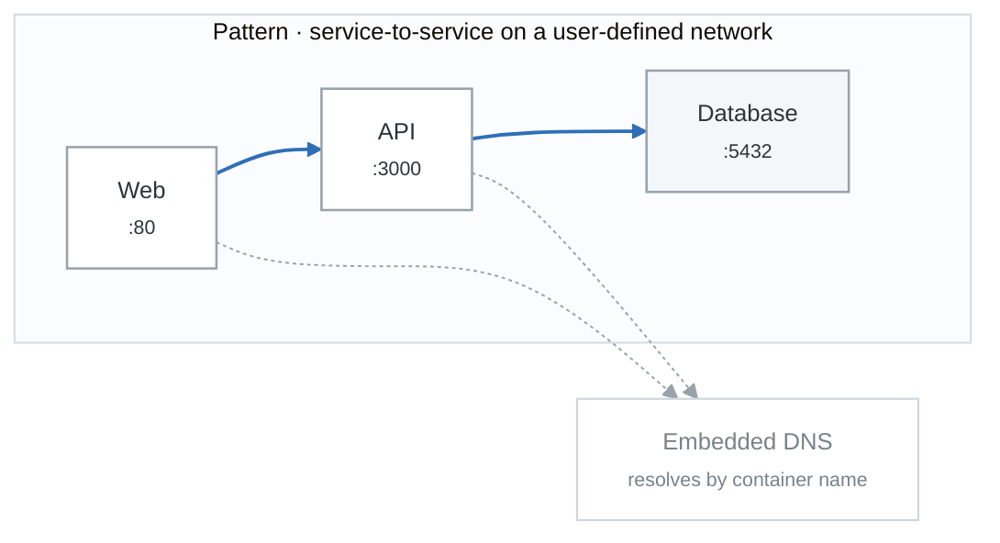

</details>

## Docker Compose Networking

### Default Network Behavior

```yaml
# docker-compose.yml
version: '3.8'
services:
  web:
    image: nginx
    ports:
      - "80:80"

  api:
    image: myapi
    # Can reach web via hostname "web"

  db:
    image: postgres
    # Can reach api via hostname "api"

# Creates network: projectname_default
# All services join default network
# DNS: service names resolve to container IPs
```

### Custom Networks

```yaml
version: '3.8'

services:
  web:
    image: nginx
    networks:
      - frontend
    ports:
      - "80:80"

  api:
    image: myapi
    networks:
      - frontend
      - backend

  db:
    image: postgres
    networks:
      - backend

  cache:
    image: redis
    networks:
      - backend

networks:
  frontend:
    driver: bridge
  backend:
    driver: bridge
    internal: true  # No external access
```

### Network Configuration

```yaml
version: '3.8'

services:
  app:
    image: myapp
    networks:
      app-net:
        ipv4_address: 172.28.0.10
        aliases:
          - myapp
          - api

networks:
  app-net:
    driver: bridge
    ipam:
      driver: default
      config:
        - subnet: 172.28.0.0/16
          ip_range: 172.28.5.0/24
          gateway: 172.28.5.254
    driver_opts:
      com.docker.network.bridge.name: app-bridge
```

### External Networks

```yaml
version: '3.8'

services:
  app:
    image: myapp
    networks:
      - shared-net

networks:
  shared-net:
    external: true
    name: my-existing-network
```

## Network Troubleshooting

### Diagnostic Commands

```bash
# List networks
docker network ls

# Inspect network
docker network inspect mynetwork

# View container network settings
docker inspect --format='{{json .NetworkSettings}}' container_name

# View container IP address
docker inspect --format='{{range .NetworkSettings.Networks}}{{.IPAddress}}{{end}}' container_name

# Test connectivity from container
docker exec container_name ping other_container
docker exec container_name curl http://other_container:port
docker exec container_name nslookup other_container

# Debug DNS
docker exec container_name cat /etc/resolv.conf

# Check listening ports
docker exec container_name netstat -tlnp
docker exec container_name ss -tlnp

# Trace network path
docker exec container_name traceroute target_host
```

### Common Issues

```bash
# Issue: Cannot resolve container name
# Solution: Use user-defined network
docker network create mynet
docker run --network mynet --name web nginx

# Issue: Port already in use
# Solution: Find and stop conflicting process
lsof -i :80
docker ps --filter "publish=80"

# Issue: Cannot reach container from host
# Solution: Check port publishing
docker run -p 8080:80 nginx

# Issue: Containers cannot reach internet
# Solution: Check Docker daemon settings
# /etc/docker/daemon.json
{
  "dns": ["8.8.8.8", "8.8.4.4"]
}

# Issue: Network conflict
# Solution: Use different subnet
docker network create --subnet 10.10.0.0/16 mynet
```

### Network Debugging Container

```bash
# Run network debugging container
docker run -it --rm \
  --network container:target_container \
  nicolaka/netshoot

# Available tools: curl, ping, dig, nslookup, netstat, ss,
#                  tcpdump, iptables, traceroute, mtr, etc.
```

## Summary

Key concepts:
- Docker uses Container Network Model (CNM)
- User-defined networks provide DNS resolution
- Multiple network drivers for different use cases
- Port publishing uses iptables NAT
- Network isolation enhances security

Best practices:
- Always use user-defined networks
- Use internal networks for backend services
- Minimize exposed ports
- Use network aliases for service discovery
- Enable encryption for sensitive traffic

## Practice Exercises

1. Create multi-tier application with isolated networks
2. Implement service discovery with DNS
3. Configure macvlan for direct network access
4. Set up overlay network across multiple hosts

## Next Module

Continue to [Container Storage](./06-container-storage.md) to learn about persistent data management.

<!-- feynman-check -->

---

## Feynman check

Close the file. Blank page, no notes. Explain each of these to a competent engineer who has never
used this tool — **under five minutes, no jargon you can't define on the spot:**

- Docker Network Model
- Network Drivers
- Port Publishing
- DNS and Service Discovery

**The gap is not what you forgot. It is where you used a word instead of a mechanism.**

| | |
|---|---|
| ✗ | *"A container isolates the application."* |
| ✓ | *"A container is an ordinary Linux process started with namespaces (what it can see), cgroups (what it can use) and usually seccomp (what it may ask the kernel). There is no container object in the kernel — only a process with those features switched on."* |

**Trace it:** `docker run` → an isolated process. Name the namespaces in the order they are created, and which component actually calls `clone()`.

Stop at the first component you cannot name. Reopen this file and read **only** that.

**Go deeper — only once the gap has a name:** the [LWN namespaces series](https://lwn.net/Articles/531114/) — seven parts by the man-pages maintainer, and the reason containers stop being magic.
Full list per domain: [`SOURCES.md`](../SOURCES.md#containers)

→ Protocol, the three levels of knowing, and worked examples: [`MASTERY.md`](../MASTERY.md)

<!-- /feynman-check -->
