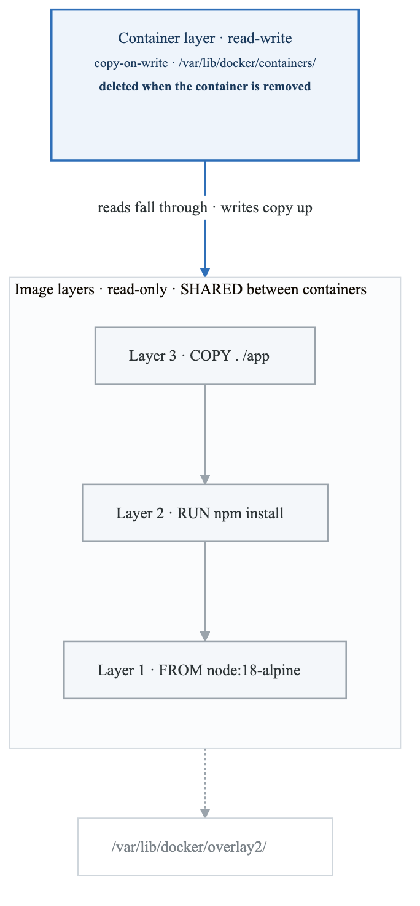
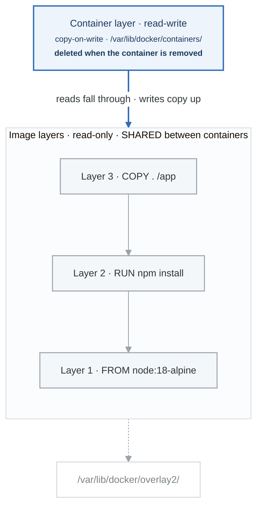
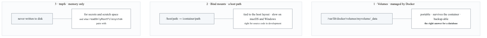
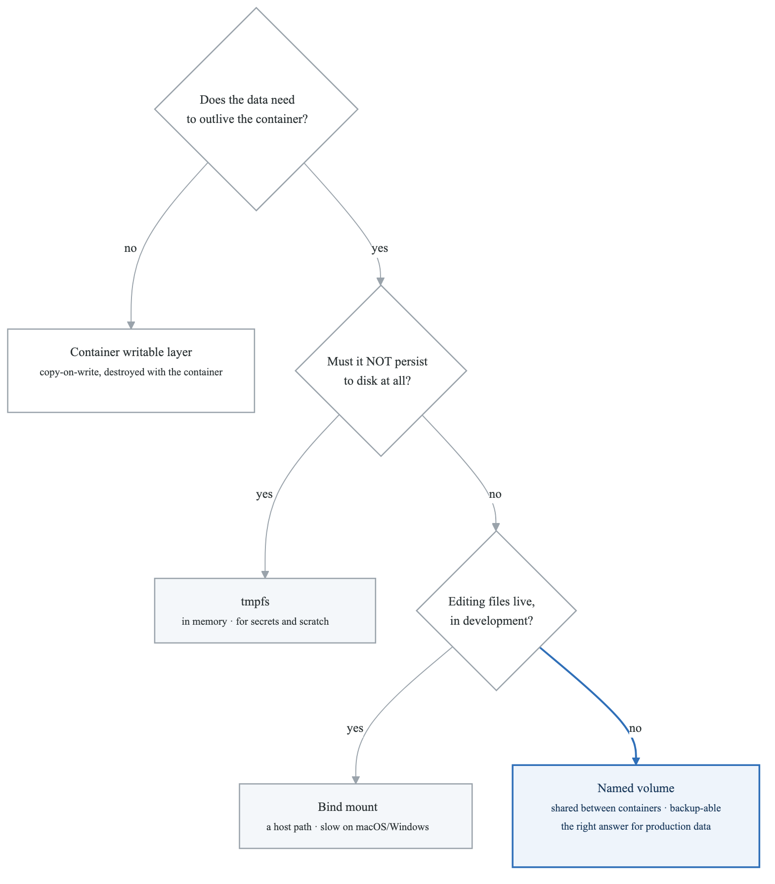
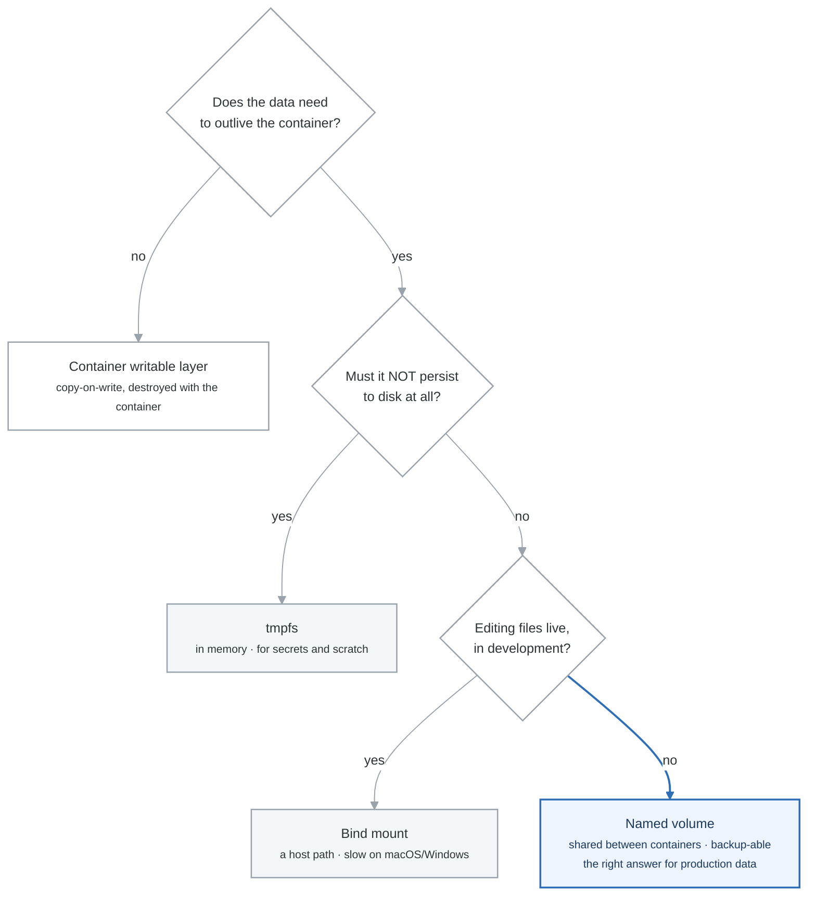

# Container Storage

## Introduction

Containers are ephemeral by design, meaning data stored inside a container is lost when the container is removed. This module covers Docker's storage options for persisting data beyond the container lifecycle.

## Storage Overview

### Container Filesystem

<!-- figure: generated from the Mermaid below by _shared/diagrams/embed-figures.py — do not edit the image -->


<details>
<summary>Diagram source (Mermaid)</summary>



</details>

### Storage Types

```mermaid
%%{init: {'theme':'base','themeVariables':{'fontFamily':'Helvetica, Arial, sans-serif','fontSize':'13px','primaryColor':'#ffffff','primaryTextColor':'#2d3436','primaryBorderColor':'#9aa3ab','lineColor':'#9aa3ab','textColor':'#2d3436','clusterBkg':'#fbfcfd','clusterBorder':'#d4dae0','edgeLabelBackground':'#ffffff','tertiaryColor':'#eef4fb'},'flowchart':{'curve':'basis','padding':14,'nodeSpacing':42,'rankSpacing':58}}}%%
flowchart TB
  classDef default fill:#ffffff,stroke:#9aa3ab,stroke-width:1.3px,color:#2d3436
  classDef n    fill:#ffffff,stroke:#9aa3ab,stroke-width:1.3px,color:#2d3436
  classDef crit fill:#eef4fb,stroke:#2f6fb8,stroke-width:1.8px,color:#1b3a5c
  classDef data fill:#f4f7fa,stroke:#9aa3ab,stroke-width:1.3px,color:#2d3436
  classDef mut  fill:#ffffff,stroke:#cfd6dc,stroke-width:1.1px,color:#7a8288
  classDef warn fill:#fdf0ec,stroke:#c0522d,stroke-width:1.6px,color:#8a3a1e
  subgraph V["1 · Volumes · managed by Docker"]
    direction LR
    V1["/var/lib/docker/volumes/myvolume/_data"]:::data
    V2["portable · survives the container · backup-able<br/><small><b>the right answer for a database</b></small>"]:::n
  end
  subgraph B["2 · Bind mounts · a host path"]
    direction LR
    B1["/host/path → /container/path"]:::data
    B2["tied to the host layout · slow on macOS and Windows<br/><small>right for source code in development</small>"]:::n
  end
  subgraph T["3 · tmpfs · memory only"]
    direction LR
    T1["never written to disk"]:::data
    T2["for secrets and scratch space<br/><small>and what <code>readOnlyRootFilesystem</code> pairs with</small>"]:::n
  end

  V1 --- V2
  B1 --- B2
  T1 --- T2
```

<!-- figure: generated from the Mermaid below by _shared/diagrams/embed-figures.py — do not edit the image -->


<details>
<summary>Diagram source (Mermaid)</summary>



</details>

## Volumes

### Creating and Managing Volumes

```bash
# Create a volume
docker volume create myvolume

# Create with options
docker volume create \
  --driver local \
  --opt type=none \
  --opt device=/path/to/dir \
  --opt o=bind \
  myvolume

# List volumes
docker volume ls

# Inspect volume
docker volume inspect myvolume

# Remove volume
docker volume rm myvolume

# Remove all unused volumes
docker volume prune

# Remove volumes with filter
docker volume prune --filter "label!=keep"
```

### Using Volumes with Containers

```bash
# Mount volume (named volume)
docker run -d \
  --name db \
  -v myvolume:/var/lib/postgresql/data \
  postgres:15

# Mount volume (anonymous volume)
docker run -d \
  --name db \
  -v /var/lib/postgresql/data \
  postgres:15

# Using --mount flag (more explicit)
docker run -d \
  --name db \
  --mount type=volume,source=myvolume,target=/var/lib/postgresql/data \
  postgres:15

# Read-only volume
docker run -d \
  --name app \
  --mount type=volume,source=config,target=/app/config,readonly \
  myapp

# Volume with options
docker run -d \
  --name db \
  --mount type=volume,source=dbdata,target=/data,volume-opt=type=nfs,volume-opt=device=:/path \
  postgres:15
```

### Volume Drivers

```bash
# Local driver (default)
docker volume create --driver local myvolume

# NFS volume
docker volume create \
  --driver local \
  --opt type=nfs \
  --opt o=addr=192.168.1.100,rw \
  --opt device=:/path/to/share \
  nfs-volume

# CIFS/SMB volume
docker volume create \
  --driver local \
  --opt type=cifs \
  --opt o=addr=192.168.1.100,username=user,password=pass \
  --opt device=//192.168.1.100/share \
  cifs-volume

# Third-party drivers (examples)
# - REX-Ray for cloud storage
# - Portworx for distributed storage
# - GlusterFS for cluster storage
```

### Sharing Volumes Between Containers

```bash
# Create volume
docker volume create shared-data

# Container 1 writes data
docker run -d \
  --name writer \
  -v shared-data:/data \
  alpine \
  sh -c "while true; do date >> /data/log.txt; sleep 5; done"

# Container 2 reads data
docker run -d \
  --name reader \
  -v shared-data:/data:ro \
  alpine \
  tail -f /data/log.txt
```

## Bind Mounts

### Basic Bind Mounts

```bash
# Mount host directory
docker run -d \
  --name web \
  -v /host/path:/container/path \
  nginx

# Using --mount flag (recommended)
docker run -d \
  --name web \
  --mount type=bind,source=/host/path,target=/container/path \
  nginx

# Read-only bind mount
docker run -d \
  --name app \
  --mount type=bind,source=/host/config,target=/app/config,readonly \
  myapp

# Must use absolute paths
docker run -d \
  -v $(pwd)/src:/app/src \
  node:18
```

### Development Use Case

```bash
# Mount source code for development
docker run -d \
  --name dev \
  -v $(pwd):/app \
  -w /app \
  -p 3000:3000 \
  node:18 \
  npm run dev

# With file watching
docker run -d \
  --name dev \
  -v $(pwd):/app:delegated \
  -e CHOKIDAR_USEPOLLING=true \
  node:18 \
  npm run dev
```

### Bind Mount Considerations

**Bind Mount Considerations**

Permissions:
• Container user must have access to host files
• UID/GID mapping may cause permission issues
• Use --user flag or fix permissions
Performance (macOS/Windows):
• Native: Excellent (Linux)
• VM-based: Slower (macOS, Windows)
• Options: cached, delegated, consistent
Security:
• Container can access host filesystem
• Use read-only when possible
• Be careful with bind mounts in production


```bash
# Fix permission issues
docker run -d \
  --user $(id -u):$(id -g) \
  -v $(pwd):/app \
  node:18

# macOS performance optimization
docker run -d \
  -v $(pwd):/app:delegated \
  node:18

# Options:
# - consistent (default): Full consistency
# - cached: Host view authoritative
# - delegated: Container view authoritative (fastest)
```

## tmpfs Mounts

### Using tmpfs

```bash
# Create tmpfs mount
docker run -d \
  --name secure-app \
  --tmpfs /tmp \
  myapp

# With options
docker run -d \
  --name secure-app \
  --mount type=tmpfs,target=/tmp,tmpfs-size=100m,tmpfs-mode=1777 \
  myapp

# Multiple tmpfs mounts
docker run -d \
  --tmpfs /tmp:size=100m \
  --tmpfs /run:size=50m \
  myapp
```

### tmpfs Use Cases

**tmpfs Use Cases**

1. Sensitive Data
   • Secrets never written to disk
   • Temporary credentials
   • Session data
2. High-Performance Scratch Space
   • Build artifacts
   • Cache files
   • Temporary files
3. Security Compliance
   • Data that must not persist
   • Regulatory requirements


## Storage Comparison

### When to Use Each Type

<!-- figure: generated from the Mermaid below by _shared/diagrams/embed-figures.py — do not edit the image -->


<details>
<summary>Diagram source (Mermaid)</summary>



</details>

### Comparison Table

| Feature | Volumes | Bind Mounts | tmpfs |
|---------|---------|-------------|-------|
| **Managed by Docker** | Yes | No | N/A |
| **Persists** | Yes | Yes | No |
| **Shareable** | Yes | Yes | No |
| **Drivers** | Multiple | N/A | N/A |
| **Pre-populate** | Yes | No | No |
| **Backup** | Easy | Manual | N/A |
| **Platform** | All | All | Linux |
| **Performance** | Good | Best (Linux) | Best |

## Docker Compose Storage

### Volume Configuration

```yaml
version: '3.8'

services:
  db:
    image: postgres:15
    volumes:
      # Named volume
      - db-data:/var/lib/postgresql/data
      # Bind mount
      - ./init.sql:/docker-entrypoint-initdb.d/init.sql:ro
      # Anonymous volume
      - /var/log/postgresql

  app:
    image: myapp
    volumes:
      - app-data:/app/data
      - ./config:/app/config:ro
    tmpfs:
      - /tmp

volumes:
  db-data:
  app-data:
    driver: local
    driver_opts:
      type: none
      device: /data/app
      o: bind
```

### External Volumes

```yaml
version: '3.8'

services:
  app:
    image: myapp
    volumes:
      - existing-volume:/data

volumes:
  existing-volume:
    external: true
    name: my-preexisting-volume
```

### Volume Labels

```yaml
version: '3.8'

volumes:
  app-data:
    labels:
      com.example.description: "Application data"
      com.example.backup: "daily"
      com.example.environment: "production"
```

## Backup and Restore

### Volume Backup

```bash
# Backup volume to tar file
docker run --rm \
  -v myvolume:/data \
  -v $(pwd):/backup \
  alpine \
  tar czf /backup/myvolume-backup.tar.gz -C /data .

# Backup with container stopped
docker stop mycontainer
docker run --rm \
  --volumes-from mycontainer \
  -v $(pwd):/backup \
  alpine \
  tar czf /backup/backup.tar.gz /data
docker start mycontainer
```

### Volume Restore

```bash
# Create new volume
docker volume create myvolume-restored

# Restore from backup
docker run --rm \
  -v myvolume-restored:/data \
  -v $(pwd):/backup \
  alpine \
  sh -c "cd /data && tar xzf /backup/myvolume-backup.tar.gz"
```

### Backup Script

```bash
#!/bin/bash
# backup-volumes.sh

BACKUP_DIR="/backups/docker-volumes"
DATE=$(date +%Y%m%d_%H%M%S)

# Create backup directory
mkdir -p "$BACKUP_DIR"

# Backup all volumes
for volume in $(docker volume ls -q); do
    echo "Backing up volume: $volume"
    docker run --rm \
        -v "$volume":/source:ro \
        -v "$BACKUP_DIR":/backup \
        alpine \
        tar czf "/backup/${volume}_${DATE}.tar.gz" -C /source .
done

# Remove old backups (keep last 7 days)
find "$BACKUP_DIR" -name "*.tar.gz" -mtime +7 -delete

echo "Backup complete!"
```

## Data Management Best Practices

### Database Containers

```yaml
# PostgreSQL with proper volume setup
version: '3.8'

services:
  postgres:
    image: postgres:15
    volumes:
      - postgres-data:/var/lib/postgresql/data
      - ./init-scripts:/docker-entrypoint-initdb.d:ro
    environment:
      POSTGRES_PASSWORD_FILE: /run/secrets/postgres_password
    secrets:
      - postgres_password
    deploy:
      resources:
        limits:
          memory: 1G

volumes:
  postgres-data:

secrets:
  postgres_password:
    file: ./secrets/postgres_password.txt
```

### Stateful Application Pattern

```yaml
version: '3.8'

services:
  app:
    image: myapp
    volumes:
      - app-data:/app/data
      - app-uploads:/app/uploads
      - app-logs:/app/logs
    deploy:
      replicas: 1  # Stateful - single replica

  # Backup sidecar
  backup:
    image: alpine
    volumes:
      - app-data:/data:ro
      - backup-storage:/backup
    command: |
      sh -c "while true; do
        tar czf /backup/data-$(date +%Y%m%d).tar.gz -C /data .
        sleep 86400
      done"

volumes:
  app-data:
  app-uploads:
  app-logs:
  backup-storage:
```

## Storage Drivers

### Understanding Storage Drivers

**Storage Drivers**

**overlay2 (Recommended)**

- Default on most modern Linux systems
- Efficient layer sharing
- Good performance

**devicemapper**

- Block-level storage
- Direct-lvm for production
- Loop-lvm for testing only

**btrfs**

- Copy-on-write filesystem
- Snapshots and subvolumes
- Requires btrfs filesystem

**zfs**

- Advanced features (snapshots, compression)
- High memory requirements
- Requires ZFS module


```bash
# Check current storage driver
docker info | grep "Storage Driver"

# Configure storage driver (/etc/docker/daemon.json)
{
  "storage-driver": "overlay2",
  "storage-opts": [
    "overlay2.override_kernel_check=true"
  ]
}
```

### Storage Location

```bash
# Default Docker data location
/var/lib/docker/

# Structure
├── containers/    # Container metadata
├── image/         # Image metadata
├── overlay2/      # Layer data (overlay2 driver)
├── volumes/       # Named volumes
├── network/       # Network configurations
└── buildkit/      # BuildKit cache

# Change data location
{
  "data-root": "/mnt/docker-data"
}
```

## Troubleshooting

### Common Issues

```bash
# Check disk usage
docker system df
docker system df -v

# Find large volumes
docker system df -v | grep -A 100 "VOLUME NAME"

# Clean up
docker volume prune
docker system prune --volumes

# Check volume exists
docker volume ls --filter name=myvolume

# Debug mount issues
docker run --rm -it \
  -v myvolume:/data \
  alpine \
  ls -la /data

# Check permissions
docker run --rm \
  -v myvolume:/data \
  alpine \
  stat /data
```

### Permission Issues

```bash
# Check container user
docker exec container_name id

# Check file ownership
docker exec container_name ls -la /data

# Fix ownership (in Dockerfile)
RUN chown -R app:app /data

# Or run as specific user
docker run -u 1000:1000 -v myvolume:/data myimage
```

## Summary

Key concepts:
- Volumes: Docker-managed, persistent storage
- Bind mounts: Direct host filesystem access
- tmpfs: In-memory temporary storage
- Storage drivers: Handle image layer storage

Best practices:
- Use volumes for persistent data
- Use bind mounts for development
- Use tmpfs for sensitive temporary data
- Regular backup strategy
- Monitor disk usage

## Practice Exercises

1. Create and backup database volumes
2. Set up development environment with bind mounts
3. Implement secure storage with tmpfs
4. Configure NFS volume for multi-host storage

## Next Module

Continue to [Kubernetes Architecture](./07-kubernetes-architecture.md) to learn about container orchestration.

<!-- feynman-check -->

---

## Feynman check

Close the file. Blank page, no notes. Explain each of these to a competent engineer who has never
used this tool — **under five minutes, no jargon you can't define on the spot:**

- Storage Overview
- Volumes
- Bind Mounts
- tmpfs Mounts

**The gap is not what you forgot. It is where you used a word instead of a mechanism.**

| | |
|---|---|
| ✗ | *"A container isolates the application."* |
| ✓ | *"A container is an ordinary Linux process started with namespaces (what it can see), cgroups (what it can use) and usually seccomp (what it may ask the kernel). There is no container object in the kernel — only a process with those features switched on."* |

**Trace it:** `docker run` → an isolated process. Name the namespaces in the order they are created, and which component actually calls `clone()`.

Stop at the first component you cannot name. Reopen this file and read **only** that.

**Go deeper — only once the gap has a name:** the [LWN namespaces series](https://lwn.net/Articles/531114/) — seven parts by the man-pages maintainer, and the reason containers stop being magic.
Full list per domain: [`SOURCES.md`](../SOURCES.md#containers)

→ Protocol, the three levels of knowing, and worked examples: [`MASTERY.md`](../MASTERY.md)

<!-- /feynman-check -->
