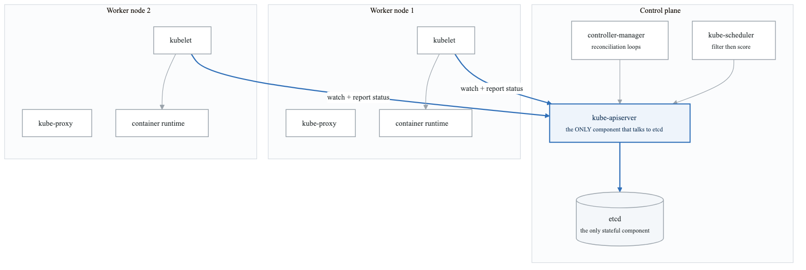
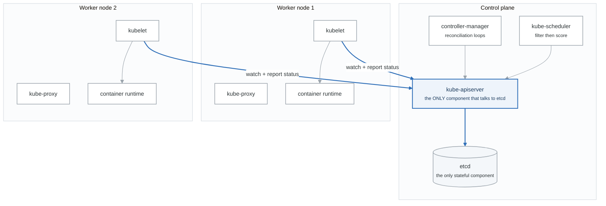
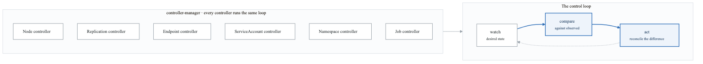
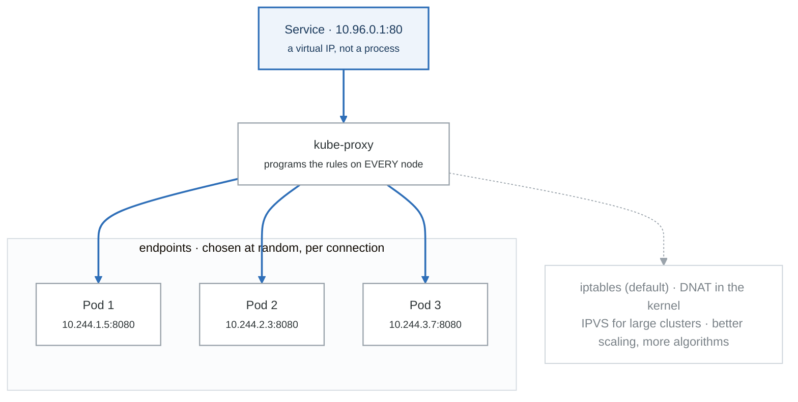
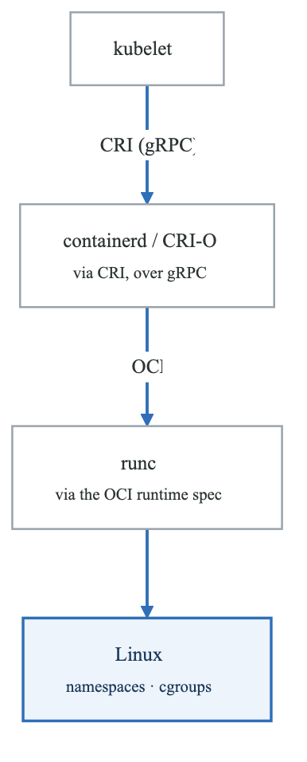
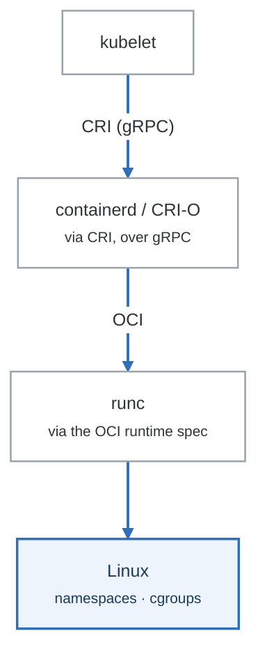
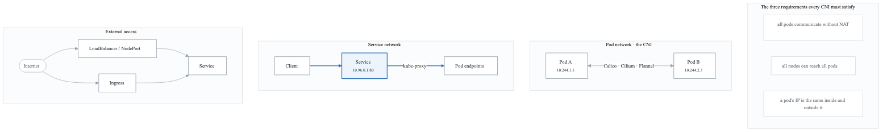

# Kubernetes Architecture

## Introduction

Kubernetes (K8s) is the leading container orchestration platform. Understanding its architecture is essential for deploying and managing containerized applications at scale.

## What is Kubernetes?

Kubernetes is an open-source platform for automating deployment, scaling, and management of containerized applications. Originally developed by Google, it's now maintained by the Cloud Native Computing Foundation (CNCF).

## High-Level Architecture

<!-- figure: generated from the Mermaid below by _shared/diagrams/embed-figures.py — do not edit the image -->


<details>
<summary>Diagram source (Mermaid)</summary>



</details>

## Control Plane Components

### API Server (kube-apiserver)

The API server is the front-end for the Kubernetes control plane.

**API Server**

**Responsibilities:**

- REST API endpoint for all operations
- Authentication and authorization
- Admission control
- API versioning
- Watches and notifications

**Clients:**

- kubectl (CLI)
- Dashboard (UI)
- CI/CD systems
- Controllers
- Other components


```bash
# API server endpoints
kubectl cluster-info
# Kubernetes control plane is running at https://api.cluster.local:6443

# Direct API access
kubectl get --raw /api/v1/namespaces
kubectl get --raw /apis/apps/v1/deployments

# API resources
kubectl api-resources
kubectl api-versions
```

### etcd

Distributed key-value store for cluster state.

**etcd**

**Stores:**

- Cluster configuration
- Desired state (specs)
- Current state (status)
- Secrets and ConfigMaps
- Service account tokens

**Properties:**

- Consistent (Raft consensus)
- Highly available (odd number of nodes)
- Encrypted at rest (optional)
- Watched by API server


```bash
# etcd cluster status (on master node)
ETCDCTL_API=3 etcdctl member list

# Backup etcd
ETCDCTL_API=3 etcdctl snapshot save backup.db

# List keys (for debugging)
ETCDCTL_API=3 etcdctl get / --prefix --keys-only
```

### Controller Manager (kube-controller-manager)

Runs controller loops that regulate cluster state.

```mermaid
%%{init: {'theme':'base','themeVariables':{'fontFamily':'Helvetica, Arial, sans-serif','fontSize':'13px','primaryColor':'#ffffff','primaryTextColor':'#2d3436','primaryBorderColor':'#9aa3ab','lineColor':'#9aa3ab','textColor':'#2d3436','clusterBkg':'#fbfcfd','clusterBorder':'#d4dae0','edgeLabelBackground':'#ffffff','tertiaryColor':'#eef4fb'},'flowchart':{'curve':'basis','padding':14,'nodeSpacing':42,'rankSpacing':58}}}%%
flowchart LR
  classDef default fill:#ffffff,stroke:#9aa3ab,stroke-width:1.3px,color:#2d3436
  classDef n    fill:#ffffff,stroke:#9aa3ab,stroke-width:1.3px,color:#2d3436
  classDef crit fill:#eef4fb,stroke:#2f6fb8,stroke-width:1.8px,color:#1b3a5c
  classDef data fill:#f4f7fa,stroke:#9aa3ab,stroke-width:1.3px,color:#2d3436
  classDef mut  fill:#ffffff,stroke:#cfd6dc,stroke-width:1.1px,color:#7a8288
  classDef warn fill:#fdf0ec,stroke:#c0522d,stroke-width:1.6px,color:#8a3a1e
  subgraph CTRL["controller-manager · every controller runs the same loop"]
    direction TB
    C1["Node controller"]:::n
    C2["Replication controller"]:::n
    C3["Endpoint controller"]:::n
    C4["ServiceAccount controller"]:::n
    C5["Namespace controller"]:::n
    C6["Job controller"]:::n
  end

  subgraph LOOP["The control loop"]
    direction LR
    L1["watch<br/><small>desired state</small>"]:::n
    L2["compare<br/><small>against observed</small>"]:::crit
    L3["act<br/><small>reconcile the difference</small>"]:::crit
    L1 --> L2 --> L3
    L3 -.-> L1
  end

  CTRL --> LOOP

  linkStyle 0,1 stroke:#2f6fb8,stroke-width:2px
```

<!-- figure: generated from the Mermaid below by _shared/diagrams/embed-figures.py — do not edit the image -->


<details>
<summary>Diagram source (Mermaid)</summary>



</details>

### Scheduler (kube-scheduler)

Assigns pods to nodes based on resource requirements and constraints.

**Scheduler**

Scheduling Process:

**1. Filter (Predicates)**

- NodeSelector match
- Resource requirements (CPU, memory)
- Taints and tolerations
- Node affinity/anti-affinity
- Pod affinity/anti-affinity

**2. Score (Priorities)**

- Least requested resources
- Balanced resource allocation
- Image locality
- Inter-pod affinity

**3. Bind**

- Assign pod to highest-scoring node


```yaml
# Example: Pod with scheduling constraints
apiVersion: v1
kind: Pod
metadata:
  name: scheduled-pod
spec:
  nodeSelector:
    disk: ssd
  affinity:
    nodeAffinity:
      requiredDuringSchedulingIgnoredDuringExecution:
        nodeSelectorTerms:
        - matchExpressions:
          - key: zone
            operator: In
            values:
            - us-east-1a
  tolerations:
  - key: "dedicated"
    operator: "Equal"
    value: "database"
    effect: "NoSchedule"
  containers:
  - name: app
    image: nginx
    resources:
      requests:
        memory: "128Mi"
        cpu: "250m"
```

## Node Components

### kubelet

Primary node agent that manages pods.

| kubelet |  |
|---|---|
| Responsibilities: |  |
| ├── Pod lifecycle management |  |
|  | ├── Pull images |
|  | ├── Create containers |
|  | ├── Run health checks |
|  | └── Report status |
| ├── Volume management |  |
|  | ├── Mount volumes |
|  | └── Handle CSI drivers |
| └── Node status reporting |  |
| ├── Resource capacity |  |
| ├── Conditions (Ready, DiskPressure, etc.) |  |
| └── Pod status |  |
| Interfaces: |  |
| ├── CRI (Container Runtime Interface) |  |
| ├── CNI (Container Network Interface) |  |
| └── CSI (Container Storage Interface) |  |


### kube-proxy

Network proxy on each node implementing Services.

<!-- figure: generated from the Mermaid below by _shared/diagrams/embed-figures.py — do not edit the image -->


<details>
<summary>Diagram source (Mermaid)</summary>



</details>

### Container Runtime

Runs containers (containerd, CRI-O, Docker).

<!-- figure: generated from the Mermaid below by _shared/diagrams/embed-figures.py — do not edit the image -->


<details>
<summary>Diagram source (Mermaid)</summary>



</details>

## Kubernetes Objects

### Core Objects

```yaml
# Pod - smallest deployable unit
apiVersion: v1
kind: Pod
metadata:
  name: my-pod
  labels:
    app: myapp
spec:
  containers:
  - name: main
    image: nginx:1.21

---
# Deployment - manages ReplicaSets
apiVersion: apps/v1
kind: Deployment
metadata:
  name: my-deployment
spec:
  replicas: 3
  selector:
    matchLabels:
      app: myapp
  template:
    metadata:
      labels:
        app: myapp
    spec:
      containers:
      - name: main
        image: nginx:1.21

---
# Service - network abstraction
apiVersion: v1
kind: Service
metadata:
  name: my-service
spec:
  selector:
    app: myapp
  ports:
  - port: 80
    targetPort: 8080
  type: ClusterIP
```

### Object Hierarchy

**Object Hierarchy**

**Deployment**

- ReplicaSet
  - Pod
    - Container

**StatefulSet**

- Pod (with stable identity)
  - Container
  - PersistentVolumeClaim

**DaemonSet**

- Pod (one per node)
  - Container

**Job**

- Pod (runs to completion)
  - Container

**CronJob**

- Job (on schedule)
  - Pod
    - Container


## Networking Model

```mermaid
%%{init: {'theme':'base','themeVariables':{'fontFamily':'Helvetica, Arial, sans-serif','fontSize':'13px','primaryColor':'#ffffff','primaryTextColor':'#2d3436','primaryBorderColor':'#9aa3ab','lineColor':'#9aa3ab','textColor':'#2d3436','clusterBkg':'#fbfcfd','clusterBorder':'#d4dae0','edgeLabelBackground':'#ffffff','tertiaryColor':'#eef4fb'},'flowchart':{'curve':'basis','padding':14,'nodeSpacing':42,'rankSpacing':58}}}%%
flowchart TB
  classDef default fill:#ffffff,stroke:#9aa3ab,stroke-width:1.3px,color:#2d3436
  classDef n    fill:#ffffff,stroke:#9aa3ab,stroke-width:1.3px,color:#2d3436
  classDef crit fill:#eef4fb,stroke:#2f6fb8,stroke-width:1.8px,color:#1b3a5c
  classDef data fill:#f4f7fa,stroke:#9aa3ab,stroke-width:1.3px,color:#2d3436
  classDef mut  fill:#ffffff,stroke:#cfd6dc,stroke-width:1.1px,color:#7a8288
  classDef warn fill:#fdf0ec,stroke:#c0522d,stroke-width:1.6px,color:#8a3a1e
  subgraph REQ["The three requirements every CNI must satisfy"]
    R1["all pods communicate without NAT"]:::mut
    R2["all nodes can reach all pods"]:::mut
    R3["a pod's IP is the same inside and outside it"]:::mut
  end

  subgraph POD["Pod network · the CNI"]
    direction LR
    A["Pod A<br/><small>10.244.1.5</small>"]:::n
    B["Pod B<br/><small>10.244.2.3</small>"]:::n
    A <-->|"Calico · Cilium · Flannel"| B
  end

  subgraph SVCN["Service network"]
    direction LR
    CL["Client"]:::n
    SV["Service<br/><small>10.96.0.1:80</small>"]:::crit
    EPS["Pod endpoints"]:::n
    CL --> SV -->|"kube-proxy"| EPS
  end

  subgraph EXT["External access"]
    direction LR
    NET(["Internet"]):::mut
    LB["LoadBalancer / NodePort"]:::n
    ING["Ingress"]:::n
    SV2["Service"]:::n
    NET --> LB --> SV2
    NET --> ING --> SV2
  end

  linkStyle 1,2 stroke:#2f6fb8,stroke-width:2px
```

<!-- figure: generated from the Mermaid below by _shared/diagrams/embed-figures.py — do not edit the image -->


<details>
<summary>Diagram source (Mermaid)</summary>



</details>

## kubectl Commands

```bash
# Cluster info
kubectl cluster-info
kubectl get nodes
kubectl describe node <node-name>

# Workload operations
kubectl get pods -A                    # All namespaces
kubectl get deployments
kubectl describe pod <pod-name>
kubectl logs <pod-name>
kubectl exec -it <pod-name> -- bash

# Resource management
kubectl apply -f manifest.yaml
kubectl delete -f manifest.yaml
kubectl scale deployment myapp --replicas=5

# Debugging
kubectl get events --sort-by='.lastTimestamp'
kubectl top nodes
kubectl top pods
```

## Summary

Kubernetes architecture consists of:

**Control Plane:**
- API Server: Central management point
- etcd: Cluster state storage
- Controller Manager: Reconciliation loops
- Scheduler: Pod placement

**Node Components:**
- kubelet: Pod management
- kube-proxy: Network rules
- Container Runtime: Container execution

Key concepts:
- Declarative configuration
- Desired state vs current state
- Controllers for reconciliation
- Labels and selectors for organization

## Practice Exercises

1. Explore cluster components
2. Trace a pod scheduling decision
3. Examine controller behavior
4. Debug networking issues

## Next Module

Continue to [Pods and Workloads](./08-pods-and-workloads.md) to learn about deploying applications.

<!-- feynman-check -->

---

## Feynman check

Close the file. Blank page, no notes. Explain each of these to a competent engineer who has never
used this tool — **under five minutes, no jargon you can't define on the spot:**

- What is Kubernetes?
- High-Level Architecture
- Control Plane Components
- Node Components

**The gap is not what you forgot. It is where you used a word instead of a mechanism.**

| | |
|---|---|
| ✗ | *"A container isolates the application."* |
| ✓ | *"A container is an ordinary Linux process started with namespaces (what it can see), cgroups (what it can use) and usually seccomp (what it may ask the kernel). There is no container object in the kernel — only a process with those features switched on."* |

**Trace it:** `docker run` → an isolated process. Name the namespaces in the order they are created, and which component actually calls `clone()`.

Stop at the first component you cannot name. Reopen this file and read **only** that.

**Go deeper — only once the gap has a name:** the [LWN namespaces series](https://lwn.net/Articles/531114/) — seven parts by the man-pages maintainer, and the reason containers stop being magic.
Full list per domain: [`SOURCES.md`](../SOURCES.md#containers)

→ Protocol, the three levels of knowing, and worked examples: [`MASTERY.md`](../MASTERY.md)

<!-- /feynman-check -->
