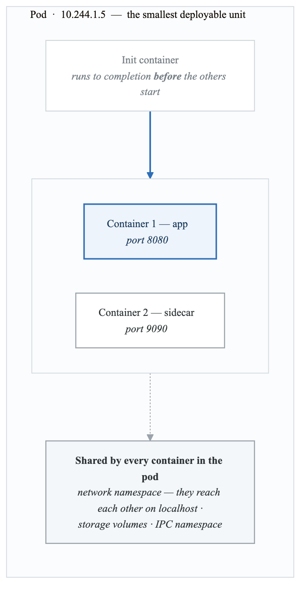
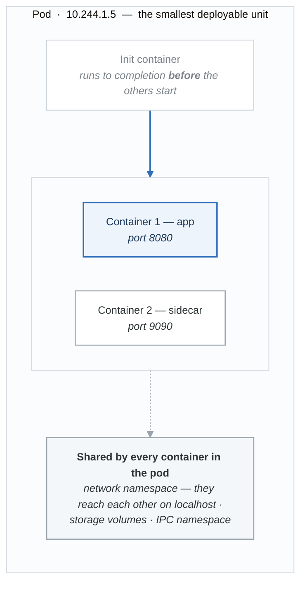
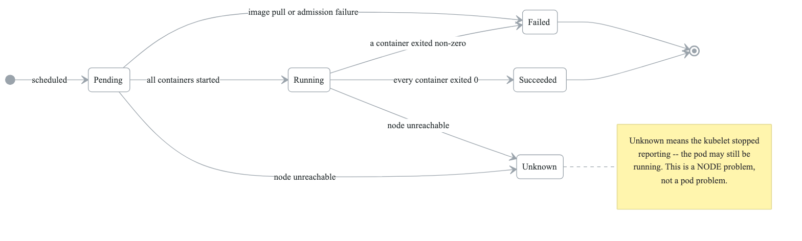
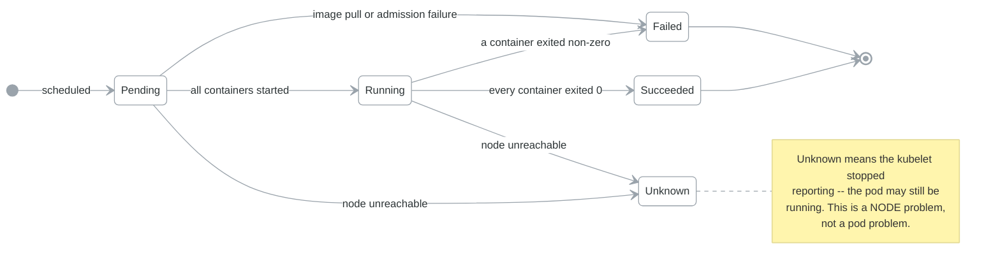
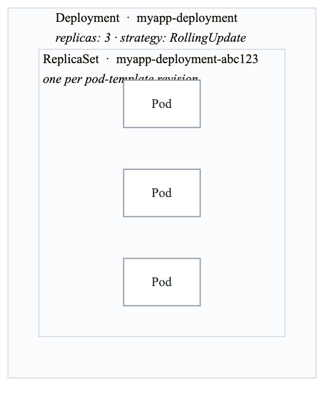
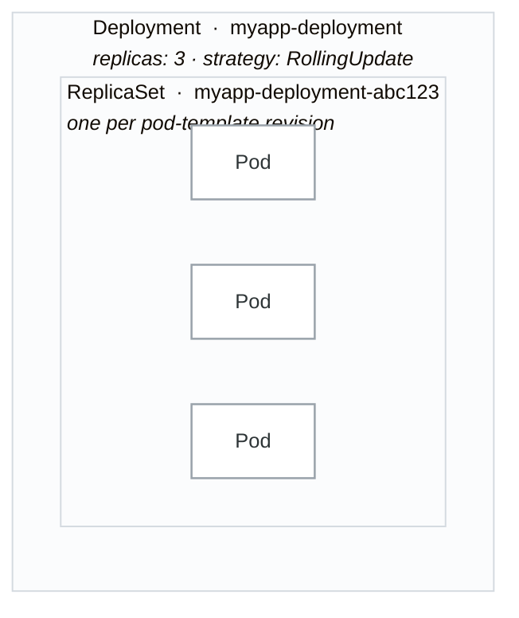
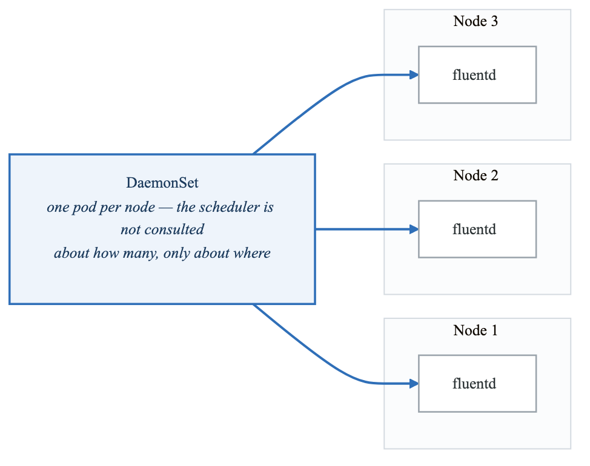
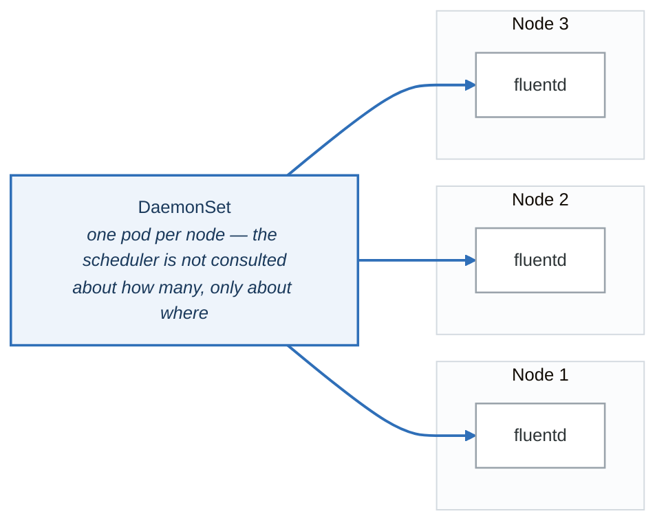
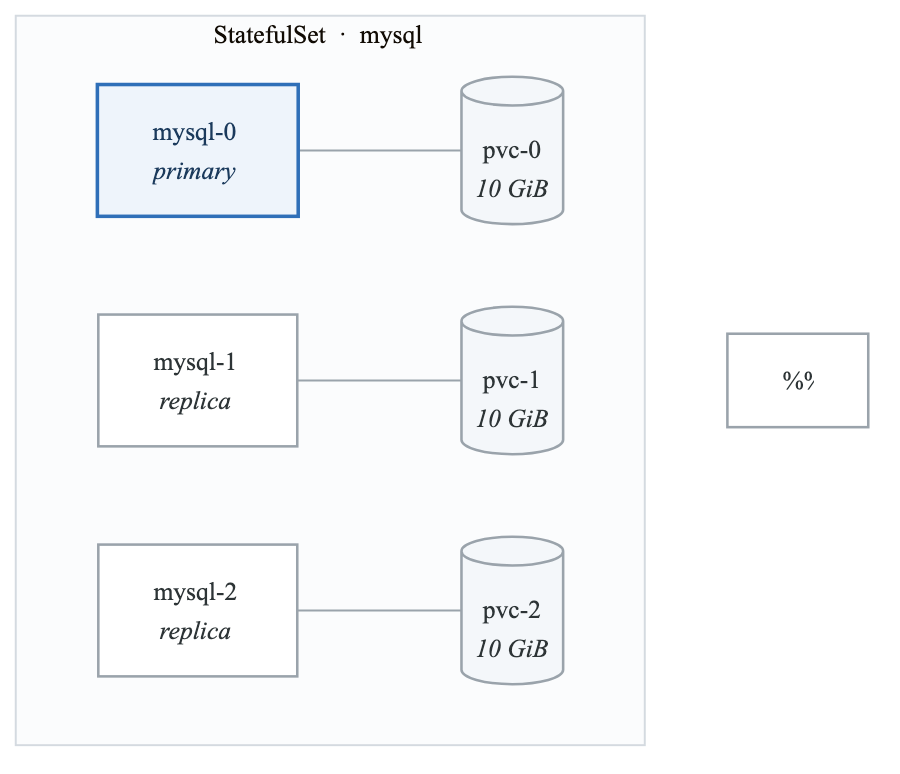
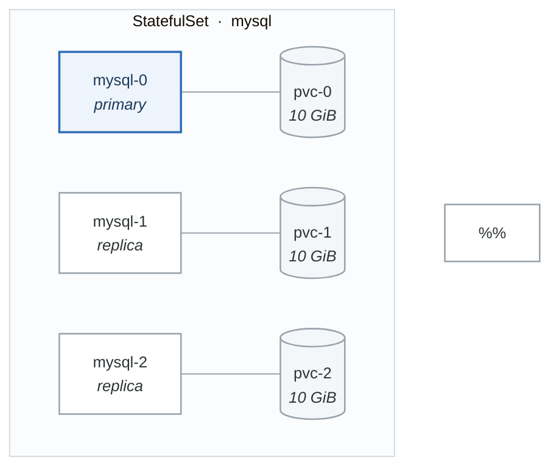

# Pods and Workloads

## Introduction

Kubernetes workloads are the applications that run on your cluster. This module covers the fundamental workload resources: Pods, Deployments, ReplicaSets, DaemonSets, and Jobs.

## Pods

### Pod Fundamentals

<!-- figure: generated from the Mermaid below by _shared/diagrams/embed-figures.py — do not edit the image -->


<details>
<summary>Diagram source (Mermaid)</summary>



</details>

### Pod Manifest

```yaml
# pod.yaml
apiVersion: v1
kind: Pod
metadata:
  name: myapp
  namespace: default
  labels:
    app: myapp
    tier: frontend
  annotations:
    description: "My application pod"
spec:
  # Init containers run before main containers
  initContainers:
    - name: init-db
      image: busybox:1.36
      command: ['sh', '-c', 'until nc -z db-service 5432; do sleep 2; done']

  # Main containers
  containers:
    - name: app
      image: myapp:1.0
      ports:
        - name: http
          containerPort: 8080
          protocol: TCP
      env:
        - name: DATABASE_URL
          value: "postgres://db-service:5432/mydb"
        - name: SECRET_KEY
          valueFrom:
            secretKeyRef:
              name: app-secrets
              key: secret-key
      resources:
        requests:
          memory: "128Mi"
          cpu: "100m"
        limits:
          memory: "256Mi"
          cpu: "500m"
      livenessProbe:
        httpGet:
          path: /health
          port: 8080
        initialDelaySeconds: 15
        periodSeconds: 10
      readinessProbe:
        httpGet:
          path: /ready
          port: 8080
        initialDelaySeconds: 5
        periodSeconds: 5
      volumeMounts:
        - name: app-data
          mountPath: /data
        - name: config
          mountPath: /app/config
          readOnly: true

    - name: sidecar
      image: fluent/fluent-bit:latest
      volumeMounts:
        - name: app-logs
          mountPath: /var/log/app

  # Volumes
  volumes:
    - name: app-data
      persistentVolumeClaim:
        claimName: app-data-pvc
    - name: config
      configMap:
        name: app-config
    - name: app-logs
      emptyDir: {}

  # Pod scheduling
  nodeSelector:
    disktype: ssd

  tolerations:
    - key: "dedicated"
      operator: "Equal"
      value: "app"
      effect: "NoSchedule"

  # Security context
  securityContext:
    runAsNonRoot: true
    runAsUser: 1000
    fsGroup: 1000

  # Restart policy
  restartPolicy: Always

  # DNS policy
  dnsPolicy: ClusterFirst

  # Service account
  serviceAccountName: app-service-account
```

### Pod Lifecycle

<!-- figure: generated from the Mermaid below by _shared/diagrams/embed-figures.py — do not edit the image -->


<details>
<summary>Diagram source (Mermaid)</summary>



</details>

**Pod phases**

| Phase | Meaning |
|---|---|
| `Pending` | Accepted by the cluster; containers not yet created — scheduling, image pull, or volume attach |
| `Running` | Bound to a node, and at least one container is running |
| `Succeeded` | Every container terminated successfully and will not restart |
| `Failed` | Every container terminated, and at least one failed |
| `Unknown` | The pod's state could not be obtained — usually the node is unreachable |

**Container states** — a pod phase is a summary of these:

| State | Meaning |
|---|---|
| `Waiting` | Not running yet: pulling the image, waiting on a secret, in `CrashLoopBackOff` |
| `Running` | Executing |
| `Terminated` | Finished, with an exit code and a reason |

`CrashLoopBackOff` is a *waiting* state, not a phase. A pod stuck there reports `Running` — which is
why "the pod is Running" is never sufficient evidence that anything works.

### Pod Commands

```bash
# Create pod
kubectl apply -f pod.yaml

# List pods
kubectl get pods
kubectl get pods -o wide
kubectl get pods --show-labels
kubectl get pods -l app=myapp

# Describe pod
kubectl describe pod myapp

# View logs
kubectl logs myapp
kubectl logs myapp -c sidecar  # Specific container
kubectl logs myapp --previous  # Previous container instance
kubectl logs -f myapp          # Follow logs

# Execute command in pod
kubectl exec myapp -- ls /app
kubectl exec -it myapp -- /bin/sh
kubectl exec -it myapp -c sidecar -- /bin/sh

# Port forward
kubectl port-forward myapp 8080:8080

# Copy files
kubectl cp myapp:/app/log.txt ./log.txt
kubectl cp ./config.yaml myapp:/app/config.yaml

# Delete pod
kubectl delete pod myapp
kubectl delete pod myapp --grace-period=0 --force
```

## Deployments

### Deployment Overview

<!-- figure: generated from the Mermaid below by _shared/diagrams/embed-figures.py — do not edit the image -->


<details>
<summary>Diagram source (Mermaid)</summary>



</details>

### Deployment Manifest

```yaml
# deployment.yaml
apiVersion: apps/v1
kind: Deployment
metadata:
  name: myapp
  labels:
    app: myapp
spec:
  replicas: 3

  # How to find pods to manage
  selector:
    matchLabels:
      app: myapp

  # Update strategy
  strategy:
    type: RollingUpdate
    rollingUpdate:
      maxSurge: 1        # Max pods above replicas during update
      maxUnavailable: 0  # Max unavailable pods during update

  # Revision history
  revisionHistoryLimit: 10

  # Pod template
  template:
    metadata:
      labels:
        app: myapp
        version: v1
    spec:
      containers:
        - name: myapp
          image: myapp:1.0
          ports:
            - containerPort: 8080
          resources:
            requests:
              memory: "128Mi"
              cpu: "100m"
            limits:
              memory: "256Mi"
              cpu: "500m"
          livenessProbe:
            httpGet:
              path: /health
              port: 8080
            initialDelaySeconds: 15
            periodSeconds: 10
          readinessProbe:
            httpGet:
              path: /ready
              port: 8080
            initialDelaySeconds: 5
            periodSeconds: 5
          env:
            - name: POD_NAME
              valueFrom:
                fieldRef:
                  fieldPath: metadata.name
```

### Deployment Strategies

**Deployment strategies**

**1. RollingUpdate** — the default

| Step | Pods | |
|---|---|---|
| Before | `v1` `v1` `v1` | |
| Step 1 | `v1` `v1` `v1` `v2` | `maxSurge: 1` adds one before removing any |
| Step 2 | `v1` `v1` `v2` `v2` | |
| Step 3 | `v1` `v2` `v2` `v2` | |
| After | `v2` `v2` `v2` | |

*Pros:* zero downtime, gradual rollout, easy to halt mid-flight.
*Cons:* both versions serve traffic at once — your API and your database schema must tolerate that.

**2. Recreate**

| Step | Pods | |
|---|---|---|
| Before | `v1` `v1` `v1` | |
| Step 1 | — | every pod terminated |
| After | `v2` `v2` `v2` | every pod created |

*Pros:* a clean switch, never two versions at once.
*Cons:* downtime for the length of the restart.

`Recreate` is the right choice more often than people expect: a singleton that takes an exclusive
lock, or a migration that cannot run against two application versions, is safer with a short,
announced outage than with a rolling update that half-works.

### Deployment Commands

```bash
# Create deployment
kubectl apply -f deployment.yaml

# List deployments
kubectl get deployments
kubectl get deploy -o wide

# Describe deployment
kubectl describe deployment myapp

# Scale deployment
kubectl scale deployment myapp --replicas=5

# Update image (triggers rolling update)
kubectl set image deployment/myapp myapp=myapp:2.0

# Check rollout status
kubectl rollout status deployment/myapp

# View rollout history
kubectl rollout history deployment/myapp
kubectl rollout history deployment/myapp --revision=2

# Rollback
kubectl rollout undo deployment/myapp
kubectl rollout undo deployment/myapp --to-revision=2

# Pause/Resume rollout
kubectl rollout pause deployment/myapp
kubectl rollout resume deployment/myapp

# Restart deployment
kubectl rollout restart deployment/myapp
```

## ReplicaSets

### ReplicaSet Overview

```yaml
# replicaset.yaml (usually managed by Deployment)
apiVersion: apps/v1
kind: ReplicaSet
metadata:
  name: myapp-rs
  labels:
    app: myapp
spec:
  replicas: 3
  selector:
    matchLabels:
      app: myapp
    matchExpressions:
      - key: tier
        operator: In
        values:
          - frontend
          - backend
  template:
    metadata:
      labels:
        app: myapp
        tier: frontend
    spec:
      containers:
        - name: myapp
          image: myapp:1.0
          ports:
            - containerPort: 8080
```

### ReplicaSet Commands

```bash
# List ReplicaSets
kubectl get rs
kubectl get replicasets

# Describe ReplicaSet
kubectl describe rs myapp-rs

# Scale ReplicaSet
kubectl scale rs myapp-rs --replicas=5

# Delete ReplicaSet (keeps pods)
kubectl delete rs myapp-rs --cascade=orphan

# Delete ReplicaSet (deletes pods)
kubectl delete rs myapp-rs
```

## DaemonSets

### DaemonSet Overview

<!-- figure: generated from the Mermaid below by _shared/diagrams/embed-figures.py — do not edit the image -->


<details>
<summary>Diagram source (Mermaid)</summary>



</details>

### DaemonSet Manifest

```yaml
# daemonset.yaml
apiVersion: apps/v1
kind: DaemonSet
metadata:
  name: node-exporter
  namespace: monitoring
  labels:
    app: node-exporter
spec:
  selector:
    matchLabels:
      app: node-exporter

  updateStrategy:
    type: RollingUpdate
    rollingUpdate:
      maxUnavailable: 1

  template:
    metadata:
      labels:
        app: node-exporter
    spec:
      # Run on all nodes including masters
      tolerations:
        - key: node-role.kubernetes.io/control-plane
          effect: NoSchedule
        - key: node-role.kubernetes.io/master
          effect: NoSchedule

      hostNetwork: true
      hostPID: true

      containers:
        - name: node-exporter
          image: prom/node-exporter:v1.6.1
          ports:
            - containerPort: 9100
              hostPort: 9100
          resources:
            requests:
              cpu: 100m
              memory: 128Mi
            limits:
              cpu: 200m
              memory: 256Mi
          volumeMounts:
            - name: proc
              mountPath: /host/proc
              readOnly: true
            - name: sys
              mountPath: /host/sys
              readOnly: true
            - name: rootfs
              mountPath: /rootfs
              readOnly: true
          args:
            - --path.procfs=/host/proc
            - --path.sysfs=/host/sys
            - --path.rootfs=/rootfs

      volumes:
        - name: proc
          hostPath:
            path: /proc
        - name: sys
          hostPath:
            path: /sys
        - name: rootfs
          hostPath:
            path: /
```

### Node Selection

```yaml
# Run DaemonSet only on specific nodes
spec:
  template:
    spec:
      nodeSelector:
        node-type: worker

      # Or use affinity
      affinity:
        nodeAffinity:
          requiredDuringSchedulingIgnoredDuringExecution:
            nodeSelectorTerms:
              - matchExpressions:
                  - key: kubernetes.io/os
                    operator: In
                    values:
                      - linux
```

## StatefulSets

### StatefulSet Overview

<!-- figure: generated from the Mermaid below by _shared/diagrams/embed-figures.py — do not edit the image -->


<details>
<summary>Diagram source (Mermaid)</summary>



</details>

### StatefulSet Manifest

```yaml
# statefulset.yaml
apiVersion: apps/v1
kind: StatefulSet
metadata:
  name: mysql
spec:
  serviceName: mysql-headless
  replicas: 3

  selector:
    matchLabels:
      app: mysql

  # Pod management policy
  podManagementPolicy: OrderedReady  # or Parallel

  # Update strategy
  updateStrategy:
    type: RollingUpdate
    rollingUpdate:
      partition: 0

  template:
    metadata:
      labels:
        app: mysql
    spec:
      containers:
        - name: mysql
          image: mysql:8.0
          ports:
            - containerPort: 3306
              name: mysql
          env:
            - name: MYSQL_ROOT_PASSWORD
              valueFrom:
                secretKeyRef:
                  name: mysql-secrets
                  key: root-password
          volumeMounts:
            - name: data
              mountPath: /var/lib/mysql
          resources:
            requests:
              memory: "512Mi"
              cpu: "500m"
            limits:
              memory: "1Gi"
              cpu: "1"
          livenessProbe:
            exec:
              command:
                - mysqladmin
                - ping
            initialDelaySeconds: 30
            periodSeconds: 10

  # Volume claim templates
  volumeClaimTemplates:
    - metadata:
        name: data
      spec:
        accessModes: ["ReadWriteOnce"]
        storageClassName: standard
        resources:
          requests:
            storage: 10Gi

---
# Headless service for StatefulSet
apiVersion: v1
kind: Service
metadata:
  name: mysql-headless
spec:
  clusterIP: None
  selector:
    app: mysql
  ports:
    - port: 3306
      targetPort: 3306
```

## Jobs and CronJobs

### Job Overview

```yaml
# job.yaml
apiVersion: batch/v1
kind: Job
metadata:
  name: data-migration
spec:
  # Number of successful completions needed
  completions: 1

  # Max parallel pods
  parallelism: 1

  # Retry on failure
  backoffLimit: 3

  # Active deadline
  activeDeadlineSeconds: 600

  # TTL for cleanup
  ttlSecondsAfterFinished: 100

  template:
    spec:
      restartPolicy: Never  # or OnFailure
      containers:
        - name: migration
          image: myapp:migration
          command: ["./migrate.sh"]
          env:
            - name: DATABASE_URL
              valueFrom:
                secretKeyRef:
                  name: db-secrets
                  key: url
```

### Parallel Jobs

```yaml
# parallel-job.yaml
apiVersion: batch/v1
kind: Job
metadata:
  name: batch-processor
spec:
  completions: 10    # Total work items
  parallelism: 3     # Run 3 pods at a time
  backoffLimit: 5

  template:
    spec:
      restartPolicy: OnFailure
      containers:
        - name: processor
          image: batch-processor:1.0
          env:
            - name: BATCH_ID
              valueFrom:
                fieldRef:
                  fieldPath: metadata.name
```

### CronJob

```yaml
# cronjob.yaml
apiVersion: batch/v1
kind: CronJob
metadata:
  name: database-backup
spec:
  # Cron schedule (every day at 2am)
  schedule: "0 2 * * *"

  # Concurrency policy
  concurrencyPolicy: Forbid  # or Allow, Replace

  # Keep job history
  successfulJobsHistoryLimit: 3
  failedJobsHistoryLimit: 1

  # Start deadline
  startingDeadlineSeconds: 300

  # Suspend scheduling
  suspend: false

  jobTemplate:
    spec:
      backoffLimit: 2
      template:
        spec:
          restartPolicy: OnFailure
          containers:
            - name: backup
              image: postgres:15
              command:
                - /bin/sh
                - -c
                - |
                  pg_dump -h $DB_HOST -U $DB_USER $DB_NAME | \
                  gzip > /backup/db-$(date +%Y%m%d).sql.gz
              env:
                - name: DB_HOST
                  value: "postgres-service"
                - name: DB_USER
                  valueFrom:
                    secretKeyRef:
                      name: db-secrets
                      key: username
                - name: PGPASSWORD
                  valueFrom:
                    secretKeyRef:
                      name: db-secrets
                      key: password
              volumeMounts:
                - name: backup
                  mountPath: /backup
          volumes:
            - name: backup
              persistentVolumeClaim:
                claimName: backup-pvc
```

### Job Commands

```bash
# Create job
kubectl apply -f job.yaml

# List jobs
kubectl get jobs

# View job logs
kubectl logs job/data-migration

# Delete job
kubectl delete job data-migration

# Create CronJob
kubectl apply -f cronjob.yaml

# List CronJobs
kubectl get cronjobs

# Manual trigger
kubectl create job --from=cronjob/database-backup manual-backup
```

## Resource Management

### Resource Requests and Limits

```yaml
resources:
  requests:
    memory: "128Mi"
    cpu: "100m"      # 100 millicores = 0.1 CPU
  limits:
    memory: "256Mi"
    cpu: "500m"
```

### Resource Quotas

```yaml
# resourcequota.yaml
apiVersion: v1
kind: ResourceQuota
metadata:
  name: compute-quota
  namespace: dev
spec:
  hard:
    requests.cpu: "4"
    requests.memory: 8Gi
    limits.cpu: "8"
    limits.memory: 16Gi
    pods: "20"
    persistentvolumeclaims: "10"
```

### Limit Ranges

```yaml
# limitrange.yaml
apiVersion: v1
kind: LimitRange
metadata:
  name: limit-range
  namespace: dev
spec:
  limits:
    - type: Container
      default:
        memory: "256Mi"
        cpu: "200m"
      defaultRequest:
        memory: "128Mi"
        cpu: "100m"
      max:
        memory: "1Gi"
        cpu: "1"
      min:
        memory: "64Mi"
        cpu: "50m"
    - type: Pod
      max:
        memory: "2Gi"
        cpu: "2"
```

## Summary

Key concepts:
- Pods are the smallest deployable unit
- Deployments manage stateless applications
- StatefulSets manage stateful applications
- DaemonSets run pods on all nodes
- Jobs run one-off tasks

Best practices:
- Always use Deployments for stateless apps
- Configure resource requests and limits
- Implement health probes
- Use proper restart policies
- Monitor resource usage

## Practice Exercises

1. Deploy a multi-container pod with sidecar
2. Perform rolling update and rollback
3. Create StatefulSet for database
4. Set up CronJob for backups

## Next Module

Continue to [Services and Networking](./09-kubernetes-networking.md) to learn about Kubernetes networking.

<!-- feynman-check -->

---

## Feynman check

Close the file. Blank page, no notes. Explain each of these to a competent engineer who has never
used this tool — **under five minutes, no jargon you can't define on the spot:**

- Pods
- Deployments
- ReplicaSets
- DaemonSets

**The gap is not what you forgot. It is where you used a word instead of a mechanism.**

| | |
|---|---|
| ✗ | *"A container isolates the application."* |
| ✓ | *"A container is an ordinary Linux process started with namespaces (what it can see), cgroups (what it can use) and usually seccomp (what it may ask the kernel). There is no container object in the kernel — only a process with those features switched on."* |

**Trace it:** `docker run` → an isolated process. Name the namespaces in the order they are created, and which component actually calls `clone()`.

Stop at the first component you cannot name. Reopen this file and read **only** that.

**Go deeper — only once the gap has a name:** the [LWN namespaces series](https://lwn.net/Articles/531114/) — seven parts by the man-pages maintainer, and the reason containers stop being magic.
Full list per domain: [`SOURCES.md`](../SOURCES.md#containers)

→ Protocol, the three levels of knowing, and worked examples: [`MASTERY.md`](../MASTERY.md)

<!-- /feynman-check -->
