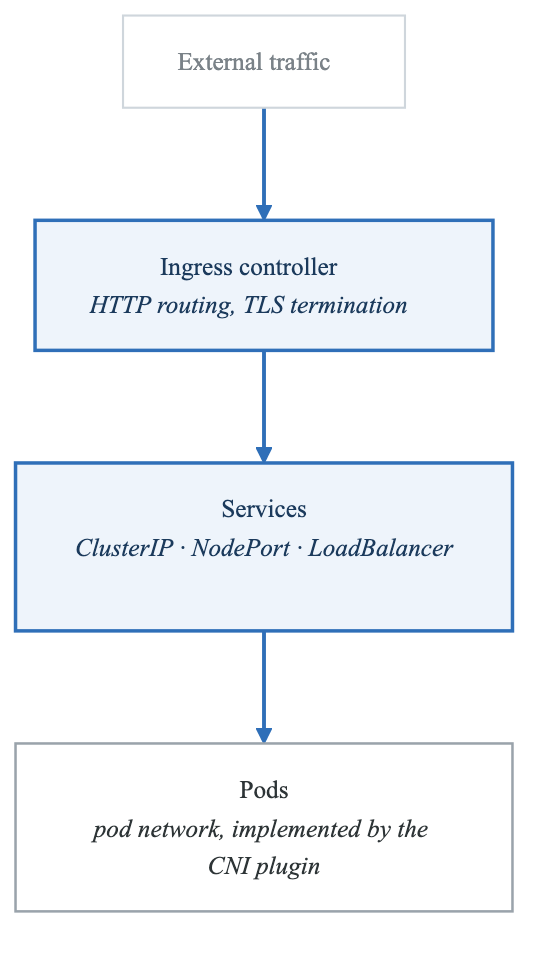
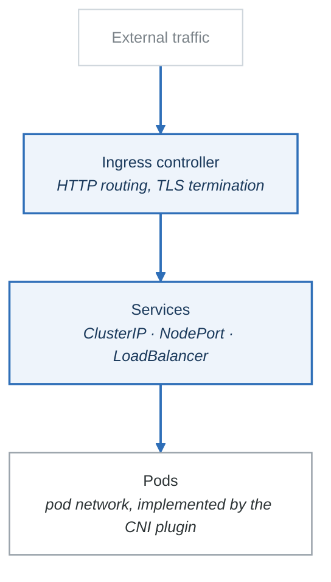
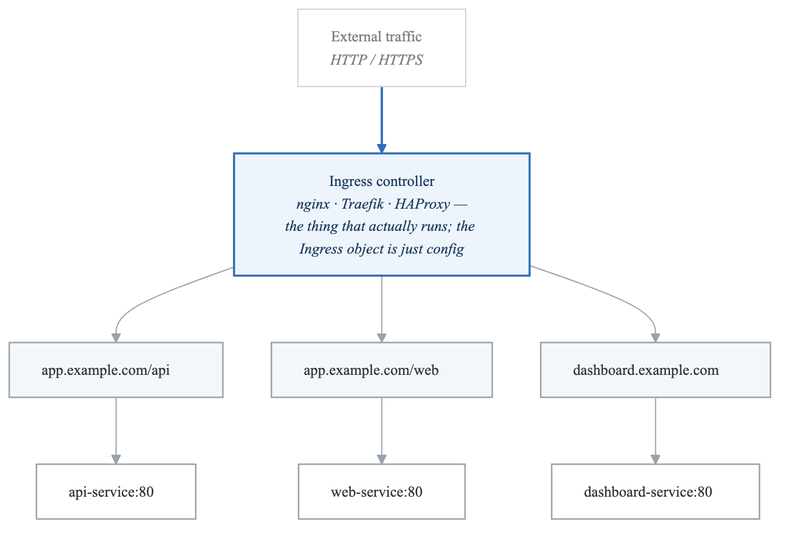
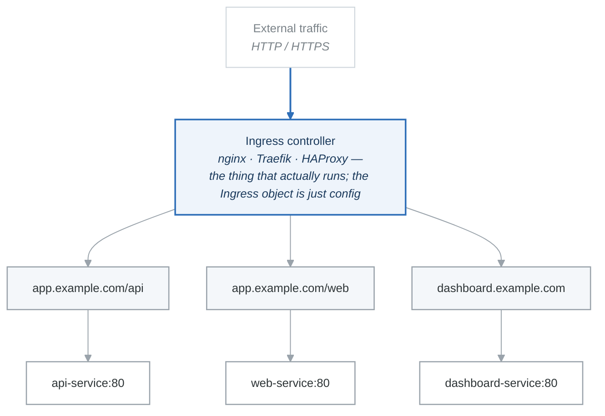
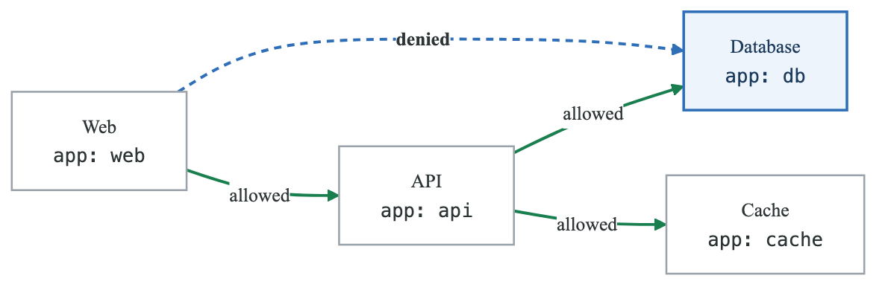
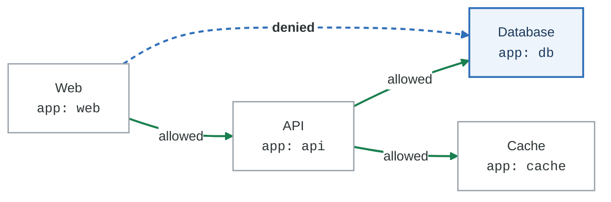
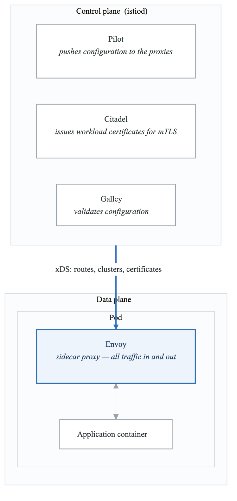
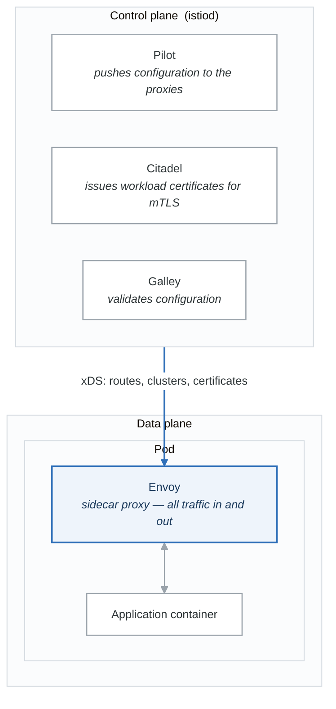

# Kubernetes Services and Networking

## Introduction

Kubernetes networking enables communication between pods, services, and external clients. This module covers Services, Ingress, Network Policies, and the Kubernetes networking model.

## Kubernetes Networking Model

### Core Principles

**The four rules every Kubernetes network must satisfy**

1. Every pod gets its own IP address
2. Pods can reach all other pods **without NAT**
3. Agents on a node (kubelet, daemons) can reach all pods on that node
4. A pod sees its own IP as the same address others use to reach it

Rule 4 is the one that trips people: no port mapping, no address translation, no "inside the container it is 127.0.0.1 but outside it is something else." Everything below exists to make those four statements true.

<!-- figure: generated from the Mermaid below by _shared/diagrams/embed-figures.py — do not edit the image -->


<details>
<summary>Diagram source (Mermaid)</summary>



</details>

### Container Network Interface (CNI)

| CNI Plugins |  |
|---|---|
| Plugin | Features |
| Calico | Network policies, BGP, high performance |
| Cilium | eBPF-based, L7 policies, observability |
| Flannel | Simple overlay, minimal features |
| Weave | Encrypted, easy setup, multicast |
| AWS VPC CNI | Native AWS networking, high performance |
| Azure CNI | Native Azure networking |
| GKE CNI | Native GCP networking |


## Services

### Service Types

**Service types**

Each one builds on the one above it — a `LoadBalancer` *is* a `NodePort` which *is* a `ClusterIP`.

| Type | What it gives you | Reachable from |
|---|---|---|
| **ClusterIP** *(default)* | A stable virtual IP inside the cluster | Inside the cluster only |
| **NodePort** | The same, plus a static port on **every** node, from 30000–32767 | Anything that can reach a node |
| **LoadBalancer** | The same, plus a cloud load balancer pointed at those node ports | The internet, or a private network |
| **ExternalName** | A CNAME. No proxying, no endpoints, no IP | Wherever the DNS name resolves |

```text
ClusterIP      10.96.0.1:80  ──►  10.244.1.5:8080
                             ──►  10.244.2.3:8080

NodePort       <node-ip>:30080  ──►  service:80  ──►  pod:8080

LoadBalancer   cloud LB  ──►  <node-ip>:30080  ──►  service:80  ──►  pod:8080

ExternalName   mydb.default.svc.cluster.local  ──►  db.example.com
```

The Service IP is not attached to anything — no interface holds it. It is a rule in iptables or IPVS
on every node, which is why you can never ping a ClusterIP and why `kubectl get endpoints` is the
first command to run when a Service "isn't working.

### ClusterIP Service

```yaml
# clusterip-service.yaml
apiVersion: v1
kind: Service
metadata:
  name: myapp-service
  labels:
    app: myapp
spec:
  type: ClusterIP  # Default
  selector:
    app: myapp
  ports:
    - name: http
      port: 80         # Service port
      targetPort: 8080 # Container port
      protocol: TCP
    - name: grpc
      port: 9090
      targetPort: 9090

---
# Headless service (for StatefulSets)
apiVersion: v1
kind: Service
metadata:
  name: myapp-headless
spec:
  clusterIP: None
  selector:
    app: myapp
  ports:
    - port: 8080
```

### NodePort Service

```yaml
# nodeport-service.yaml
apiVersion: v1
kind: Service
metadata:
  name: myapp-nodeport
spec:
  type: NodePort
  selector:
    app: myapp
  ports:
    - port: 80
      targetPort: 8080
      nodePort: 30080  # Optional, auto-assigned if omitted

# Access: http://<any-node-ip>:30080
```

### LoadBalancer Service

```yaml
# loadbalancer-service.yaml
apiVersion: v1
kind: Service
metadata:
  name: myapp-lb
  annotations:
    # AWS annotations
    service.beta.kubernetes.io/aws-load-balancer-type: nlb
    service.beta.kubernetes.io/aws-load-balancer-internal: "true"
    # GCP annotations
    cloud.google.com/load-balancer-type: "Internal"
spec:
  type: LoadBalancer
  selector:
    app: myapp
  ports:
    - port: 80
      targetPort: 8080
  # Optional: Restrict source IPs
  loadBalancerSourceRanges:
    - 10.0.0.0/8
    - 192.168.0.0/16
```

### ExternalName Service

```yaml
# externalname-service.yaml
apiVersion: v1
kind: Service
metadata:
  name: external-db
spec:
  type: ExternalName
  externalName: db.example.com

# Pods can connect to: external-db.default.svc.cluster.local
# DNS resolves to: db.example.com
```

### Service Discovery

```bash
# DNS-based discovery
# Format: <service>.<namespace>.svc.cluster.local

# From within cluster:
curl http://myapp-service                    # Same namespace
curl http://myapp-service.default            # With namespace
curl http://myapp-service.default.svc        # With svc
curl http://myapp-service.default.svc.cluster.local  # FQDN

# Environment variables (legacy)
# MYAPP_SERVICE_HOST=10.96.0.1
# MYAPP_SERVICE_PORT=80
```

## Ingress

### Ingress Overview

<!-- figure: generated from the Mermaid below by _shared/diagrams/embed-figures.py — do not edit the image -->


<details>
<summary>Diagram source (Mermaid)</summary>



</details>

### Ingress Resource

```yaml
# ingress.yaml
apiVersion: networking.k8s.io/v1
kind: Ingress
metadata:
  name: myapp-ingress
  annotations:
    nginx.ingress.kubernetes.io/rewrite-target: /
    nginx.ingress.kubernetes.io/ssl-redirect: "true"
    cert-manager.io/cluster-issuer: letsencrypt-prod
spec:
  ingressClassName: nginx

  # TLS configuration
  tls:
    - hosts:
        - app.example.com
        - api.example.com
      secretName: app-tls-secret

  # Routing rules
  rules:
    # Host-based routing
    - host: app.example.com
      http:
        paths:
          - path: /
            pathType: Prefix
            backend:
              service:
                name: web-service
                port:
                  number: 80

          - path: /api
            pathType: Prefix
            backend:
              service:
                name: api-service
                port:
                  number: 80

    - host: dashboard.example.com
      http:
        paths:
          - path: /
            pathType: Prefix
            backend:
              service:
                name: dashboard-service
                port:
                  number: 80

  # Default backend
  defaultBackend:
    service:
      name: default-service
      port:
        number: 80
```

### Path Types

```yaml
# Exact: /api matches only /api
paths:
  - path: /api
    pathType: Exact

# Prefix: /api matches /api, /api/, /api/v1
paths:
  - path: /api
    pathType: Prefix

# ImplementationSpecific: Controller-specific
paths:
  - path: /api/*
    pathType: ImplementationSpecific
```

### Ingress Controller Installation

```bash
# Install NGINX Ingress Controller
kubectl apply -f https://raw.githubusercontent.com/kubernetes/ingress-nginx/controller-v1.8.1/deploy/static/provider/cloud/deploy.yaml

# Install Traefik
helm repo add traefik https://helm.traefik.io/traefik
helm install traefik traefik/traefik

# Verify installation
kubectl get pods -n ingress-nginx
kubectl get svc -n ingress-nginx
```

### TLS with cert-manager

```yaml
# ClusterIssuer for Let's Encrypt
apiVersion: cert-manager.io/v1
kind: ClusterIssuer
metadata:
  name: letsencrypt-prod
spec:
  acme:
    server: https://acme-v02.api.letsencrypt.org/directory
    email: admin@example.com
    privateKeySecretRef:
      name: letsencrypt-prod-key
    solvers:
      - http01:
          ingress:
            class: nginx

---
# Certificate request (auto-created by ingress annotation)
apiVersion: cert-manager.io/v1
kind: Certificate
metadata:
  name: app-tls
spec:
  secretName: app-tls-secret
  issuerRef:
    name: letsencrypt-prod
    kind: ClusterIssuer
  commonName: app.example.com
  dnsNames:
    - app.example.com
    - api.example.com
```

## Network Policies

### Network Policy Overview

<!-- figure: generated from the Mermaid below by _shared/diagrams/embed-figures.py — do not edit the image -->


<details>
<summary>Diagram source (Mermaid)</summary>



</details>

### Network Policy Examples

```yaml
# Default deny all ingress
apiVersion: networking.k8s.io/v1
kind: NetworkPolicy
metadata:
  name: default-deny-ingress
  namespace: production
spec:
  podSelector: {}  # Apply to all pods
  policyTypes:
    - Ingress

---
# Default deny all egress
apiVersion: networking.k8s.io/v1
kind: NetworkPolicy
metadata:
  name: default-deny-egress
  namespace: production
spec:
  podSelector: {}
  policyTypes:
    - Egress

---
# Allow specific ingress
apiVersion: networking.k8s.io/v1
kind: NetworkPolicy
metadata:
  name: api-network-policy
  namespace: production
spec:
  podSelector:
    matchLabels:
      app: api
  policyTypes:
    - Ingress
    - Egress

  ingress:
    # Allow from web pods
    - from:
        - podSelector:
            matchLabels:
              app: web
      ports:
        - protocol: TCP
          port: 8080

    # Allow from specific namespace
    - from:
        - namespaceSelector:
            matchLabels:
              name: monitoring
      ports:
        - protocol: TCP
          port: 9090

  egress:
    # Allow to database
    - to:
        - podSelector:
            matchLabels:
              app: database
      ports:
        - protocol: TCP
          port: 5432

    # Allow DNS
    - to:
        - namespaceSelector: {}
          podSelector:
            matchLabels:
              k8s-app: kube-dns
      ports:
        - protocol: UDP
          port: 53
```

### Advanced Network Policies

```yaml
# Allow from external CIDR
apiVersion: networking.k8s.io/v1
kind: NetworkPolicy
metadata:
  name: allow-external
spec:
  podSelector:
    matchLabels:
      app: public-api
  ingress:
    - from:
        - ipBlock:
            cidr: 0.0.0.0/0
            except:
              - 10.0.0.0/8
              - 172.16.0.0/12
              - 192.168.0.0/16
      ports:
        - protocol: TCP
          port: 443

---
# Complex policy with multiple rules
apiVersion: networking.k8s.io/v1
kind: NetworkPolicy
metadata:
  name: complex-policy
spec:
  podSelector:
    matchLabels:
      app: backend
  policyTypes:
    - Ingress
    - Egress

  ingress:
    # Rule 1: From frontend in same namespace
    - from:
        - podSelector:
            matchLabels:
              app: frontend
      ports:
        - port: 8080

    # Rule 2: From any pod in 'allowed' namespaces
    - from:
        - namespaceSelector:
            matchLabels:
              access: allowed
      ports:
        - port: 8080

    # Rule 3: From specific IP range
    - from:
        - ipBlock:
            cidr: 10.0.0.0/24
      ports:
        - port: 8080

  egress:
    # Allow to database and cache
    - to:
        - podSelector:
            matchExpressions:
              - key: app
                operator: In
                values:
                  - database
                  - cache
      ports:
        - port: 5432
        - port: 6379

    # Allow HTTPS to external
    - to:
        - ipBlock:
            cidr: 0.0.0.0/0
      ports:
        - port: 443
```

## DNS in Kubernetes

### CoreDNS

```yaml
# CoreDNS ConfigMap
apiVersion: v1
kind: ConfigMap
metadata:
  name: coredns
  namespace: kube-system
data:
  Corefile: |
    .:53 {
        errors
        health {
            lameduck 5s
        }
        ready
        kubernetes cluster.local in-addr.arpa ip6.arpa {
            pods insecure
            fallthrough in-addr.arpa ip6.arpa
            ttl 30
        }
        prometheus :9153
        forward . /etc/resolv.conf {
            max_concurrent 1000
        }
        cache 30
        loop
        reload
        loadbalance
    }
```

### Custom DNS Configuration

```yaml
# Pod with custom DNS
apiVersion: v1
kind: Pod
metadata:
  name: custom-dns-pod
spec:
  dnsPolicy: "None"
  dnsConfig:
    nameservers:
      - 8.8.8.8
      - 8.8.4.4
    searches:
      - ns1.svc.cluster.local
      - my.dns.search.suffix
    options:
      - name: ndots
        value: "2"
      - name: edns0
  containers:
    - name: app
      image: myapp
```

### DNS Policies

```yaml
# ClusterFirst (default)
dnsPolicy: ClusterFirst

# ClusterFirstWithHostNet (for hostNetwork: true)
dnsPolicy: ClusterFirstWithHostNet

# Default (inherit node's DNS)
dnsPolicy: Default

# None (custom DNS config)
dnsPolicy: None
```

## Service Mesh (Istio)

### Istio Architecture

<!-- figure: generated from the Mermaid below by _shared/diagrams/embed-figures.py — do not edit the image -->


<details>
<summary>Diagram source (Mermaid)</summary>



</details>

### Istio Virtual Service

```yaml
# Virtual service for traffic routing
apiVersion: networking.istio.io/v1beta1
kind: VirtualService
metadata:
  name: myapp-routing
spec:
  hosts:
    - myapp
  http:
    # Canary routing
    - match:
        - headers:
            x-canary:
              exact: "true"
      route:
        - destination:
            host: myapp
            subset: v2

    # Weight-based routing
    - route:
        - destination:
            host: myapp
            subset: v1
          weight: 90
        - destination:
            host: myapp
            subset: v2
          weight: 10

---
# Destination rule
apiVersion: networking.istio.io/v1beta1
kind: DestinationRule
metadata:
  name: myapp-destinations
spec:
  host: myapp
  subsets:
    - name: v1
      labels:
        version: v1
    - name: v2
      labels:
        version: v2
  trafficPolicy:
    connectionPool:
      tcp:
        maxConnections: 100
      http:
        h2UpgradePolicy: UPGRADE
    loadBalancer:
      simple: ROUND_ROBIN
```

## Commands Reference

```bash
# Services
kubectl get svc
kubectl describe svc myapp-service
kubectl expose deployment myapp --port=80 --type=LoadBalancer

# Endpoints
kubectl get endpoints
kubectl describe endpoints myapp-service

# Ingress
kubectl get ingress
kubectl describe ingress myapp-ingress

# Network Policies
kubectl get networkpolicies
kubectl describe networkpolicy api-policy

# DNS debugging
kubectl run dnsutils --image=tutum/dnsutils --restart=Never -- sleep infinity
kubectl exec dnsutils -- nslookup myapp-service
kubectl exec dnsutils -- dig myapp-service.default.svc.cluster.local

# Network debugging
kubectl run netshoot --image=nicolaka/netshoot --restart=Never -- sleep infinity
kubectl exec netshoot -- curl http://myapp-service
kubectl exec netshoot -- traceroute myapp-service
```

## Summary

Key concepts:
- Services provide stable endpoints for pods
- Ingress handles external HTTP/HTTPS traffic
- Network Policies control pod communication
- DNS enables service discovery

Best practices:
- Use ClusterIP for internal services
- Use Ingress for HTTP routing
- Implement Network Policies for security
- Use service mesh for advanced traffic management

## Practice Exercises

1. Create services with different types
2. Configure Ingress with TLS
3. Implement Network Policies for microservices
4. Set up canary deployments with Istio

## Next Module

Continue to [Storage in Kubernetes](./10-kubernetes-storage.md) to learn about persistent storage.

<!-- feynman-check -->

---

## Feynman check

Close the file. Blank page, no notes. Explain each of these to a competent engineer who has never
used this tool — **under five minutes, no jargon you can't define on the spot:**

- Kubernetes Networking Model
- Services
- Ingress
- Network Policies

**The gap is not what you forgot. It is where you used a word instead of a mechanism.**

| | |
|---|---|
| ✗ | *"A container isolates the application."* |
| ✓ | *"A container is an ordinary Linux process started with namespaces (what it can see), cgroups (what it can use) and usually seccomp (what it may ask the kernel). There is no container object in the kernel — only a process with those features switched on."* |

**Trace it:** `docker run` → an isolated process. Name the namespaces in the order they are created, and which component actually calls `clone()`.

Stop at the first component you cannot name. Reopen this file and read **only** that.

**Go deeper — only once the gap has a name:** the [LWN namespaces series](https://lwn.net/Articles/531114/) — seven parts by the man-pages maintainer, and the reason containers stop being magic.
Full list per domain: [`SOURCES.md`](../SOURCES.md#containers)

→ Protocol, the three levels of knowing, and worked examples: [`MASTERY.md`](../MASTERY.md)

<!-- /feynman-check -->
