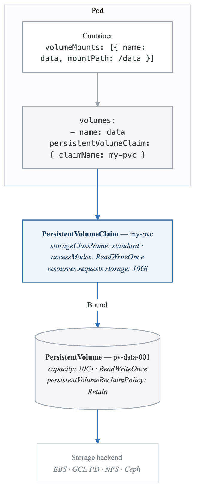
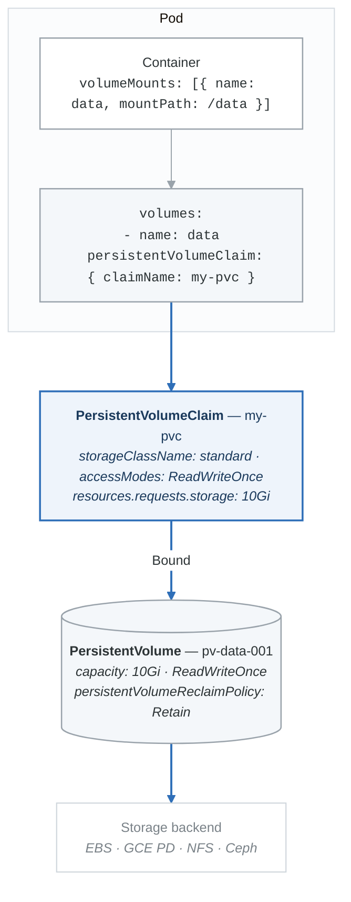
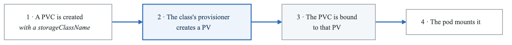
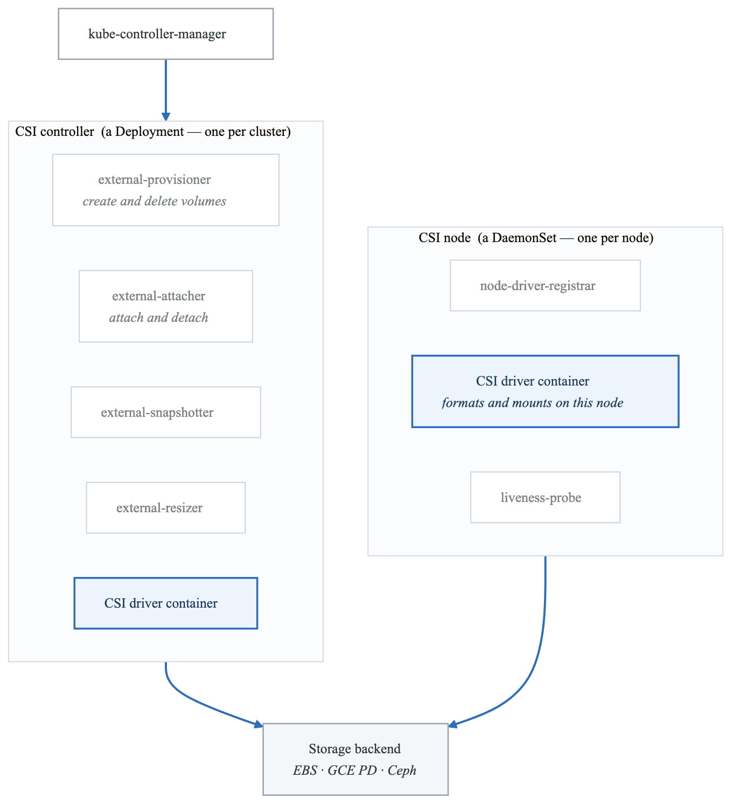
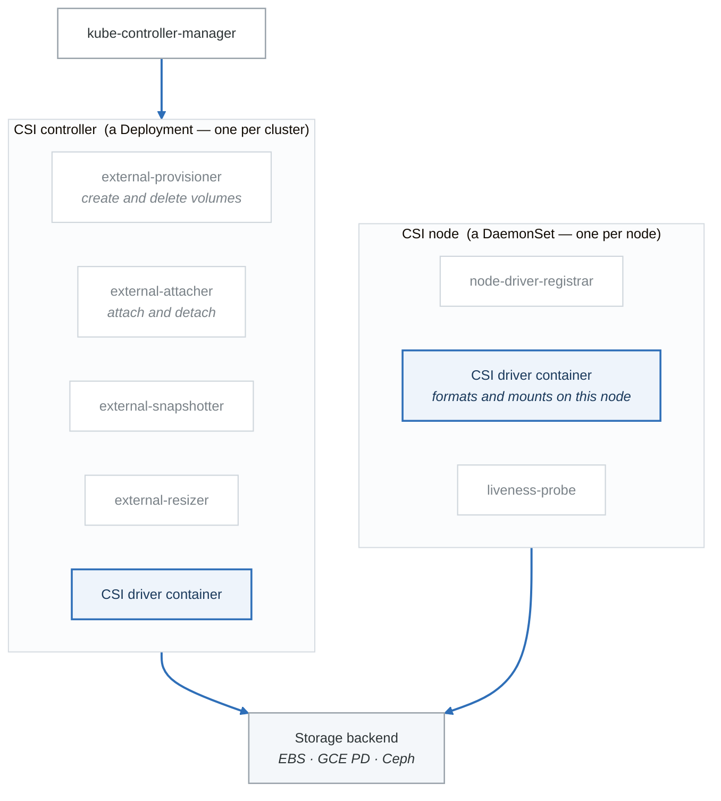

# Storage in Kubernetes

## Introduction

Kubernetes provides a robust storage system for stateful applications. This module covers Persistent Volumes, Persistent Volume Claims, Storage Classes, and best practices for managing storage in Kubernetes.

## Storage Architecture

### Storage Overview

<!-- figure: generated from the Mermaid below by _shared/diagrams/embed-figures.py — do not edit the image -->


<details>
<summary>Diagram source (Mermaid)</summary>



</details>

## Volume Types

### Ephemeral Volumes

```yaml
# emptyDir - Temporary storage (deleted when pod terminates)
apiVersion: v1
kind: Pod
metadata:
  name: shared-data-pod
spec:
  containers:
    - name: app
      image: myapp
      volumeMounts:
        - name: shared-data
          mountPath: /data
    - name: sidecar
      image: sidecar
      volumeMounts:
        - name: shared-data
          mountPath: /data
  volumes:
    - name: shared-data
      emptyDir: {}

---
# emptyDir with memory backing (RAM disk)
volumes:
  - name: cache
    emptyDir:
      medium: Memory
      sizeLimit: 1Gi
```

### ConfigMap and Secret Volumes

```yaml
# ConfigMap volume
apiVersion: v1
kind: Pod
metadata:
  name: config-pod
spec:
  containers:
    - name: app
      image: myapp
      volumeMounts:
        - name: config
          mountPath: /etc/config
          readOnly: true
        - name: secrets
          mountPath: /etc/secrets
          readOnly: true
  volumes:
    - name: config
      configMap:
        name: app-config
        items:
          - key: config.yaml
            path: config.yaml
            mode: 0644
    - name: secrets
      secret:
        secretName: app-secrets
        defaultMode: 0400
```

### HostPath Volume

```yaml
# HostPath - Mount host directory (use with caution)
apiVersion: v1
kind: Pod
metadata:
  name: hostpath-pod
spec:
  containers:
    - name: app
      image: myapp
      volumeMounts:
        - name: host-data
          mountPath: /data
  volumes:
    - name: host-data
      hostPath:
        path: /var/data
        type: DirectoryOrCreate
        # Types: Directory, DirectoryOrCreate, File, FileOrCreate,
        #        Socket, CharDevice, BlockDevice
```

## Persistent Volumes (PV)

### PV Manifest

```yaml
# persistent-volume.yaml
apiVersion: v1
kind: PersistentVolume
metadata:
  name: pv-data-001
  labels:
    type: local
spec:
  # Capacity
  capacity:
    storage: 10Gi

  # Access modes
  accessModes:
    - ReadWriteOnce    # RWO: Single node read-write
    # - ReadOnlyMany   # ROX: Multiple nodes read-only
    # - ReadWriteMany  # RWX: Multiple nodes read-write
    # - ReadWriteOncePod # RWOP: Single pod read-write (K8s 1.22+)

  # Reclaim policy
  persistentVolumeReclaimPolicy: Retain
  # Retain: Keep data after PVC deleted
  # Delete: Delete data after PVC deleted
  # Recycle: Basic scrub (deprecated)

  # Storage class
  storageClassName: standard

  # Volume mode
  volumeMode: Filesystem  # or Block

  # Mount options
  mountOptions:
    - hard
    - nfsvers=4.1

  # Backend-specific configuration
  # NFS example
  nfs:
    path: /exports/data
    server: nfs-server.example.com

---
# AWS EBS Volume
apiVersion: v1
kind: PersistentVolume
metadata:
  name: pv-aws-ebs
spec:
  capacity:
    storage: 100Gi
  accessModes:
    - ReadWriteOnce
  persistentVolumeReclaimPolicy: Delete
  storageClassName: gp2
  awsElasticBlockStore:
    volumeID: vol-0123456789abcdef
    fsType: ext4

---
# GCE Persistent Disk
apiVersion: v1
kind: PersistentVolume
metadata:
  name: pv-gce-pd
spec:
  capacity:
    storage: 100Gi
  accessModes:
    - ReadWriteOnce
  persistentVolumeReclaimPolicy: Delete
  storageClassName: standard
  gcePersistentDisk:
    pdName: my-disk
    fsType: ext4

---
# CSI Volume
apiVersion: v1
kind: PersistentVolume
metadata:
  name: pv-csi
spec:
  capacity:
    storage: 100Gi
  accessModes:
    - ReadWriteOnce
  persistentVolumeReclaimPolicy: Delete
  storageClassName: csi-standard
  csi:
    driver: ebs.csi.aws.com
    volumeHandle: vol-0123456789abcdef
    fsType: ext4
```

## Persistent Volume Claims (PVC)

### PVC Manifest

```yaml
# persistent-volume-claim.yaml
apiVersion: v1
kind: PersistentVolumeClaim
metadata:
  name: my-pvc
  namespace: default
spec:
  # Access modes
  accessModes:
    - ReadWriteOnce

  # Storage class
  storageClassName: standard  # Empty string "" for no dynamic provisioning

  # Volume mode
  volumeMode: Filesystem

  # Resource requests
  resources:
    requests:
      storage: 10Gi

  # Selector (optional - for specific PV binding)
  selector:
    matchLabels:
      type: local
    matchExpressions:
      - key: environment
        operator: In
        values:
          - production
```

### Using PVC in Pods

```yaml
# pod-with-pvc.yaml
apiVersion: v1
kind: Pod
metadata:
  name: app-with-storage
spec:
  containers:
    - name: app
      image: myapp
      volumeMounts:
        - name: data
          mountPath: /data
  volumes:
    - name: data
      persistentVolumeClaim:
        claimName: my-pvc
        readOnly: false
```

### PVC in Deployments

```yaml
# deployment-with-pvc.yaml
apiVersion: apps/v1
kind: Deployment
metadata:
  name: app-deployment
spec:
  replicas: 1  # Only 1 for RWO volumes
  selector:
    matchLabels:
      app: myapp
  template:
    metadata:
      labels:
        app: myapp
    spec:
      containers:
        - name: app
          image: myapp
          volumeMounts:
            - name: data
              mountPath: /data
      volumes:
        - name: data
          persistentVolumeClaim:
            claimName: my-pvc
```

## Storage Classes

### Storage Class Overview

**StorageClass** defines four things: the *provisioner* that creates volumes, the *parameters* it is given, the *reclaim policy* for volumes it creates, and the *volume binding mode* — whether a volume is created immediately or waits until a pod is scheduled.

**Dynamic provisioning**

```mermaid
%%{init: {'theme':'base','themeVariables':{'fontFamily':'Helvetica, Arial, sans-serif','fontSize':'13px','primaryColor':'#ffffff','primaryTextColor':'#2d3436','primaryBorderColor':'#9aa3ab','lineColor':'#9aa3ab','textColor':'#2d3436','clusterBkg':'#fbfcfd','clusterBorder':'#d4dae0','edgeLabelBackground':'#ffffff','tertiaryColor':'#eef4fb'},'flowchart':{'curve':'basis','padding':14,'nodeSpacing':42,'rankSpacing':58}}}%%
flowchart LR
  classDef default fill:#ffffff,stroke:#9aa3ab,stroke-width:1.3px,color:#2d3436
  classDef n    fill:#ffffff,stroke:#9aa3ab,stroke-width:1.3px,color:#2d3436
  classDef crit fill:#eef4fb,stroke:#2f6fb8,stroke-width:1.8px,color:#1b3a5c
  classDef data fill:#f4f7fa,stroke:#9aa3ab,stroke-width:1.3px,color:#2d3436
  classDef mut  fill:#ffffff,stroke:#cfd6dc,stroke-width:1.1px,color:#7a8288
  classDef warn fill:#fdf0ec,stroke:#c0522d,stroke-width:1.6px,color:#8a3a1e
  A["1 · A PVC is created<br/><i>with a storageClassName</i>"]
  B["2 · The class's provisioner<br/>creates a PV"]
  C["3 · The PVC is bound<br/>to that PV"]
  D["4 · The pod mounts it"]
  A ==> B ==> C ==> D
  class A n
  class B crit
  class C data
  class D n
  linkStyle 0,1,2 stroke:#2f6fb8,stroke-width:2px
```

<!-- figure: generated from the Mermaid below by _shared/diagrams/embed-figures.py — do not edit the image -->


<details>
<summary>Diagram source (Mermaid)</summary>



</details>

`volumeBindingMode: WaitForFirstConsumer` is the setting that matters in a multi-zone cluster. With the default, `Immediate`, the volume is created in some zone before the scheduler has chosen a node — and a pod that lands in a different zone can never mount it.

### Storage Class Manifests

```yaml
# AWS EBS Storage Class
apiVersion: storage.k8s.io/v1
kind: StorageClass
metadata:
  name: fast-ebs
  annotations:
    storageclass.kubernetes.io/is-default-class: "true"
provisioner: ebs.csi.aws.com
parameters:
  type: gp3
  iops: "3000"
  throughput: "125"
  encrypted: "true"
reclaimPolicy: Delete
volumeBindingMode: WaitForFirstConsumer
allowVolumeExpansion: true

---
# GCE PD Storage Class
apiVersion: storage.k8s.io/v1
kind: StorageClass
metadata:
  name: fast-ssd
provisioner: pd.csi.storage.gke.io
parameters:
  type: pd-ssd
  replication-type: regional-pd
reclaimPolicy: Retain
volumeBindingMode: WaitForFirstConsumer
allowVolumeExpansion: true
allowedTopologies:
  - matchLabelExpressions:
      - key: topology.gke.io/zone
        values:
          - us-central1-a
          - us-central1-b

---
# NFS Storage Class (requires external provisioner)
apiVersion: storage.k8s.io/v1
kind: StorageClass
metadata:
  name: nfs
provisioner: cluster.local/nfs-provisioner
parameters:
  server: nfs-server.example.com
  path: /exports
reclaimPolicy: Delete
volumeBindingMode: Immediate
mountOptions:
  - hard
  - nfsvers=4.1

---
# Local Storage Class
apiVersion: storage.k8s.io/v1
kind: StorageClass
metadata:
  name: local-storage
provisioner: kubernetes.io/no-provisioner
volumeBindingMode: WaitForFirstConsumer
reclaimPolicy: Delete
```

### Volume Binding Modes

```yaml
# Immediate: PV created and bound immediately
volumeBindingMode: Immediate

# WaitForFirstConsumer: PV created when Pod is scheduled
# Better for topology-aware provisioning
volumeBindingMode: WaitForFirstConsumer
```

## StatefulSet Storage

### Volume Claim Templates

```yaml
# statefulset-storage.yaml
apiVersion: apps/v1
kind: StatefulSet
metadata:
  name: mysql
spec:
  serviceName: mysql
  replicas: 3
  selector:
    matchLabels:
      app: mysql
  template:
    metadata:
      labels:
        app: mysql
    spec:
      containers:
        - name: mysql
          image: mysql:8.0
          volumeMounts:
            - name: data
              mountPath: /var/lib/mysql

  # Volume claim template - creates PVC for each pod
  volumeClaimTemplates:
    - metadata:
        name: data
      spec:
        accessModes: ["ReadWriteOnce"]
        storageClassName: fast-ssd
        resources:
          requests:
            storage: 100Gi

# Creates:
# - data-mysql-0 (PVC)
# - data-mysql-1 (PVC)
# - data-mysql-2 (PVC)
```

## Volume Snapshots

### Volume Snapshot Class

```yaml
# volume-snapshot-class.yaml
apiVersion: snapshot.storage.k8s.io/v1
kind: VolumeSnapshotClass
metadata:
  name: csi-snapclass
driver: ebs.csi.aws.com
deletionPolicy: Delete
parameters:
  # Driver-specific parameters
```

### Creating Snapshots

```yaml
# volume-snapshot.yaml
apiVersion: snapshot.storage.k8s.io/v1
kind: VolumeSnapshot
metadata:
  name: my-snapshot
spec:
  volumeSnapshotClassName: csi-snapclass
  source:
    persistentVolumeClaimName: my-pvc

---
# Restore from snapshot
apiVersion: v1
kind: PersistentVolumeClaim
metadata:
  name: restored-pvc
spec:
  storageClassName: fast-ssd
  dataSource:
    name: my-snapshot
    kind: VolumeSnapshot
    apiGroup: snapshot.storage.k8s.io
  accessModes:
    - ReadWriteOnce
  resources:
    requests:
      storage: 10Gi
```

## Volume Expansion

### Expanding PVC

```yaml
# Enable in StorageClass
apiVersion: storage.k8s.io/v1
kind: StorageClass
metadata:
  name: expandable
provisioner: ebs.csi.aws.com
allowVolumeExpansion: true

---
# Expand PVC by editing
apiVersion: v1
kind: PersistentVolumeClaim
metadata:
  name: my-pvc
spec:
  accessModes:
    - ReadWriteOnce
  resources:
    requests:
      storage: 20Gi  # Changed from 10Gi
```

```bash
# Expand via kubectl
kubectl patch pvc my-pvc -p '{"spec":{"resources":{"requests":{"storage":"20Gi"}}}}'

# Check expansion status
kubectl describe pvc my-pvc
```

## Backup and Restore

### Velero Backup

```bash
# Install Velero
velero install \
  --provider aws \
  --plugins velero/velero-plugin-for-aws:v1.7.0 \
  --bucket my-backup-bucket \
  --backup-location-config region=us-west-2 \
  --snapshot-location-config region=us-west-2 \
  --secret-file ./credentials-velero

# Create backup
velero backup create my-backup \
  --include-namespaces production \
  --include-resources persistentvolumeclaims,persistentvolumes

# Scheduled backup
velero schedule create daily-backup \
  --schedule="0 2 * * *" \
  --include-namespaces production \
  --ttl 720h

# Restore
velero restore create --from-backup my-backup
```

### Manual Backup Strategy

```yaml
# Backup CronJob
apiVersion: batch/v1
kind: CronJob
metadata:
  name: backup-job
spec:
  schedule: "0 2 * * *"
  jobTemplate:
    spec:
      template:
        spec:
          containers:
            - name: backup
              image: backup-tool
              volumeMounts:
                - name: data
                  mountPath: /data
                  readOnly: true
                - name: backup-storage
                  mountPath: /backup
              command:
                - /bin/sh
                - -c
                - |
                  DATE=$(date +%Y%m%d)
                  tar -czf /backup/data-$DATE.tar.gz /data
          restartPolicy: OnFailure
          volumes:
            - name: data
              persistentVolumeClaim:
                claimName: app-data
            - name: backup-storage
              persistentVolumeClaim:
                claimName: backup-pvc
```

## CSI Drivers

### Container Storage Interface

<!-- figure: generated from the Mermaid below by _shared/diagrams/embed-figures.py — do not edit the image -->


<details>
<summary>Diagram source (Mermaid)</summary>



</details>

### Installing CSI Drivers

```bash
# AWS EBS CSI Driver
kubectl apply -k "github.com/kubernetes-sigs/aws-ebs-csi-driver/deploy/kubernetes/overlays/stable/?ref=release-1.22"

# GCE PD CSI Driver
kubectl apply -f https://raw.githubusercontent.com/kubernetes-sigs/gcp-compute-persistent-disk-csi-driver/master/deploy/kubernetes/base/controller.yaml

# Check driver
kubectl get csidrivers
kubectl get csinodes
```

## Commands Reference

```bash
# Persistent Volumes
kubectl get pv
kubectl describe pv pv-name
kubectl delete pv pv-name

# Persistent Volume Claims
kubectl get pvc
kubectl get pvc -A  # All namespaces
kubectl describe pvc pvc-name
kubectl delete pvc pvc-name

# Storage Classes
kubectl get sc
kubectl describe sc storageclass-name
kubectl patch sc standard -p '{"metadata":{"annotations":{"storageclass.kubernetes.io/is-default-class":"true"}}}'

# Volume Snapshots
kubectl get volumesnapshot
kubectl get volumesnapshotclass

# Check storage usage
kubectl exec pod-name -- df -h /data

# Debug storage issues
kubectl describe pod pod-name | grep -A 10 Volumes
kubectl get events --field-selector involvedObject.name=pvc-name
```

## Best Practices

**Storage Best Practices**

1. Use Dynamic Provisioning
   • Define Storage Classes
   • Use WaitForFirstConsumer binding mode
2. Choose Appropriate Access Modes
   • RWO for single-pod databases
   • RWX for shared storage (requires NFS/EFS)
3. Set Resource Requests Accurately
   • Monitor actual usage
   • Enable volume expansion
4. Implement Backup Strategy
   • Regular snapshots
   • Test restore procedures
   • Off-cluster backups
5. Use Labels and Annotations
   • Track PVs and PVCs
   • Add metadata for management
6. Security
   • Encrypt volumes at rest
   • Use appropriate reclaim policies
   • Limit access with RBAC


## Summary

Key concepts:
- PersistentVolume (PV): Cluster storage resource
- PersistentVolumeClaim (PVC): Request for storage
- StorageClass: Dynamic provisioning configuration
- CSI: Standard storage interface

Best practices:
- Use dynamic provisioning
- Implement backup strategies
- Monitor storage usage
- Enable volume expansion
- Use appropriate access modes

## Practice Exercises

1. Create PV and PVC manually
2. Set up dynamic provisioning with StorageClass
3. Implement StatefulSet with volume templates
4. Configure volume snapshots and restore

## Next Module

Continue to [Configuration Management](./11-config-management.md) to learn about ConfigMaps and Secrets.

<!-- feynman-check -->

---

## Feynman check

Close the file. Blank page, no notes. Explain each of these to a competent engineer who has never
used this tool — **under five minutes, no jargon you can't define on the spot:**

- Storage Architecture
- Volume Types
- Persistent Volumes (PV)
- Persistent Volume Claims (PVC)

**The gap is not what you forgot. It is where you used a word instead of a mechanism.**

| | |
|---|---|
| ✗ | *"A container isolates the application."* |
| ✓ | *"A container is an ordinary Linux process started with namespaces (what it can see), cgroups (what it can use) and usually seccomp (what it may ask the kernel). There is no container object in the kernel — only a process with those features switched on."* |

**Trace it:** `docker run` → an isolated process. Name the namespaces in the order they are created, and which component actually calls `clone()`.

Stop at the first component you cannot name. Reopen this file and read **only** that.

**Go deeper — only once the gap has a name:** the [LWN namespaces series](https://lwn.net/Articles/531114/) — seven parts by the man-pages maintainer, and the reason containers stop being magic.
Full list per domain: [`SOURCES.md`](../SOURCES.md#containers)

→ Protocol, the three levels of knowing, and worked examples: [`MASTERY.md`](../MASTERY.md)

<!-- /feynman-check -->
