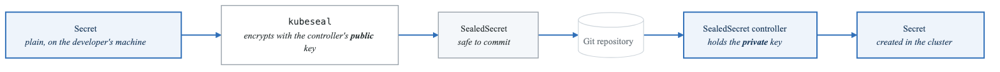

# Configuration Management

## Introduction

Kubernetes provides ConfigMaps and Secrets to manage application configuration and sensitive data. This module covers best practices for configuration management, environment variables, and secrets handling.

## ConfigMaps

### ConfigMap Overview

**ConfigMaps**

Store non-confidential configuration, decoupled from the image, so the same image runs in every
environment.

**Three ways to consume one**

**1. As environment variables**

```yaml
env:
  - name: DATABASE_HOST
    valueFrom:
      configMapKeyRef:
        name: app-config
        key: database.host
```

**2. As a mounted volume** — each key becomes a file

```yaml
volumes:
  - name: config
    configMap:
      name: app-config
```

**3. As command arguments**

```yaml
args:
  - $(CONFIG_VALUE)
```

The difference matters at update time. A **mounted** ConfigMap is updated in place — the file changes
within a minute or so, and an application that re-reads it picks up the change with no restart. An
**environment variable** is fixed at process start and never changes. That is why config you intend
to reload belongs in a volume, and why "I updated the ConfigMap and nothing happened" is usually the
env-var form.

### Creating ConfigMaps

```yaml
# configmap.yaml
apiVersion: v1
kind: ConfigMap
metadata:
  name: app-config
  namespace: default
  labels:
    app: myapp
data:
  # Simple key-value pairs
  DATABASE_HOST: "postgres.default.svc.cluster.local"
  DATABASE_PORT: "5432"
  LOG_LEVEL: "info"
  FEATURE_FLAGS: "true"

  # Multi-line configuration file
  config.yaml: |
    server:
      port: 8080
      timeout: 30s
    database:
      host: postgres
      port: 5432
      pool_size: 10
    logging:
      level: info
      format: json

  # JSON configuration
  settings.json: |
    {
      "api": {
        "version": "v1",
        "rate_limit": 1000
      }
    }

  # Properties file
  app.properties: |
    app.name=MyApplication
    app.version=1.0.0
    app.environment=production
```

### Creating ConfigMaps from Files

```bash
# From literal values
kubectl create configmap app-config \
  --from-literal=DATABASE_HOST=postgres \
  --from-literal=DATABASE_PORT=5432

# From file
kubectl create configmap app-config \
  --from-file=config.yaml

# From directory
kubectl create configmap app-config \
  --from-file=./config/

# From env file
kubectl create configmap app-config \
  --from-env-file=.env

# Generate YAML
kubectl create configmap app-config \
  --from-file=config.yaml \
  --dry-run=client -o yaml > configmap.yaml
```

### Using ConfigMaps in Pods

```yaml
# pod-with-configmap.yaml
apiVersion: v1
kind: Pod
metadata:
  name: app
spec:
  containers:
    - name: app
      image: myapp

      # Method 1: Single environment variable
      env:
        - name: DATABASE_HOST
          valueFrom:
            configMapKeyRef:
              name: app-config
              key: DATABASE_HOST
              optional: false  # Pod fails if key missing

        - name: LOG_LEVEL
          valueFrom:
            configMapKeyRef:
              name: app-config
              key: LOG_LEVEL
              optional: true  # Pod starts even if key missing

      # Method 2: All keys as environment variables
      envFrom:
        - configMapRef:
            name: app-config
          prefix: APP_  # Optional prefix

      # Method 3: Volume mount
      volumeMounts:
        - name: config-volume
          mountPath: /etc/config
          readOnly: true

        # Mount specific key to specific path
        - name: config-file
          mountPath: /app/config.yaml
          subPath: config.yaml

  volumes:
    - name: config-volume
      configMap:
        name: app-config

    - name: config-file
      configMap:
        name: app-config
        items:
          - key: config.yaml
            path: config.yaml
            mode: 0644
```

### ConfigMap Updates

```yaml
# ConfigMaps mounted as volumes update automatically
# (default sync period: ~1 minute)

# For immediate updates, use subPath mounting with caution
# subPath mounts don't receive updates

# Alternative: Use hash annotation for rolling updates
apiVersion: apps/v1
kind: Deployment
metadata:
  name: myapp
spec:
  template:
    metadata:
      annotations:
        # Change this when ConfigMap changes to trigger rollout
        checksum/config: "abc123"
```

## Secrets

### Secret Types

| Secret Types |  |
|---|---|
| Type | Description |
| Opaque | Generic secret (default) |
| kubernetes.io/tls | TLS certificate and key |
| kubernetes.io/dockerconfigjson | Docker registry auth |
| kubernetes.io/basic-auth | Basic authentication |
| kubernetes.io/ssh-auth | SSH private key |
| kubernetes.io/service-account | Service account token |


### Creating Secrets

```yaml
# secret.yaml
apiVersion: v1
kind: Secret
metadata:
  name: app-secrets
type: Opaque
# Data is base64 encoded
data:
  DATABASE_PASSWORD: cGFzc3dvcmQxMjM=  # base64 of "password123"
  API_KEY: YXBpa2V5MTIzNDU=

# stringData is plain text (converted to base64)
stringData:
  JWT_SECRET: "my-jwt-secret-key"
  config.yaml: |
    secrets:
      api_key: secret123

---
# TLS Secret
apiVersion: v1
kind: Secret
metadata:
  name: tls-secret
type: kubernetes.io/tls
data:
  tls.crt: <base64-encoded-cert>
  tls.key: <base64-encoded-key>

---
# Docker Registry Secret
apiVersion: v1
kind: Secret
metadata:
  name: registry-credentials
type: kubernetes.io/dockerconfigjson
data:
  .dockerconfigjson: <base64-encoded-docker-config>
```

### Creating Secrets from CLI

```bash
# From literal values
kubectl create secret generic app-secrets \
  --from-literal=DATABASE_PASSWORD=password123 \
  --from-literal=API_KEY=apikey12345

# From file
kubectl create secret generic app-secrets \
  --from-file=private-key=./id_rsa \
  --from-file=public-key=./id_rsa.pub

# TLS secret
kubectl create secret tls tls-secret \
  --cert=tls.crt \
  --key=tls.key

# Docker registry secret
kubectl create secret docker-registry registry-creds \
  --docker-server=gcr.io \
  --docker-username=_json_key \
  --docker-password="$(cat key.json)" \
  --docker-email=user@example.com

# Base64 encode/decode
echo -n "password123" | base64
echo "cGFzc3dvcmQxMjM=" | base64 -d
```

### Using Secrets in Pods

```yaml
# pod-with-secrets.yaml
apiVersion: v1
kind: Pod
metadata:
  name: app
spec:
  containers:
    - name: app
      image: myapp

      # Environment variables from secrets
      env:
        - name: DATABASE_PASSWORD
          valueFrom:
            secretKeyRef:
              name: app-secrets
              key: DATABASE_PASSWORD

      # All secrets as environment variables
      envFrom:
        - secretRef:
            name: app-secrets

      # Volume mount
      volumeMounts:
        - name: secrets-volume
          mountPath: /etc/secrets
          readOnly: true

  volumes:
    - name: secrets-volume
      secret:
        secretName: app-secrets
        defaultMode: 0400  # Restrict permissions
        items:
          - key: API_KEY
            path: api-key

  # Image pull secrets
  imagePullSecrets:
    - name: registry-credentials
```

## Sealed Secrets

### Sealed Secrets Overview

```mermaid
%%{init: {'theme':'base','themeVariables':{'fontFamily':'Helvetica, Arial, sans-serif','fontSize':'13px','primaryColor':'#ffffff','primaryTextColor':'#2d3436','primaryBorderColor':'#9aa3ab','lineColor':'#9aa3ab','textColor':'#2d3436','clusterBkg':'#fbfcfd','clusterBorder':'#d4dae0','edgeLabelBackground':'#ffffff','tertiaryColor':'#eef4fb'},'flowchart':{'curve':'basis','padding':14,'nodeSpacing':42,'rankSpacing':58}}}%%
flowchart LR
  classDef default fill:#ffffff,stroke:#9aa3ab,stroke-width:1.3px,color:#2d3436
  classDef n    fill:#ffffff,stroke:#9aa3ab,stroke-width:1.3px,color:#2d3436
  classDef crit fill:#eef4fb,stroke:#2f6fb8,stroke-width:1.8px,color:#1b3a5c
  classDef data fill:#f4f7fa,stroke:#9aa3ab,stroke-width:1.3px,color:#2d3436
  classDef mut  fill:#ffffff,stroke:#cfd6dc,stroke-width:1.1px,color:#7a8288
  classDef warn fill:#fdf0ec,stroke:#c0522d,stroke-width:1.6px,color:#8a3a1e
  SEC["Secret<br/><i>plain, on the developer's machine</i>"]
  KS["<code>kubeseal</code><br/><i>encrypts with the controller's <b>public</b> key</i>"]
  SS["SealedSecret<br/><i>safe to commit</i>"]
  GIT[("Git repository")]
  CTRL["SealedSecret controller<br/><i>holds the <b>private</b> key</i>"]
  OUT["Secret<br/><i>created in the cluster</i>"]
  SEC ==> KS ==> SS ==> GIT
  GIT ==> CTRL ==> OUT
  class SEC crit
  class KS n
  class SS data
  class GIT mut
  class CTRL crit
  class OUT crit
  linkStyle 0,1,2,3,4 stroke:#2f6fb8,stroke-width:2px

%% The private key never leaves the cluster, so a SealedSecret in a public repo
%% is useless to anyone else -- and useless to YOU if you lose the controller's
%% key without a backup. Back up that key the day you install it, or a cluster
%% rebuild means re-sealing every secret you have.
```

<!-- figure: generated from the Mermaid below by _shared/diagrams/embed-figures.py — do not edit the image -->


<details>
<summary>Diagram source (Mermaid)</summary>



</details>

### Using Sealed Secrets

```bash
# Install Sealed Secrets controller
kubectl apply -f https://github.com/bitnami-labs/sealed-secrets/releases/download/v0.23.0/controller.yaml

# Install kubeseal CLI
brew install kubeseal

# Create sealed secret
kubectl create secret generic app-secrets \
  --from-literal=DATABASE_PASSWORD=password123 \
  --dry-run=client -o yaml | \
  kubeseal --format yaml > sealed-secret.yaml

# View sealed secret
cat sealed-secret.yaml
```

```yaml
# sealed-secret.yaml (safe for Git)
apiVersion: bitnami.com/v1alpha1
kind: SealedSecret
metadata:
  name: app-secrets
  namespace: default
spec:
  encryptedData:
    DATABASE_PASSWORD: AgBy8hj...encrypted...
```

## External Secrets

### External Secrets Operator

```yaml
# SecretStore - Connection to external provider
apiVersion: external-secrets.io/v1beta1
kind: SecretStore
metadata:
  name: aws-secrets-manager
spec:
  provider:
    aws:
      service: SecretsManager
      region: us-west-2
      auth:
        jwt:
          serviceAccountRef:
            name: external-secrets-sa

---
# ExternalSecret - Reference to external secret
apiVersion: external-secrets.io/v1beta1
kind: ExternalSecret
metadata:
  name: app-secrets
spec:
  refreshInterval: 1h

  secretStoreRef:
    name: aws-secrets-manager
    kind: SecretStore

  target:
    name: app-secrets
    creationPolicy: Owner

  data:
    - secretKey: DATABASE_PASSWORD
      remoteRef:
        key: production/database
        property: password

    - secretKey: API_KEY
      remoteRef:
        key: production/api
        property: key
```

### HashiCorp Vault Integration

```yaml
# Vault SecretStore
apiVersion: external-secrets.io/v1beta1
kind: SecretStore
metadata:
  name: vault-store
spec:
  provider:
    vault:
      server: "https://vault.example.com"
      path: "secret"
      version: "v2"
      auth:
        kubernetes:
          mountPath: "kubernetes"
          role: "myapp"
          serviceAccountRef:
            name: vault-sa

---
# External Secret from Vault
apiVersion: external-secrets.io/v1beta1
kind: ExternalSecret
metadata:
  name: vault-secrets
spec:
  refreshInterval: 15m
  secretStoreRef:
    name: vault-store
    kind: SecretStore
  target:
    name: app-secrets
  data:
    - secretKey: DATABASE_PASSWORD
      remoteRef:
        key: secret/data/production/database
        property: password
```

## Environment Variables

### Environment Variable Patterns

```yaml
apiVersion: v1
kind: Pod
metadata:
  name: app
spec:
  containers:
    - name: app
      image: myapp

      env:
        # Static value
        - name: APP_NAME
          value: "MyApplication"

        # From ConfigMap key
        - name: LOG_LEVEL
          valueFrom:
            configMapKeyRef:
              name: app-config
              key: LOG_LEVEL

        # From Secret key
        - name: DATABASE_PASSWORD
          valueFrom:
            secretKeyRef:
              name: app-secrets
              key: DATABASE_PASSWORD

        # Pod name (downward API)
        - name: POD_NAME
          valueFrom:
            fieldRef:
              fieldPath: metadata.name

        # Pod namespace
        - name: POD_NAMESPACE
          valueFrom:
            fieldRef:
              fieldPath: metadata.namespace

        # Pod IP
        - name: POD_IP
          valueFrom:
            fieldRef:
              fieldPath: status.podIP

        # Node name
        - name: NODE_NAME
          valueFrom:
            fieldRef:
              fieldPath: spec.nodeName

        # Container resource limits
        - name: MEMORY_LIMIT
          valueFrom:
            resourceFieldRef:
              containerName: app
              resource: limits.memory

        - name: CPU_REQUEST
          valueFrom:
            resourceFieldRef:
              containerName: app
              resource: requests.cpu
```

### Downward API

```yaml
# Using downward API as volume
apiVersion: v1
kind: Pod
metadata:
  name: app
  labels:
    app: myapp
  annotations:
    build: "123"
spec:
  containers:
    - name: app
      image: myapp
      volumeMounts:
        - name: podinfo
          mountPath: /etc/podinfo
          readOnly: true

  volumes:
    - name: podinfo
      downwardAPI:
        items:
          - path: "labels"
            fieldRef:
              fieldPath: metadata.labels
          - path: "annotations"
            fieldRef:
              fieldPath: metadata.annotations
          - path: "name"
            fieldRef:
              fieldPath: metadata.name
          - path: "namespace"
            fieldRef:
              fieldPath: metadata.namespace
          - path: "cpu_limit"
            resourceFieldRef:
              containerName: app
              resource: limits.cpu
```

## Configuration Best Practices

### Environment-Specific Configuration

```yaml
# base/configmap.yaml
apiVersion: v1
kind: ConfigMap
metadata:
  name: app-config
data:
  LOG_LEVEL: "info"
  FEATURE_A: "true"

---
# overlays/production/configmap-patch.yaml
apiVersion: v1
kind: ConfigMap
metadata:
  name: app-config
data:
  LOG_LEVEL: "warn"

---
# overlays/production/kustomization.yaml
apiVersion: kustomize.config.k8s.io/v1beta1
kind: Kustomization
resources:
  - ../../base
patchesStrategicMerge:
  - configmap-patch.yaml
```

### Configuration Validation

```yaml
# Init container for config validation
apiVersion: v1
kind: Pod
metadata:
  name: app
spec:
  initContainers:
    - name: validate-config
      image: myapp:validator
      command: ["./validate-config.sh"]
      volumeMounts:
        - name: config
          mountPath: /etc/config
          readOnly: true

  containers:
    - name: app
      image: myapp
      volumeMounts:
        - name: config
          mountPath: /etc/config
          readOnly: true

  volumes:
    - name: config
      configMap:
        name: app-config
```

### Immutable ConfigMaps and Secrets

```yaml
# Immutable ConfigMap (cannot be updated)
apiVersion: v1
kind: ConfigMap
metadata:
  name: app-config-v1
data:
  config.yaml: |
    version: 1
immutable: true

# Benefits:
# - Protects against accidental updates
# - Improves performance (no watch needed)
# - Requires creating new ConfigMap for changes
```

## Commands Reference

```bash
# ConfigMaps
kubectl get configmaps
kubectl describe configmap app-config
kubectl get configmap app-config -o yaml
kubectl edit configmap app-config
kubectl delete configmap app-config

# Secrets
kubectl get secrets
kubectl describe secret app-secrets
kubectl get secret app-secrets -o yaml
kubectl get secret app-secrets -o jsonpath='{.data.DATABASE_PASSWORD}' | base64 -d

# View decoded secrets
kubectl get secret app-secrets -o go-template='{{range $k,$v := .data}}{{$k}}: {{$v | base64decode}}{{"\n"}}{{end}}'

# Create from YAML
kubectl apply -f configmap.yaml
kubectl apply -f secret.yaml
```

## Summary

Key concepts:
- ConfigMaps store non-sensitive configuration
- Secrets store sensitive data (base64 encoded)
- Multiple ways to consume: env vars, volumes, args
- Sealed Secrets for GitOps workflows
- External Secrets for secrets management systems

Best practices:
- Use ConfigMaps for non-sensitive config
- Use Secrets for sensitive data
- Use Sealed Secrets or External Secrets for GitOps
- Make ConfigMaps/Secrets immutable when possible
- Use environment-specific overlays

## Practice Exercises

1. Create and use ConfigMaps with different methods
2. Manage secrets securely with Sealed Secrets
3. Integrate with external secrets provider
4. Implement environment-specific configuration

## Next Module

Continue to [Advanced Patterns](./12-advanced-patterns.md) to learn about StatefulSets, Operators, and advanced Kubernetes patterns.

<!-- feynman-check -->

---

## Feynman check

Close the file. Blank page, no notes. Explain each of these to a competent engineer who has never
used this tool — **under five minutes, no jargon you can't define on the spot:**

- ConfigMaps
- Secrets
- Sealed Secrets
- External Secrets

**The gap is not what you forgot. It is where you used a word instead of a mechanism.**

| | |
|---|---|
| ✗ | *"A container isolates the application."* |
| ✓ | *"A container is an ordinary Linux process started with namespaces (what it can see), cgroups (what it can use) and usually seccomp (what it may ask the kernel). There is no container object in the kernel — only a process with those features switched on."* |

**Trace it:** `docker run` → an isolated process. Name the namespaces in the order they are created, and which component actually calls `clone()`.

Stop at the first component you cannot name. Reopen this file and read **only** that.

**Go deeper — only once the gap has a name:** the [LWN namespaces series](https://lwn.net/Articles/531114/) — seven parts by the man-pages maintainer, and the reason containers stop being magic.
Full list per domain: [`SOURCES.md`](../SOURCES.md#containers)

→ Protocol, the three levels of knowing, and worked examples: [`MASTERY.md`](../MASTERY.md)

<!-- /feynman-check -->
