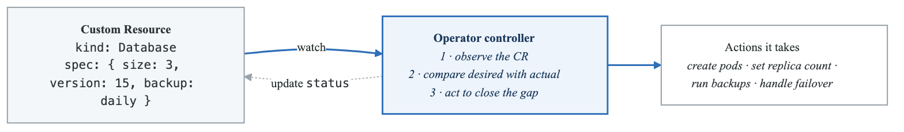

# Advanced Kubernetes Patterns

## Introduction

This module covers advanced Kubernetes patterns including Operators, custom resources, Helm charts, and production deployment strategies. These patterns are essential for building and managing complex applications at scale.

## Operators

### Operator Pattern Overview

```mermaid
%%{init: {'theme':'base','themeVariables':{'fontFamily':'Helvetica, Arial, sans-serif','fontSize':'13px','primaryColor':'#ffffff','primaryTextColor':'#2d3436','primaryBorderColor':'#9aa3ab','lineColor':'#9aa3ab','textColor':'#2d3436','clusterBkg':'#fbfcfd','clusterBorder':'#d4dae0','edgeLabelBackground':'#ffffff','tertiaryColor':'#eef4fb'},'flowchart':{'curve':'basis','padding':14,'nodeSpacing':42,'rankSpacing':58}}}%%
flowchart LR
  classDef default fill:#ffffff,stroke:#9aa3ab,stroke-width:1.3px,color:#2d3436
  classDef n    fill:#ffffff,stroke:#9aa3ab,stroke-width:1.3px,color:#2d3436
  classDef crit fill:#eef4fb,stroke:#2f6fb8,stroke-width:1.8px,color:#1b3a5c
  classDef data fill:#f4f7fa,stroke:#9aa3ab,stroke-width:1.3px,color:#2d3436
  classDef mut  fill:#ffffff,stroke:#cfd6dc,stroke-width:1.1px,color:#7a8288
  classDef warn fill:#fdf0ec,stroke:#c0522d,stroke-width:1.6px,color:#8a3a1e
  CR["<b>Custom Resource</b><br/><code>kind: Database</code><br/><code>spec: { size: 3, version: 15, backup: daily }</code>"]
  OP["<b>Operator controller</b><br/><i>1 · observe the CR<br/>2 · compare desired with actual<br/>3 · act to close the gap</i>"]
  ACT["Actions it takes<br/><i>create pods · set replica count ·<br/>run backups · handle failover</i>"]
  CR ==>|"watch"| OP
  OP ==> ACT
  OP -.->|"update <code>status</code>"| CR
  class CR data
  class OP crit
  class ACT n
  linkStyle 0,1 stroke:#2f6fb8,stroke-width:2px

%% An Operator is the control loop Kubernetes already runs for Deployments,
%% applied to something it does not know about. The value is not the CRD -- it
%% is encoding the OPERATIONAL knowledge: which replica to promote, in what
%% order to upgrade, when a backup is safe to take.
```

<!-- figure: generated from the Mermaid below by _shared/diagrams/embed-figures.py — do not edit the image -->


<details>
<summary>Diagram source (Mermaid)</summary>



</details>

### Custom Resource Definitions (CRD)

```yaml
# crd.yaml
apiVersion: apiextensions.k8s.io/v1
kind: CustomResourceDefinition
metadata:
  name: databases.example.com
spec:
  group: example.com
  versions:
    - name: v1
      served: true
      storage: true
      schema:
        openAPIV3Schema:
          type: object
          properties:
            spec:
              type: object
              required:
                - replicas
                - version
              properties:
                replicas:
                  type: integer
                  minimum: 1
                  maximum: 10
                version:
                  type: string
                  enum: ["14", "15", "16"]
                storage:
                  type: string
                  pattern: '^[0-9]+Gi$'
                backup:
                  type: object
                  properties:
                    enabled:
                      type: boolean
                    schedule:
                      type: string
            status:
              type: object
              properties:
                phase:
                  type: string
                replicas:
                  type: integer
                message:
                  type: string
      subresources:
        status: {}
      additionalPrinterColumns:
        - name: Replicas
          type: integer
          jsonPath: .spec.replicas
        - name: Version
          type: string
          jsonPath: .spec.version
        - name: Status
          type: string
          jsonPath: .status.phase
        - name: Age
          type: date
          jsonPath: .metadata.creationTimestamp
  scope: Namespaced
  names:
    plural: databases
    singular: database
    kind: Database
    shortNames:
      - db

---
# Custom Resource instance
apiVersion: example.com/v1
kind: Database
metadata:
  name: production-db
spec:
  replicas: 3
  version: "15"
  storage: "100Gi"
  backup:
    enabled: true
    schedule: "0 2 * * *"
```

### Popular Operators

```bash
# PostgreSQL Operator (CrunchyData)
kubectl apply -f https://raw.githubusercontent.com/CrunchyData/postgres-operator/v5.4.0/install/namespace.yaml
kubectl apply -f https://raw.githubusercontent.com/CrunchyData/postgres-operator/v5.4.0/install/default/manager.yaml

# Prometheus Operator
helm repo add prometheus-community https://prometheus-community.github.io/helm-charts
helm install prometheus prometheus-community/kube-prometheus-stack

# Cert-Manager
kubectl apply -f https://github.com/cert-manager/cert-manager/releases/download/v1.12.0/cert-manager.yaml

# NGINX Ingress Operator
helm repo add ingress-nginx https://kubernetes.github.io/ingress-nginx
helm install ingress-nginx ingress-nginx/ingress-nginx
```

## Helm Charts

### Helm Overview

| Helm |  |
|---|---|
| Helm is a package manager for Kubernetes |  |
| Chart Structure: |  |
| mychart/ |  |
| ├── Chart.yaml          # Chart metadata |  |
| ├── values.yaml         # Default values |  |
| ├── charts/             # Chart dependencies |  |
| ├── templates/          # Kubernetes manifests |  |
|  | ├── deployment.yaml |
|  | ├── service.yaml |
|  | ├── ingress.yaml |
|  | ├── configmap.yaml |
|  | ├── _helpers.tpl    # Template helpers |
|  | └── NOTES.txt       # Post-install notes |
| └── crds/               # Custom Resource Definitions |  |


### Chart.yaml

```yaml
# Chart.yaml
apiVersion: v2
name: myapp
description: A Helm chart for MyApp
type: application
version: 1.0.0
appVersion: "2.0.0"

keywords:
  - app
  - web

maintainers:
  - name: DevOps Team
    email: devops@example.com

dependencies:
  - name: postgresql
    version: "12.1.9"
    repository: "https://charts.bitnami.com/bitnami"
    condition: postgresql.enabled
  - name: redis
    version: "17.3.14"
    repository: "https://charts.bitnami.com/bitnami"
    condition: redis.enabled
```

### Values.yaml

```yaml
# values.yaml
replicaCount: 3

image:
  repository: myapp
  tag: "latest"
  pullPolicy: IfNotPresent

imagePullSecrets: []

service:
  type: ClusterIP
  port: 80

ingress:
  enabled: true
  className: nginx
  annotations:
    cert-manager.io/cluster-issuer: letsencrypt-prod
  hosts:
    - host: app.example.com
      paths:
        - path: /
          pathType: Prefix
  tls:
    - secretName: app-tls
      hosts:
        - app.example.com

resources:
  requests:
    memory: "128Mi"
    cpu: "100m"
  limits:
    memory: "256Mi"
    cpu: "500m"

autoscaling:
  enabled: true
  minReplicas: 3
  maxReplicas: 10
  targetCPUUtilizationPercentage: 80

env:
  - name: LOG_LEVEL
    value: "info"

configMap:
  data:
    config.yaml: |
      server:
        port: 8080

postgresql:
  enabled: true
  auth:
    database: myapp
    username: myapp

redis:
  enabled: false
```

### Template Example

```yaml
# templates/deployment.yaml
apiVersion: apps/v1
kind: Deployment
metadata:
  name: {{ include "myapp.fullname" . }}
  labels:
    {{- include "myapp.labels" . | nindent 4 }}
spec:
  {{- if not .Values.autoscaling.enabled }}
  replicas: {{ .Values.replicaCount }}
  {{- end }}
  selector:
    matchLabels:
      {{- include "myapp.selectorLabels" . | nindent 6 }}
  template:
    metadata:
      annotations:
        checksum/config: {{ include (print $.Template.BasePath "/configmap.yaml") . | sha256sum }}
      labels:
        {{- include "myapp.selectorLabels" . | nindent 8 }}
    spec:
      {{- with .Values.imagePullSecrets }}
      imagePullSecrets:
        {{- toYaml . | nindent 8 }}
      {{- end }}
      containers:
        - name: {{ .Chart.Name }}
          image: "{{ .Values.image.repository }}:{{ .Values.image.tag | default .Chart.AppVersion }}"
          imagePullPolicy: {{ .Values.image.pullPolicy }}
          ports:
            - name: http
              containerPort: 8080
              protocol: TCP
          {{- with .Values.env }}
          env:
            {{- toYaml . | nindent 12 }}
          {{- end }}
          {{- with .Values.resources }}
          resources:
            {{- toYaml . | nindent 12 }}
          {{- end }}
          livenessProbe:
            httpGet:
              path: /health
              port: http
            initialDelaySeconds: 15
          readinessProbe:
            httpGet:
              path: /ready
              port: http
            initialDelaySeconds: 5
```

### Helm Commands

```bash
# Repository management
helm repo add bitnami https://charts.bitnami.com/bitnami
helm repo update
helm search repo postgresql

# Install chart
helm install myapp ./mychart
helm install myapp ./mychart -f values-prod.yaml
helm install myapp ./mychart --set replicaCount=5

# Upgrade
helm upgrade myapp ./mychart
helm upgrade myapp ./mychart --install  # Install if not exists

# Rollback
helm rollback myapp 1
helm history myapp

# List releases
helm list
helm list -A  # All namespaces

# Uninstall
helm uninstall myapp

# Template (dry run)
helm template myapp ./mychart > manifests.yaml
helm template myapp ./mychart --debug

# Package chart
helm package ./mychart
helm push mychart-1.0.0.tgz oci://registry.example.com/charts
```

## Kustomize

### Kustomize Structure

**`project/`**

- `base/`
  - `kustomization.yaml`
  - `deployment.yaml`
  - `service.yaml`
  - `configmap.yaml`
- `overlays/`
  - `development/`
    - `kustomization.yaml`
    - `replicas-patch.yaml`
  - `staging/`
    - `kustomization.yaml`
    - `replicas-patch.yaml`
  - `production/`
    - `kustomization.yaml`
    - `replicas-patch.yaml`
    - `resources-patch.yaml`


### Base Kustomization

```yaml
# base/kustomization.yaml
apiVersion: kustomize.config.k8s.io/v1beta1
kind: Kustomization

resources:
  - deployment.yaml
  - service.yaml
  - configmap.yaml

commonLabels:
  app: myapp

configMapGenerator:
  - name: app-config
    literals:
      - LOG_LEVEL=info
```

### Production Overlay

```yaml
# overlays/production/kustomization.yaml
apiVersion: kustomize.config.k8s.io/v1beta1
kind: Kustomization

namespace: production

resources:
  - ../../base

namePrefix: prod-

commonLabels:
  environment: production

images:
  - name: myapp
    newTag: v2.0.0

replicas:
  - name: myapp
    count: 5

patches:
  - path: replicas-patch.yaml
  - path: resources-patch.yaml

configMapGenerator:
  - name: app-config
    behavior: merge
    literals:
      - LOG_LEVEL=warn

---
# overlays/production/resources-patch.yaml
apiVersion: apps/v1
kind: Deployment
metadata:
  name: myapp
spec:
  template:
    spec:
      containers:
        - name: myapp
          resources:
            requests:
              memory: "512Mi"
              cpu: "500m"
            limits:
              memory: "1Gi"
              cpu: "1"
```

### Kustomize Commands

```bash
# Build manifests
kubectl kustomize ./overlays/production

# Apply directly
kubectl apply -k ./overlays/production

# Diff
kubectl diff -k ./overlays/production
```

## Deployment Strategies

### Blue-Green Deployment

```yaml
# Blue deployment (current)
apiVersion: apps/v1
kind: Deployment
metadata:
  name: myapp-blue
  labels:
    app: myapp
    version: blue
spec:
  replicas: 3
  selector:
    matchLabels:
      app: myapp
      version: blue
  template:
    metadata:
      labels:
        app: myapp
        version: blue
    spec:
      containers:
        - name: myapp
          image: myapp:1.0

---
# Green deployment (new)
apiVersion: apps/v1
kind: Deployment
metadata:
  name: myapp-green
  labels:
    app: myapp
    version: green
spec:
  replicas: 3
  selector:
    matchLabels:
      app: myapp
      version: green
  template:
    metadata:
      labels:
        app: myapp
        version: green
    spec:
      containers:
        - name: myapp
          image: myapp:2.0

---
# Service - switch between blue/green
apiVersion: v1
kind: Service
metadata:
  name: myapp
spec:
  selector:
    app: myapp
    version: blue  # Change to 'green' to switch
  ports:
    - port: 80
      targetPort: 8080
```

### Canary Deployment

```yaml
# Stable deployment
apiVersion: apps/v1
kind: Deployment
metadata:
  name: myapp-stable
spec:
  replicas: 9  # 90% of traffic
  selector:
    matchLabels:
      app: myapp
      track: stable
  template:
    metadata:
      labels:
        app: myapp
        track: stable
    spec:
      containers:
        - name: myapp
          image: myapp:1.0

---
# Canary deployment
apiVersion: apps/v1
kind: Deployment
metadata:
  name: myapp-canary
spec:
  replicas: 1  # 10% of traffic
  selector:
    matchLabels:
      app: myapp
      track: canary
  template:
    metadata:
      labels:
        app: myapp
        track: canary
    spec:
      containers:
        - name: myapp
          image: myapp:2.0

---
# Service serves both
apiVersion: v1
kind: Service
metadata:
  name: myapp
spec:
  selector:
    app: myapp  # Matches both stable and canary
  ports:
    - port: 80
      targetPort: 8080
```

### Argo Rollouts

```yaml
# Canary with Argo Rollouts
apiVersion: argoproj.io/v1alpha1
kind: Rollout
metadata:
  name: myapp
spec:
  replicas: 10
  selector:
    matchLabels:
      app: myapp
  template:
    metadata:
      labels:
        app: myapp
    spec:
      containers:
        - name: myapp
          image: myapp:2.0
          ports:
            - containerPort: 8080
  strategy:
    canary:
      steps:
        - setWeight: 10
        - pause: {duration: 1h}
        - setWeight: 30
        - pause: {duration: 1h}
        - setWeight: 50
        - pause: {duration: 1h}
        - setWeight: 80
        - pause: {duration: 1h}

      # Automated analysis
      analysis:
        templates:
          - templateName: success-rate
        startingStep: 1
        args:
          - name: service-name
            value: myapp

---
# Analysis template
apiVersion: argoproj.io/v1alpha1
kind: AnalysisTemplate
metadata:
  name: success-rate
spec:
  args:
    - name: service-name
  metrics:
    - name: success-rate
      interval: 1m
      successCondition: result[0] >= 0.95
      failureLimit: 3
      provider:
        prometheus:
          address: http://prometheus:9090
          query: |
            sum(rate(http_requests_total{service="{{args.service-name}}",status=~"2.*"}[5m]))
            /
            sum(rate(http_requests_total{service="{{args.service-name}}"}[5m]))
```

## Pod Disruption Budgets

```yaml
# pod-disruption-budget.yaml
apiVersion: policy/v1
kind: PodDisruptionBudget
metadata:
  name: myapp-pdb
spec:
  # Minimum available pods
  minAvailable: 2
  # OR maximum unavailable
  # maxUnavailable: 1
  # OR percentage
  # minAvailable: "50%"

  selector:
    matchLabels:
      app: myapp

---
# High availability example
apiVersion: policy/v1
kind: PodDisruptionBudget
metadata:
  name: myapp-pdb
spec:
  maxUnavailable: 1
  selector:
    matchLabels:
      app: myapp
```

## Pod Topology Spread

```yaml
# Spread pods across zones and nodes
apiVersion: apps/v1
kind: Deployment
metadata:
  name: myapp
spec:
  replicas: 6
  selector:
    matchLabels:
      app: myapp
  template:
    metadata:
      labels:
        app: myapp
    spec:
      topologySpreadConstraints:
        # Spread across zones
        - maxSkew: 1
          topologyKey: topology.kubernetes.io/zone
          whenUnsatisfiable: DoNotSchedule
          labelSelector:
            matchLabels:
              app: myapp

        # Spread across nodes
        - maxSkew: 1
          topologyKey: kubernetes.io/hostname
          whenUnsatisfiable: ScheduleAnyway
          labelSelector:
            matchLabels:
              app: myapp

      containers:
        - name: myapp
          image: myapp:1.0
```

## Priority Classes

```yaml
# priority-classes.yaml
apiVersion: scheduling.k8s.io/v1
kind: PriorityClass
metadata:
  name: high-priority
value: 1000000
globalDefault: false
description: "High priority for critical workloads"
preemptionPolicy: PreemptLowerPriority

---
apiVersion: scheduling.k8s.io/v1
kind: PriorityClass
metadata:
  name: low-priority
value: 100
globalDefault: false
description: "Low priority for batch jobs"
preemptionPolicy: Never

---
# Use in Pod
apiVersion: v1
kind: Pod
metadata:
  name: critical-app
spec:
  priorityClassName: high-priority
  containers:
    - name: app
      image: myapp
```

## Vertical Pod Autoscaler

```yaml
# vpa.yaml
apiVersion: autoscaling.k8s.io/v1
kind: VerticalPodAutoscaler
metadata:
  name: myapp-vpa
spec:
  targetRef:
    apiVersion: apps/v1
    kind: Deployment
    name: myapp

  updatePolicy:
    updateMode: "Auto"  # Off, Initial, Recreate, Auto

  resourcePolicy:
    containerPolicies:
      - containerName: myapp
        minAllowed:
          cpu: 100m
          memory: 128Mi
        maxAllowed:
          cpu: 2
          memory: 4Gi
        controlledResources: ["cpu", "memory"]
        controlledValues: RequestsAndLimits
```

## GitOps with ArgoCD

```yaml
# ArgoCD Application
apiVersion: argoproj.io/v1alpha1
kind: Application
metadata:
  name: myapp
  namespace: argocd
spec:
  project: default

  source:
    repoURL: https://github.com/myorg/myapp-config
    targetRevision: HEAD
    path: overlays/production

  destination:
    server: https://kubernetes.default.svc
    namespace: production

  syncPolicy:
    automated:
      prune: true
      selfHeal: true
      allowEmpty: false
    syncOptions:
      - CreateNamespace=true
      - PrunePropagationPolicy=foreground
    retry:
      limit: 5
      backoff:
        duration: 5s
        factor: 2
        maxDuration: 3m

---
# ArgoCD ApplicationSet
apiVersion: argoproj.io/v1alpha1
kind: ApplicationSet
metadata:
  name: myapp-environments
  namespace: argocd
spec:
  generators:
    - list:
        elements:
          - env: development
            cluster: dev-cluster
          - env: staging
            cluster: staging-cluster
          - env: production
            cluster: prod-cluster

  template:
    metadata:
      name: 'myapp-{{env}}'
    spec:
      project: default
      source:
        repoURL: https://github.com/myorg/myapp-config
        targetRevision: HEAD
        path: 'overlays/{{env}}'
      destination:
        server: '{{cluster}}'
        namespace: myapp
```

## Summary

Key patterns:
- Operators automate complex application management
- Helm provides templating and packaging
- Kustomize enables environment-specific overlays
- Blue-green and canary for safe deployments
- PDBs ensure availability during disruptions

Best practices:
- Use Operators for stateful applications
- Implement GitOps for deployment automation
- Use proper deployment strategies
- Configure topology spread for HA
- Define resource policies with VPA

## Practice Exercises

1. Create a custom CRD and simple operator
2. Build a Helm chart with dependencies
3. Implement canary deployment with Argo Rollouts
4. Set up GitOps with ArgoCD

## Assessments

Complete the Phase 2 Assessment to validate your container and Kubernetes knowledge.

<!-- feynman-check -->

---

## Feynman check

Close the file. Blank page, no notes. Explain each of these to a competent engineer who has never
used this tool — **under five minutes, no jargon you can't define on the spot:**

- Operators
- Helm Charts
- Kustomize
- Deployment Strategies

**The gap is not what you forgot. It is where you used a word instead of a mechanism.**

| | |
|---|---|
| ✗ | *"A container isolates the application."* |
| ✓ | *"A container is an ordinary Linux process started with namespaces (what it can see), cgroups (what it can use) and usually seccomp (what it may ask the kernel). There is no container object in the kernel — only a process with those features switched on."* |

**Trace it:** `docker run` → an isolated process. Name the namespaces in the order they are created, and which component actually calls `clone()`.

Stop at the first component you cannot name. Reopen this file and read **only** that.

**Go deeper — only once the gap has a name:** the [LWN namespaces series](https://lwn.net/Articles/531114/) — seven parts by the man-pages maintainer, and the reason containers stop being magic.
Full list per domain: [`SOURCES.md`](../SOURCES.md#containers)

→ Protocol, the three levels of knowing, and worked examples: [`MASTERY.md`](../MASTERY.md)

<!-- /feynman-check -->
