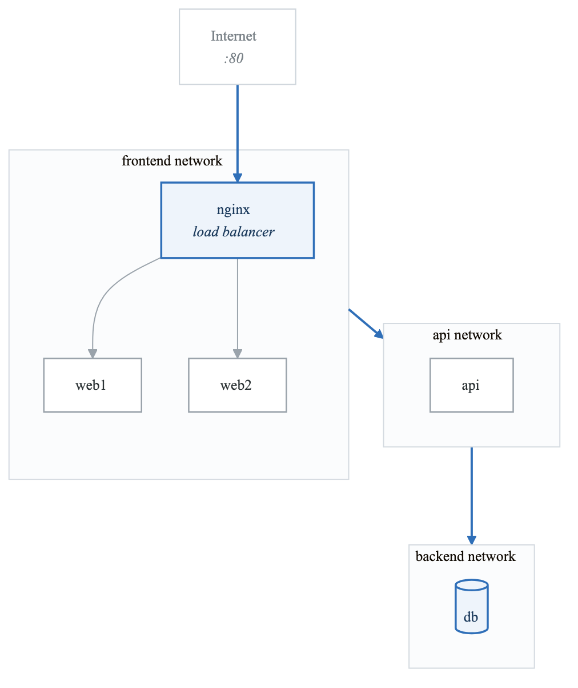
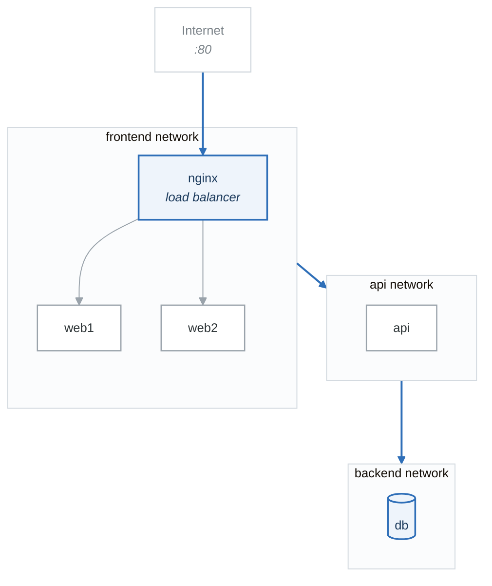

# Lab 04: Docker Networking

## Objectives

- Understand Docker networking concepts
- Work with different network drivers
- Configure container DNS and service discovery
- Troubleshoot network issues

## Prerequisites

- Completed Labs 01-03
- Docker installed and configured

---

## Part 1: Network Basics (Guided)

### Step 1: Explore Default Networks

```bash
# List networks
docker network ls

# Inspect bridge network
docker network inspect bridge

# View network driver details
docker info | grep -A 10 "Network"
```

### Step 2: Default Bridge Network

```bash
# Run two containers on default bridge
docker run -d --name web1 nginx:alpine
docker run -d --name web2 nginx:alpine

# Get container IPs
docker inspect -f '{{range .NetworkSettings.Networks}}{{.IPAddress}}{{end}}' web1
docker inspect -f '{{range .NetworkSettings.Networks}}{{.IPAddress}}{{end}}' web2

# Test connectivity (by IP only on default bridge)
docker exec web1 ping -c 3 $(docker inspect -f '{{range .NetworkSettings.Networks}}{{.IPAddress}}{{end}}' web2)

# DNS resolution fails on default bridge
docker exec web1 ping -c 3 web2  # This will fail

# Cleanup
docker rm -f web1 web2
```

### Step 3: User-Defined Bridge Network

```bash
# Create custom network
docker network create --driver bridge my-network

# Inspect network
docker network inspect my-network

# Run containers on custom network
docker run -d --name web1 --network my-network nginx:alpine
docker run -d --name web2 --network my-network nginx:alpine

# DNS resolution works!
docker exec web1 ping -c 3 web2

# Test HTTP
docker exec web1 wget -qO- http://web2

# Cleanup
docker rm -f web1 web2
docker network rm my-network
```

### Validation

```bash
#!/bin/bash
# validate-part1.sh

echo "=== Part 1 Validation ==="

# Create test network
docker network create test-net

# Run containers
docker run -d --name test1 --network test-net alpine sleep 60
docker run -d --name test2 --network test-net alpine sleep 60

# Test DNS resolution
if docker exec test1 ping -c 1 test2 &> /dev/null; then
    echo "✓ DNS resolution works on custom network"
else
    echo "✗ DNS resolution failed"
fi

# Cleanup
docker rm -f test1 test2
docker network rm test-net

echo "Part 1 validation complete!"
```

---

## Part 2: Network Drivers (Semi-Guided)

### Objective

Work with different network drivers and understand their use cases.

### Tasks

1. Create networks with different drivers:
   - Bridge with custom subnet
   - Host network usage
   - None network

2. Test connectivity between containers on different networks

3. Connect container to multiple networks

### Create Custom Bridge

```bash
# Create bridge with custom settings
docker network create \
  --driver bridge \
  --subnet 172.28.0.0/16 \
  --ip-range 172.28.5.0/24 \
  --gateway 172.28.5.254 \
  --opt com.docker.network.bridge.name=custom-bridge \
  custom-net

# Verify
docker network inspect custom-net
ip addr show custom-bridge
```

### Host Network Mode

```bash
# Run with host network
docker run -d --name host-nginx --network host nginx:alpine

# Verify - container uses host's network stack
curl http://localhost

# Note: Port mapping (-p) is not needed and ignored with host network
```

### Multiple Networks

```bash
# Create two networks
docker network create frontend
docker network create backend

# Run database (backend only)
docker run -d --name db --network backend alpine sleep 300

# Run API (connected to both)
docker run -d --name api --network backend alpine sleep 300
docker network connect frontend api

# Run web (frontend only)
docker run -d --name web --network frontend alpine sleep 300

# Test connectivity
docker exec api ping -c 1 db     # Should work
docker exec api ping -c 1 web    # Should work
docker exec web ping -c 1 db     # Should fail (isolated)
```

### Validation

```bash
#!/bin/bash
# validate-part2.sh

echo "=== Part 2 Validation ==="

# Setup networks
docker network create frontend
docker network create backend

docker run -d --name db --network backend alpine sleep 60
docker run -d --name api --network backend alpine sleep 60
docker network connect frontend api
docker run -d --name web --network frontend alpine sleep 60

# Test isolation
if docker exec web ping -c 1 db &> /dev/null; then
    echo "✗ Network isolation failed - web can reach db"
else
    echo "✓ Network isolation works - web cannot reach db"
fi

# Test multi-network
if docker exec api ping -c 1 db &> /dev/null && docker exec api ping -c 1 web &> /dev/null; then
    echo "✓ Multi-network works - api can reach both"
else
    echo "✗ Multi-network failed"
fi

# Cleanup
docker rm -f db api web
docker network rm frontend backend

echo "Part 2 validation complete!"
```

---

## Part 3: Port Publishing and DNS (Semi-Guided)

### Objective

Configure port publishing and custom DNS settings.

### Tasks

1. Publish ports with different options
2. Configure custom DNS servers
3. Use network aliases for service discovery

### Port Publishing Options

```bash
# Publish to all interfaces
docker run -d --name web1 -p 8080:80 nginx:alpine

# Publish to specific interface
docker run -d --name web2 -p 127.0.0.1:8081:80 nginx:alpine

# Publish random port
docker run -d --name web3 -p 80 nginx:alpine

# View port mappings
docker port web3

# Cleanup
docker rm -f web1 web2 web3
```

### Network Aliases

```bash
# Create network
docker network create app-net

# Run multiple instances with same alias
docker run -d --name api1 --network app-net --network-alias api alpine sh -c "echo 'api1' && sleep 300"
docker run -d --name api2 --network app-net --network-alias api alpine sh -c "echo 'api2' && sleep 300"

# DNS round-robin
docker run --rm --network app-net alpine nslookup api

# Multiple lookups may return different IPs
for i in 1 2 3 4 5; do
  docker run --rm --network app-net alpine nslookup api 2>/dev/null | grep "Address:" | tail -1
done
```

### Custom DNS

```bash
# Run with custom DNS
docker run -d --name custom-dns \
  --dns 8.8.8.8 \
  --dns 8.8.4.4 \
  --dns-search example.com \
  alpine sleep 300

# Verify
docker exec custom-dns cat /etc/resolv.conf
```

### Validation

```bash
#!/bin/bash
# validate-part3.sh

echo "=== Part 3 Validation ==="

docker network create alias-net

# Create containers with aliases
docker run -d --name svc1 --network alias-net --network-alias myservice alpine sleep 60
docker run -d --name svc2 --network alias-net --network-alias myservice alpine sleep 60

# Check DNS returns multiple IPs
IPS=$(docker run --rm --network alias-net alpine nslookup myservice 2>/dev/null | grep "Address:" | wc -l)

if [ "$IPS" -ge 2 ]; then
    echo "✓ Network alias returns multiple IPs"
else
    echo "✗ Network alias not working properly"
fi

# Cleanup
docker rm -f svc1 svc2
docker network rm alias-net

echo "Part 3 validation complete!"
```

---

## Part 4: Challenge - Microservices Network

### Objective

Design and implement a multi-tier application network architecture.

### Architecture

<!-- figure: generated from the Mermaid below by _shared/diagrams/embed-figures.py — do not edit the image -->


<details>
<summary>Diagram source (Mermaid)</summary>



</details>

### Requirements

1. Create three isolated networks:
   - frontend-net
   - api-net
   - backend-net

2. Deploy containers:
   - nginx (load balancer) - frontend only, port 80 exposed
   - web1, web2 - frontend only (using network alias "web")
   - api - connected to both frontend and api networks
   - db - backend only

3. Configure nginx to load balance between web1 and web2

4. Ensure proper network isolation:
   - web containers cannot reach db
   - Only api can reach db
   - External access only through nginx

5. Create a test script that validates:
   - All services are accessible through their intended paths
   - Network isolation is maintained
   - DNS resolution works correctly

### Nginx Configuration Template

```nginx
# nginx.conf
upstream web_backend {
    server web:80;
}

server {
    listen 80;

    location / {
        proxy_pass http://web_backend;
    }
}
```

### Validation Script

```bash
#!/bin/bash
# validate-challenge.sh

echo "=== Challenge Validation ==="

# Test external access
if curl -s http://localhost | grep -q "nginx\|web"; then
    echo "✓ External access works"
else
    echo "✗ External access failed"
fi

# Test network isolation (web cannot reach db)
if docker exec web1 ping -c 1 db &> /dev/null; then
    echo "✗ Network isolation failed - web can reach db"
else
    echo "✓ Network isolation - web cannot reach db"
fi

# Test api can reach both web and db
API_TO_WEB=$(docker exec api ping -c 1 web 2>/dev/null && echo "ok")
API_TO_DB=$(docker exec api ping -c 1 db 2>/dev/null && echo "ok")

if [ "$API_TO_WEB" = "ok" ] && [ "$API_TO_DB" = "ok" ]; then
    echo "✓ API can reach both web and db"
else
    echo "✗ API connectivity issues"
fi

# Test load balancing (multiple requests should hit different backends)
echo "Testing load balancing..."
for i in 1 2 3 4; do
    curl -s http://localhost | head -1
done

echo ""
echo "Challenge validation complete!"
```

---

## Deliverables

1. Network architecture diagram
2. Docker commands or docker-compose.yml
3. nginx configuration
4. Test script demonstrating isolation
5. Network troubleshooting documentation

## Troubleshooting Commands

```bash
# Network debugging
docker network inspect <network>
docker exec <container> ip addr
docker exec <container> ip route
docker exec <container> cat /etc/resolv.conf
docker exec <container> ping <target>
docker exec <container> traceroute <target>

# Using netshoot for debugging
docker run -it --rm --network <network> nicolaka/netshoot
```

## Resources

- [Docker Networking](https://docs.docker.com/network/)
- [Bridge Networks](https://docs.docker.com/network/bridge/)
- [Network Troubleshooting](https://docs.docker.com/engine/network/tutorials/standalone/)

## Next Lab

Continue to [Lab 05: Docker Volumes](lab-05-docker-volumes-README.md)

<!-- feynman-check -->

---

## Feynman check

Close the file. Blank page, no notes. Explain each of these to a competent engineer who has never
used this tool — **under five minutes, no jargon you can't define on the spot:**

- Network Basics
- Network Drivers
- Port Publishing and DNS
- Challenge - Microservices Network

**The gap is not what you forgot. It is where you used a word instead of a mechanism.**

| | |
|---|---|
| ✗ | *"A container isolates the application."* |
| ✓ | *"A container is an ordinary Linux process started with namespaces (what it can see), cgroups (what it can use) and usually seccomp (what it may ask the kernel). There is no container object in the kernel — only a process with those features switched on."* |

**Trace it:** `docker run` → an isolated process. Name the namespaces in the order they are created, and which component actually calls `clone()`.

Stop at the first component you cannot name. Reopen this file and read **only** that.

**Go deeper — only once the gap has a name:** the [LWN namespaces series](https://lwn.net/Articles/531114/) — seven parts by the man-pages maintainer, and the reason containers stop being magic.
Full list per domain: [`SOURCES.md`](../../SOURCES.md#containers)

→ Protocol, the three levels of knowing, and worked examples: [`MASTERY.md`](../../MASTERY.md)

<!-- /feynman-check -->
