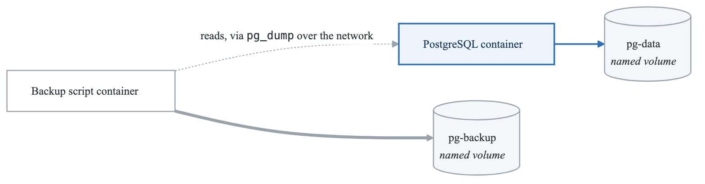
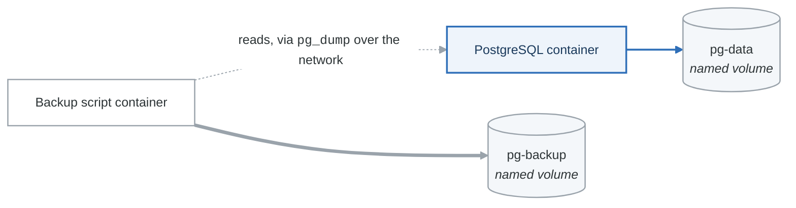

# Lab 05: Docker Volumes and Storage

## Objectives

- Understand Docker storage options
- Work with volumes and bind mounts
- Implement data persistence patterns
- Backup and restore volume data

## Prerequisites

- Completed Labs 01-04
- Docker installed and configured

---

## Part 1: Volume Basics (Guided)

### Step 1: Create and Inspect Volumes

```bash
# Create a named volume
docker volume create mydata

# List volumes
docker volume ls

# Inspect volume
docker volume inspect mydata

# View volume location
ls -la /var/lib/docker/volumes/mydata/_data
```

### Step 2: Use Volumes with Containers

```bash
# Run container with volume
docker run -d --name db \
  -v mydata:/var/lib/postgresql/data \
  -e POSTGRES_PASSWORD=secret \
  postgres:15-alpine

# Verify data is in volume
docker exec db psql -U postgres -c "CREATE TABLE test (id serial PRIMARY KEY, name varchar(50));"
docker exec db psql -U postgres -c "INSERT INTO test (name) VALUES ('Hello from Docker!');"

# Stop and remove container
docker stop db && docker rm db

# Data persists - create new container with same volume
docker run -d --name db2 \
  -v mydata:/var/lib/postgresql/data \
  -e POSTGRES_PASSWORD=secret \
  postgres:15-alpine

# Verify data still exists
sleep 5
docker exec db2 psql -U postgres -c "SELECT * FROM test;"

# Cleanup
docker rm -f db2
```

### Step 3: Anonymous vs Named Volumes

```bash
# Anonymous volume (auto-generated name)
docker run -d --name anon-vol -v /data alpine sleep 300

# View anonymous volume
docker inspect --format '{{range .Mounts}}{{.Name}}{{end}}' anon-vol

# Anonymous volumes are harder to manage
docker volume ls

# Cleanup
docker rm -f anon-vol
docker volume prune -f
```

### Validation

```bash
#!/bin/bash
# validate-part1.sh

echo "=== Part 1 Validation ==="

# Create test volume
docker volume create test-vol

# Write data
docker run --rm -v test-vol:/data alpine sh -c "echo 'persistent data' > /data/test.txt"

# Read data in new container
DATA=$(docker run --rm -v test-vol:/data alpine cat /data/test.txt)

if [ "$DATA" = "persistent data" ]; then
    echo "✓ Volume persistence works"
else
    echo "✗ Volume persistence failed"
fi

# Cleanup
docker volume rm test-vol

echo "Part 1 validation complete!"
```

---

## Part 2: Bind Mounts (Semi-Guided)

### Objective

Use bind mounts for development workflows.

### Tasks

1. Create a local development environment with bind mounts
2. Demonstrate live code reloading
3. Handle file permissions

### Development Setup

```bash
# Create project directory
mkdir -p ~/docker-labs/lab05/app
cd ~/docker-labs/lab05/app

# Create simple Node.js app
cat > package.json << 'EOF'
{
  "name": "dev-app",
  "version": "1.0.0",
  "scripts": {
    "start": "node server.js",
    "dev": "nodemon server.js"
  },
  "dependencies": {
    "express": "^4.18.0"
  },
  "devDependencies": {
    "nodemon": "^3.0.0"
  }
}
EOF

cat > server.js << 'EOF'
const express = require('express');
const app = express();

app.get('/', (req, res) => {
  res.json({ message: 'Hello from the app!' });
});

const PORT = 3000;
app.listen(PORT, () => {
  console.log(`Server running on port ${PORT}`);
});
EOF
```

### Run with Bind Mount

```bash
# Run with bind mount for development
docker run -d --name dev-app \
  -v $(pwd):/app \
  -w /app \
  -p 3000:3000 \
  node:18-alpine \
  sh -c "npm install && npm run dev"

# Test
curl http://localhost:3000

# Edit server.js locally and see changes (with nodemon)
```

### File Permission Handling

```bash
# Check who owns files
ls -la

# Run container as current user
docker run --rm \
  -v $(pwd):/app \
  -u $(id -u):$(id -g) \
  node:18-alpine \
  touch /app/newfile.txt

# Verify ownership
ls -la newfile.txt
```

### Validation

```bash
#!/bin/bash
# validate-part2.sh

echo "=== Part 2 Validation ==="

cd ~/docker-labs/lab05/app

# Check bind mount works
docker run --rm -v $(pwd):/app alpine ls /app/server.js &> /dev/null
if [ $? -eq 0 ]; then
    echo "✓ Bind mount works"
else
    echo "✗ Bind mount failed"
fi

# Check file creation with correct permissions
docker run --rm -v $(pwd):/app -u $(id -u):$(id -g) alpine touch /app/test-perm.txt
OWNER=$(stat -c "%u" test-perm.txt)

if [ "$OWNER" = "$(id -u)" ]; then
    echo "✓ File permissions correct"
else
    echo "✗ File permissions incorrect"
fi

rm -f test-perm.txt newfile.txt

echo "Part 2 validation complete!"
```

---

## Part 3: tmpfs Mounts (Semi-Guided)

### Objective

Use tmpfs for sensitive or temporary data.

### Tasks

1. Create container with tmpfs mount
2. Verify data is not persisted
3. Use for sensitive data handling

### tmpfs Usage

```bash
# Run with tmpfs
docker run -d --name tmpfs-demo \
  --tmpfs /tmp:size=100m \
  alpine sleep 300

# Write data to tmpfs
docker exec tmpfs-demo sh -c "echo 'sensitive data' > /tmp/secret.txt"
docker exec tmpfs-demo cat /tmp/secret.txt

# Verify tmpfs
docker exec tmpfs-demo df -h /tmp
docker exec tmpfs-demo mount | grep tmp

# Stop and start - data is gone
docker stop tmpfs-demo
docker start tmpfs-demo
docker exec tmpfs-demo cat /tmp/secret.txt  # File not found
```

### Secret Handling Pattern

```bash
# Use tmpfs for secrets that should never persist
docker run -d --name secure-app \
  --tmpfs /run/secrets:size=1m,mode=0700 \
  alpine sleep 300

# Inject secret at runtime
docker exec secure-app sh -c "echo 'API_KEY=secret123' > /run/secrets/api_key"
docker exec secure-app cat /run/secrets/api_key

# Cleanup
docker rm -f tmpfs-demo secure-app
```

---

## Part 4: Challenge - Database with Backup

### Objective

Implement a complete database solution with:
- Persistent data storage
- Automated backups
- Restore capability

### Requirements

1. Run PostgreSQL with named volume for data
2. Create backup script that:
   - Dumps database to gzipped file
   - Stores in backup volume
   - Keeps last 7 backups
3. Create restore script
4. Test full backup/restore cycle

### Architecture

<!-- figure: generated from the Mermaid below by _shared/diagrams/embed-figures.py — do not edit the image -->


<details>
<summary>Diagram source (Mermaid)</summary>



</details>

### Starter Code

```bash
#!/bin/bash
# backup.sh

TIMESTAMP=$(date +%Y%m%d_%H%M%S)
BACKUP_FILE="/backup/db_${TIMESTAMP}.sql.gz"

# Create backup
pg_dump -U postgres mydb | gzip > $BACKUP_FILE

# Keep only last 7 backups
ls -t /backup/*.sql.gz | tail -n +8 | xargs -r rm

echo "Backup completed: $BACKUP_FILE"
```

```bash
#!/bin/bash
# restore.sh

BACKUP_FILE=$1

if [ -z "$BACKUP_FILE" ]; then
    echo "Latest backups:"
    ls -lt /backup/*.sql.gz | head -5
    echo ""
    echo "Usage: restore.sh <backup_file>"
    exit 1
fi

# Restore from backup
gunzip -c /backup/$BACKUP_FILE | psql -U postgres mydb

echo "Restore completed from: $BACKUP_FILE"
```

### Validation Script

```bash
#!/bin/bash
# validate-challenge.sh

echo "=== Challenge Validation ==="

# Check volumes exist
if docker volume ls | grep -q "pg-data"; then
    echo "✓ pg-data volume exists"
else
    echo "✗ pg-data volume not found"
fi

if docker volume ls | grep -q "pg-backup"; then
    echo "✓ pg-backup volume exists"
else
    echo "✗ pg-backup volume not found"
fi

# Check PostgreSQL is running
if docker ps | grep -q "postgres"; then
    echo "✓ PostgreSQL container running"
else
    echo "✗ PostgreSQL container not running"
    exit 1
fi

# Create test data
docker exec postgres psql -U postgres -d mydb -c "
    CREATE TABLE IF NOT EXISTS backup_test (id serial, data text);
    INSERT INTO backup_test (data) VALUES ('test-$(date +%s)');
"

# Run backup
docker run --rm \
    -v pg-backup:/backup \
    --network container:postgres \
    postgres:15-alpine \
    sh -c "pg_dump -h localhost -U postgres mydb | gzip > /backup/test_backup.sql.gz"

# Check backup exists
BACKUP_COUNT=$(docker run --rm -v pg-backup:/backup alpine ls /backup/*.sql.gz 2>/dev/null | wc -l)
if [ "$BACKUP_COUNT" -gt 0 ]; then
    echo "✓ Backup created successfully"
else
    echo "✗ Backup not found"
fi

# Test restore (drop and recreate table, then restore)
docker exec postgres psql -U postgres -d mydb -c "DROP TABLE backup_test;"

docker run --rm \
    -v pg-backup:/backup \
    --network container:postgres \
    postgres:15-alpine \
    sh -c "gunzip -c /backup/test_backup.sql.gz | psql -h localhost -U postgres mydb"

# Verify restore
COUNT=$(docker exec postgres psql -U postgres -d mydb -t -c "SELECT COUNT(*) FROM backup_test;")
if [ "$COUNT" -gt 0 ]; then
    echo "✓ Restore successful"
else
    echo "✗ Restore failed"
fi

echo ""
echo "Challenge validation complete!"
```

---

## Deliverables

1. Working PostgreSQL with persistent storage
2. Automated backup script
3. Restore script with verification
4. Documentation of backup/restore procedure

## Volume Commands Reference

```bash
# Create/manage volumes
docker volume create <name>
docker volume ls
docker volume inspect <name>
docker volume rm <name>
docker volume prune

# Mount options
-v volume_name:/path                    # Named volume
-v /host/path:/container/path           # Bind mount
-v /host/path:/container/path:ro        # Read-only
--mount type=volume,source=vol,target=/path
--mount type=bind,source=/host,target=/container
--mount type=tmpfs,target=/tmp

# Backup/restore
docker run --rm -v volume:/data -v $(pwd):/backup alpine tar czf /backup/backup.tar.gz -C /data .
docker run --rm -v volume:/data -v $(pwd):/backup alpine tar xzf /backup/backup.tar.gz -C /data
```

## Resources

- [Docker Volumes](https://docs.docker.com/storage/volumes/)
- [Bind Mounts](https://docs.docker.com/storage/bind-mounts/)
- [tmpfs Mounts](https://docs.docker.com/storage/tmpfs/)

## Next Lab

Continue to [Lab 06: Docker Compose](../lab-06-docker-compose/)

<!-- feynman-check -->

---

## Feynman check

Close the file. Blank page, no notes. Explain each of these to a competent engineer who has never
used this tool — **under five minutes, no jargon you can't define on the spot:**

- Volume Basics
- Bind Mounts
- tmpfs Mounts
- Challenge - Database with Backup

**The gap is not what you forgot. It is where you used a word instead of a mechanism.**

| | |
|---|---|
| ✗ | *"A container isolates the application."* |
| ✓ | *"A container is an ordinary Linux process started with namespaces (what it can see), cgroups (what it can use) and usually seccomp (what it may ask the kernel). There is no container object in the kernel — only a process with those features switched on."* |

**Trace it:** `docker run` → an isolated process. Name the namespaces in the order they are created, and which component actually calls `clone()`.

Stop at the first component you cannot name. Reopen this file and read **only** that.

**Go deeper — only once the gap has a name:** the [LWN namespaces series](https://lwn.net/Articles/531114/) — seven parts by the man-pages maintainer, and the reason containers stop being magic.
Full list per domain: [`SOURCES.md`](../../SOURCES.md#containers)

→ Protocol, the three levels of knowing, and worked examples: [`MASTERY.md`](../../MASTERY.md)

<!-- /feynman-check -->
