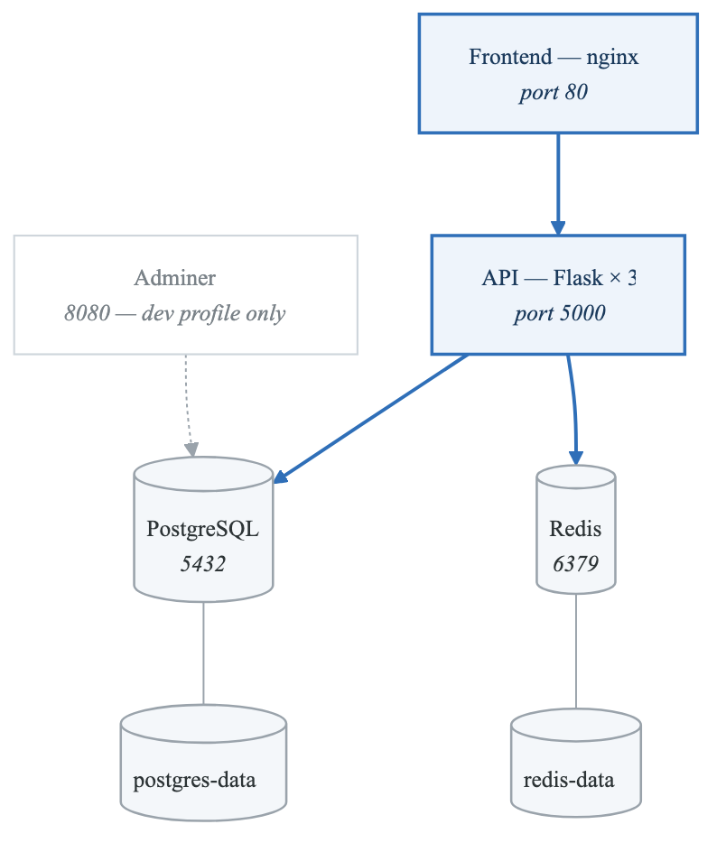
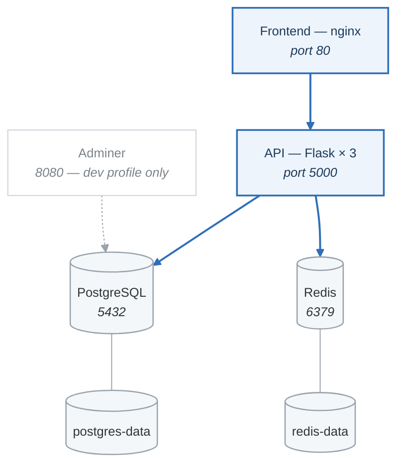

# Lab 06: Docker Compose

## Objectives

- Define multi-container applications with Docker Compose
- Manage service dependencies and networking
- Use environment files and secrets
- Implement production-ready compose patterns

## Prerequisites

- Completed Labs 01-05
- Docker and Docker Compose installed

---

## Part 1: Compose Basics (Guided)

### Step 1: Create Project Structure

```bash
mkdir -p ~/docker-labs/lab06
cd ~/docker-labs/lab06

# Create directory structure
mkdir -p app nginx
```

### Step 2: Create Simple Application

```bash
# Create Flask application
cat > app/app.py << 'EOF'
from flask import Flask, jsonify
import os
import redis
import socket

app = Flask(__name__)

def get_redis():
    return redis.Redis(host='redis', port=6379, decode_responses=True)

@app.route('/')
def hello():
    r = get_redis()
    count = r.incr('hits')
    return jsonify({
        'message': 'Hello from Flask!',
        'hostname': socket.gethostname(),
        'visits': count
    })

@app.route('/health')
def health():
    return jsonify({'status': 'healthy'})

if __name__ == '__main__':
    app.run(host='0.0.0.0', port=5000)
EOF

cat > app/requirements.txt << 'EOF'
flask==3.0.0
redis==5.0.0
gunicorn==21.2.0
EOF

cat > app/Dockerfile << 'EOF'
FROM python:3.11-slim
WORKDIR /app
COPY requirements.txt .
RUN pip install --no-cache-dir -r requirements.txt
COPY app.py .
USER nobody
EXPOSE 5000
CMD ["gunicorn", "-w", "4", "-b", "0.0.0.0:5000", "app:app"]
EOF
```

### Step 3: Create Docker Compose File

```yaml
# docker-compose.yml
version: '3.8'

services:
  app:
    build: ./app
    ports:
      - "5000:5000"
    environment:
      - FLASK_ENV=development
    depends_on:
      - redis
    healthcheck:
      test: ["CMD", "curl", "-f", "http://localhost:5000/health"]
      interval: 30s
      timeout: 10s
      retries: 3
      start_period: 10s

  redis:
    image: redis:7-alpine
    volumes:
      - redis-data:/data
    healthcheck:
      test: ["CMD", "redis-cli", "ping"]
      interval: 10s
      timeout: 5s
      retries: 3

volumes:
  redis-data:
```

### Step 4: Run and Manage

```bash
# Start services
docker compose up -d

# View logs
docker compose logs -f

# View status
docker compose ps

# Test application
curl http://localhost:5000

# Scale service
docker compose up -d --scale app=3

# Stop services
docker compose down

# Stop and remove volumes
docker compose down -v
```

### Validation

```bash
#!/bin/bash
# validate-part1.sh

cd ~/docker-labs/lab06

echo "=== Part 1 Validation ==="

# Start services
docker compose up -d

sleep 10

# Check services running
if docker compose ps | grep -q "running"; then
    echo "✓ Services are running"
else
    echo "✗ Services not running"
    exit 1
fi

# Test endpoint
RESPONSE=$(curl -s http://localhost:5000)
if echo "$RESPONSE" | grep -q "Hello from Flask"; then
    echo "✓ Application responds"
else
    echo "✗ Application not responding"
fi

# Test visit counter increments
VISITS1=$(curl -s http://localhost:5000 | jq -r '.visits')
VISITS2=$(curl -s http://localhost:5000 | jq -r '.visits')

if [ "$VISITS2" -gt "$VISITS1" ]; then
    echo "✓ Redis integration working"
else
    echo "✗ Redis integration failed"
fi

docker compose down

echo "Part 1 validation complete!"
```

---

## Part 2: Advanced Compose Features (Semi-Guided)

### Objective

Implement advanced Docker Compose features.

### Tasks

1. Add nginx reverse proxy
2. Use environment files
3. Implement profiles for different environments
4. Add healthchecks and resource limits

### Add Nginx Reverse Proxy

```bash
# Create nginx config
cat > nginx/nginx.conf << 'EOF'
upstream app {
    server app:5000;
}

server {
    listen 80;

    location / {
        proxy_pass http://app;
        proxy_set_header Host $host;
        proxy_set_header X-Real-IP $remote_addr;
        proxy_set_header X-Forwarded-For $proxy_add_x_forwarded_for;
    }

    location /health {
        access_log off;
        proxy_pass http://app/health;
    }
}
EOF
```

### Environment Files

```bash
# Create .env file
cat > .env << 'EOF'
COMPOSE_PROJECT_NAME=myapp
FLASK_ENV=development
REDIS_HOST=redis
APP_REPLICAS=2
EOF

# Create production.env
cat > production.env << 'EOF'
FLASK_ENV=production
APP_REPLICAS=4
EOF
```

### Updated Compose File

Create `docker-compose.yml` with:
- nginx service
- Environment file support
- Resource limits
- Profiles (development, production)

### Hints

<details>
<summary>Nginx Service</summary>

```yaml
nginx:
  image: nginx:alpine
  ports:
    - "80:80"
  volumes:
    - ./nginx/nginx.conf:/etc/nginx/conf.d/default.conf:ro
  depends_on:
    - app
```
</details>

<details>
<summary>Profiles</summary>

```yaml
services:
  debug:
    profiles: ["development"]
    image: alpine
```
</details>

### Validation

```bash
#!/bin/bash
# validate-part2.sh

cd ~/docker-labs/lab06

echo "=== Part 2 Validation ==="

# Start with env file
docker compose --env-file .env up -d

sleep 10

# Check nginx is serving
if curl -s http://localhost | grep -q "Hello from Flask"; then
    echo "✓ Nginx reverse proxy working"
else
    echo "✗ Nginx not working"
fi

# Check resource limits
MEMORY=$(docker compose ps -q app | head -1 | xargs docker inspect --format '{{.HostConfig.Memory}}')
if [ "$MEMORY" != "0" ]; then
    echo "✓ Resource limits configured"
else
    echo "! Resource limits not set"
fi

docker compose down

echo "Part 2 validation complete!"
```

---

## Part 3: Development Workflow (Semi-Guided)

### Objective

Create a development-optimized Docker Compose setup.

### Tasks

1. Add development overrides
2. Enable hot reloading
3. Add debugging tools

### Create Override File

```yaml
# docker-compose.override.yml (automatically applied in development)
version: '3.8'

services:
  app:
    build:
      context: ./app
      target: development
    volumes:
      - ./app:/app
    environment:
      - FLASK_DEBUG=1
    ports:
      - "5678:5678"  # Debugger port

  redis:
    ports:
      - "6379:6379"  # Expose for local tools
```

### Dockerfile with Development Target

```dockerfile
# app/Dockerfile
FROM python:3.11-slim AS base
WORKDIR /app
COPY requirements.txt .
RUN pip install --no-cache-dir -r requirements.txt

FROM base AS development
RUN pip install debugpy watchdog
COPY . .
CMD ["python", "-m", "debugpy", "--listen", "0.0.0.0:5678", "-m", "flask", "run", "--host=0.0.0.0"]

FROM base AS production
COPY . .
USER nobody
CMD ["gunicorn", "-w", "4", "-b", "0.0.0.0:5000", "app:app"]
```

### Production Compose

```yaml
# docker-compose.prod.yml
version: '3.8'

services:
  app:
    build:
      context: ./app
      target: production
    deploy:
      replicas: 3
      resources:
        limits:
          cpus: '0.5'
          memory: 256M
    restart: always

  nginx:
    restart: always
    deploy:
      resources:
        limits:
          cpus: '0.25'
          memory: 128M

  redis:
    restart: always
    command: redis-server --appendonly yes
```

### Usage

```bash
# Development (uses docker-compose.override.yml automatically)
docker compose up

# Production
docker compose -f docker-compose.yml -f docker-compose.prod.yml up -d
```

---

## Part 4: Challenge - Full Stack Application

### Objective

Build a complete three-tier application with Docker Compose.

### Architecture

<!-- figure: generated from the Mermaid below by _shared/diagrams/embed-figures.py — do not edit the image -->


<details>
<summary>Diagram source (Mermaid)</summary>



</details>

### Requirements

1. **Services:**
   - nginx (reverse proxy)
   - api (Flask with 3 replicas in production)
   - postgres (with persistent storage)
   - redis (caching layer)
   - adminer (development only - database UI)

2. **Networks:**
   - frontend (nginx, api)
   - backend (api, postgres, redis)

3. **Features:**
   - Health checks on all services
   - Proper dependency management
   - Environment-based configuration
   - Secrets for database password
   - Resource limits in production

4. **Files:**
   - docker-compose.yml (base)
   - docker-compose.override.yml (development)
   - docker-compose.prod.yml (production)
   - .env (development settings)
   - .env.prod (production settings)

### API Endpoints

```python
# Required endpoints
GET /                 # Returns app info
GET /health           # Health check
GET /users            # List users from PostgreSQL
POST /users           # Create user
GET /cache-test       # Test Redis caching
```

### Validation Script

```bash
#!/bin/bash
# validate-challenge.sh

cd ~/docker-labs/lab06

echo "=== Challenge Validation ==="

# Start in development mode
docker compose up -d
sleep 15

# Check all services running
SERVICES=$(docker compose ps --services | wc -l)
if [ "$SERVICES" -ge 4 ]; then
    echo "✓ All services running"
else
    echo "✗ Not all services running"
fi

# Check network isolation
if docker network inspect lab06_frontend &> /dev/null; then
    echo "✓ Frontend network exists"
else
    echo "✗ Frontend network not found"
fi

if docker network inspect lab06_backend &> /dev/null; then
    echo "✓ Backend network exists"
else
    echo "✗ Backend network not found"
fi

# Test API
if curl -s http://localhost/health | grep -q "healthy"; then
    echo "✓ API health check passed"
else
    echo "✗ API health check failed"
fi

# Test PostgreSQL connection
if curl -s http://localhost/users &> /dev/null; then
    echo "✓ PostgreSQL connection working"
else
    echo "✗ PostgreSQL connection failed"
fi

# Test Redis
if curl -s http://localhost/cache-test | grep -q "cached\|success"; then
    echo "✓ Redis caching working"
else
    echo "✗ Redis caching failed"
fi

# Check Adminer is running (dev only)
if docker compose ps | grep -q "adminer"; then
    echo "✓ Adminer running (development mode)"
fi

# Test production mode
docker compose down
docker compose -f docker-compose.yml -f docker-compose.prod.yml up -d
sleep 15

API_COUNT=$(docker compose ps | grep api | wc -l)
if [ "$API_COUNT" -ge 3 ]; then
    echo "✓ Production: 3 API replicas running"
else
    echo "! Production: Expected 3 API replicas, got $API_COUNT"
fi

docker compose down -v

echo ""
echo "Challenge validation complete!"
```

---

## Deliverables

1. Complete docker-compose files (base, override, prod)
2. Working multi-tier application
3. Proper network isolation
4. Environment configuration files
5. Documentation of the architecture

## Compose Commands Reference

```bash
# Basic commands
docker compose up [-d]
docker compose down [-v]
docker compose ps
docker compose logs [-f]

# Build and run
docker compose build
docker compose up --build
docker compose up --force-recreate

# Scale and manage
docker compose up -d --scale app=3
docker compose restart <service>
docker compose exec <service> <command>

# Configuration
docker compose config                    # Validate and view
docker compose --env-file .env.prod up   # Use specific env file
docker compose -f file1.yml -f file2.yml up

# Cleanup
docker compose down --rmi all            # Remove images too
docker compose down -v --remove-orphans  # Full cleanup
```

## Resources

- [Docker Compose File Reference](https://docs.docker.com/compose/compose-file/)
- [Compose Networking](https://docs.docker.com/compose/networking/)
- [Environment Variables](https://docs.docker.com/compose/environment-variables/)

## Next Lab

Continue to [Lab 07: Kubernetes Setup](lab-07-kubernetes-setup-README.md)

<!-- feynman-check -->

---

## Feynman check

Close the file. Blank page, no notes. Explain each of these to a competent engineer who has never
used this tool — **under five minutes, no jargon you can't define on the spot:**

- Compose Basics
- Advanced Compose Features
- Development Workflow
- Challenge - Full Stack Application

**The gap is not what you forgot. It is where you used a word instead of a mechanism.**

| | |
|---|---|
| ✗ | *"A container isolates the application."* |
| ✓ | *"A container is an ordinary Linux process started with namespaces (what it can see), cgroups (what it can use) and usually seccomp (what it may ask the kernel). There is no container object in the kernel — only a process with those features switched on."* |

**Trace it:** `docker run` → an isolated process. Name the namespaces in the order they are created, and which component actually calls `clone()`.

Stop at the first component you cannot name. Reopen this file and read **only** that.

**Go deeper — only once the gap has a name:** the [LWN namespaces series](https://lwn.net/Articles/531114/) — seven parts by the man-pages maintainer, and the reason containers stop being magic.
Full list per domain: [`SOURCES.md`](../../SOURCES.md#containers)

→ Protocol, the three levels of knowing, and worked examples: [`MASTERY.md`](../../MASTERY.md)

<!-- /feynman-check -->
