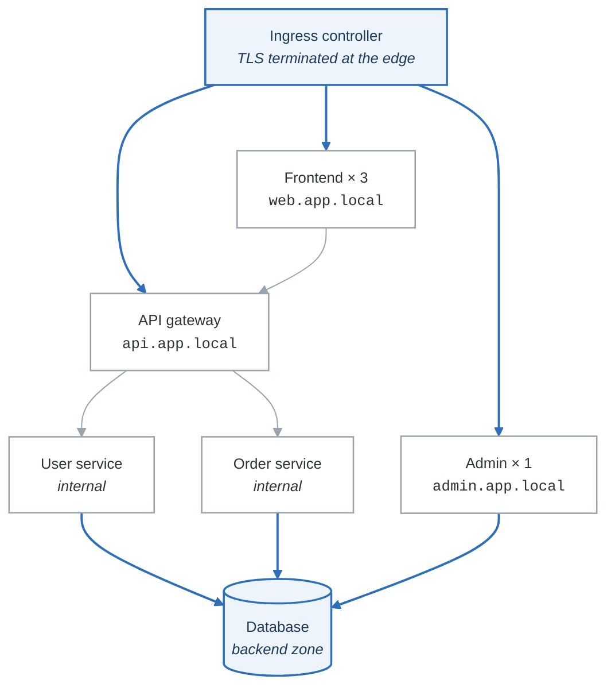

# Lab 09: Services and Ingress

## Objectives

- Create and configure Kubernetes Services
- Implement Ingress resources with routing rules
- Configure TLS termination
- Set up Network Policies for traffic control

## Prerequisites

- Completed Lab 08
- Running Kubernetes cluster with Ingress controller
- kubectl configured

---

## Part 1: Service Types (Guided)

### Step 1: Create ClusterIP Service

```yaml
# Create deployment first
# app-deployment.yaml
apiVersion: apps/v1
kind: Deployment
metadata:
  name: webapp
spec:
  replicas: 3
  selector:
    matchLabels:
      app: webapp
  template:
    metadata:
      labels:
        app: webapp
    spec:
      containers:
      - name: webapp
        image: hashicorp/http-echo
        args:
        - "-text=Hello from webapp"
        ports:
        - containerPort: 5678
---
# ClusterIP service (default)
apiVersion: v1
kind: Service
metadata:
  name: webapp-clusterip
spec:
  type: ClusterIP
  selector:
    app: webapp
  ports:
  - port: 80
    targetPort: 5678
```

```bash
# Apply resources
kubectl apply -f app-deployment.yaml

# View service
kubectl get svc webapp-clusterip
kubectl describe svc webapp-clusterip

# View endpoints
kubectl get endpoints webapp-clusterip

# Test from within cluster
kubectl run test-pod --rm -it --image=alpine -- wget -qO- http://webapp-clusterip
```

### Step 2: NodePort Service

```yaml
# nodeport-service.yaml
apiVersion: v1
kind: Service
metadata:
  name: webapp-nodeport
spec:
  type: NodePort
  selector:
    app: webapp
  ports:
  - port: 80
    targetPort: 5678
    nodePort: 30080  # Optional: auto-assigned if not specified (30000-32767)
```

```bash
# Apply
kubectl apply -f nodeport-service.yaml

# Get service
kubectl get svc webapp-nodeport

# Access via node IP
NODE_IP=$(kubectl get nodes -o jsonpath='{.items[0].status.addresses[0].address}')
curl http://$NODE_IP:30080

# For minikube
minikube service webapp-nodeport --url
```

### Step 3: LoadBalancer Service

```yaml
# loadbalancer-service.yaml
apiVersion: v1
kind: Service
metadata:
  name: webapp-lb
spec:
  type: LoadBalancer
  selector:
    app: webapp
  ports:
  - port: 80
    targetPort: 5678
```

```bash
# Apply
kubectl apply -f loadbalancer-service.yaml

# View service (EXTERNAL-IP may be <pending> in local clusters)
kubectl get svc webapp-lb -w

# For minikube, run in separate terminal:
minikube tunnel

# Access via LoadBalancer IP
EXTERNAL_IP=$(kubectl get svc webapp-lb -o jsonpath='{.status.loadBalancer.ingress[0].ip}')
curl http://$EXTERNAL_IP
```

### Validation

```bash
#!/bin/bash
# validate-part1.sh

echo "=== Part 1 Validation ==="

# Check ClusterIP
if kubectl get svc webapp-clusterip -o jsonpath='{.spec.type}' | grep -q "ClusterIP"; then
    echo "✓ ClusterIP service exists"
else
    echo "✗ ClusterIP service not found"
fi

# Check NodePort
NODEPORT=$(kubectl get svc webapp-nodeport -o jsonpath='{.spec.ports[0].nodePort}')
if [ -n "$NODEPORT" ]; then
    echo "✓ NodePort service exists (port: $NODEPORT)"
else
    echo "✗ NodePort service not found"
fi

# Check LoadBalancer
if kubectl get svc webapp-lb -o jsonpath='{.spec.type}' | grep -q "LoadBalancer"; then
    echo "✓ LoadBalancer service exists"
else
    echo "✗ LoadBalancer service not found"
fi

# Check endpoints
ENDPOINTS=$(kubectl get endpoints webapp-clusterip -o jsonpath='{.subsets[0].addresses}' | jq length)
if [ "$ENDPOINTS" -ge 3 ]; then
    echo "✓ Service has $ENDPOINTS endpoints"
else
    echo "✗ Expected 3 endpoints, got $ENDPOINTS"
fi

echo "Part 1 validation complete!"
```

---

## Part 2: Ingress Basics (Semi-Guided)

### Objective

Configure Ingress for HTTP routing and virtual hosts.

### Tasks

1. Install Ingress controller (if not present)
2. Create basic Ingress resource
3. Configure path-based routing
4. Configure host-based routing

### Install Ingress Controller

```bash
# For minikube
minikube addons enable ingress

# For kind
kubectl apply -f https://raw.githubusercontent.com/kubernetes/ingress-nginx/main/deploy/static/provider/kind/deploy.yaml

# Wait for controller
kubectl wait --namespace ingress-nginx \
  --for=condition=ready pod \
  --selector=app.kubernetes.io/component=controller \
  --timeout=120s

# Verify
kubectl get pods -n ingress-nginx
```

### Create Backend Services

```yaml
# backends.yaml
apiVersion: apps/v1
kind: Deployment
metadata:
  name: api
spec:
  replicas: 2
  selector:
    matchLabels:
      app: api
  template:
    metadata:
      labels:
        app: api
    spec:
      containers:
      - name: api
        image: hashicorp/http-echo
        args: ["-text=API Response"]
        ports:
        - containerPort: 5678
---
apiVersion: v1
kind: Service
metadata:
  name: api
spec:
  selector:
    app: api
  ports:
  - port: 80
    targetPort: 5678
---
apiVersion: apps/v1
kind: Deployment
metadata:
  name: web
spec:
  replicas: 2
  selector:
    matchLabels:
      app: web
  template:
    metadata:
      labels:
        app: web
    spec:
      containers:
      - name: web
        image: hashicorp/http-echo
        args: ["-text=Web Response"]
        ports:
        - containerPort: 5678
---
apiVersion: v1
kind: Service
metadata:
  name: web
spec:
  selector:
    app: web
  ports:
  - port: 80
    targetPort: 5678
```

### Path-Based Routing

```yaml
# path-ingress.yaml
apiVersion: networking.k8s.io/v1
kind: Ingress
metadata:
  name: path-routing
  annotations:
    nginx.ingress.kubernetes.io/rewrite-target: /
spec:
  ingressClassName: nginx
  rules:
  - http:
      paths:
      - path: /api
        pathType: Prefix
        backend:
          service:
            name: api
            port:
              number: 80
      - path: /web
        pathType: Prefix
        backend:
          service:
            name: web
            port:
              number: 80
      - path: /
        pathType: Prefix
        backend:
          service:
            name: web
            port:
              number: 80
```

### Host-Based Routing

```yaml
# host-ingress.yaml
apiVersion: networking.k8s.io/v1
kind: Ingress
metadata:
  name: host-routing
spec:
  ingressClassName: nginx
  rules:
  - host: api.local.dev
    http:
      paths:
      - path: /
        pathType: Prefix
        backend:
          service:
            name: api
            port:
              number: 80
  - host: web.local.dev
    http:
      paths:
      - path: /
        pathType: Prefix
        backend:
          service:
            name: web
            port:
              number: 80
```

```bash
# Apply
kubectl apply -f backends.yaml
kubectl apply -f path-ingress.yaml
kubectl apply -f host-ingress.yaml

# Get Ingress IP
INGRESS_IP=$(kubectl get ingress path-routing -o jsonpath='{.status.loadBalancer.ingress[0].ip}')

# For minikube
INGRESS_IP=$(minikube ip)

# Test path routing
curl http://$INGRESS_IP/api
curl http://$INGRESS_IP/web
curl http://$INGRESS_IP/

# Add to /etc/hosts for host routing
echo "$INGRESS_IP api.local.dev web.local.dev" | sudo tee -a /etc/hosts

# Test host routing
curl http://api.local.dev
curl http://web.local.dev
```

### Validation

```bash
#!/bin/bash
# validate-part2.sh

echo "=== Part 2 Validation ==="

# Get Ingress IP
INGRESS_IP=$(kubectl get ingress path-routing -o jsonpath='{.status.loadBalancer.ingress[0].ip}' 2>/dev/null)
if [ -z "$INGRESS_IP" ]; then
    INGRESS_IP=$(minikube ip 2>/dev/null)
fi

if [ -z "$INGRESS_IP" ]; then
    echo "✗ Cannot determine Ingress IP"
    exit 1
fi

echo "Ingress IP: $INGRESS_IP"

# Test path routing
API_RESPONSE=$(curl -s http://$INGRESS_IP/api)
WEB_RESPONSE=$(curl -s http://$INGRESS_IP/web)

if echo "$API_RESPONSE" | grep -q "API"; then
    echo "✓ Path /api routes correctly"
else
    echo "✗ Path /api routing failed"
fi

if echo "$WEB_RESPONSE" | grep -q "Web"; then
    echo "✓ Path /web routes correctly"
else
    echo "✗ Path /web routing failed"
fi

# Test host routing
API_HOST=$(curl -s -H "Host: api.local.dev" http://$INGRESS_IP/)
WEB_HOST=$(curl -s -H "Host: web.local.dev" http://$INGRESS_IP/)

if echo "$API_HOST" | grep -q "API"; then
    echo "✓ Host api.local.dev routes correctly"
else
    echo "✗ Host api.local.dev routing failed"
fi

if echo "$WEB_HOST" | grep -q "Web"; then
    echo "✓ Host web.local.dev routes correctly"
else
    echo "✗ Host web.local.dev routing failed"
fi

echo "Part 2 validation complete!"
```

---

## Part 3: TLS and Advanced Ingress (Semi-Guided)

### Objective

Configure TLS termination and advanced Ingress features.

### Tasks

1. Create self-signed certificate
2. Configure TLS in Ingress
3. Set up cert-manager for automatic certificates
4. Configure rate limiting and other annotations

### Create TLS Secret

```bash
# Generate self-signed certificate
openssl req -x509 -nodes -days 365 -newkey rsa:2048 \
  -keyout tls.key \
  -out tls.crt \
  -subj "/CN=*.local.dev/O=DevOps Training"

# Create secret
kubectl create secret tls tls-secret \
  --cert=tls.crt \
  --key=tls.key

# Verify
kubectl get secret tls-secret
kubectl describe secret tls-secret
```

### TLS Ingress

```yaml
# tls-ingress.yaml
apiVersion: networking.k8s.io/v1
kind: Ingress
metadata:
  name: tls-ingress
  annotations:
    nginx.ingress.kubernetes.io/ssl-redirect: "true"
spec:
  ingressClassName: nginx
  tls:
  - hosts:
    - api.local.dev
    - web.local.dev
    secretName: tls-secret
  rules:
  - host: api.local.dev
    http:
      paths:
      - path: /
        pathType: Prefix
        backend:
          service:
            name: api
            port:
              number: 80
  - host: web.local.dev
    http:
      paths:
      - path: /
        pathType: Prefix
        backend:
          service:
            name: web
            port:
              number: 80
```

### Advanced Annotations

```yaml
# advanced-ingress.yaml
apiVersion: networking.k8s.io/v1
kind: Ingress
metadata:
  name: advanced-ingress
  annotations:
    # Rate limiting
    nginx.ingress.kubernetes.io/limit-rps: "10"
    nginx.ingress.kubernetes.io/limit-connections: "5"

    # Timeouts
    nginx.ingress.kubernetes.io/proxy-connect-timeout: "30"
    nginx.ingress.kubernetes.io/proxy-read-timeout: "60"
    nginx.ingress.kubernetes.io/proxy-send-timeout: "60"

    # Request size
    nginx.ingress.kubernetes.io/proxy-body-size: "10m"

    # CORS
    nginx.ingress.kubernetes.io/enable-cors: "true"
    nginx.ingress.kubernetes.io/cors-allow-origin: "*"

    # Custom headers
    nginx.ingress.kubernetes.io/configuration-snippet: |
      add_header X-Custom-Header "DevOps Training";

    # Sticky sessions
    nginx.ingress.kubernetes.io/affinity: "cookie"
    nginx.ingress.kubernetes.io/session-cookie-name: "route"
spec:
  ingressClassName: nginx
  rules:
  - host: app.local.dev
    http:
      paths:
      - path: /
        pathType: Prefix
        backend:
          service:
            name: web
            port:
              number: 80
```

### Install cert-manager (Optional)

```bash
# Install cert-manager
kubectl apply -f https://github.com/cert-manager/cert-manager/releases/download/v1.13.0/cert-manager.yaml

# Wait for cert-manager
kubectl wait --for=condition=ready pod -l app.kubernetes.io/instance=cert-manager -n cert-manager --timeout=120s

# Create ClusterIssuer for Let's Encrypt (staging)
cat <<EOF | kubectl apply -f -
apiVersion: cert-manager.io/v1
kind: ClusterIssuer
metadata:
  name: letsencrypt-staging
spec:
  acme:
    server: https://acme-staging-v02.api.letsencrypt.org/directory
    email: your-email@example.com
    privateKeySecretRef:
      name: letsencrypt-staging
    solvers:
    - http01:
        ingress:
          class: nginx
EOF

# Ingress with cert-manager
cat <<EOF | kubectl apply -f -
apiVersion: networking.k8s.io/v1
kind: Ingress
metadata:
  name: cert-manager-ingress
  annotations:
    cert-manager.io/cluster-issuer: "letsencrypt-staging"
spec:
  ingressClassName: nginx
  tls:
  - hosts:
    - myapp.example.com
    secretName: myapp-tls
  rules:
  - host: myapp.example.com
    http:
      paths:
      - path: /
        pathType: Prefix
        backend:
          service:
            name: web
            port:
              number: 80
EOF
```

### Validation

```bash
#!/bin/bash
# validate-part3.sh

echo "=== Part 3 Validation ==="

# Check TLS secret
if kubectl get secret tls-secret &> /dev/null; then
    echo "✓ TLS secret exists"
else
    echo "✗ TLS secret not found"
fi

# Check TLS Ingress
TLS_HOSTS=$(kubectl get ingress tls-ingress -o jsonpath='{.spec.tls[0].hosts}')
if [ -n "$TLS_HOSTS" ]; then
    echo "✓ TLS configured on Ingress"
else
    echo "✗ TLS not configured"
fi

# Test HTTPS (allow self-signed cert)
INGRESS_IP=$(kubectl get ingress tls-ingress -o jsonpath='{.status.loadBalancer.ingress[0].ip}' 2>/dev/null)
if [ -z "$INGRESS_IP" ]; then
    INGRESS_IP=$(minikube ip 2>/dev/null)
fi

if curl -sk https://$INGRESS_IP -H "Host: api.local.dev" | grep -q "API"; then
    echo "✓ HTTPS working"
else
    echo "! HTTPS test inconclusive"
fi

echo "Part 3 validation complete!"
```

---

## Part 4: Network Policies (Semi-Guided)

### Objective

Implement Network Policies for traffic control.

### Tasks

1. Create default deny policy
2. Allow specific traffic patterns
3. Test network isolation

### Default Deny All

```yaml
# default-deny.yaml
apiVersion: networking.k8s.io/v1
kind: NetworkPolicy
metadata:
  name: default-deny-all
  namespace: default
spec:
  podSelector: {}
  policyTypes:
  - Ingress
  - Egress
```

### Allow DNS

```yaml
# allow-dns.yaml
apiVersion: networking.k8s.io/v1
kind: NetworkPolicy
metadata:
  name: allow-dns
  namespace: default
spec:
  podSelector: {}
  policyTypes:
  - Egress
  egress:
  - to:
    - namespaceSelector: {}
      podSelector:
        matchLabels:
          k8s-app: kube-dns
    ports:
    - protocol: UDP
      port: 53
    - protocol: TCP
      port: 53
```

### Allow Web to API

```yaml
# allow-web-to-api.yaml
apiVersion: networking.k8s.io/v1
kind: NetworkPolicy
metadata:
  name: allow-web-to-api
spec:
  podSelector:
    matchLabels:
      app: api
  policyTypes:
  - Ingress
  ingress:
  - from:
    - podSelector:
        matchLabels:
          app: web
    ports:
    - protocol: TCP
      port: 5678
```

### Allow Ingress to Services

```yaml
# allow-ingress.yaml
apiVersion: networking.k8s.io/v1
kind: NetworkPolicy
metadata:
  name: allow-ingress
spec:
  podSelector:
    matchLabels:
      app: web
  policyTypes:
  - Ingress
  ingress:
  - from:
    - namespaceSelector:
        matchLabels:
          name: ingress-nginx
    ports:
    - protocol: TCP
      port: 5678
```

### Complete Network Policy Set

```yaml
# network-policies.yaml
---
# Default deny all traffic
apiVersion: networking.k8s.io/v1
kind: NetworkPolicy
metadata:
  name: default-deny
spec:
  podSelector: {}
  policyTypes:
  - Ingress
  - Egress
---
# Allow DNS for all pods
apiVersion: networking.k8s.io/v1
kind: NetworkPolicy
metadata:
  name: allow-dns
spec:
  podSelector: {}
  policyTypes:
  - Egress
  egress:
  - to:
    - namespaceSelector: {}
    ports:
    - protocol: UDP
      port: 53
---
# Allow ingress controller to web
apiVersion: networking.k8s.io/v1
kind: NetworkPolicy
metadata:
  name: allow-ingress-to-web
spec:
  podSelector:
    matchLabels:
      app: web
  policyTypes:
  - Ingress
  ingress:
  - from: []  # Allow from anywhere (ingress controller)
    ports:
    - protocol: TCP
      port: 5678
---
# Allow ingress controller to api
apiVersion: networking.k8s.io/v1
kind: NetworkPolicy
metadata:
  name: allow-ingress-to-api
spec:
  podSelector:
    matchLabels:
      app: api
  policyTypes:
  - Ingress
  ingress:
  - from: []
    ports:
    - protocol: TCP
      port: 5678
---
# Allow web to api (internal communication)
apiVersion: networking.k8s.io/v1
kind: NetworkPolicy
metadata:
  name: allow-web-to-api
spec:
  podSelector:
    matchLabels:
      app: api
  policyTypes:
  - Ingress
  ingress:
  - from:
    - podSelector:
        matchLabels:
          app: web
    ports:
    - protocol: TCP
      port: 5678
---
# Allow web egress to api
apiVersion: networking.k8s.io/v1
kind: NetworkPolicy
metadata:
  name: allow-web-egress
spec:
  podSelector:
    matchLabels:
      app: web
  policyTypes:
  - Egress
  egress:
  - to:
    - podSelector:
        matchLabels:
          app: api
    ports:
    - protocol: TCP
      port: 5678
```

```bash
# Apply policies
kubectl apply -f network-policies.yaml

# Test connectivity
# Web should be able to reach API
kubectl exec -it $(kubectl get pod -l app=web -o jsonpath='{.items[0].metadata.name}') -- wget -qO- http://api

# Random pod should NOT be able to reach API
kubectl run test-pod --rm -it --image=alpine -- wget -qO- --timeout=5 http://api
# This should fail
```

### Validation

```bash
#!/bin/bash
# validate-part4.sh

echo "=== Part 4 Validation ==="

# Check network policies exist
NP_COUNT=$(kubectl get networkpolicies --no-headers | wc -l)
if [ "$NP_COUNT" -ge 3 ]; then
    echo "✓ Network policies configured: $NP_COUNT policies"
else
    echo "✗ Expected at least 3 network policies, got $NP_COUNT"
fi

# Test allowed traffic (web to api)
WEB_POD=$(kubectl get pod -l app=web -o jsonpath='{.items[0].metadata.name}')
if kubectl exec $WEB_POD -- wget -qO- --timeout=5 http://api 2>/dev/null | grep -q "API"; then
    echo "✓ Allowed traffic: web can reach api"
else
    echo "! Allowed traffic test inconclusive"
fi

# Test blocked traffic
kubectl run test-blocked --rm -it --restart=Never --image=alpine -- wget -qO- --timeout=3 http://api 2>/dev/null
if [ $? -ne 0 ]; then
    echo "✓ Blocked traffic: unauthorized pod cannot reach api"
else
    echo "✗ Blocked traffic test failed - unauthorized pod reached api"
fi

echo "Part 4 validation complete!"
```

---

## Part 5: Challenge - Production Service Mesh

### Objective

Design and implement a complete service networking solution with:
- Multiple services with proper routing
- TLS everywhere
- Network policies for zero-trust
- Monitoring and observability

### Architecture

<!-- figure: generated from the Mermaid below by _shared/diagrams/embed-figures.py — do not edit the image -->


<details>
<summary>Diagram source (Mermaid)</summary>



</details>

**Network zones**

| Zone | Contains |
|---|---|
| `public` | The ingress controller, and nothing else |
| `frontend` | web, admin |
| `api` | gateway, user-service, order-service |
| `backend` | database |

The user and order services have no Ingress and no `public` attachment — they are reachable only from
the gateway. An internal service that is accidentally exposed is the commonest way a cluster leaks.

### Requirements

1. **Services:**
   - Frontend web (3 replicas)
   - Admin panel (1 replica)
   - API Gateway (2 replicas)
   - User Service (2 replicas)
   - Order Service (2 replicas)
   - Database (1 replica)

2. **Ingress:**
   - web.app.local → Frontend
   - api.app.local → API Gateway
   - admin.app.local → Admin

3. **TLS:**
   - Wildcard certificate for *.app.local
   - HTTPS redirect enabled

4. **Network Policies:**
   - Default deny all
   - Frontend can only reach API Gateway
   - API Gateway can reach all internal services
   - Only internal services can reach Database
   - Admin can reach API Gateway and Database

5. **Additional:**
   - Health check endpoints on all services
   - Rate limiting on API Gateway (20 req/s)
   - Session affinity on Frontend

### Validation Script

```bash
#!/bin/bash
# validate-challenge.sh

echo "=== Challenge Validation ==="

# Check all deployments
DEPLOYMENTS="frontend admin api-gateway user-service order-service database"
for DEP in $DEPLOYMENTS; do
    if kubectl get deployment $DEP &> /dev/null; then
        READY=$(kubectl get deployment $DEP -o jsonpath='{.status.readyReplicas}')
        echo "✓ $DEP deployment exists (replicas: $READY)"
    else
        echo "✗ $DEP deployment not found"
    fi
done

# Check Ingress
INGRESS_COUNT=$(kubectl get ingress --no-headers | wc -l)
if [ "$INGRESS_COUNT" -ge 1 ]; then
    echo "✓ Ingress configured"
else
    echo "✗ Ingress not found"
fi

# Check TLS
TLS_SECRET=$(kubectl get ingress -o jsonpath='{.items[0].spec.tls[0].secretName}')
if [ -n "$TLS_SECRET" ]; then
    echo "✓ TLS configured with secret: $TLS_SECRET"
else
    echo "✗ TLS not configured"
fi

# Check Network Policies
NP_COUNT=$(kubectl get networkpolicies --no-headers | wc -l)
if [ "$NP_COUNT" -ge 5 ]; then
    echo "✓ Network policies configured: $NP_COUNT policies"
else
    echo "✗ Expected at least 5 network policies"
fi

# Test routing
INGRESS_IP=$(kubectl get ingress -o jsonpath='{.items[0].status.loadBalancer.ingress[0].ip}')
if [ -z "$INGRESS_IP" ]; then
    INGRESS_IP=$(minikube ip 2>/dev/null)
fi

for HOST in web.app.local api.app.local admin.app.local; do
    RESPONSE=$(curl -sk -H "Host: $HOST" https://$INGRESS_IP/ 2>/dev/null)
    if [ -n "$RESPONSE" ]; then
        echo "✓ $HOST responds"
    else
        echo "✗ $HOST not responding"
    fi
done

# Test network isolation
echo ""
echo "Testing network isolation..."

# Frontend should NOT reach database directly
FRONTEND_POD=$(kubectl get pod -l app=frontend -o jsonpath='{.items[0].metadata.name}')
if kubectl exec $FRONTEND_POD -- wget -qO- --timeout=3 http://database 2>/dev/null; then
    echo "✗ Network isolation FAILED: frontend reached database"
else
    echo "✓ Network isolation: frontend cannot reach database"
fi

# API Gateway should reach user-service
GATEWAY_POD=$(kubectl get pod -l app=api-gateway -o jsonpath='{.items[0].metadata.name}')
if kubectl exec $GATEWAY_POD -- wget -qO- --timeout=3 http://user-service 2>/dev/null; then
    echo "✓ API Gateway can reach user-service"
else
    echo "! API Gateway to user-service test inconclusive"
fi

echo ""
echo "Challenge validation complete!"
```

---

## Deliverables

1. All service manifests
2. Ingress configuration with TLS
3. Network policy set
4. Architecture diagram
5. Test documentation

## Commands Reference

```bash
# Services
kubectl get svc
kubectl describe svc <name>
kubectl get endpoints <name>
kubectl expose deployment <name> --port=<port> --type=<type>

# Ingress
kubectl get ingress
kubectl describe ingress <name>
kubectl get ingressclass

# Network Policies
kubectl get networkpolicies
kubectl describe networkpolicy <name>

# Debugging
kubectl run debug --rm -it --image=nicolaka/netshoot -- bash
kubectl exec -it <pod> -- wget -qO- http://<service>
kubectl logs -n ingress-nginx -l app.kubernetes.io/component=controller
```

## Resources

- [Kubernetes Services](https://kubernetes.io/docs/concepts/services-networking/service/)
- [Ingress](https://kubernetes.io/docs/concepts/services-networking/ingress/)
- [Network Policies](https://kubernetes.io/docs/concepts/services-networking/network-policies/)
- [nginx-ingress Annotations](https://kubernetes.github.io/ingress-nginx/user-guide/nginx-configuration/annotations/)

## Next Lab

Continue to [Lab 10: Persistent Storage](../lab-10-persistent-storage/)

<!-- feynman-check -->

---

## Feynman check

Close the file. Blank page, no notes. Explain each of these to a competent engineer who has never
used this tool — **under five minutes, no jargon you can't define on the spot:**

- Service Types
- Ingress Basics
- TLS and Advanced Ingress
- Network Policies

**The gap is not what you forgot. It is where you used a word instead of a mechanism.**

| | |
|---|---|
| ✗ | *"A container isolates the application."* |
| ✓ | *"A container is an ordinary Linux process started with namespaces (what it can see), cgroups (what it can use) and usually seccomp (what it may ask the kernel). There is no container object in the kernel — only a process with those features switched on."* |

**Trace it:** `docker run` → an isolated process. Name the namespaces in the order they are created, and which component actually calls `clone()`.

Stop at the first component you cannot name. Reopen this file and read **only** that.

**Go deeper — only once the gap has a name:** the [LWN namespaces series](https://lwn.net/Articles/531114/) — seven parts by the man-pages maintainer, and the reason containers stop being magic.
Full list per domain: [`SOURCES.md`](../../SOURCES.md#containers)

→ Protocol, the three levels of knowing, and worked examples: [`MASTERY.md`](../../MASTERY.md)

<!-- /feynman-check -->
