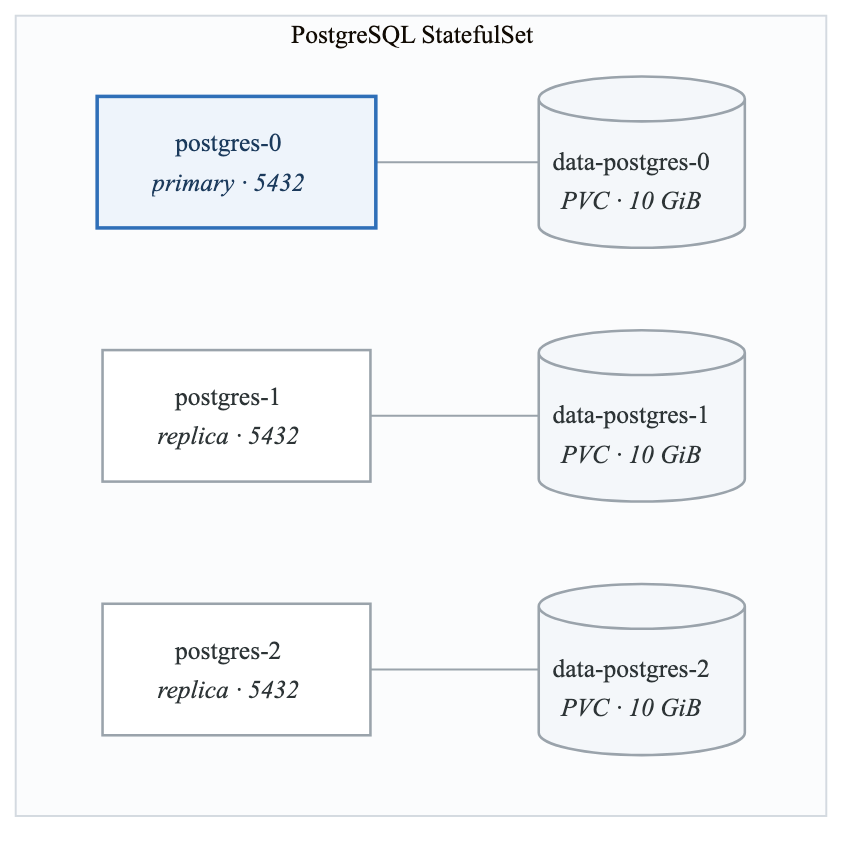
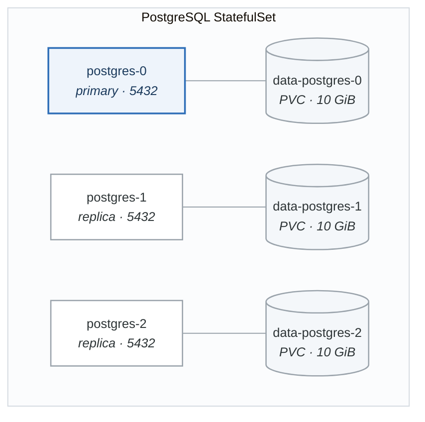

# Lab 10: Kubernetes Persistent Storage

## Objectives

- Create and manage Persistent Volumes (PV) and Claims (PVC)
- Work with StorageClasses for dynamic provisioning
- Implement stateful applications
- Backup and restore persistent data

## Prerequisites

- Completed Lab 09
- Running Kubernetes cluster
- kubectl configured

---

## Part 1: Persistent Volumes Basics (Guided)

### Step 1: Create Static Persistent Volume

```yaml
# pv-hostpath.yaml
apiVersion: v1
kind: PersistentVolume
metadata:
  name: pv-manual
  labels:
    type: local
spec:
  storageClassName: manual
  capacity:
    storage: 1Gi
  accessModes:
    - ReadWriteOnce
  hostPath:
    path: "/mnt/data"
  persistentVolumeReclaimPolicy: Retain
```

```bash
# Create directory on node (for minikube)
minikube ssh "sudo mkdir -p /mnt/data && sudo chmod 777 /mnt/data"

# Apply PV
kubectl apply -f pv-hostpath.yaml

# View PV
kubectl get pv
kubectl describe pv pv-manual
```

### Step 2: Create Persistent Volume Claim

```yaml
# pvc-manual.yaml
apiVersion: v1
kind: PersistentVolumeClaim
metadata:
  name: pvc-manual
spec:
  storageClassName: manual
  accessModes:
    - ReadWriteOnce
  resources:
    requests:
      storage: 500Mi
```

```bash
# Apply PVC
kubectl apply -f pvc-manual.yaml

# View PVC
kubectl get pvc
kubectl describe pvc pvc-manual

# Check PV is now bound
kubectl get pv
```

### Step 3: Use PVC in Pod

```yaml
# pod-with-pvc.yaml
apiVersion: v1
kind: Pod
metadata:
  name: storage-test
spec:
  containers:
  - name: app
    image: nginx:alpine
    volumeMounts:
    - name: storage
      mountPath: /usr/share/nginx/html
  volumes:
  - name: storage
    persistentVolumeClaim:
      claimName: pvc-manual
```

```bash
# Apply pod
kubectl apply -f pod-with-pvc.yaml

# Write data
kubectl exec storage-test -- sh -c "echo 'Persistent Data!' > /usr/share/nginx/html/index.html"

# Verify data
kubectl exec storage-test -- cat /usr/share/nginx/html/index.html

# Delete pod
kubectl delete pod storage-test

# Recreate pod
kubectl apply -f pod-with-pvc.yaml

# Data persists!
kubectl exec storage-test -- cat /usr/share/nginx/html/index.html
```

### Validation

```bash
#!/bin/bash
# validate-part1.sh

echo "=== Part 1 Validation ==="

# Check PV exists
if kubectl get pv pv-manual &> /dev/null; then
    STATUS=$(kubectl get pv pv-manual -o jsonpath='{.status.phase}')
    echo "✓ PV exists (status: $STATUS)"
else
    echo "✗ PV not found"
fi

# Check PVC exists and is bound
if kubectl get pvc pvc-manual &> /dev/null; then
    STATUS=$(kubectl get pvc pvc-manual -o jsonpath='{.status.phase}')
    if [ "$STATUS" = "Bound" ]; then
        echo "✓ PVC bound to PV"
    else
        echo "✗ PVC not bound: $STATUS"
    fi
else
    echo "✗ PVC not found"
fi

# Test persistence
kubectl exec storage-test -- sh -c "echo 'test-$(date +%s)' > /usr/share/nginx/html/test.txt"
kubectl delete pod storage-test --wait
kubectl apply -f pod-with-pvc.yaml
sleep 5

if kubectl exec storage-test -- cat /usr/share/nginx/html/test.txt &> /dev/null; then
    echo "✓ Data persists across pod deletion"
else
    echo "✗ Data persistence failed"
fi

echo "Part 1 validation complete!"
```

---

## Part 2: Dynamic Provisioning (Semi-Guided)

### Objective

Use StorageClasses for dynamic volume provisioning.

### Tasks

1. Explore available StorageClasses
2. Create PVC with dynamic provisioning
3. Configure different storage tiers

### View StorageClasses

```bash
# List StorageClasses
kubectl get storageclass

# View default StorageClass
kubectl get sc -o jsonpath='{range .items[*]}{.metadata.name}{"\t"}{.metadata.annotations.storageclass\.kubernetes\.io/is-default-class}{"\n"}{end}'

# Describe StorageClass
kubectl describe sc standard
```

### Dynamic PVC

```yaml
# pvc-dynamic.yaml
apiVersion: v1
kind: PersistentVolumeClaim
metadata:
  name: pvc-dynamic
spec:
  accessModes:
    - ReadWriteOnce
  resources:
    requests:
      storage: 1Gi
  # StorageClassName omitted = use default
  # Or specify: storageClassName: standard
```

```bash
# Apply
kubectl apply -f pvc-dynamic.yaml

# Watch PV get created automatically
kubectl get pv -w

# View PVC
kubectl get pvc pvc-dynamic
```

### Custom StorageClass

```yaml
# storageclass-fast.yaml
apiVersion: storage.k8s.io/v1
kind: StorageClass
metadata:
  name: fast
provisioner: k8s.io/minikube-hostpath  # For minikube
reclaimPolicy: Delete
volumeBindingMode: Immediate
allowVolumeExpansion: true
parameters:
  type: pd-ssd  # Provider-specific parameter
---
# For kind/other local clusters
apiVersion: storage.k8s.io/v1
kind: StorageClass
metadata:
  name: local-storage
provisioner: kubernetes.io/no-provisioner
volumeBindingMode: WaitForFirstConsumer
reclaimPolicy: Retain
```

### PVC with Custom StorageClass

```yaml
# pvc-fast.yaml
apiVersion: v1
kind: PersistentVolumeClaim
metadata:
  name: pvc-fast
spec:
  storageClassName: fast
  accessModes:
    - ReadWriteOnce
  resources:
    requests:
      storage: 2Gi
```

### Volume Expansion

```bash
# Edit PVC to increase size (if allowVolumeExpansion: true)
kubectl patch pvc pvc-dynamic -p '{"spec":{"resources":{"requests":{"storage":"2Gi"}}}}'

# Verify
kubectl get pvc pvc-dynamic
kubectl describe pvc pvc-dynamic
```

### Validation

```bash
#!/bin/bash
# validate-part2.sh

echo "=== Part 2 Validation ==="

# Check StorageClass exists
SC_COUNT=$(kubectl get sc --no-headers | wc -l)
if [ "$SC_COUNT" -ge 1 ]; then
    echo "✓ StorageClasses available: $SC_COUNT"
else
    echo "✗ No StorageClasses found"
fi

# Check dynamic PVC creates PV
kubectl apply -f pvc-dynamic.yaml
sleep 5

PV_NAME=$(kubectl get pvc pvc-dynamic -o jsonpath='{.spec.volumeName}')
if [ -n "$PV_NAME" ]; then
    echo "✓ Dynamic provisioning created PV: $PV_NAME"
else
    echo "✗ Dynamic provisioning failed"
fi

# Check volume expansion capability
EXPANSION=$(kubectl get sc -o jsonpath='{.items[0].allowVolumeExpansion}')
if [ "$EXPANSION" = "true" ]; then
    echo "✓ Volume expansion supported"
else
    echo "! Volume expansion not enabled on default SC"
fi

echo "Part 2 validation complete!"
```

---

## Part 3: StatefulSets (Semi-Guided)

### Objective

Deploy stateful applications with persistent storage.

### Tasks

1. Create StatefulSet with volumeClaimTemplates
2. Understand pod identity and storage association
3. Scale StatefulSet and observe storage behavior

### StatefulSet with Storage

```yaml
# statefulset.yaml
apiVersion: v1
kind: Service
metadata:
  name: nginx
  labels:
    app: nginx
spec:
  ports:
  - port: 80
    name: web
  clusterIP: None  # Headless service
  selector:
    app: nginx
---
apiVersion: apps/v1
kind: StatefulSet
metadata:
  name: web
spec:
  serviceName: "nginx"
  replicas: 3
  selector:
    matchLabels:
      app: nginx
  template:
    metadata:
      labels:
        app: nginx
    spec:
      containers:
      - name: nginx
        image: nginx:alpine
        ports:
        - containerPort: 80
          name: web
        volumeMounts:
        - name: www
          mountPath: /usr/share/nginx/html
  volumeClaimTemplates:
  - metadata:
      name: www
    spec:
      accessModes: ["ReadWriteOnce"]
      resources:
        requests:
          storage: 1Gi
```

```bash
# Apply StatefulSet
kubectl apply -f statefulset.yaml

# Watch pods come up in order
kubectl get pods -l app=nginx -w

# View PVCs created
kubectl get pvc -l app=nginx

# Each pod gets its own PVC
kubectl get pvc
# www-web-0, www-web-1, www-web-2

# Write unique data to each pod
for i in 0 1 2; do
    kubectl exec web-$i -- sh -c "echo 'Hello from web-$i' > /usr/share/nginx/html/index.html"
done

# Verify each pod has its own data
for i in 0 1 2; do
    echo "web-$i:"
    kubectl exec web-$i -- cat /usr/share/nginx/html/index.html
done

# Test DNS for headless service
kubectl run test --rm -it --image=alpine -- nslookup nginx
kubectl run test --rm -it --image=alpine -- nslookup web-0.nginx
```

### Scale StatefulSet

```bash
# Scale up
kubectl scale statefulset web --replicas=5

# Watch new pods and PVCs
kubectl get pods -l app=nginx -w
kubectl get pvc

# Scale down
kubectl scale statefulset web --replicas=2

# Note: PVCs are NOT deleted when scaling down
kubectl get pvc

# Scale back up - original PVCs are reused
kubectl scale statefulset web --replicas=5
```

### Delete and Recreate

```bash
# Delete StatefulSet (PVCs persist)
kubectl delete statefulset web

# PVCs still exist
kubectl get pvc

# Recreate - same PVCs reattach
kubectl apply -f statefulset.yaml

# Data is preserved!
for i in 0 1 2; do
    kubectl exec web-$i -- cat /usr/share/nginx/html/index.html
done
```

### Validation

```bash
#!/bin/bash
# validate-part3.sh

echo "=== Part 3 Validation ==="

# Check StatefulSet
if kubectl get statefulset web &> /dev/null; then
    READY=$(kubectl get statefulset web -o jsonpath='{.status.readyReplicas}')
    echo "✓ StatefulSet exists (ready: $READY)"
else
    echo "✗ StatefulSet not found"
fi

# Check PVCs match pods
PVC_COUNT=$(kubectl get pvc -l app=nginx --no-headers | wc -l)
POD_COUNT=$(kubectl get pods -l app=nginx --no-headers | wc -l)

if [ "$PVC_COUNT" -ge "$POD_COUNT" ]; then
    echo "✓ PVCs created for pods: $PVC_COUNT"
else
    echo "✗ PVC count mismatch"
fi

# Check headless service
CLUSTER_IP=$(kubectl get svc nginx -o jsonpath='{.spec.clusterIP}')
if [ "$CLUSTER_IP" = "None" ]; then
    echo "✓ Headless service configured"
else
    echo "✗ Service should be headless"
fi

# Test stable network identity
if kubectl run test --rm -it --restart=Never --image=alpine -- nslookup web-0.nginx 2>/dev/null | grep -q "Address"; then
    echo "✓ Stable DNS identity works"
else
    echo "! DNS identity test inconclusive"
fi

echo "Part 3 validation complete!"
```

---

## Part 4: Backup and Restore (Semi-Guided)

### Objective

Implement backup and restore for persistent data.

### Tasks

1. Manual backup using temporary pods
2. Restore data to new PVC
3. Implement scheduled backups

### Manual Backup

```yaml
# backup-job.yaml
apiVersion: batch/v1
kind: Job
metadata:
  name: backup-job
spec:
  template:
    spec:
      containers:
      - name: backup
        image: alpine
        command:
        - sh
        - -c
        - |
          tar czf /backup/data-$(date +%Y%m%d-%H%M%S).tar.gz -C /data .
          ls -la /backup/
        volumeMounts:
        - name: source-data
          mountPath: /data
          readOnly: true
        - name: backup-volume
          mountPath: /backup
      restartPolicy: Never
      volumes:
      - name: source-data
        persistentVolumeClaim:
          claimName: pvc-manual
      - name: backup-volume
        persistentVolumeClaim:
          claimName: pvc-backup
  backoffLimit: 1
```

```bash
# Create backup PVC
cat <<EOF | kubectl apply -f -
apiVersion: v1
kind: PersistentVolumeClaim
metadata:
  name: pvc-backup
spec:
  accessModes:
    - ReadWriteOnce
  resources:
    requests:
      storage: 5Gi
EOF

# Run backup job
kubectl apply -f backup-job.yaml

# Watch job
kubectl get jobs -w
kubectl logs job/backup-job

# Verify backup
kubectl run verify --rm -it --image=alpine \
  --overrides='{"spec":{"volumes":[{"name":"backup","persistentVolumeClaim":{"claimName":"pvc-backup"}}],"containers":[{"name":"verify","image":"alpine","command":["ls","-la","/backup"],"volumeMounts":[{"name":"backup","mountPath":"/backup"}]}]}}' \
  -- ls -la /backup
```

### Restore

```yaml
# restore-job.yaml
apiVersion: batch/v1
kind: Job
metadata:
  name: restore-job
spec:
  template:
    spec:
      containers:
      - name: restore
        image: alpine
        command:
        - sh
        - -c
        - |
          LATEST=$(ls -t /backup/*.tar.gz | head -1)
          echo "Restoring from: $LATEST"
          tar xzf $LATEST -C /data
          ls -la /data/
        volumeMounts:
        - name: restore-target
          mountPath: /data
        - name: backup-volume
          mountPath: /backup
          readOnly: true
      restartPolicy: Never
      volumes:
      - name: restore-target
        persistentVolumeClaim:
          claimName: pvc-restored
      - name: backup-volume
        persistentVolumeClaim:
          claimName: pvc-backup
  backoffLimit: 1
```

```bash
# Create restore target PVC
cat <<EOF | kubectl apply -f -
apiVersion: v1
kind: PersistentVolumeClaim
metadata:
  name: pvc-restored
spec:
  accessModes:
    - ReadWriteOnce
  resources:
    requests:
      storage: 1Gi
EOF

# Run restore
kubectl apply -f restore-job.yaml

# Watch
kubectl get jobs -w
kubectl logs job/restore-job
```

### Scheduled Backup with CronJob

```yaml
# backup-cronjob.yaml
apiVersion: batch/v1
kind: CronJob
metadata:
  name: scheduled-backup
spec:
  schedule: "0 2 * * *"  # Daily at 2 AM
  concurrencyPolicy: Forbid
  successfulJobsHistoryLimit: 3
  failedJobsHistoryLimit: 1
  jobTemplate:
    spec:
      template:
        spec:
          containers:
          - name: backup
            image: alpine
            command:
            - sh
            - -c
            - |
              TIMESTAMP=$(date +%Y%m%d-%H%M%S)
              tar czf /backup/data-${TIMESTAMP}.tar.gz -C /data .

              # Keep only last 7 backups
              ls -t /backup/*.tar.gz | tail -n +8 | xargs -r rm

              echo "Backup completed: data-${TIMESTAMP}.tar.gz"
              ls -la /backup/
            volumeMounts:
            - name: source-data
              mountPath: /data
              readOnly: true
            - name: backup-volume
              mountPath: /backup
          restartPolicy: OnFailure
          volumes:
          - name: source-data
            persistentVolumeClaim:
              claimName: pvc-manual
          - name: backup-volume
            persistentVolumeClaim:
              claimName: pvc-backup
```

```bash
# Apply CronJob
kubectl apply -f backup-cronjob.yaml

# View CronJob
kubectl get cronjob
kubectl describe cronjob scheduled-backup

# Manually trigger for testing
kubectl create job --from=cronjob/scheduled-backup manual-backup

# Watch
kubectl get jobs -w
kubectl logs job/manual-backup
```

### Validation

```bash
#!/bin/bash
# validate-part4.sh

echo "=== Part 4 Validation ==="

# Check backup PVC
if kubectl get pvc pvc-backup &> /dev/null; then
    echo "✓ Backup PVC exists"
else
    echo "✗ Backup PVC not found"
fi

# Check backup exists
BACKUP_COUNT=$(kubectl run check --rm -it --restart=Never --image=alpine \
  --overrides='{"spec":{"volumes":[{"name":"backup","persistentVolumeClaim":{"claimName":"pvc-backup"}}],"containers":[{"name":"check","image":"alpine","command":["sh","-c","ls /backup/*.tar.gz 2>/dev/null | wc -l"],"volumeMounts":[{"name":"backup","mountPath":"/backup"}]}]}}' \
  2>/dev/null | tail -1 | tr -d ' ')

if [ "$BACKUP_COUNT" -gt 0 ]; then
    echo "✓ Backups found: $BACKUP_COUNT"
else
    echo "✗ No backups found"
fi

# Check CronJob
if kubectl get cronjob scheduled-backup &> /dev/null; then
    SCHEDULE=$(kubectl get cronjob scheduled-backup -o jsonpath='{.spec.schedule}')
    echo "✓ Scheduled backup configured: $SCHEDULE"
else
    echo "! CronJob not configured"
fi

echo "Part 4 validation complete!"
```

---

## Part 5: Challenge - Stateful Database Cluster

### Objective

Deploy a production-ready PostgreSQL cluster with:
- StatefulSet for ordered deployment
- Persistent storage for each instance
- Automated backups
- Point-in-time recovery capability

### Architecture

<!-- figure: generated from the Mermaid below by _shared/diagrams/embed-figures.py — do not edit the image -->


<details>
<summary>Diagram source (Mermaid)</summary>



</details>

**Services** — three, because they answer three different questions:

| Service | Type | Answers |
|---|---|---|
| `postgres` | headless (`clusterIP: None`) | *"What is the address of postgres-1 specifically?"* — gives each pod a stable DNS name |
| `postgres-read` | ClusterIP | *"Any replica will do."* |
| `postgres-write` | ClusterIP, selector pinned to the primary | *"I need the one that accepts writes."* |

**Backup** — a CronJob writing a daily dump to a separate volume.

The headless Service is the one that makes a StatefulSet work: `postgres-0.postgres.default.svc` is a
name that survives rescheduling, which is what replication configuration needs.

### Requirements

1. **StatefulSet:**
   - 3 PostgreSQL replicas
   - volumeClaimTemplates for data (10Gi each)
   - Proper pod anti-affinity
   - Resource limits

2. **Storage:**
   - Fast StorageClass for data volumes
   - Backup PVC (50Gi)
   - Volume snapshots (if supported)

3. **Services:**
   - Headless service for internal DNS
   - Read service (load balanced across all replicas)
   - Write service (primary only)

4. **Backup:**
   - Daily backup CronJob at 2 AM
   - Retain last 7 backups
   - Backup verification job

5. **ConfigMap:**
   - PostgreSQL configuration
   - Replication settings

6. **Secrets:**
   - PostgreSQL passwords
   - Replication credentials

### Starter Files

```yaml
# postgres-config.yaml
apiVersion: v1
kind: ConfigMap
metadata:
  name: postgres-config
data:
  postgresql.conf: |
    listen_addresses = '*'
    max_connections = 100
    shared_buffers = 256MB
    effective_cache_size = 768MB
    work_mem = 4MB
    maintenance_work_mem = 64MB

  pg_hba.conf: |
    # TYPE  DATABASE  USER  ADDRESS     METHOD
    local   all       all               trust
    host    all       all   0.0.0.0/0   md5
    host    replication all 0.0.0.0/0   md5
---
apiVersion: v1
kind: Secret
metadata:
  name: postgres-secret
type: Opaque
stringData:
  POSTGRES_PASSWORD: "supersecret123"
  REPLICATION_PASSWORD: "replpassword"
```

```yaml
# postgres-statefulset.yaml (partial - complete this)
apiVersion: apps/v1
kind: StatefulSet
metadata:
  name: postgres
spec:
  serviceName: postgres
  replicas: 3
  selector:
    matchLabels:
      app: postgres
  template:
    metadata:
      labels:
        app: postgres
    spec:
      # Add pod anti-affinity
      containers:
      - name: postgres
        image: postgres:15-alpine
        ports:
        - containerPort: 5432
        env:
        - name: POSTGRES_PASSWORD
          valueFrom:
            secretKeyRef:
              name: postgres-secret
              key: POSTGRES_PASSWORD
        # Add volume mounts
        # Add resource limits
        # Add health probes
  volumeClaimTemplates:
  # Complete this section
```

### Validation Script

```bash
#!/bin/bash
# validate-challenge.sh

echo "=== Challenge Validation ==="

# Check StatefulSet
if kubectl get statefulset postgres &> /dev/null; then
    READY=$(kubectl get statefulset postgres -o jsonpath='{.status.readyReplicas}')
    DESIRED=$(kubectl get statefulset postgres -o jsonpath='{.spec.replicas}')
    if [ "$READY" = "$DESIRED" ]; then
        echo "✓ StatefulSet ready: $READY/$DESIRED"
    else
        echo "✗ StatefulSet not ready: $READY/$DESIRED"
    fi
else
    echo "✗ StatefulSet not found"
fi

# Check PVCs
PVC_COUNT=$(kubectl get pvc -l app=postgres --no-headers | wc -l)
if [ "$PVC_COUNT" -ge 3 ]; then
    echo "✓ PVCs created: $PVC_COUNT"

    # Check sizes
    for i in 0 1 2; do
        SIZE=$(kubectl get pvc data-postgres-$i -o jsonpath='{.spec.resources.requests.storage}')
        echo "  data-postgres-$i: $SIZE"
    done
else
    echo "✗ Expected 3 PVCs, got $PVC_COUNT"
fi

# Check services
for SVC in postgres postgres-read postgres-write; do
    if kubectl get svc $SVC &> /dev/null; then
        echo "✓ Service $SVC exists"
    else
        echo "✗ Service $SVC not found"
    fi
done

# Check headless service
CLUSTER_IP=$(kubectl get svc postgres -o jsonpath='{.spec.clusterIP}')
if [ "$CLUSTER_IP" = "None" ]; then
    echo "✓ Headless service configured"
else
    echo "✗ Service should be headless"
fi

# Test database connectivity
kubectl run pg-test --rm -it --restart=Never --image=postgres:15-alpine --env="PGPASSWORD=supersecret123" -- psql -h postgres-0.postgres -U postgres -c "SELECT 1" 2>/dev/null
if [ $? -eq 0 ]; then
    echo "✓ Database connectivity works"
else
    echo "! Database connectivity test inconclusive"
fi

# Check backup CronJob
if kubectl get cronjob postgres-backup &> /dev/null; then
    SCHEDULE=$(kubectl get cronjob postgres-backup -o jsonpath='{.spec.schedule}')
    echo "✓ Backup CronJob configured: $SCHEDULE"
else
    echo "✗ Backup CronJob not found"
fi

# Check backup volume
if kubectl get pvc backup-volume &> /dev/null; then
    SIZE=$(kubectl get pvc backup-volume -o jsonpath='{.spec.resources.requests.storage}')
    echo "✓ Backup volume exists: $SIZE"
else
    echo "✗ Backup volume not found"
fi

# Check secrets
if kubectl get secret postgres-secret &> /dev/null; then
    echo "✓ Postgres secret exists"
else
    echo "✗ Postgres secret not found"
fi

# Check ConfigMap
if kubectl get configmap postgres-config &> /dev/null; then
    echo "✓ Postgres ConfigMap exists"
else
    echo "✗ Postgres ConfigMap not found"
fi

echo ""
echo "Challenge validation complete!"
```

---

## Deliverables

1. Complete PostgreSQL StatefulSet
2. All service definitions
3. ConfigMap and Secrets
4. Backup CronJob
5. Restore procedure documentation

## Commands Reference

```bash
# Persistent Volumes
kubectl get pv
kubectl describe pv <name>
kubectl patch pv <name> -p '{"spec":{"persistentVolumeReclaimPolicy":"Retain"}}'

# Persistent Volume Claims
kubectl get pvc
kubectl describe pvc <name>
kubectl patch pvc <name> -p '{"spec":{"resources":{"requests":{"storage":"2Gi"}}}}'

# StorageClasses
kubectl get sc
kubectl describe sc <name>
kubectl patch sc <name> -p '{"allowVolumeExpansion":true}'

# StatefulSets
kubectl get statefulset
kubectl scale statefulset <name> --replicas=<n>
kubectl rollout status statefulset <name>

# Debugging
kubectl exec -it <pod> -- df -h
kubectl exec -it <pod> -- ls -la /mount/path
```

## Resources

- [Persistent Volumes](https://kubernetes.io/docs/concepts/storage/persistent-volumes/)
- [StorageClasses](https://kubernetes.io/docs/concepts/storage/storage-classes/)
- [StatefulSets](https://kubernetes.io/docs/concepts/workloads/controllers/statefulset/)
- [Volume Snapshots](https://kubernetes.io/docs/concepts/storage/volume-snapshots/)

## Next Lab

Continue to [Lab 11: Configuration Management](../lab-11-configuration/)

<!-- feynman-check -->

---

## Feynman check

Close the file. Blank page, no notes. Explain each of these to a competent engineer who has never
used this tool — **under five minutes, no jargon you can't define on the spot:**

- Persistent Volumes Basics
- Dynamic Provisioning
- StatefulSets
- Backup and Restore

**The gap is not what you forgot. It is where you used a word instead of a mechanism.**

| | |
|---|---|
| ✗ | *"A container isolates the application."* |
| ✓ | *"A container is an ordinary Linux process started with namespaces (what it can see), cgroups (what it can use) and usually seccomp (what it may ask the kernel). There is no container object in the kernel — only a process with those features switched on."* |

**Trace it:** `docker run` → an isolated process. Name the namespaces in the order they are created, and which component actually calls `clone()`.

Stop at the first component you cannot name. Reopen this file and read **only** that.

**Go deeper — only once the gap has a name:** the [LWN namespaces series](https://lwn.net/Articles/531114/) — seven parts by the man-pages maintainer, and the reason containers stop being magic.
Full list per domain: [`SOURCES.md`](../../SOURCES.md#containers)

→ Protocol, the three levels of knowing, and worked examples: [`MASTERY.md`](../../MASTERY.md)

<!-- /feynman-check -->
