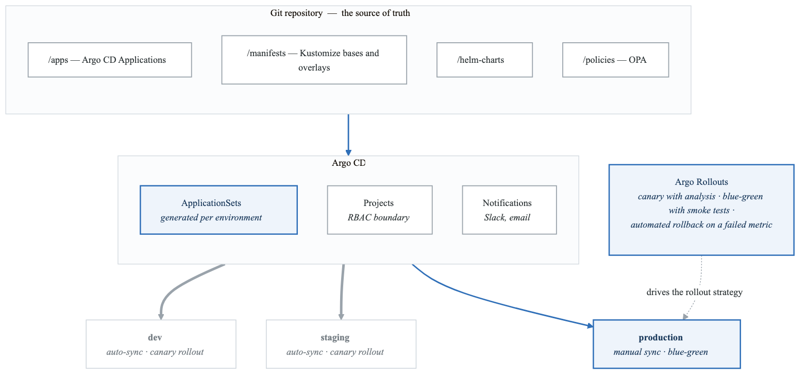
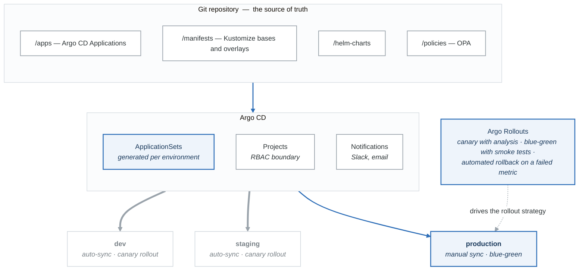

# Lab 12: Production Patterns

## Objectives

- Implement Helm charts for application packaging
- Use Kustomize for environment management
- Deploy with advanced strategies (Canary, Blue-Green)
- Set up GitOps with ArgoCD

## Prerequisites

- Completed Labs 07-11
- Running Kubernetes cluster
- kubectl configured
- Helm installed

---

## Part 1: Helm Charts (Guided)

### Step 1: Install Helm

```bash
# Install Helm
curl https://raw.githubusercontent.com/helm/helm/main/scripts/get-helm-3 | bash

# Verify
helm version

# Add common repos
helm repo add bitnami https://charts.bitnami.com/bitnami
helm repo add ingress-nginx https://kubernetes.github.io/ingress-nginx
helm repo update
```

### Step 2: Use Existing Charts

```bash
# Search for charts
helm search repo nginx
helm search repo postgresql

# Show chart info
helm show chart bitnami/nginx
helm show values bitnami/nginx

# Install chart
helm install my-nginx bitnami/nginx

# List releases
helm list

# Get release info
helm status my-nginx
helm get values my-nginx
helm get manifest my-nginx

# Upgrade with custom values
helm upgrade my-nginx bitnami/nginx --set service.type=ClusterIP

# Rollback
helm rollback my-nginx 1

# Uninstall
helm uninstall my-nginx
```

### Step 3: Create Your Own Chart

```bash
# Create chart scaffold
helm create webapp

# View structure
tree webapp/
```

**`webapp/`**

- `Chart.yaml` — Chart metadata
- `values.yaml` — Default values
- `charts/` — Dependencies
- `templates/` — Kubernetes manifests
  - `deployment.yaml`
  - `service.yaml`
  - `ingress.yaml`
  - `hpa.yaml`
  - `serviceaccount.yaml`
  - `_helpers.tpl` — Template helpers
  - `NOTES.txt` — Post-install notes
  - `tests/`
    - `test-connection.yaml`
- `.helmignore`


### Chart.yaml

```yaml
# webapp/Chart.yaml
apiVersion: v2
name: webapp
description: A production-ready web application chart
type: application
version: 0.1.0
appVersion: "1.0.0"
keywords:
  - webapp
  - nginx
maintainers:
  - name: DevOps Team
    email: devops@example.com
dependencies:
  - name: redis
    version: "17.x.x"
    repository: https://charts.bitnami.com/bitnami
    condition: redis.enabled
```

### values.yaml

```yaml
# webapp/values.yaml
replicaCount: 3

image:
  repository: nginx
  pullPolicy: IfNotPresent
  tag: "alpine"

imagePullSecrets: []
nameOverride: ""
fullnameOverride: ""

serviceAccount:
  create: true
  annotations: {}
  name: ""

podAnnotations: {}
podSecurityContext:
  fsGroup: 1000

securityContext:
  runAsNonRoot: true
  runAsUser: 1000
  capabilities:
    drop:
      - ALL

service:
  type: ClusterIP
  port: 80

ingress:
  enabled: false
  className: nginx
  annotations: {}
  hosts:
    - host: webapp.local
      paths:
        - path: /
          pathType: Prefix
  tls: []

resources:
  limits:
    cpu: 200m
    memory: 256Mi
  requests:
    cpu: 100m
    memory: 128Mi

autoscaling:
  enabled: true
  minReplicas: 3
  maxReplicas: 10
  targetCPUUtilizationPercentage: 70

nodeSelector: {}
tolerations: []
affinity:
  podAntiAffinity:
    preferredDuringSchedulingIgnoredDuringExecution:
      - weight: 100
        podAffinityTerm:
          labelSelector:
            matchLabels:
              app.kubernetes.io/name: webapp
          topologyKey: kubernetes.io/hostname

# Application config
config:
  logLevel: info
  features:
    darkMode: true

# Redis dependency
redis:
  enabled: false
  auth:
    enabled: true
```

### Deployment Template

```yaml
# webapp/templates/deployment.yaml
apiVersion: apps/v1
kind: Deployment
metadata:
  name: {{ include "webapp.fullname" . }}
  labels:
    {{- include "webapp.labels" . | nindent 4 }}
spec:
  {{- if not .Values.autoscaling.enabled }}
  replicas: {{ .Values.replicaCount }}
  {{- end }}
  selector:
    matchLabels:
      {{- include "webapp.selectorLabels" . | nindent 6 }}
  template:
    metadata:
      annotations:
        checksum/config: {{ include (print $.Template.BasePath "/configmap.yaml") . | sha256sum }}
        {{- with .Values.podAnnotations }}
        {{- toYaml . | nindent 8 }}
        {{- end }}
      labels:
        {{- include "webapp.selectorLabels" . | nindent 8 }}
    spec:
      {{- with .Values.imagePullSecrets }}
      imagePullSecrets:
        {{- toYaml . | nindent 8 }}
      {{- end }}
      serviceAccountName: {{ include "webapp.serviceAccountName" . }}
      securityContext:
        {{- toYaml .Values.podSecurityContext | nindent 8 }}
      containers:
        - name: {{ .Chart.Name }}
          securityContext:
            {{- toYaml .Values.securityContext | nindent 12 }}
          image: "{{ .Values.image.repository }}:{{ .Values.image.tag | default .Chart.AppVersion }}"
          imagePullPolicy: {{ .Values.image.pullPolicy }}
          ports:
            - name: http
              containerPort: 80
              protocol: TCP
          livenessProbe:
            httpGet:
              path: /
              port: http
            initialDelaySeconds: 10
            periodSeconds: 10
          readinessProbe:
            httpGet:
              path: /
              port: http
            initialDelaySeconds: 5
            periodSeconds: 5
          resources:
            {{- toYaml .Values.resources | nindent 12 }}
          envFrom:
            - configMapRef:
                name: {{ include "webapp.fullname" . }}-config
          {{- if .Values.redis.enabled }}
          env:
            - name: REDIS_HOST
              value: {{ include "webapp.fullname" . }}-redis-master
            - name: REDIS_PASSWORD
              valueFrom:
                secretKeyRef:
                  name: {{ include "webapp.fullname" . }}-redis
                  key: redis-password
          {{- end }}
      {{- with .Values.nodeSelector }}
      nodeSelector:
        {{- toYaml . | nindent 8 }}
      {{- end }}
      {{- with .Values.affinity }}
      affinity:
        {{- toYaml . | nindent 8 }}
      {{- end }}
      {{- with .Values.tolerations }}
      tolerations:
        {{- toYaml . | nindent 8 }}
      {{- end }}
```

### ConfigMap Template

```yaml
# webapp/templates/configmap.yaml
apiVersion: v1
kind: ConfigMap
metadata:
  name: {{ include "webapp.fullname" . }}-config
  labels:
    {{- include "webapp.labels" . | nindent 4 }}
data:
  LOG_LEVEL: {{ .Values.config.logLevel | quote }}
  FEATURES_DARK_MODE: {{ .Values.config.features.darkMode | quote }}
```

### Install and Test

```bash
# Lint chart
helm lint webapp/

# Template (dry-run)
helm template my-webapp webapp/

# Install
helm install my-webapp webapp/ -f webapp/values.yaml

# Install with overrides
helm install my-webapp webapp/ \
  --set replicaCount=5 \
  --set image.tag=1.24 \
  --set ingress.enabled=true

# Upgrade
helm upgrade my-webapp webapp/ --set replicaCount=3

# Package for distribution
helm package webapp/
```

### Validation

```bash
#!/bin/bash
# validate-part1.sh

echo "=== Part 1 Validation ==="

# Check Helm installed
if command -v helm &> /dev/null; then
    VERSION=$(helm version --short)
    echo "✓ Helm installed: $VERSION"
else
    echo "✗ Helm not installed"
    exit 1
fi

# Check chart structure
if [ -f "webapp/Chart.yaml" ] && [ -f "webapp/values.yaml" ]; then
    echo "✓ Chart structure exists"
else
    echo "✗ Chart structure incomplete"
fi

# Lint chart
if helm lint webapp/ &> /dev/null; then
    echo "✓ Chart linting passed"
else
    echo "✗ Chart linting failed"
fi

# Test template rendering
if helm template test webapp/ &> /dev/null; then
    echo "✓ Template rendering works"
else
    echo "✗ Template rendering failed"
fi

# Test installation
helm install test-webapp webapp/ --dry-run &> /dev/null
if [ $? -eq 0 ]; then
    echo "✓ Dry-run installation succeeded"
else
    echo "✗ Dry-run installation failed"
fi

echo "Part 1 validation complete!"
```

---

## Part 2: Kustomize (Semi-Guided)

### Objective

Use Kustomize for environment-specific customizations.

### Tasks

1. Create base resources
2. Create overlays for different environments
3. Use patches and generators

### Create Base

```bash
mkdir -p kustomize-demo/base
mkdir -p kustomize-demo/overlays/{dev,staging,production}
```

```yaml
# kustomize-demo/base/deployment.yaml
apiVersion: apps/v1
kind: Deployment
metadata:
  name: webapp
spec:
  replicas: 1
  selector:
    matchLabels:
      app: webapp
  template:
    metadata:
      labels:
        app: webapp
    spec:
      containers:
      - name: webapp
        image: nginx:alpine
        ports:
        - containerPort: 80
        resources:
          requests:
            cpu: 100m
            memory: 128Mi
          limits:
            cpu: 200m
            memory: 256Mi
        envFrom:
        - configMapRef:
            name: webapp-config
```

```yaml
# kustomize-demo/base/service.yaml
apiVersion: v1
kind: Service
metadata:
  name: webapp
spec:
  selector:
    app: webapp
  ports:
  - port: 80
    targetPort: 80
```

```yaml
# kustomize-demo/base/configmap.yaml
apiVersion: v1
kind: ConfigMap
metadata:
  name: webapp-config
data:
  LOG_LEVEL: info
  APP_ENV: base
```

```yaml
# kustomize-demo/base/kustomization.yaml
apiVersion: kustomize.config.k8s.io/v1beta1
kind: Kustomization

resources:
  - deployment.yaml
  - service.yaml
  - configmap.yaml

commonLabels:
  app.kubernetes.io/name: webapp
  app.kubernetes.io/managed-by: kustomize
```

### Development Overlay

```yaml
# kustomize-demo/overlays/dev/kustomization.yaml
apiVersion: kustomize.config.k8s.io/v1beta1
kind: Kustomization

namespace: dev
namePrefix: dev-

resources:
  - ../../base

patches:
  - path: deployment-patch.yaml

configMapGenerator:
  - name: webapp-config
    behavior: replace
    literals:
      - LOG_LEVEL=debug
      - APP_ENV=development
      - DEBUG=true

images:
  - name: nginx
    newTag: alpine
```

```yaml
# kustomize-demo/overlays/dev/deployment-patch.yaml
apiVersion: apps/v1
kind: Deployment
metadata:
  name: webapp
spec:
  replicas: 1
  template:
    spec:
      containers:
      - name: webapp
        resources:
          requests:
            cpu: 50m
            memory: 64Mi
          limits:
            cpu: 100m
            memory: 128Mi
```

### Production Overlay

```yaml
# kustomize-demo/overlays/production/kustomization.yaml
apiVersion: kustomize.config.k8s.io/v1beta1
kind: Kustomization

namespace: production
namePrefix: prod-

resources:
  - ../../base
  - hpa.yaml
  - pdb.yaml

patches:
  - path: deployment-patch.yaml
  - path: service-patch.yaml

configMapGenerator:
  - name: webapp-config
    behavior: replace
    literals:
      - LOG_LEVEL=warn
      - APP_ENV=production

secretGenerator:
  - name: webapp-secrets
    literals:
      - API_KEY=production-secret-key

images:
  - name: nginx
    newTag: "1.24"
```

```yaml
# kustomize-demo/overlays/production/deployment-patch.yaml
apiVersion: apps/v1
kind: Deployment
metadata:
  name: webapp
spec:
  replicas: 5
  template:
    spec:
      containers:
      - name: webapp
        resources:
          requests:
            cpu: 200m
            memory: 256Mi
          limits:
            cpu: 500m
            memory: 512Mi
        livenessProbe:
          httpGet:
            path: /
            port: 80
          initialDelaySeconds: 10
          periodSeconds: 10
        readinessProbe:
          httpGet:
            path: /
            port: 80
          initialDelaySeconds: 5
          periodSeconds: 5
      affinity:
        podAntiAffinity:
          preferredDuringSchedulingIgnoredDuringExecution:
          - weight: 100
            podAffinityTerm:
              labelSelector:
                matchLabels:
                  app: webapp
              topologyKey: kubernetes.io/hostname
```

```yaml
# kustomize-demo/overlays/production/service-patch.yaml
apiVersion: v1
kind: Service
metadata:
  name: webapp
  annotations:
    service.beta.kubernetes.io/aws-load-balancer-type: nlb
spec:
  type: LoadBalancer
```

```yaml
# kustomize-demo/overlays/production/hpa.yaml
apiVersion: autoscaling/v2
kind: HorizontalPodAutoscaler
metadata:
  name: webapp
spec:
  scaleTargetRef:
    apiVersion: apps/v1
    kind: Deployment
    name: webapp
  minReplicas: 5
  maxReplicas: 20
  metrics:
  - type: Resource
    resource:
      name: cpu
      target:
        type: Utilization
        averageUtilization: 70
```

```yaml
# kustomize-demo/overlays/production/pdb.yaml
apiVersion: policy/v1
kind: PodDisruptionBudget
metadata:
  name: webapp
spec:
  minAvailable: 3
  selector:
    matchLabels:
      app: webapp
```

### Apply Kustomizations

```bash
# Preview dev
kubectl kustomize kustomize-demo/overlays/dev/

# Preview production
kubectl kustomize kustomize-demo/overlays/production/

# Apply dev
kubectl create namespace dev
kubectl apply -k kustomize-demo/overlays/dev/

# Apply production
kubectl create namespace production
kubectl apply -k kustomize-demo/overlays/production/

# Compare environments
diff <(kubectl kustomize kustomize-demo/overlays/dev/) <(kubectl kustomize kustomize-demo/overlays/production/)
```

### Validation

```bash
#!/bin/bash
# validate-part2.sh

echo "=== Part 2 Validation ==="

# Check kustomization files
for ENV in base overlays/dev overlays/production; do
    if [ -f "kustomize-demo/$ENV/kustomization.yaml" ]; then
        echo "✓ $ENV kustomization exists"
    else
        echo "✗ $ENV kustomization missing"
    fi
done

# Validate kustomizations
for ENV in dev production; do
    if kubectl kustomize kustomize-demo/overlays/$ENV/ &> /dev/null; then
        echo "✓ $ENV kustomization valid"
    else
        echo "✗ $ENV kustomization invalid"
    fi
done

# Check environment differences
DEV_REPLICAS=$(kubectl kustomize kustomize-demo/overlays/dev/ | grep "replicas:" | head -1 | awk '{print $2}')
PROD_REPLICAS=$(kubectl kustomize kustomize-demo/overlays/production/ | grep "replicas:" | head -1 | awk '{print $2}')

if [ "$DEV_REPLICAS" != "$PROD_REPLICAS" ]; then
    echo "✓ Environment-specific replicas (dev: $DEV_REPLICAS, prod: $PROD_REPLICAS)"
else
    echo "✗ Replicas should differ between environments"
fi

echo "Part 2 validation complete!"
```

---

## Part 3: Advanced Deployment Strategies (Semi-Guided)

### Objective

Implement Canary and Blue-Green deployments.

### Tasks

1. Install Argo Rollouts
2. Implement Canary deployment
3. Implement Blue-Green deployment

### Install Argo Rollouts

```bash
# Install controller
kubectl create namespace argo-rollouts
kubectl apply -n argo-rollouts -f https://github.com/argoproj/argo-rollouts/releases/latest/download/install.yaml

# Install kubectl plugin
curl -LO https://github.com/argoproj/argo-rollouts/releases/latest/download/kubectl-argo-rollouts-linux-amd64
chmod +x kubectl-argo-rollouts-linux-amd64
sudo mv kubectl-argo-rollouts-linux-amd64 /usr/local/bin/kubectl-argo-rollouts

# Verify
kubectl argo rollouts version
```

### Canary Deployment

```yaml
# canary-rollout.yaml
apiVersion: argoproj.io/v1alpha1
kind: Rollout
metadata:
  name: canary-demo
spec:
  replicas: 5
  strategy:
    canary:
      steps:
      - setWeight: 20
      - pause: {duration: 30s}
      - setWeight: 40
      - pause: {duration: 30s}
      - setWeight: 60
      - pause: {duration: 30s}
      - setWeight: 80
      - pause: {duration: 30s}
      # Analysis before full rollout
      - analysis:
          templates:
          - templateName: success-rate
      canaryService: canary-demo-canary
      stableService: canary-demo-stable
      trafficRouting:
        nginx:
          stableIngress: canary-demo-ingress
  selector:
    matchLabels:
      app: canary-demo
  template:
    metadata:
      labels:
        app: canary-demo
    spec:
      containers:
      - name: app
        image: hashicorp/http-echo
        args:
        - "-text=Version 1"
        ports:
        - containerPort: 5678
        resources:
          requests:
            cpu: 100m
            memory: 128Mi
---
apiVersion: v1
kind: Service
metadata:
  name: canary-demo-stable
spec:
  selector:
    app: canary-demo
  ports:
  - port: 80
    targetPort: 5678
---
apiVersion: v1
kind: Service
metadata:
  name: canary-demo-canary
spec:
  selector:
    app: canary-demo
  ports:
  - port: 80
    targetPort: 5678
---
apiVersion: networking.k8s.io/v1
kind: Ingress
metadata:
  name: canary-demo-ingress
  annotations:
    nginx.ingress.kubernetes.io/canary: "true"
spec:
  ingressClassName: nginx
  rules:
  - host: canary.local
    http:
      paths:
      - path: /
        pathType: Prefix
        backend:
          service:
            name: canary-demo-stable
            port:
              number: 80
```

```yaml
# analysis-template.yaml
apiVersion: argoproj.io/v1alpha1
kind: AnalysisTemplate
metadata:
  name: success-rate
spec:
  metrics:
  - name: success-rate
    interval: 10s
    successCondition: result[0] >= 0.95
    failureLimit: 3
    provider:
      prometheus:
        address: http://prometheus:9090
        query: |
          sum(rate(http_requests_total{status=~"2.*",app="canary-demo"}[5m])) /
          sum(rate(http_requests_total{app="canary-demo"}[5m]))
```

```bash
# Apply rollout
kubectl apply -f canary-rollout.yaml
kubectl apply -f analysis-template.yaml

# Watch rollout
kubectl argo rollouts get rollout canary-demo --watch

# Trigger update
kubectl argo rollouts set image canary-demo app=hashicorp/http-echo:latest

# Watch canary progression
kubectl argo rollouts get rollout canary-demo --watch

# Manual promotion
kubectl argo rollouts promote canary-demo

# Abort rollout
kubectl argo rollouts abort canary-demo

# Rollback
kubectl argo rollouts undo canary-demo
```

### Blue-Green Deployment

```yaml
# blue-green-rollout.yaml
apiVersion: argoproj.io/v1alpha1
kind: Rollout
metadata:
  name: blue-green-demo
spec:
  replicas: 3
  strategy:
    blueGreen:
      activeService: blue-green-active
      previewService: blue-green-preview
      autoPromotionEnabled: false
      scaleDownDelaySeconds: 30
      prePromotionAnalysis:
        templates:
        - templateName: smoke-tests
        args:
        - name: service-name
          value: blue-green-preview
      postPromotionAnalysis:
        templates:
        - templateName: success-rate
  selector:
    matchLabels:
      app: blue-green-demo
  template:
    metadata:
      labels:
        app: blue-green-demo
    spec:
      containers:
      - name: app
        image: hashicorp/http-echo
        args:
        - "-text=Blue Version"
        ports:
        - containerPort: 5678
        livenessProbe:
          httpGet:
            path: /
            port: 5678
          initialDelaySeconds: 5
        readinessProbe:
          httpGet:
            path: /
            port: 5678
          initialDelaySeconds: 3
---
apiVersion: v1
kind: Service
metadata:
  name: blue-green-active
spec:
  selector:
    app: blue-green-demo
  ports:
  - port: 80
    targetPort: 5678
---
apiVersion: v1
kind: Service
metadata:
  name: blue-green-preview
spec:
  selector:
    app: blue-green-demo
  ports:
  - port: 80
    targetPort: 5678
```

```yaml
# smoke-test-template.yaml
apiVersion: argoproj.io/v1alpha1
kind: AnalysisTemplate
metadata:
  name: smoke-tests
spec:
  args:
  - name: service-name
  metrics:
  - name: smoke-test
    successCondition: result == "passed"
    provider:
      job:
        spec:
          backoffLimit: 0
          template:
            spec:
              containers:
              - name: test
                image: curlimages/curl
                command:
                - sh
                - -c
                - |
                  response=$(curl -s http://{{args.service-name}})
                  if echo "$response" | grep -q "Version"; then
                    echo "passed"
                  else
                    echo "failed"
                    exit 1
                  fi
              restartPolicy: Never
```

```bash
# Apply
kubectl apply -f blue-green-rollout.yaml
kubectl apply -f smoke-test-template.yaml

# Watch rollout
kubectl argo rollouts get rollout blue-green-demo --watch

# Update (creates green deployment)
kubectl argo rollouts set image blue-green-demo app=hashicorp/http-echo:latest -- -text="Green Version"

# Preview is available, active still serves old version
kubectl get svc blue-green-active -o jsonpath='{.spec.selector}'
kubectl get svc blue-green-preview -o jsonpath='{.spec.selector}'

# Promote (switch traffic to green)
kubectl argo rollouts promote blue-green-demo

# Dashboard
kubectl argo rollouts dashboard
```

### Validation

```bash
#!/bin/bash
# validate-part3.sh

echo "=== Part 3 Validation ==="

# Check Argo Rollouts controller
if kubectl get deployment argo-rollouts -n argo-rollouts &> /dev/null; then
    READY=$(kubectl get deployment argo-rollouts -n argo-rollouts -o jsonpath='{.status.readyReplicas}')
    echo "✓ Argo Rollouts controller running (replicas: $READY)"
else
    echo "✗ Argo Rollouts not installed"
fi

# Check kubectl plugin
if command -v kubectl-argo-rollouts &> /dev/null; then
    echo "✓ kubectl argo rollouts plugin installed"
else
    echo "! kubectl plugin not installed (optional)"
fi

# Check canary rollout
if kubectl get rollout canary-demo &> /dev/null; then
    STATUS=$(kubectl argo rollouts status canary-demo 2>/dev/null | head -1)
    echo "✓ Canary rollout exists: $STATUS"
else
    echo "✗ Canary rollout not found"
fi

# Check blue-green rollout
if kubectl get rollout blue-green-demo &> /dev/null; then
    STATUS=$(kubectl argo rollouts status blue-green-demo 2>/dev/null | head -1)
    echo "✓ Blue-green rollout exists: $STATUS"
else
    echo "✗ Blue-green rollout not found"
fi

echo "Part 3 validation complete!"
```

---

## Part 4: GitOps with ArgoCD (Semi-Guided)

### Objective

Set up GitOps workflow with ArgoCD.

### Tasks

1. Install ArgoCD
2. Configure Git repository
3. Create Application resources
4. Implement automated sync

### Install ArgoCD

```bash
# Create namespace
kubectl create namespace argocd

# Install ArgoCD
kubectl apply -n argocd -f https://raw.githubusercontent.com/argoproj/argo-cd/stable/manifests/install.yaml

# Wait for deployment
kubectl wait --for=condition=ready pod -l app.kubernetes.io/name=argocd-server -n argocd --timeout=120s

# Get initial admin password
kubectl -n argocd get secret argocd-initial-admin-secret -o jsonpath="{.data.password}" | base64 -d

# Access UI (port-forward)
kubectl port-forward svc/argocd-server -n argocd 8080:443 &

# Or via LoadBalancer
kubectl patch svc argocd-server -n argocd -p '{"spec": {"type": "LoadBalancer"}}'

# Install CLI
curl -sSL -o argocd https://github.com/argoproj/argo-cd/releases/latest/download/argocd-linux-amd64
chmod +x argocd
sudo mv argocd /usr/local/bin/

# Login
argocd login localhost:8080 --username admin --password <password> --insecure
```

### Create Git Repository Structure

```bash
# Repository structure for GitOps
gitops-repo/
├── apps/                    # ArgoCD Application manifests
│   ├── dev/
│   │   └── webapp.yaml
│   ├── staging/
│   │   └── webapp.yaml
│   └── production/
│       └── webapp.yaml
├── manifests/               # Kubernetes manifests
│   ├── base/
│   │   ├── kustomization.yaml
│   │   ├── deployment.yaml
│   │   ├── service.yaml
│   │   └── configmap.yaml
│   └── overlays/
│       ├── dev/
│       ├── staging/
│       └── production/
└── helm-charts/            # Helm charts
    └── webapp/
```

### Create ArgoCD Application

```yaml
# apps/dev/webapp.yaml
apiVersion: argoproj.io/v1alpha1
kind: Application
metadata:
  name: webapp-dev
  namespace: argocd
  finalizers:
    - resources-finalizer.argocd.argoproj.io
spec:
  project: default
  source:
    repoURL: https://github.com/your-org/gitops-repo.git
    targetRevision: main
    path: manifests/overlays/dev
  destination:
    server: https://kubernetes.default.svc
    namespace: dev
  syncPolicy:
    automated:
      prune: true
      selfHeal: true
    syncOptions:
      - CreateNamespace=true
    retry:
      limit: 5
      backoff:
        duration: 5s
        factor: 2
        maxDuration: 3m
```

```yaml
# apps/production/webapp.yaml
apiVersion: argoproj.io/v1alpha1
kind: Application
metadata:
  name: webapp-production
  namespace: argocd
  finalizers:
    - resources-finalizer.argocd.argoproj.io
spec:
  project: default
  source:
    repoURL: https://github.com/your-org/gitops-repo.git
    targetRevision: main
    path: manifests/overlays/production
  destination:
    server: https://kubernetes.default.svc
    namespace: production
  syncPolicy:
    # Manual sync for production
    syncOptions:
      - CreateNamespace=true
  # Require manual approval for production
```

### Application with Helm

```yaml
# apps/helm-webapp.yaml
apiVersion: argoproj.io/v1alpha1
kind: Application
metadata:
  name: webapp-helm
  namespace: argocd
spec:
  project: default
  source:
    repoURL: https://github.com/your-org/gitops-repo.git
    targetRevision: main
    path: helm-charts/webapp
    helm:
      valueFiles:
        - values.yaml
        - values-production.yaml
      parameters:
        - name: replicaCount
          value: "5"
  destination:
    server: https://kubernetes.default.svc
    namespace: webapp
  syncPolicy:
    automated:
      prune: true
      selfHeal: true
```

### AppProject for RBAC

```yaml
# projects/webapp-project.yaml
apiVersion: argoproj.io/v1alpha1
kind: AppProject
metadata:
  name: webapp
  namespace: argocd
spec:
  description: WebApp project
  sourceRepos:
    - https://github.com/your-org/gitops-repo.git
  destinations:
    - namespace: dev
      server: https://kubernetes.default.svc
    - namespace: staging
      server: https://kubernetes.default.svc
    - namespace: production
      server: https://kubernetes.default.svc
  clusterResourceWhitelist:
    - group: ''
      kind: Namespace
  namespaceResourceWhitelist:
    - group: '*'
      kind: '*'
  roles:
    - name: developer
      description: Developer access
      policies:
        - p, proj:webapp:developer, applications, get, webapp/*, allow
        - p, proj:webapp:developer, applications, sync, webapp/webapp-dev, allow
      groups:
        - developers
```

### ApplicationSet for Multiple Environments

```yaml
# app-sets/webapp-set.yaml
apiVersion: argoproj.io/v1alpha1
kind: ApplicationSet
metadata:
  name: webapp
  namespace: argocd
spec:
  generators:
    - list:
        elements:
          - env: dev
            replicas: "1"
            autoSync: "true"
          - env: staging
            replicas: "2"
            autoSync: "true"
          - env: production
            replicas: "5"
            autoSync: "false"
  template:
    metadata:
      name: 'webapp-{{env}}'
    spec:
      project: webapp
      source:
        repoURL: https://github.com/your-org/gitops-repo.git
        targetRevision: main
        path: 'manifests/overlays/{{env}}'
      destination:
        server: https://kubernetes.default.svc
        namespace: '{{env}}'
      syncPolicy:
        automated:
          prune: '{{autoSync}}'
          selfHeal: '{{autoSync}}'
        syncOptions:
          - CreateNamespace=true
```

### ArgoCD CLI Operations

```bash
# List applications
argocd app list

# Get app details
argocd app get webapp-dev

# Sync application
argocd app sync webapp-dev

# Watch sync
argocd app sync webapp-dev --watch

# Diff (preview changes)
argocd app diff webapp-dev

# Rollback
argocd app rollback webapp-dev

# Delete application
argocd app delete webapp-dev

# Add Git repository
argocd repo add https://github.com/your-org/gitops-repo.git --username user --password token

# Add cluster
argocd cluster add my-cluster-context
```

### Validation

```bash
#!/bin/bash
# validate-part4.sh

echo "=== Part 4 Validation ==="

# Check ArgoCD installed
if kubectl get deployment argocd-server -n argocd &> /dev/null; then
    READY=$(kubectl get deployment argocd-server -n argocd -o jsonpath='{.status.readyReplicas}')
    echo "✓ ArgoCD server running (replicas: $READY)"
else
    echo "✗ ArgoCD not installed"
fi

# Check ArgoCD CLI
if command -v argocd &> /dev/null; then
    VERSION=$(argocd version --client --short)
    echo "✓ ArgoCD CLI installed: $VERSION"
else
    echo "! ArgoCD CLI not installed"
fi

# Check Applications
APP_COUNT=$(kubectl get applications -n argocd --no-headers 2>/dev/null | wc -l)
echo "  Applications configured: $APP_COUNT"

# Check sync status
for APP in $(kubectl get applications -n argocd -o jsonpath='{.items[*].metadata.name}' 2>/dev/null); do
    STATUS=$(kubectl get application $APP -n argocd -o jsonpath='{.status.sync.status}')
    HEALTH=$(kubectl get application $APP -n argocd -o jsonpath='{.status.health.status}')
    echo "  $APP: sync=$STATUS, health=$HEALTH"
done

echo "Part 4 validation complete!"
```

---

## Part 5: Challenge - Complete GitOps Platform

### Objective

Build a complete GitOps platform with:
- Multi-environment deployment
- Canary releases
- Automated testing
- Observability

### Architecture

<!-- figure: generated from the Mermaid below by _shared/diagrams/embed-figures.py — do not edit the image -->


<details>
<summary>Diagram source (Mermaid)</summary>



</details>

### Requirements

1. **Git Repository:**
   - Kustomize structure with base and overlays
   - Helm chart for the application
   - ArgoCD Application manifests
   - Sealed Secrets for credentials

2. **ArgoCD:**
   - ApplicationSet for all environments
   - AppProject with proper RBAC
   - Notifications configured
   - Image updater for automatic updates

3. **Argo Rollouts:**
   - Canary deployment for dev/staging
   - Blue-Green for production
   - Analysis templates for automated testing
   - Integration with ArgoCD

4. **Observability:**
   - Prometheus metrics for analysis
   - Grafana dashboard for deployments
   - Slack notifications for events

5. **Security:**
   - Sealed Secrets for all credentials
   - RBAC for team access
   - Network policies

### Validation Script

```bash
#!/bin/bash
# validate-challenge.sh

echo "=== Challenge Validation ==="

# Check ArgoCD
echo ""
echo "Checking ArgoCD..."
if kubectl get deployment argocd-server -n argocd &> /dev/null; then
    echo "✓ ArgoCD installed"

    # Check ApplicationSet
    APPSET_COUNT=$(kubectl get applicationset -n argocd --no-headers 2>/dev/null | wc -l)
    if [ "$APPSET_COUNT" -gt 0 ]; then
        echo "✓ ApplicationSets configured: $APPSET_COUNT"
    else
        echo "✗ No ApplicationSets found"
    fi

    # Check AppProject
    if kubectl get appproject webapp -n argocd &> /dev/null; then
        echo "✓ AppProject 'webapp' configured"
    else
        echo "✗ AppProject not found"
    fi
else
    echo "✗ ArgoCD not installed"
fi

# Check Argo Rollouts
echo ""
echo "Checking Argo Rollouts..."
if kubectl get deployment argo-rollouts -n argo-rollouts &> /dev/null; then
    echo "✓ Argo Rollouts installed"

    # Check rollouts per environment
    for NS in dev staging production; do
        ROLLOUT_COUNT=$(kubectl get rollout -n $NS --no-headers 2>/dev/null | wc -l)
        if [ "$ROLLOUT_COUNT" -gt 0 ]; then
            STRATEGY=$(kubectl get rollout -n $NS -o jsonpath='{.items[0].spec.strategy}' 2>/dev/null | jq -r 'keys[0]')
            echo "✓ $NS: $ROLLOUT_COUNT rollout(s), strategy: $STRATEGY"
        else
            echo "! $NS: No rollouts found"
        fi
    done
else
    echo "✗ Argo Rollouts not installed"
fi

# Check Analysis Templates
echo ""
echo "Checking Analysis..."
ANALYSIS_COUNT=$(kubectl get analysistemplate --all-namespaces --no-headers 2>/dev/null | wc -l)
if [ "$ANALYSIS_COUNT" -gt 0 ]; then
    echo "✓ AnalysisTemplates configured: $ANALYSIS_COUNT"
else
    echo "✗ No AnalysisTemplates found"
fi

# Check environments
echo ""
echo "Checking Environments..."
for NS in dev staging production; do
    if kubectl get namespace $NS &> /dev/null; then
        POD_COUNT=$(kubectl get pods -n $NS --no-headers 2>/dev/null | wc -l)
        echo "✓ $NS namespace exists (pods: $POD_COUNT)"

        # Check for sealed secrets
        SS_COUNT=$(kubectl get sealedsecret -n $NS --no-headers 2>/dev/null | wc -l)
        if [ "$SS_COUNT" -gt 0 ]; then
            echo "  ✓ Sealed Secrets: $SS_COUNT"
        fi

        # Check for network policies
        NP_COUNT=$(kubectl get networkpolicy -n $NS --no-headers 2>/dev/null | wc -l)
        if [ "$NP_COUNT" -gt 0 ]; then
            echo "  ✓ Network Policies: $NP_COUNT"
        fi
    else
        echo "✗ $NS namespace not found"
    fi
done

# Check sync status
echo ""
echo "Checking Sync Status..."
for APP in $(kubectl get applications -n argocd -o jsonpath='{.items[*].metadata.name}' 2>/dev/null); do
    STATUS=$(kubectl get application $APP -n argocd -o jsonpath='{.status.sync.status}')
    HEALTH=$(kubectl get application $APP -n argocd -o jsonpath='{.status.health.status}')
    if [ "$STATUS" = "Synced" ] && [ "$HEALTH" = "Healthy" ]; then
        echo "✓ $APP: sync=$STATUS, health=$HEALTH"
    else
        echo "! $APP: sync=$STATUS, health=$HEALTH"
    fi
done

echo ""
echo "Challenge validation complete!"
```

---

## Deliverables

1. Complete GitOps repository structure
2. ArgoCD configuration (ApplicationSets, Projects)
3. Argo Rollouts manifests for all environments
4. Analysis templates for automated testing
5. Documentation of the deployment workflow

## Commands Reference

```bash
# Helm
helm create <chart>
helm install <release> <chart>
helm upgrade <release> <chart>
helm rollback <release> <revision>
helm list

# Kustomize
kubectl kustomize <path>
kubectl apply -k <path>
kubectl diff -k <path>

# Argo Rollouts
kubectl argo rollouts get rollout <name>
kubectl argo rollouts set image <name> <container>=<image>
kubectl argo rollouts promote <name>
kubectl argo rollouts abort <name>
kubectl argo rollouts undo <name>

# ArgoCD
argocd app list
argocd app get <name>
argocd app sync <name>
argocd app diff <name>
argocd app rollback <name>
```

## Resources

- [Helm Documentation](https://helm.sh/docs/)
- [Kustomize](https://kustomize.io/)
- [Argo Rollouts](https://argoproj.github.io/argo-rollouts/)
- [ArgoCD](https://argo-cd.readthedocs.io/)
- [GitOps Principles](https://opengitops.dev/)

## Next Steps

Congratulations on completing Phase 2! Continue to Phase 3: Infrastructure as Code

<!-- feynman-check -->

---

## Feynman check

Close the file. Blank page, no notes. Explain each of these to a competent engineer who has never
used this tool — **under five minutes, no jargon you can't define on the spot:**

- Helm Charts
- Kustomize
- Advanced Deployment Strategies
- GitOps with ArgoCD

**The gap is not what you forgot. It is where you used a word instead of a mechanism.**

| | |
|---|---|
| ✗ | *"A container isolates the application."* |
| ✓ | *"A container is an ordinary Linux process started with namespaces (what it can see), cgroups (what it can use) and usually seccomp (what it may ask the kernel). There is no container object in the kernel — only a process with those features switched on."* |

**Trace it:** `docker run` → an isolated process. Name the namespaces in the order they are created, and which component actually calls `clone()`.

Stop at the first component you cannot name. Reopen this file and read **only** that.

**Go deeper — only once the gap has a name:** the [LWN namespaces series](https://lwn.net/Articles/531114/) — seven parts by the man-pages maintainer, and the reason containers stop being magic.
Full list per domain: [`SOURCES.md`](../../SOURCES.md#containers)

→ Protocol, the three levels of knowing, and worked examples: [`MASTERY.md`](../../MASTERY.md)

<!-- /feynman-check -->
