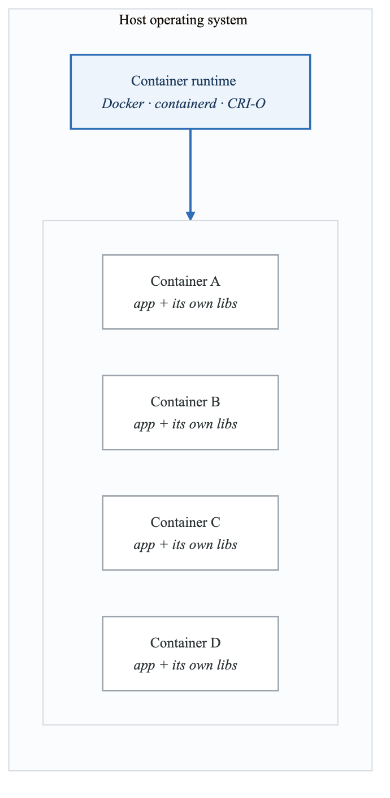
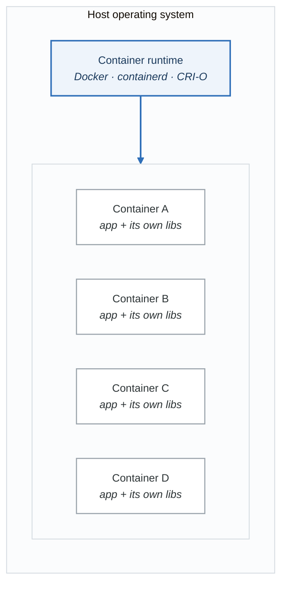
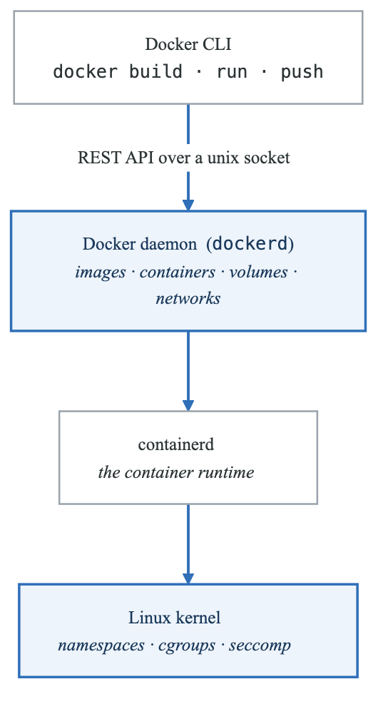
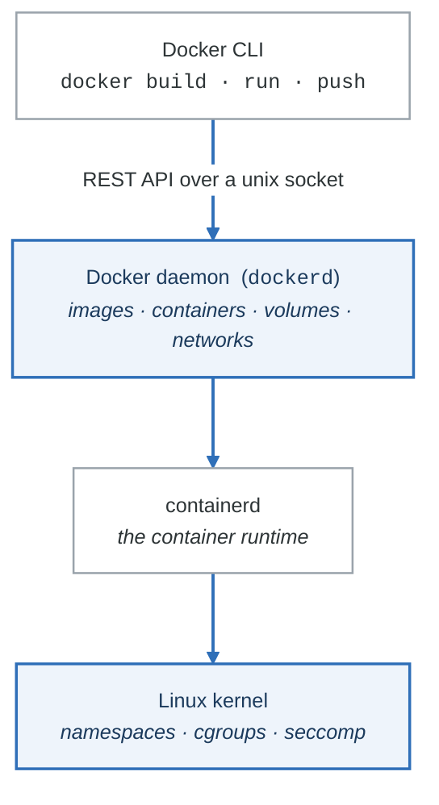
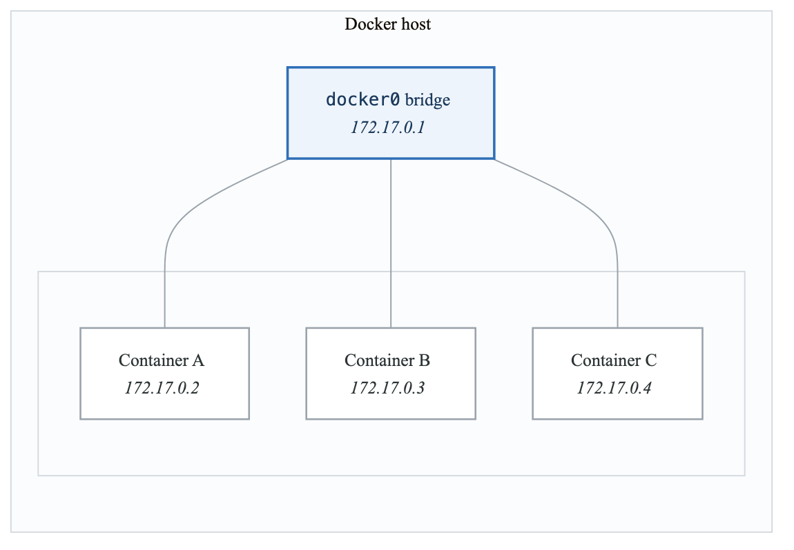
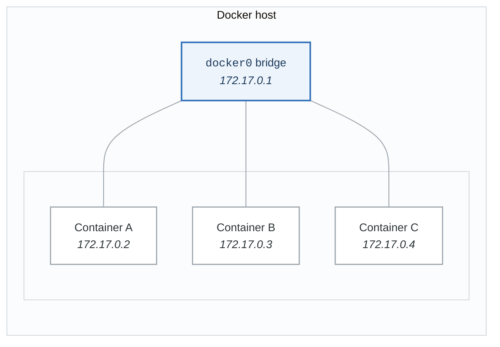

# Module 3: Containers Deep Dive

> **Duration:** 2 weeks (30-40 hours)
> **Prerequisites:** Module 1-2
> **Certification Prep:** Docker Certified Associate

---

## Learning Objectives

By the end of this module, you will be able to:

- [ ] Build optimized, secure container images
- [ ] Understand container networking and storage
- [ ] Write production-ready Dockerfiles
- [ ] Implement multi-stage builds
- [ ] Scan and harden container images
- [ ] Debug containerized applications
- [ ] Use Docker Compose for local development

---

## Concept Guide

### 3.1 Container Fundamentals

#### What is a Container?

<!-- figure: generated from the Mermaid below by _shared/diagrams/embed-figures.py — do not edit the image -->


<details>
<summary>Diagram source (Mermaid)</summary>



</details>

Each container carries its own libraries and shares the host's **kernel**. That is the whole
difference from a virtual machine, and it is why a container starts in milliseconds and why a Linux
container cannot run on a Windows kernel.

**The kernel features doing the work**

| Feature | Provides |
|---|---|
| Namespaces | Isolation — PID, network, mount, UTS, IPC, user |
| cgroups | Limits — CPU, memory, block I/O, PIDs |
| Union filesystems | Layered images, so a shared base layer is stored once |

None of these are new, and none of them were built for containers. A container is a process with
those three features turned on.

#### Container vs VM

| Aspect | Container | Virtual Machine |
|--------|-----------|-----------------|
| Startup | Seconds | Minutes |
| Size | MBs | GBs |
| Isolation | Process-level | Hardware-level |
| Overhead | Minimal | Significant |
| Portability | High | Medium |
| Security | Shared kernel | Separate kernel |

### 3.2 Docker Architecture

<!-- figure: generated from the Mermaid below by _shared/diagrams/embed-figures.py — do not edit the image -->


<details>
<summary>Diagram source (Mermaid)</summary>



</details>

### 3.3 Essential Docker Commands

```bash
# Image Management
docker build -t myapp:v1 .              # Build image
docker pull nginx:1.25                   # Pull from registry
docker push myregistry/myapp:v1         # Push to registry
docker images                            # List images
docker rmi myapp:v1                      # Remove image
docker image prune -a                    # Remove unused images

# Container Lifecycle
docker run -d -p 8080:80 nginx          # Run container
docker run -it ubuntu bash              # Interactive mode
docker start/stop/restart container_id  # Control containers
docker ps -a                            # List all containers
docker rm container_id                  # Remove container
docker container prune                  # Remove stopped containers

# Inspection & Debugging
docker logs -f container_id             # Follow logs
docker exec -it container_id bash       # Shell into container
docker inspect container_id             # Detailed info
docker stats                            # Resource usage
docker top container_id                 # Process list

# Network & Volumes
docker network create mynet             # Create network
docker volume create myvol              # Create volume
docker run -v myvol:/data myapp         # Mount volume
docker run --network mynet myapp        # Attach to network

# Cleanup
docker system prune -a                  # Remove everything unused
docker system df                        # Show disk usage
```

### 3.4 Dockerfile Best Practices

#### Production-Ready Dockerfile

```dockerfile
# syntax=docker/dockerfile:1.4
# ^^^^^^ Enable BuildKit features

# Stage 1: Build
FROM golang:1.21-alpine AS builder

# Install build dependencies
RUN apk add --no-cache git ca-certificates tzdata

# Create non-root user for final image
RUN adduser -D -g '' appuser

# Set working directory
WORKDIR /build

# Copy dependency files first (better caching)
COPY go.mod go.sum ./
RUN go mod download

# Copy source code
COPY . .

# Build with security flags
RUN CGO_ENABLED=0 GOOS=linux GOARCH=amd64 \
    go build -ldflags="-w -s -X main.version=${VERSION}" \
    -o /app ./cmd/server

# Stage 2: Runtime
FROM scratch

# Import from builder
COPY --from=builder /etc/ssl/certs/ca-certificates.crt /etc/ssl/certs/
COPY --from=builder /usr/share/zoneinfo /usr/share/zoneinfo
COPY --from=builder /etc/passwd /etc/passwd
COPY --from=builder /app /app

# Use non-root user
USER appuser

# Expose port (documentation only)
EXPOSE 8080

# Health check
HEALTHCHECK --interval=30s --timeout=3s --start-period=5s --retries=3 \
    CMD ["/app", "health"]

# Run application
ENTRYPOINT ["/app"]
CMD ["serve"]
```

#### Common Optimizations

```dockerfile
# 1. Order layers by change frequency
COPY package.json package-lock.json ./    # Rarely changes
RUN npm ci --only=production              # Cached if above unchanged
COPY . .                                   # Changes often

# 2. Combine RUN commands
RUN apt-get update && \
    apt-get install -y --no-install-recommends \
        curl \
        ca-certificates && \
    rm -rf /var/lib/apt/lists/*

# 3. Use .dockerignore
# .dockerignore contents:
# .git
# node_modules
# *.md
# Dockerfile
# .env

# 4. Use specific versions
FROM node:20.11.0-alpine3.19  # NOT node:latest

# 5. Set proper permissions
COPY --chown=node:node . .
USER node
```

### 3.5 Multi-Stage Builds

```dockerfile
# Example: Node.js with TypeScript

# Stage 1: Dependencies
FROM node:20-alpine AS deps
WORKDIR /app
COPY package*.json ./
RUN npm ci

# Stage 2: Build
FROM node:20-alpine AS builder
WORKDIR /app
COPY --from=deps /app/node_modules ./node_modules
COPY . .
RUN npm run build

# Stage 3: Production
FROM node:20-alpine AS runner
WORKDIR /app

ENV NODE_ENV=production

# Create non-root user
RUN addgroup -g 1001 -S nodejs && \
    adduser -S nextjs -u 1001

# Copy only production dependencies
COPY --from=deps /app/node_modules ./node_modules
COPY --from=builder /app/dist ./dist
COPY package*.json ./

# Remove dev dependencies
RUN npm prune --production

USER nextjs
EXPOSE 3000

CMD ["node", "dist/index.js"]
```

### 3.6 Container Security

#### Security Scanning

```bash
# Trivy scan
trivy image myapp:latest

# Trivy with severity filter
trivy image --severity HIGH,CRITICAL myapp:latest

# Scan Dockerfile
trivy config Dockerfile

# Scan filesystem
trivy fs --security-checks vuln,config .

# Grype scan
grype myapp:latest

# Docker Scout (Docker Desktop)
docker scout cves myapp:latest
docker scout recommendations myapp:latest
```

#### Security Best Practices

```dockerfile
# 1. Use minimal base images
FROM gcr.io/distroless/static-debian12
# or
FROM alpine:3.19

# 2. Don't run as root
USER 1000:1000

# 3. Set filesystem read-only where possible
# At runtime: docker run --read-only myapp

# 4. Drop capabilities
# At runtime: docker run --cap-drop=ALL myapp

# 5. No secrets in images
# Use build secrets:
RUN --mount=type=secret,id=npmrc,target=/root/.npmrc npm ci

# 6. Security scanning in CI
# Fail build on HIGH/CRITICAL vulnerabilities
```

#### Secure Runtime Flags

```bash
docker run \
    --read-only \
    --tmpfs /tmp \
    --cap-drop ALL \
    --cap-add NET_BIND_SERVICE \
    --security-opt no-new-privileges:true \
    --security-opt seccomp=default.json \
    --user 1000:1000 \
    --memory 512m \
    --cpus 0.5 \
    myapp:latest
```

### 3.7 Container Networking

<!-- figure: generated from the Mermaid below by _shared/diagrams/embed-figures.py — do not edit the image -->


<details>
<summary>Diagram source (Mermaid)</summary>



</details>

**Network drivers**

| Driver | Behaviour |
|---|---|
| `bridge` | The default. A private subnet per network; containers on the same network reach each other |
| `host` | No isolation — the container uses the host's network stack directly |
| `none` | No networking at all |
| `overlay` | Spans multiple hosts (Swarm, or a multi-host setup) |
| `macvlan` | The container gets its own MAC and appears directly on the physical network |

On the **default** `bridge` network, containers can reach each other only by IP. On a **user-defined**
bridge they also get DNS resolution by container name — which is why `docker network create` is
almost always the right first step.

```bash
# Create custom network
docker network create --driver bridge \
    --subnet 10.0.0.0/24 \
    --gateway 10.0.0.1 \
    mynetwork

# Run containers on network
docker run -d --name db --network mynetwork postgres
docker run -d --name app --network mynetwork myapp

# Containers can reach each other by name
# From app: ping db -> resolves to db's IP
```

### 3.8 Container Storage

| Storage Types |  |  |
|---|---|---|
| Volumes | Bind Mounts | tmpfs |
| (Recommended) | (Dev/Debug) | (Sensitive) |
| docker volume | -v /host:/cont | --tmpfs /run |
| create myvol |  |  |
| Managed by | Host filesystem | In-memory only |
| Docker | access |  |
| /var/lib/docker | Any path | Never persisted |
| /volumes/ |  |  |


```bash
# Volumes
docker volume create pgdata
docker run -v pgdata:/var/lib/postgresql/data postgres

# Bind mounts
docker run -v $(pwd):/app -w /app node npm run dev

# tmpfs
docker run --tmpfs /run:rw,noexec,nosuid,size=100m myapp
```

### 3.9 Docker Compose

```yaml
# docker-compose.yml
version: "3.9"

services:
  api:
    build:
      context: ./services/api
      dockerfile: Dockerfile
      args:
        - NODE_ENV=production
    ports:
      - "8080:8080"
    environment:
      - DATABASE_URL=postgres://user:pass@db:5432/app
      - REDIS_URL=redis://cache:6379
    depends_on:
      db:
        condition: service_healthy
      cache:
        condition: service_started
    healthcheck:
      test: ["CMD", "curl", "-f", "http://localhost:8080/health"]
      interval: 30s
      timeout: 10s
      retries: 3
    deploy:
      resources:
        limits:
          cpus: '0.5'
          memory: 512M
    networks:
      - frontend
      - backend

  db:
    image: postgres:16-alpine
    volumes:
      - pgdata:/var/lib/postgresql/data
      - ./init.sql:/docker-entrypoint-initdb.d/init.sql
    environment:
      - POSTGRES_USER=user
      - POSTGRES_PASSWORD_FILE=/run/secrets/db_password
      - POSTGRES_DB=app
    secrets:
      - db_password
    healthcheck:
      test: ["CMD-SHELL", "pg_isready -U user -d app"]
      interval: 10s
      timeout: 5s
      retries: 5
    networks:
      - backend

  cache:
    image: redis:7-alpine
    command: redis-server --appendonly yes
    volumes:
      - redisdata:/data
    networks:
      - backend

volumes:
  pgdata:
  redisdata:

networks:
  frontend:
  backend:

secrets:
  db_password:
    file: ./secrets/db_password.txt
```

```bash
# Commands
docker compose up -d                    # Start services
docker compose down                     # Stop and remove
docker compose down -v                  # Also remove volumes
docker compose logs -f api              # Follow logs
docker compose exec api sh              # Shell into service
docker compose ps                       # List services
docker compose build                    # Rebuild images
docker compose pull                     # Pull latest images
```

---

## Codebase Connections

Your northwind-platform has:

| Path | Description |
|------|-------------|
| `services/*/Dockerfile` | Production Dockerfiles for each service |
| `docker-compose.yml` | Local development setup |
| `.github/workflows/container-build.yml` | CI/CD for container builds |
| `infrastructure/packer/` | Base image creation |

---

## Resources

### Documentation
- [Docker Official Docs](https://docs.docker.com/)
- [Dockerfile Best Practices](https://docs.docker.com/develop/develop-images/dockerfile_best-practices/)
- [Docker Security](https://docs.docker.com/engine/security/)

### Tools
- [Dive](https://github.com/wagoodman/dive) - Image layer analysis
- [Hadolint](https://github.com/hadolint/hadolint) - Dockerfile linter
- [Trivy](https://trivy.dev/) - Security scanner
- [Docker Slim](https://github.com/docker-slim/docker-slim) - Image optimizer

### Practice
- [Play with Docker](https://labs.play-with-docker.com/)
- [Docker Labs](https://github.com/docker/labs)

<!-- feynman-check -->

---

## Feynman check

Close the file. Blank page, no notes. Explain each of these to a competent engineer who has never
used this tool — **under five minutes, no jargon you can't define on the spot:**

- Concept Guide
- Codebase Connections
- 1 Container Fundamentals
- 2 Docker Architecture

**The gap is not what you forgot. It is where you used a word instead of a mechanism.**

| | |
|---|---|
| ✗ | *"A container isolates the application."* |
| ✓ | *"A container is an ordinary Linux process started with namespaces (what it can see), cgroups (what it can use) and usually seccomp (what it may ask the kernel). There is no container object in the kernel — only a process with those features switched on."* |

**Trace it:** `docker run` → an isolated process. Name the namespaces in the order they are created, and which component actually calls `clone()`.

Stop at the first component you cannot name. Reopen this file and read **only** that.

**Go deeper — only once the gap has a name:** the [LWN namespaces series](https://lwn.net/Articles/531114/) — seven parts by the man-pages maintainer, and the reason containers stop being magic.
Full list per domain: [`SOURCES.md`](../../SOURCES.md#containers)

→ Protocol, the three levels of knowing, and worked examples: [`MASTERY.md`](../../MASTERY.md)

<!-- /feynman-check -->
