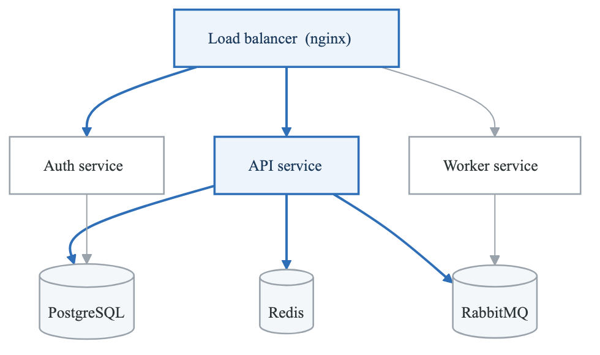
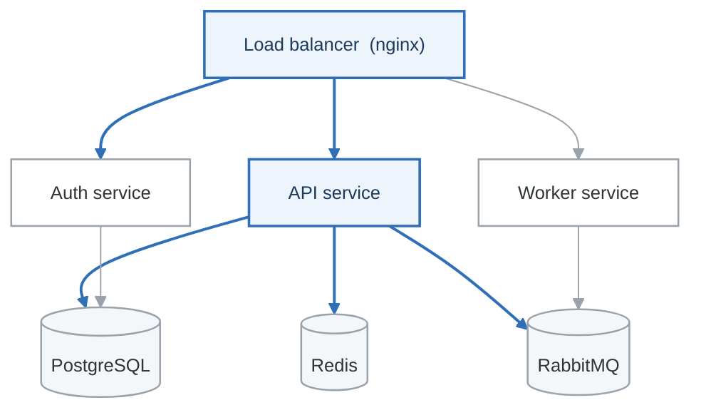

# Module 3 Project: Production Container Platform

> **Duration:** 4-6 hours
> **Type:** Hands-on Build Project
> **Difficulty:** Intermediate

---

## Overview

Build a production-ready containerized microservices application with security scanning, multi-stage builds, and local development environment.

---

## Project Requirements

### Architecture

<!-- figure: generated from the Mermaid below by _shared/diagrams/embed-figures.py — do not edit the image -->


<details>
<summary>Diagram source (Mermaid)</summary>



</details>

### Components

1. **API Service** (Python/FastAPI)
   - RESTful endpoints
   - Database access
   - Redis caching

2. **Auth Service** (Node.js/Express)
   - JWT authentication
   - User management

3. **Worker Service** (Go)
   - Background job processing
   - Queue consumption

4. **Infrastructure**
   - PostgreSQL database
   - Redis cache
   - RabbitMQ message queue
   - Nginx load balancer

---

## Project Structure

**`container-platform/`**

- `services/`
  - `api/`
    - Dockerfile
    - `app/`
    - `tests/`
  - `auth/`
    - Dockerfile
    - `src/`
  - `worker/`
    - Dockerfile
    - `main.go`
- `infrastructure/`
  - `nginx/`
    - `nginx.conf`
  - `db/`
    - `init.sql`
- `docker-compose.yml`
- `docker-compose.dev.yml`
- `docker-compose.prod.yml`
- `.env.example`
- Makefile
- `scripts/`
  - `build.sh`
  - `scan.sh`
  - `test.sh`
- `README.md`


---

## Implementation

### API Service Dockerfile

```dockerfile
# services/api/Dockerfile
# syntax=docker/dockerfile:1.4

# Stage 1: Builder
FROM python:3.12-slim AS builder

WORKDIR /app

# Install build dependencies
RUN apt-get update && apt-get install -y --no-install-recommends \
    build-essential \
    && rm -rf /var/lib/apt/lists/*

# Create virtual environment
RUN python -m venv /opt/venv
ENV PATH="/opt/venv/bin:$PATH"

# Install dependencies
COPY requirements.txt .
RUN pip install --no-cache-dir -r requirements.txt

# Stage 2: Runtime
FROM python:3.12-slim AS runtime

# Security: non-root user
RUN useradd -m -u 1000 appuser

WORKDIR /app

# Copy virtual environment
COPY --from=builder /opt/venv /opt/venv
ENV PATH="/opt/venv/bin:$PATH"

# Copy application
COPY --chown=appuser:appuser app/ ./app/

USER appuser

EXPOSE 8000

HEALTHCHECK --interval=30s --timeout=3s --start-period=5s \
    CMD python -c "import urllib.request; urllib.request.urlopen('http://localhost:8000/health')" || exit 1

CMD ["uvicorn", "app.main:app", "--host", "0.0.0.0", "--port", "8000"]
```

### Auth Service Dockerfile

```dockerfile
# services/auth/Dockerfile
# syntax=docker/dockerfile:1.4

FROM node:20-alpine AS builder
WORKDIR /app
COPY package*.json ./
RUN npm ci
COPY . .
RUN npm run build

FROM node:20-alpine AS runtime
WORKDIR /app
RUN addgroup -g 1001 -S nodejs && adduser -S nodejs -u 1001

COPY --from=builder /app/package*.json ./
RUN npm ci --only=production && npm cache clean --force

COPY --from=builder --chown=nodejs:nodejs /app/dist ./dist

USER nodejs
EXPOSE 3000

HEALTHCHECK --interval=30s --timeout=3s \
    CMD wget -q --spider http://localhost:3000/health || exit 1

CMD ["node", "dist/index.js"]
```

### Worker Service Dockerfile

```dockerfile
# services/worker/Dockerfile
# syntax=docker/dockerfile:1.4

FROM golang:1.21-alpine AS builder
WORKDIR /build
COPY go.* ./
RUN go mod download
COPY . .
RUN CGO_ENABLED=0 GOOS=linux go build -ldflags="-w -s" -o worker .

FROM scratch
COPY --from=builder /build/worker /worker
USER 1000:1000
ENTRYPOINT ["/worker"]
```

### Docker Compose

```yaml
# docker-compose.yml
version: "3.9"

services:
  nginx:
    image: nginx:1.25-alpine
    ports:
      - "80:80"
    volumes:
      - ./infrastructure/nginx/nginx.conf:/etc/nginx/nginx.conf:ro
    depends_on:
      api:
        condition: service_healthy
      auth:
        condition: service_healthy
    networks:
      - frontend

  api:
    build:
      context: ./services/api
      dockerfile: Dockerfile
    environment:
      - DATABASE_URL=postgres://user:${DB_PASSWORD}@db:5432/app
      - REDIS_URL=redis://cache:6379
    depends_on:
      db:
        condition: service_healthy
      cache:
        condition: service_started
    networks:
      - frontend
      - backend
    healthcheck:
      test: ["CMD", "python", "-c", "import urllib.request; urllib.request.urlopen('http://localhost:8000/health')"]
      interval: 10s
      timeout: 5s
      retries: 3

  auth:
    build:
      context: ./services/auth
      dockerfile: Dockerfile
    environment:
      - JWT_SECRET=${JWT_SECRET}
      - DATABASE_URL=postgres://user:${DB_PASSWORD}@db:5432/app
    depends_on:
      db:
        condition: service_healthy
    networks:
      - frontend
      - backend
    healthcheck:
      test: ["CMD", "wget", "-q", "--spider", "http://localhost:3000/health"]
      interval: 10s
      timeout: 5s
      retries: 3

  worker:
    build:
      context: ./services/worker
      dockerfile: Dockerfile
    environment:
      - RABBITMQ_URL=amqp://user:${MQ_PASSWORD}@mq:5672
      - DATABASE_URL=postgres://user:${DB_PASSWORD}@db:5432/app
    depends_on:
      db:
        condition: service_healthy
      mq:
        condition: service_healthy
    networks:
      - backend
    deploy:
      replicas: 2

  db:
    image: postgres:16-alpine
    environment:
      POSTGRES_USER: user
      POSTGRES_PASSWORD: ${DB_PASSWORD}
      POSTGRES_DB: app
    volumes:
      - pgdata:/var/lib/postgresql/data
      - ./infrastructure/db/init.sql:/docker-entrypoint-initdb.d/init.sql
    networks:
      - backend
    healthcheck:
      test: ["CMD-SHELL", "pg_isready -U user -d app"]
      interval: 5s
      timeout: 5s
      retries: 5

  cache:
    image: redis:7-alpine
    volumes:
      - redisdata:/data
    networks:
      - backend

  mq:
    image: rabbitmq:3.12-alpine
    environment:
      RABBITMQ_DEFAULT_USER: user
      RABBITMQ_DEFAULT_PASS: ${MQ_PASSWORD}
    volumes:
      - mqdata:/var/lib/rabbitmq
    networks:
      - backend
    healthcheck:
      test: ["CMD", "rabbitmq-diagnostics", "-q", "ping"]
      interval: 10s
      timeout: 5s
      retries: 5

networks:
  frontend:
  backend:
    internal: true

volumes:
  pgdata:
  redisdata:
  mqdata:
```

### Makefile

```makefile
.PHONY: build scan test up down logs clean

IMAGE_TAG ?= latest

build:
	docker compose build

scan:
	@echo "Scanning Dockerfiles..."
	hadolint services/*/Dockerfile
	@echo "Scanning images..."
	docker compose build
	trivy image --severity HIGH,CRITICAL container-platform-api:$(IMAGE_TAG)
	trivy image --severity HIGH,CRITICAL container-platform-auth:$(IMAGE_TAG)
	trivy image --severity HIGH,CRITICAL container-platform-worker:$(IMAGE_TAG)

test:
	docker compose run --rm api pytest
	docker compose run --rm auth npm test

up:
	docker compose up -d

down:
	docker compose down

logs:
	docker compose logs -f

clean:
	docker compose down -v --rmi local
	docker system prune -f
```

---

## Acceptance Criteria

- [ ] All services build with multi-stage Dockerfiles
- [ ] Images pass security scans (no CRITICAL vulnerabilities)
- [ ] All containers run as non-root
- [ ] Health checks implemented for all services
- [ ] docker-compose.yml starts all services
- [ ] Services can communicate correctly
- [ ] Documentation complete

---

## Bonus Challenges

1. Add Prometheus metrics endpoint
2. Implement container resource limits
3. Add development hot-reload
4. Create GitHub Actions workflow
5. Add container signing with cosign

---

## Evaluation

| Criteria | Points |
|----------|--------|
| Dockerfiles (multi-stage, security) | 30 |
| Docker Compose configuration | 25 |
| Security scanning integration | 20 |
| Health checks and dependencies | 15 |
| Documentation | 10 |

**Total: 100 points**

<!-- feynman-check -->

---

## Feynman check

Close the file. Blank page, no notes. Explain each of these to a competent engineer who has never
used this tool — **under five minutes, no jargon you can't define on the spot:**

- Project Requirements
- Project Structure
- Evaluation
- Components

**The gap is not what you forgot. It is where you used a word instead of a mechanism.**

| | |
|---|---|
| ✗ | *"A container isolates the application."* |
| ✓ | *"A container is an ordinary Linux process started with namespaces (what it can see), cgroups (what it can use) and usually seccomp (what it may ask the kernel). There is no container object in the kernel — only a process with those features switched on."* |

**Trace it:** `docker run` → an isolated process. Name the namespaces in the order they are created, and which component actually calls `clone()`.

Stop at the first component you cannot name. Reopen this file and read **only** that.

**Go deeper — only once the gap has a name:** the [LWN namespaces series](https://lwn.net/Articles/531114/) — seven parts by the man-pages maintainer, and the reason containers stop being magic.
Full list per domain: [`SOURCES.md`](../../SOURCES.md#containers)

→ Protocol, the three levels of knowing, and worked examples: [`MASTERY.md`](../../MASTERY.md)

<!-- /feynman-check -->
