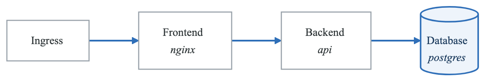
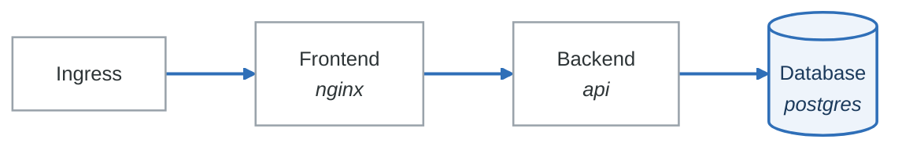

# Assessment 2: Practical Security Implementation Assessment

## Overview

**Duration**: 4 hours
**Total Points**: 100
**Passing Score**: 70%
**Format**: Hands-on practical exercises in a provided lab environment

---

## Prerequisites

- Access to provided Kubernetes cluster
- GitHub repository access
- AWS account (sandbox)
- Familiarity with kubectl, Terraform, and CI/CD tools

---

## Exercise 1: Container Security Hardening (25 points)

### Background
You have been given a vulnerable Dockerfile for a Node.js application. Your task is to harden it following container security best practices.

### Starting Dockerfile
```dockerfile
FROM node:18
WORKDIR /app
COPY package*.json ./
RUN npm install
COPY . .
ENV API_KEY=sk-prod-12345abcde
ENV NODE_ENV=production
EXPOSE 3000
USER root
CMD ["npm", "start"]
```

### Tasks

#### Task 1.1: Create Secure Dockerfile (10 points)
Create a hardened Dockerfile that addresses all security issues. Your solution must:

- Use a minimal base image
- Run as non-root user with specific UID
- Use multi-stage build
- Remove secrets from image
- Set read-only filesystem where possible
- Pin dependency versions
- Include health check

**Submit**: Your complete Dockerfile

**Grading Criteria**:
| Criterion | Points |
|-----------|--------|
| Non-root user with explicit UID | 2 |
| Multi-stage build | 2 |
| Minimal base image (distroless/alpine) | 2 |
| No hardcoded secrets | 2 |
| Health check included | 1 |
| Proper file permissions | 1 |

#### Task 1.2: Container Scanning (8 points)
Scan your hardened image using Trivy and document:

1. Run the scan command
2. Document any remaining vulnerabilities
3. Provide remediation plan for any HIGH/CRITICAL findings

**Submit**:
- Scan command used
- Summary of findings
- Remediation plan (if needed)

#### Task 1.3: Runtime Security (7 points)
Create a Kubernetes SecurityContext for deploying this container:

```yaml
# Complete this SecurityContext
securityContext:
  # Your configuration here
```

**Required settings**:
- Run as non-root
- Read-only root filesystem
- Drop all capabilities
- Prevent privilege escalation
- Seccomp profile

---

## Exercise 2: Kubernetes Security Configuration (25 points)

### Background
You are securing a three-tier application (frontend, backend, database) in Kubernetes.

### Task 2.1: RBAC Configuration (8 points)
Create RBAC resources for a development team with the following requirements:

- Developers can:
  - View pods, services, and configmaps in `development` namespace
  - Create/update deployments in `development` namespace
  - View logs from pods
  - Cannot access secrets
  - Cannot exec into pods

**Submit**: Complete Role and RoleBinding YAML

**Grading Criteria**:
| Criterion | Points |
|-----------|--------|
| Correct Role with appropriate verbs | 3 |
| Proper resource restrictions | 2 |
| Correct RoleBinding | 2 |
| Secrets explicitly excluded | 1 |

### Task 2.2: Network Policies (10 points)
Implement network policies for the three-tier application:

<!-- figure: generated from the Mermaid below by _shared/diagrams/embed-figures.py — do not edit the image -->


<details>
<summary>Diagram source (Mermaid)</summary>



</details>

Requirements:
1. Default deny all traffic in the namespace
2. Frontend only accepts traffic from ingress controller
3. Backend only accepts traffic from frontend
4. Database only accepts traffic from backend on port 5432
5. All pods can reach kube-dns for DNS resolution

**Submit**: Complete NetworkPolicy YAML files

**Grading Criteria**:
| Criterion | Points |
|-----------|--------|
| Default deny policy | 2 |
| Correct frontend ingress rules | 2 |
| Correct backend rules | 2 |
| Correct database rules | 2 |
| DNS egress allowed | 2 |

### Task 2.3: Pod Security Standards (7 points)
Configure Pod Security Standards for the namespace:

1. Set the namespace to enforce `restricted` PSS
2. Create a deployment that complies with `restricted` level
3. Document what changes were needed to make a typical deployment compliant

**Submit**:
- Namespace configuration with PSS labels
- Compliant deployment YAML
- List of changes required

---

## Exercise 3: Secrets Management (20 points)

### Task 3.1: HashiCorp Vault Integration (12 points)

Configure Vault for Kubernetes secrets injection:

1. Enable Kubernetes auth method in Vault
2. Create a policy that allows reading from `secret/data/app/*`
3. Create a role bound to the `app-service` service account
4. Configure a deployment to inject secrets using Vault Agent

**Submit**:
- Vault commands/configuration used
- Kubernetes deployment with Vault annotations
- Verification that secrets are injected

**Grading Criteria**:
| Criterion | Points |
|-----------|--------|
| Kubernetes auth configured | 3 |
| Appropriate policy created | 3 |
| Role correctly bound | 3 |
| Secrets successfully injected | 3 |

### Task 3.2: External Secrets Operator (8 points)

Configure External Secrets Operator to sync secrets from AWS Secrets Manager:

1. Create a SecretStore resource for AWS
2. Create an ExternalSecret that syncs `prod/database-credentials`
3. Verify the Kubernetes secret is created and stays in sync

**Submit**:
- SecretStore YAML
- ExternalSecret YAML
- Verification output

---

## Exercise 4: Security Pipeline Implementation (30 points)

### Task 4.1: CI/CD Security Gates (15 points)

Create a GitHub Actions workflow with security scanning:

Requirements:
1. Secret detection with Gitleaks
2. SAST with Semgrep (use security-audit ruleset)
3. SCA with Trivy (fail on HIGH/CRITICAL)
4. Container image scanning
5. Security gate that blocks deployment on critical findings

**Submit**: Complete `.github/workflows/security.yml`

**Grading Criteria**:
| Criterion | Points |
|-----------|--------|
| Secret scanning configured | 2 |
| SAST scanning configured | 3 |
| SCA scanning configured | 3 |
| Container scanning | 3 |
| Security gate logic | 2 |
| Proper job dependencies | 2 |

### Task 4.2: Security Gate Script (8 points)

Create a Python script that evaluates security scan results and determines if deployment should proceed:

Requirements:
- Parse SARIF format results
- Count findings by severity
- Fail if:
  - Any critical findings exist
  - More than 5 high findings
  - More than 20 medium findings
- Output summary report

**Submit**: Complete Python script

### Task 4.3: Kyverno Policy (7 points)

Create Kyverno policies that:

1. Require all deployments to have security scanning labels
2. Block images from untrusted registries
3. Require resource limits on all containers

**Submit**: Complete Kyverno ClusterPolicy YAML

---

## Submission Guidelines

### Format
All submissions should be:
- YAML files for Kubernetes resources
- Python files for scripts
- Markdown for documentation
- Organized in a directory structure:

**`submission/`**

- `exercise-1/`
  - Dockerfile
  - `scan-results.txt`
  - `security-context.yaml`
- `exercise-2/`
  - `rbac.yaml`
  - `network-policies.yaml`
  - `pss-config.yaml`
- `exercise-3/`
  - `vault-config.sh`
  - `vault-deployment.yaml`
  - `external-secrets.yaml`
- `exercise-4/`
  - `security.yml`
  - `security_gate.py`
  - `kyverno-policies.yaml`


### Verification
Before submitting, verify:
- All YAML files pass `kubectl apply --dry-run=client -f <file>`
- Python scripts pass linting with `pylint`
- Dockerfile builds successfully
- GitHub Actions workflow validates

---

## Grading Rubric

### Exercise 1: Container Security (25 points)
| Task | Points | Criteria |
|------|--------|----------|
| 1.1 Secure Dockerfile | 10 | Security best practices implemented |
| 1.2 Container Scanning | 8 | Proper scanning and remediation plan |
| 1.3 Runtime Security | 7 | Complete and correct SecurityContext |

### Exercise 2: Kubernetes Security (25 points)
| Task | Points | Criteria |
|------|--------|----------|
| 2.1 RBAC | 8 | Correct least-privilege configuration |
| 2.2 Network Policies | 10 | Proper segmentation implemented |
| 2.3 PSS | 7 | Correct enforcement and compliance |

### Exercise 3: Secrets Management (20 points)
| Task | Points | Criteria |
|------|--------|----------|
| 3.1 Vault Integration | 12 | Working secrets injection |
| 3.2 External Secrets | 8 | Successful sync from AWS |

### Exercise 4: Security Pipeline (30 points)
| Task | Points | Criteria |
|------|--------|----------|
| 4.1 CI/CD Security | 15 | Complete pipeline with all stages |
| 4.2 Security Gate | 8 | Functional decision logic |
| 4.3 Kyverno Policies | 7 | Correct policy enforcement |

---

## Sample Solutions

### Exercise 1.1: Secure Dockerfile

```dockerfile
# Build stage
FROM node:18-alpine AS builder
WORKDIR /app
COPY package*.json ./
RUN npm ci --only=production && npm cache clean --force
COPY --chown=node:node . .

# Production stage
FROM gcr.io/distroless/nodejs18-debian12:nonroot
WORKDIR /app

# Copy from builder
COPY --from=builder --chown=65532:65532 /app/node_modules ./node_modules
COPY --from=builder --chown=65532:65532 /app/dist ./dist
COPY --from=builder --chown=65532:65532 /app/package.json ./

# Use non-root user (distroless default)
USER 65532

EXPOSE 3000

HEALTHCHECK --interval=30s --timeout=3s --start-period=5s --retries=3 \
    CMD ["/nodejs/bin/node", "-e", "require('http').get('http://localhost:3000/health')"]

CMD ["dist/index.js"]
```

### Exercise 2.2: Network Policies

```yaml
# Default deny all
apiVersion: networking.k8s.io/v1
kind: NetworkPolicy
metadata:
  name: default-deny-all
  namespace: app
spec:
  podSelector: {}
  policyTypes:
  - Ingress
  - Egress
---
# Frontend policy
apiVersion: networking.k8s.io/v1
kind: NetworkPolicy
metadata:
  name: frontend-policy
  namespace: app
spec:
  podSelector:
    matchLabels:
      app: frontend
  policyTypes:
  - Ingress
  - Egress
  ingress:
  - from:
    - namespaceSelector:
        matchLabels:
          name: ingress-nginx
    ports:
    - protocol: TCP
      port: 80
  egress:
  - to:
    - podSelector:
        matchLabels:
          app: backend
    ports:
    - protocol: TCP
      port: 8080
  - to:
    - namespaceSelector: {}
      podSelector:
        matchLabels:
          k8s-app: kube-dns
    ports:
    - protocol: UDP
      port: 53
---
# Backend policy
apiVersion: networking.k8s.io/v1
kind: NetworkPolicy
metadata:
  name: backend-policy
  namespace: app
spec:
  podSelector:
    matchLabels:
      app: backend
  policyTypes:
  - Ingress
  - Egress
  ingress:
  - from:
    - podSelector:
        matchLabels:
          app: frontend
    ports:
    - protocol: TCP
      port: 8080
  egress:
  - to:
    - podSelector:
        matchLabels:
          app: database
    ports:
    - protocol: TCP
      port: 5432
  - to:
    - namespaceSelector: {}
      podSelector:
        matchLabels:
          k8s-app: kube-dns
    ports:
    - protocol: UDP
      port: 53
---
# Database policy
apiVersion: networking.k8s.io/v1
kind: NetworkPolicy
metadata:
  name: database-policy
  namespace: app
spec:
  podSelector:
    matchLabels:
      app: database
  policyTypes:
  - Ingress
  - Egress
  ingress:
  - from:
    - podSelector:
        matchLabels:
          app: backend
    ports:
    - protocol: TCP
      port: 5432
  egress: []
```

### Exercise 4.2: Security Gate Script

```python
#!/usr/bin/env python3
"""Security gate script for CI/CD pipeline."""

import json
import sys
from pathlib import Path
from dataclasses import dataclass
from typing import Dict, List

@dataclass
class SeverityThresholds:
    critical: int = 0
    high: int = 5
    medium: int = 20
    low: int = 100

class SecurityGate:
    def __init__(self, thresholds: SeverityThresholds = None):
        self.thresholds = thresholds or SeverityThresholds()
        self.findings: Dict[str, int] = {
            "critical": 0,
            "high": 0,
            "medium": 0,
            "low": 0
        }

    def parse_sarif(self, sarif_file: Path) -> None:
        """Parse SARIF format results."""
        with open(sarif_file) as f:
            data = json.load(f)

        for run in data.get("runs", []):
            for result in run.get("results", []):
                level = result.get("level", "warning")
                severity = self._map_level_to_severity(level, result)
                self.findings[severity] += 1

    def _map_level_to_severity(self, level: str, result: dict) -> str:
        """Map SARIF level to severity."""
        # Check for security-severity in properties
        props = result.get("properties", {})
        if "security-severity" in props:
            score = float(props["security-severity"])
            if score >= 9.0:
                return "critical"
            elif score >= 7.0:
                return "high"
            elif score >= 4.0:
                return "medium"
            else:
                return "low"

        # Default mapping
        level_map = {
            "error": "high",
            "warning": "medium",
            "note": "low"
        }
        return level_map.get(level, "medium")

    def evaluate(self) -> bool:
        """Evaluate if security gate passes."""
        passed = True
        failures = []

        if self.findings["critical"] > self.thresholds.critical:
            passed = False
            failures.append(
                f"Critical: {self.findings['critical']} "
                f"(threshold: {self.thresholds.critical})"
            )

        if self.findings["high"] > self.thresholds.high:
            passed = False
            failures.append(
                f"High: {self.findings['high']} "
                f"(threshold: {self.thresholds.high})"
            )

        if self.findings["medium"] > self.thresholds.medium:
            passed = False
            failures.append(
                f"Medium: {self.findings['medium']} "
                f"(threshold: {self.thresholds.medium})"
            )

        return passed, failures

    def generate_report(self) -> str:
        """Generate summary report."""
        passed, failures = self.evaluate()
        status = "PASSED" if passed else "FAILED"

        report = f"""
Security Gate Report
====================
Status: {status}

Findings Summary:
- Critical: {self.findings['critical']}
- High: {self.findings['high']}
- Medium: {self.findings['medium']}
- Low: {self.findings['low']}

Thresholds:
- Critical: {self.thresholds.critical}
- High: {self.thresholds.high}
- Medium: {self.thresholds.medium}
- Low: {self.thresholds.low}
"""

        if failures:
            report += "\nFailures:\n"
            for failure in failures:
                report += f"  - {failure}\n"

        return report


def main():
    if len(sys.argv) < 2:
        print("Usage: security_gate.py <sarif_files...>")
        sys.exit(1)

    gate = SecurityGate()

    for sarif_file in sys.argv[1:]:
        gate.parse_sarif(Path(sarif_file))

    print(gate.generate_report())

    passed, _ = gate.evaluate()
    sys.exit(0 if passed else 1)


if __name__ == "__main__":
    main()
```

---

## Certification

Upon passing this assessment with 70% or higher:
- Receive Security & Compliance Practitioner certification
- Valid for 2 years
- Must recertify with updated assessment
- Qualifies for advanced security engineering roles

<!-- feynman-check -->

---

## Feynman check

Close the file. Blank page, no notes. Explain each of these to a competent engineer who has never
used this tool — **under five minutes, no jargon you can't define on the spot:**

- Container Security Hardening
- Kubernetes Security Configuration
- Secrets Management
- Security Pipeline Implementation

**The gap is not what you forgot. It is where you used a word instead of a mechanism.**

| | |
|---|---|
| ✗ | *"We scan for vulnerabilities in the pipeline."* |
| ✓ | *"SAST reads source without running it, SCA resolves the dependency tree against an advisory database, and image scanning compares installed package versions to that same database. All three report what was known at build time — which is why the registry is re-scanned: the image does not change, the database does."* |

**Trace it:** A CVE published today against your base image → a blocked deploy. Name every component between the advisory and the refused `apply`.

Stop at the first component you cannot name. Reopen this file and read **only** that.

**Go deeper — only once the gap has a name:** the [SLSA threat model](https://slsa.dev/spec/v1.2/threats) — it names every point at which a build can be subverted, and most teams defend three of them.
Full list per domain: [`SOURCES.md`](../SOURCES.md#devsecops)

→ Protocol, the three levels of knowing, and worked examples: [`MASTERY.md`](../MASTERY.md)

<!-- /feynman-check -->
