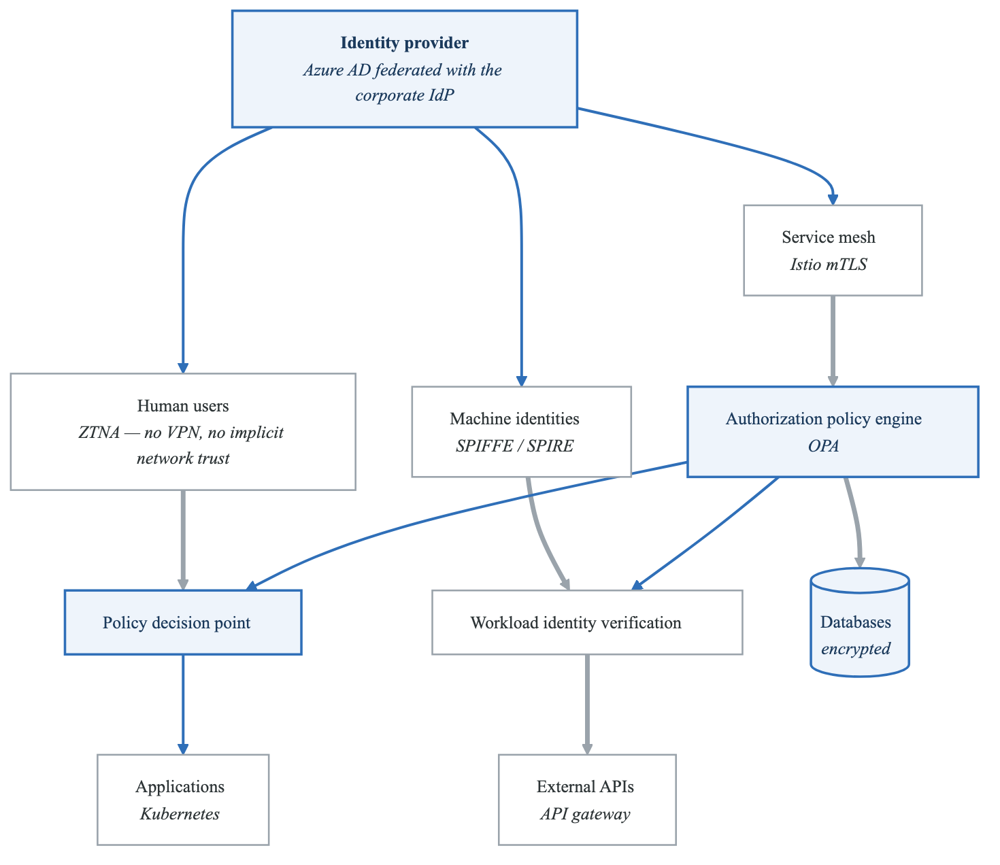
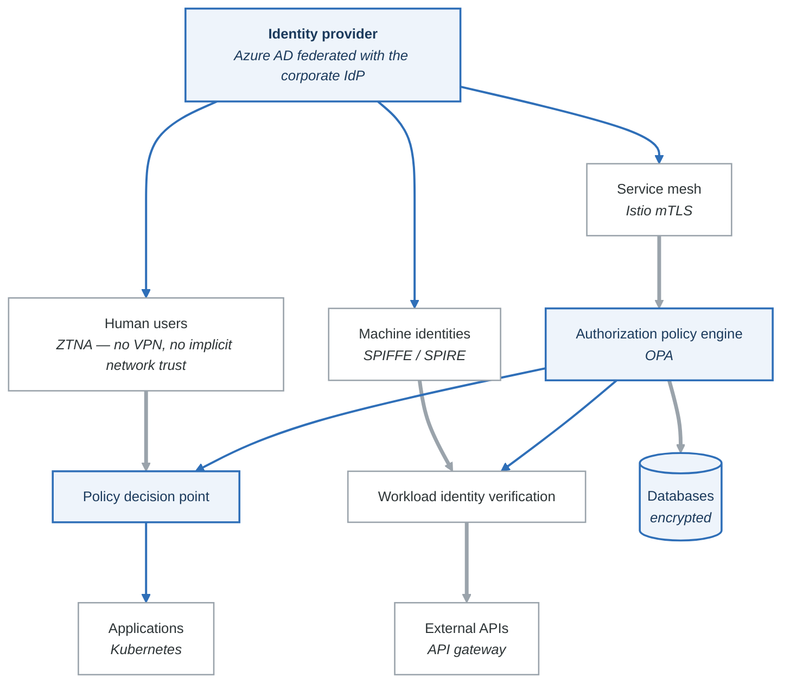

# Case Study 3: Zero Trust Architecture Implementation

## Company Profile

**Company**: GlobalHealth Systems
**Industry**: Healthcare Technology
**Size**: 3,200 employees across 15 countries
**Infrastructure**: Multi-cloud (AWS, Azure, GCP) + on-premises data centers
**Compliance**: HIPAA, HITRUST, SOC 2, GDPR
**Users**: 50,000+ healthcare providers accessing the platform

## Business Context

GlobalHealth Systems provides a cloud-based healthcare platform connecting hospitals, clinics, laboratories, and pharmacies. Their traditional perimeter-based security model faced increasing challenges:

### Legacy Architecture Challenges

```yaml
legacy_security_model:
  perimeter_based: true
  vpn_users: 15000
  network_segments: 3  # DMZ, Internal, Restricted

  pain_points:
    - VPN bottlenecks during COVID-19 remote work surge
    - Flat internal network enabled lateral movement
    - Service-to-service communication trusted by default
    - Static credentials for API integrations
    - Limited visibility into east-west traffic

  security_incidents:
    2022:
      - type: "Credential theft via phishing"
        impact: "Attacker accessed internal systems for 3 weeks"
      - type: "Ransomware via compromised vendor"
        impact: "2-day outage in European region"
    2023:
      - type: "Insider threat - data exfiltration"
        impact: "10,000 patient records accessed inappropriately"
```

### Regulatory Pressure

```text
HIPAA Security Rule Requirements:
- Access controls (164.312(a)(1))
- Audit controls (164.312(b))
- Integrity controls (164.312(c)(1))
- Transmission security (164.312(e)(1))

HITRUST CSF Requirements:
- Identity and access management
- Network protection
- Data protection and privacy
- Threat protection

OCR Enforcement Trend:
- 2023: $15M+ in HIPAA fines
- Increased focus on access controls
- Requirement for technical safeguards
```

## Zero Trust Strategy

### Guiding Principles

```yaml
zero_trust_principles:
  1_never_trust_always_verify:
    description: "Every access request is authenticated and authorized"
    implementation:
      - Strong identity verification for all users and services
      - Continuous validation throughout session
      - No implicit trust based on network location

  2_least_privilege_access:
    description: "Grant minimum permissions required"
    implementation:
      - Just-in-time access provisioning
      - Time-limited access grants
      - Regular access certification reviews

  3_assume_breach:
    description: "Design for compromise containment"
    implementation:
      - Micro-segmentation of networks
      - Encryption everywhere
      - Comprehensive logging and monitoring

  4_verify_explicitly:
    description: "Base decisions on all available data"
    implementation:
      - Context-aware access decisions
      - Device health verification
      - Behavioral analytics
```

### Architecture Overview

<!-- figure: generated from the Mermaid below by _shared/diagrams/embed-figures.py — do not edit the image -->


<details>
<summary>Diagram source (Mermaid)</summary>



</details>

## Implementation Phases

### Phase 1: Identity Foundation (Months 1-4)

#### Unified Identity Platform

```yaml
# identity/azure-ad-config.yaml
identity_provider:
  primary: azure_ad
  federation:
    - identityco  # Partner access
    - ping_identity  # Legacy systems

  authentication:
    mfa_required: true
    mfa_methods:
      - authenticator_app
      - fido2_security_key
      - phone_verification  # Backup only

    conditional_access:
      - name: "Require MFA for all users"
        conditions:
          users: all
          applications: all
        grant_controls:
          require_mfa: true

      - name: "Block legacy authentication"
        conditions:
          client_apps: ["exchange_active_sync", "other_clients"]
        grant_controls:
          block: true

      - name: "Require compliant device for PHI access"
        conditions:
          applications: ["phi_applications"]
        grant_controls:
          require_compliant_device: true
          require_mfa: true

  session_management:
    sign_in_frequency: "8 hours"
    persistent_browser_session: false
    continuous_access_evaluation: true
```

#### Service Identity with SPIFFE/SPIRE

```yaml
# spire/server-config.yaml
apiVersion: v1
kind: ConfigMap
metadata:
  name: spire-server
  namespace: spire
data:
  server.conf: |
    server {
      bind_address = "0.0.0.0"
      bind_port = "8081"
      trust_domain = "globalhealth.com"
      data_dir = "/run/spire/data"
      log_level = "INFO"

      ca_subject {
        country = ["US"]
        organization = ["GlobalHealth"]
        common_name = "GlobalHealth SPIRE CA"
      }

      ca_ttl = "24h"
      default_svid_ttl = "1h"
    }

    plugins {
      DataStore "sql" {
        plugin_data {
          database_type = "postgres"
          connection_string = "host=postgres user=spire dbname=spire sslmode=verify-full"
        }
      }

      NodeAttestor "k8s_psat" {
        plugin_data {
          clusters = {
            "production" = {
              service_account_allow_list = ["spire:spire-agent"]
              kube_config_file = ""
            }
          }
        }
      }

      KeyManager "disk" {
        plugin_data {
          keys_path = "/run/spire/data/keys.json"
        }
      }

      Notifier "k8sbundle" {
        plugin_data {
          namespace = "spire"
          config_map = "trust-bundle"
        }
      }
    }
---
# Registration entries for workloads
apiVersion: spire.spiffe.io/v1alpha1
kind: ClusterSPIFFEID
metadata:
  name: patient-api
spec:
  className: "spire"
  spiffeIDTemplate: "spiffe://globalhealth.com/ns/{{ .PodMeta.Namespace }}/sa/{{ .PodSpec.ServiceAccountName }}"
  podSelector:
    matchLabels:
      app: patient-api
  namespaceSelector:
    matchLabels:
      environment: production
```

### Phase 2: Network Micro-Segmentation (Months 5-8)

#### Service Mesh Implementation

```yaml
# istio/mesh-config.yaml
apiVersion: install.istio.io/v1alpha1
kind: IstioOperator
metadata:
  name: istio-control-plane
spec:
  profile: default
  meshConfig:
    accessLogFile: /dev/stdout
    enableTracing: true
    defaultConfig:
      tracing:
        sampling: 100
      holdApplicationUntilProxyStarts: true

    # Strict mTLS by default
    mtls:
      mode: STRICT

  values:
    global:
      proxy:
        resources:
          requests:
            cpu: 100m
            memory: 128Mi
          limits:
            cpu: 500m
            memory: 256Mi
---
# Strict mTLS for entire mesh
apiVersion: security.istio.io/v1beta1
kind: PeerAuthentication
metadata:
  name: default
  namespace: istio-system
spec:
  mtls:
    mode: STRICT
---
# Default deny-all authorization
apiVersion: security.istio.io/v1beta1
kind: AuthorizationPolicy
metadata:
  name: deny-all
  namespace: production
spec:
  {}
```

#### Fine-Grained Authorization Policies

```yaml
# istio/authorization-policies.yaml
---
# Patient API - only accessible from specific services
apiVersion: security.istio.io/v1beta1
kind: AuthorizationPolicy
metadata:
  name: patient-api-policy
  namespace: production
spec:
  selector:
    matchLabels:
      app: patient-api
  action: ALLOW
  rules:
  - from:
    - source:
        principals:
          - "cluster.local/ns/production/sa/appointment-service"
          - "cluster.local/ns/production/sa/clinical-portal"
    to:
    - operation:
        methods: ["GET"]
        paths: ["/api/v1/patients/*"]
  - from:
    - source:
        principals:
          - "cluster.local/ns/production/sa/clinical-portal"
    to:
    - operation:
        methods: ["GET", "PUT", "POST"]
        paths: ["/api/v1/patients/*"]
    when:
    - key: request.headers[x-user-role]
      values: ["physician", "nurse"]
---
# PHI Database - highly restricted
apiVersion: security.istio.io/v1beta1
kind: AuthorizationPolicy
metadata:
  name: phi-database-policy
  namespace: production
spec:
  selector:
    matchLabels:
      app: phi-database
  action: ALLOW
  rules:
  - from:
    - source:
        principals:
          - "cluster.local/ns/production/sa/patient-api"
          - "cluster.local/ns/production/sa/audit-service"
    to:
    - operation:
        ports: ["5432"]
```

#### Network Policies

```yaml
# k8s/network-policies.yaml
---
# Default deny all ingress and egress
apiVersion: networking.k8s.io/v1
kind: NetworkPolicy
metadata:
  name: default-deny-all
  namespace: production
spec:
  podSelector: {}
  policyTypes:
  - Ingress
  - Egress
---
# Patient API network policy
apiVersion: networking.k8s.io/v1
kind: NetworkPolicy
metadata:
  name: patient-api-network-policy
  namespace: production
spec:
  podSelector:
    matchLabels:
      app: patient-api
  policyTypes:
  - Ingress
  - Egress
  ingress:
  - from:
    - podSelector:
        matchLabels:
          app: istio-ingressgateway
      namespaceSelector:
        matchLabels:
          name: istio-system
    ports:
    - protocol: TCP
      port: 8080
  egress:
  # Allow to PHI database
  - to:
    - podSelector:
        matchLabels:
          app: phi-database
    ports:
    - protocol: TCP
      port: 5432
  # Allow DNS
  - to:
    - namespaceSelector: {}
      podSelector:
        matchLabels:
          k8s-app: kube-dns
    ports:
    - protocol: UDP
      port: 53
  # Allow to audit service
  - to:
    - podSelector:
        matchLabels:
          app: audit-service
    ports:
    - protocol: TCP
      port: 8080
```

### Phase 3: Zero Trust Network Access (Months 9-12)

#### ZTNA Implementation with EdgeNet Access

```yaml
# ztna/edgenet-access-config.yaml
applications:
  - name: clinical-portal
    domain: clinical.globalhealth.com
    policies:
      - name: physician-access
        decision: allow
        include:
          - group: physicians
          - group: nurses
        require:
          - mfa: true
          - device_posture:
              - disk_encryption: true
              - os_version:
                  windows: ">=10.0.19041"
                  macos: ">=12.0"
              - firewall: enabled
              - antivirus: running
        session_duration: 8h

      - name: admin-access
        decision: allow
        include:
          - group: clinical-admins
        require:
          - mfa: true
          - device_posture:
              - managed_device: true
              - disk_encryption: true
          - geo: ["US", "CA", "UK", "DE"]
        session_duration: 4h

  - name: phi-admin-console
    domain: phi-admin.globalhealth.com
    policies:
      - name: phi-admin-access
        decision: allow
        include:
          - group: phi-administrators
        require:
          - mfa: true
          - device_posture:
              - managed_device: true
              - disk_encryption: true
              - certificate: corporate_cert
          - geo: ["US"]
          - time: "08:00-18:00 America/New_York"
        session_duration: 2h

device_posture_checks:
  - name: corporate-managed
    type: gateway_managed
    match:
      - serial_number_list: managed_devices.csv

  - name: disk-encryption
    type: disk_encryption
    match:
      - os:
          windows: bitlocker
          macos: filevault

  - name: endpoint-protection
    type: crowdstrike
    match:
      - state: healthy
      - version: ">= 6.0"
```

#### Context-Aware Access Policies

```python
# opa/access-policies.rego
package globalhealth.access

import future.keywords.if
import future.keywords.in

default allow := false

# Define PHI access requirements
phi_access_requirements := {
    "required_training": "hipaa_privacy_security",
    "training_valid_days": 365,
    "require_break_glass_for_bulk": true,
    "bulk_threshold": 100
}

# Allow access if all conditions are met
allow if {
    # User is authenticated
    input.user.authenticated == true

    # User has required role
    has_required_role

    # Device is compliant
    device_compliant

    # Context is appropriate
    context_appropriate

    # Access is within scope
    within_access_scope
}

# Check role requirements
has_required_role if {
    required_roles := data.access_matrix[input.resource.type].roles
    some role in input.user.roles
    role in required_roles
}

# Device compliance check
device_compliant if {
    input.device.managed == true
    input.device.encryption_enabled == true
    input.device.endpoint_protection.status == "healthy"
    input.device.os_patched == true
}

# Context appropriateness
context_appropriate if {
    # Check business hours for sensitive operations
    is_business_hours if {
        input.resource.sensitivity == "high"
    }

    # Check location for PHI
    allowed_location if {
        input.resource.type == "phi"
    }

    # Training current
    training_current
}

# Business hours check
is_business_hours if {
    hour := time.clock([time.now_ns(), input.user.timezone])[0]
    hour >= 7
    hour <= 19
}

# Location check for PHI
allowed_location if {
    input.context.country in data.allowed_countries
    not input.context.vpn_detected  # Direct access preferred
}

# Training currency
training_current if {
    training := input.user.training[phi_access_requirements.required_training]
    days_since := (time.now_ns() - training.completed_at) / (24 * 60 * 60 * 1000000000)
    days_since < phi_access_requirements.training_valid_days
}

# Scope limitations
within_access_scope if {
    # For patient data, user must have relationship
    patient_relationship if {
        input.resource.type == "patient_record"
    }
}

patient_relationship if {
    # User is treating physician
    input.resource.patient_id in input.user.patient_assignments
}

patient_relationship if {
    # Break-glass access with audit
    input.context.break_glass == true
    input.context.break_glass_reason != ""
}

# Generate audit log entries
audit_log := {
    "timestamp": time.now_ns(),
    "user": input.user.id,
    "resource": input.resource.id,
    "action": input.action,
    "decision": allow,
    "context": {
        "device_id": input.device.id,
        "location": input.context.country,
        "ip_address": input.context.ip,
        "break_glass": input.context.break_glass
    },
    "policy_version": data.policy_version
}
```

### Phase 4: Continuous Verification (Months 13-16)

#### Behavioral Analytics

```python
# analytics/user_behavior.py
from dataclasses import dataclass
from datetime import datetime, timedelta
from typing import Dict, List, Optional
import numpy as np
from sklearn.ensemble import IsolationForest

@dataclass
class UserBehaviorProfile:
    user_id: str
    typical_login_times: List[int]  # Hours
    typical_locations: List[str]
    typical_devices: List[str]
    typical_resources: List[str]
    average_session_duration: float
    average_queries_per_session: float

class BehaviorAnalytics:
    def __init__(self):
        self.profiles: Dict[str, UserBehaviorProfile] = {}
        self.anomaly_detector = IsolationForest(contamination=0.1)

    def analyze_session(self, session_data: dict) -> dict:
        """Analyze session for anomalous behavior."""
        user_id = session_data["user_id"]
        profile = self.profiles.get(user_id)

        if not profile:
            return {"risk_score": 0.5, "reason": "New user - no baseline"}

        features = self._extract_features(session_data, profile)
        anomaly_score = self._calculate_anomaly_score(features)

        risk_factors = []

        # Check individual risk factors
        if session_data["login_hour"] not in profile.typical_login_times:
            risk_factors.append("unusual_login_time")

        if session_data["location"] not in profile.typical_locations:
            risk_factors.append("new_location")

        if session_data["device_id"] not in profile.typical_devices:
            risk_factors.append("new_device")

        if session_data["query_count"] > profile.average_queries_per_session * 3:
            risk_factors.append("excessive_data_access")

        return {
            "risk_score": anomaly_score,
            "risk_factors": risk_factors,
            "recommended_action": self._recommend_action(anomaly_score, risk_factors)
        }

    def _recommend_action(self, score: float, factors: List[str]) -> str:
        """Recommend action based on risk assessment."""
        if score > 0.9 or "excessive_data_access" in factors:
            return "terminate_session_and_alert"
        elif score > 0.7:
            return "require_step_up_authentication"
        elif score > 0.5:
            return "increase_monitoring"
        else:
            return "allow"

    def detect_insider_threat(self, user_id: str, timeframe_days: int = 30) -> dict:
        """Detect potential insider threat patterns."""
        activities = self._get_user_activities(user_id, timeframe_days)

        indicators = {
            "bulk_downloads": self._check_bulk_downloads(activities),
            "off_hours_access": self._check_off_hours_access(activities),
            "privilege_escalation_attempts": self._check_privilege_abuse(activities),
            "sensitive_data_access_increase": self._check_data_access_trend(activities),
            "data_hoarding": self._check_data_hoarding(activities)
        }

        threat_score = sum(1 for v in indicators.values() if v["detected"]) / len(indicators)

        return {
            "user_id": user_id,
            "threat_score": threat_score,
            "indicators": indicators,
            "recommendation": self._insider_threat_recommendation(threat_score)
        }
```

#### Continuous Access Evaluation

```yaml
# cae/continuous-evaluation.yaml
apiVersion: v1
kind: ConfigMap
metadata:
  name: cae-config
  namespace: security
data:
  config.yaml: |
    continuous_access_evaluation:
      enabled: true
      evaluation_interval: 60s  # Re-evaluate every minute

      triggers:
        immediate:
          - user_disabled
          - password_changed
          - mfa_reset
          - high_risk_sign_in
          - device_marked_compromised

        periodic:
          - device_compliance_check
          - user_risk_level_check
          - session_duration_check
          - geolocation_change

      actions:
        terminate_session:
          triggers:
            - user_disabled
            - device_marked_compromised
          grace_period: 0s

        require_reauthentication:
          triggers:
            - password_changed
            - mfa_reset
            - high_risk_sign_in
          grace_period: 5m

        step_up_authentication:
          triggers:
            - geolocation_change
            - sensitive_resource_access
          methods:
            - hardware_token
            - biometric

      monitoring:
        metrics:
          - session_terminations_total
          - reauth_requests_total
          - policy_evaluations_total
        alerts:
          - name: high_session_termination_rate
            threshold: 100
            window: 5m
```

## Results and Metrics

### Security Improvements

```yaml
before_zero_trust:
  security_incidents:
    credential_compromise: 8/year
    lateral_movement: 4/year
    data_exfiltration: 2/year

  mean_time_to_detect: "14 days"
  mean_time_to_contain: "4 hours"

  vpn_incidents:
    bottlenecks: "frequent during peak hours"
    unauthorized_access_via_vpn: 12/year

after_zero_trust:
  security_incidents:
    credential_compromise: 2/year
    lateral_movement: 0/year
    data_exfiltration: 0/year

  mean_time_to_detect: "< 5 minutes"
  mean_time_to_contain: "< 1 minute (automated)"

  access_incidents:
    blocked_anomalous_access: 450/month
    step_up_auth_triggered: 1200/month
```

### Compliance Improvements

```yaml
hipaa_compliance:
  before:
    access_control_findings: 12
    audit_control_findings: 8
    transmission_security_findings: 5
  after:
    access_control_findings: 1
    audit_control_findings: 0
    transmission_security_findings: 0

hitrust_assessment:
  before:
    maturity_level: 2.3
    corrective_actions: 45
  after:
    maturity_level: 4.1
    corrective_actions: 3

audit_efficiency:
  evidence_collection_time: "2 hours (was 3 weeks)"
  access_review_time: "4 hours (was 2 weeks)"
  audit_preparation: "1 day (was 1 month)"
```

### Operational Improvements

```yaml
user_experience:
  vpn_usage: "eliminated for 90% of use cases"
  average_login_time: "8 seconds (was 45 seconds with VPN)"
  help_desk_tickets_access: "-65%"
  user_satisfaction: "4.2/5 (was 2.8/5)"

operational_efficiency:
  identity_provisioning: "< 1 hour (was 3 days)"
  access_revocation: "immediate (was 24 hours)"
  security_team_time_on_access_reviews: "-70%"
```

## Implementation Costs and ROI

### Investment Summary

| Category | Year 1 | Year 2 | Year 3 |
|----------|--------|--------|--------|
| Identity Platform (Azure AD P2) | $450K | $450K | $450K |
| ZTNA Solution (EdgeNet) | $300K | $300K | $300K |
| Service Mesh (Istio + support) | $150K | $100K | $100K |
| SPIFFE/SPIRE Implementation | $200K | $50K | $50K |
| Security Engineering (4 FTE) | $800K | $800K | $800K |
| Training and Change Management | $150K | $50K | $50K |
| **Total** | **$2.05M** | **$1.75M** | **$1.75M** |

### ROI Analysis

```yaml
cost_avoidance:
  prevented_breaches:
    estimated_cost_per_breach: $4.5M
    breaches_prevented: 2/year
    annual_savings: $9M

  reduced_vpn_infrastructure:
    hardware_savings: $200K/year
    licensing_savings: $150K/year
    support_savings: $100K/year

  operational_efficiency:
    reduced_help_desk: $150K/year
    automated_access_reviews: $200K/year
    faster_onboarding: $100K/year

  compliance:
    reduced_audit_costs: $300K/year
    avoided_fines: $500K/year (estimated)

total_annual_benefit: $10.7M
annual_investment: $1.85M (average)
roi: 478%
payback_period: "4 months"
```

## Lessons Learned

### Success Factors

1. **Executive Sponsorship**: CISO and CTO jointly championed the initiative
2. **Phased Approach**: Started with identity, then network, then continuous verification
3. **User Experience Focus**: Made secure access easier than VPN
4. **Comprehensive Training**: 40 hours training for all IT staff
5. **Pilot Programs**: Tested with volunteer groups before rollout

### Challenges and Solutions

```yaml
challenges:
  legacy_application_integration:
    problem: "Some legacy apps don't support modern auth"
    solution: "Deployed identity-aware proxies for legacy apps"

  user_resistance:
    problem: "Users complained about device compliance requirements"
    solution: "Automated device remediation, clear communication"

  performance_concerns:
    problem: "Initial latency with policy evaluation"
    solution: "Optimized OPA policies, added caching layer"

  vendor_lock_in:
    problem: "Concern about dependency on single vendor"
    solution: "Used open standards (SPIFFE, OPA) where possible"
```

### What We'd Do Differently

1. Start with user identity and device trust before network segmentation
2. Invest more in automated remediation early
3. Build comprehensive metrics dashboard from day one
4. Engage business stakeholders earlier for buy-in
5. Create self-service portal for access requests sooner

## Discussion Questions

1. How do you balance security with user experience in Zero Trust?

2. What strategies help gain executive buy-in for Zero Trust investments?

3. How should organizations handle legacy applications in Zero Trust?

4. What metrics best demonstrate Zero Trust ROI?

5. How does Zero Trust change the role of the security team?

## Implementation Checklist

### Foundation (Months 1-4)
- [ ] Deploy unified identity provider
- [ ] Implement MFA for all users
- [ ] Deploy device trust framework
- [ ] Enable conditional access policies
- [ ] Implement SPIFFE/SPIRE for workload identity

### Network (Months 5-8)
- [ ] Deploy service mesh with mTLS
- [ ] Implement network micro-segmentation
- [ ] Create authorization policies for all services
- [ ] Enable network policy enforcement
- [ ] Remove implicit trust between services

### Access (Months 9-12)
- [ ] Deploy ZTNA solution
- [ ] Replace VPN for application access
- [ ] Implement context-aware access policies
- [ ] Enable device posture checking
- [ ] Create break-glass procedures

### Verification (Months 13-16)
- [ ] Deploy behavioral analytics
- [ ] Implement continuous access evaluation
- [ ] Create automated response playbooks
- [ ] Enable real-time session termination
- [ ] Build comprehensive audit trail

### Optimization (Ongoing)
- [ ] Tune detection rules based on false positives
- [ ] Optimize policy evaluation performance
- [ ] Expand to additional applications
- [ ] Regular penetration testing
- [ ] Continuous improvement based on metrics

<!-- feynman-check -->

---

## Feynman check

Close the file. Blank page, no notes. Explain each of these to a competent engineer who has never
used this tool — **under five minutes, no jargon you can't define on the spot:**

- Zero Trust Strategy
- Implementation Phases
- Implementation Costs and ROI
- Implementation Checklist

**The gap is not what you forgot. It is where you used a word instead of a mechanism.**

| | |
|---|---|
| ✗ | *"We scan for vulnerabilities in the pipeline."* |
| ✓ | *"SAST reads source without running it, SCA resolves the dependency tree against an advisory database, and image scanning compares installed package versions to that same database. All three report what was known at build time — which is why the registry is re-scanned: the image does not change, the database does."* |

**Trace it:** A CVE published today against your base image → a blocked deploy. Name every component between the advisory and the refused `apply`.

Stop at the first component you cannot name. Reopen this file and read **only** that.

**Go deeper — only once the gap has a name:** the [SLSA threat model](https://slsa.dev/spec/v1.2/threats) — it names every point at which a build can be subverted, and most teams defend three of them.
Full list per domain: [`SOURCES.md`](../SOURCES.md#devsecops)

→ Protocol, the three levels of knowing, and worked examples: [`MASTERY.md`](../MASTERY.md)

<!-- /feynman-check -->
