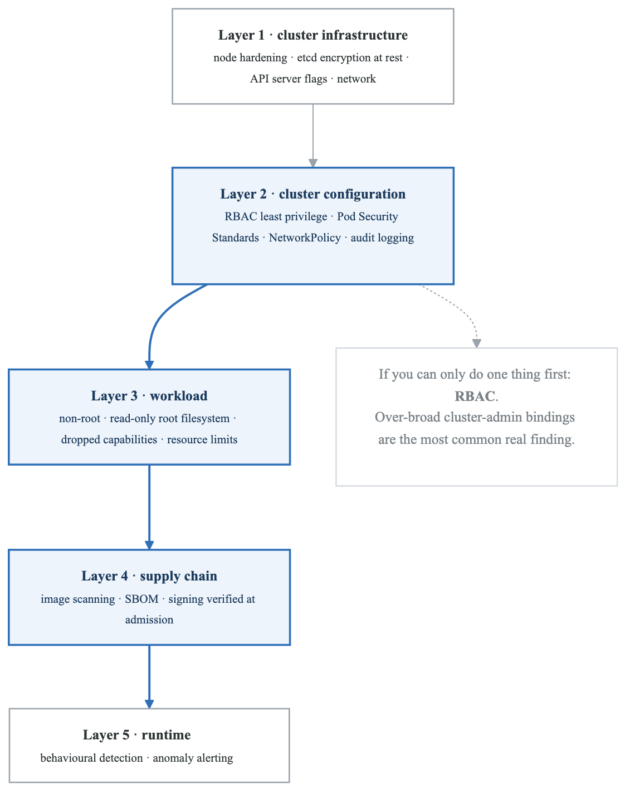
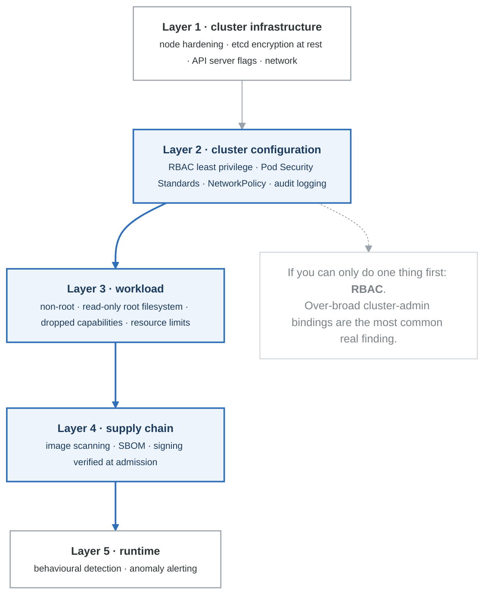

# Module 04: Kubernetes Security

## Learning Objectives

By the end of this module, you will be able to:
- Implement Kubernetes RBAC effectively
- Configure Pod Security Standards
- Secure the Kubernetes API server
- Implement Network Policies
- Use admission controllers for policy enforcement

## Kubernetes Security Model

### Security Layers

<!-- figure: generated from the Mermaid below by _shared/diagrams/embed-figures.py — do not edit the image -->


<details>
<summary>Diagram source (Mermaid)</summary>



</details>

## Role-Based Access Control (RBAC)

### RBAC Components

```yaml
# ServiceAccount - Identity for pods
apiVersion: v1
kind: ServiceAccount
metadata:
  name: app-service-account
  namespace: production
automountServiceAccountToken: false  # Disable auto-mount

---
# Role - Namespace-scoped permissions
apiVersion: rbac.authorization.k8s.io/v1
kind: Role
metadata:
  name: app-role
  namespace: production
rules:
  # Read-only access to pods
  - apiGroups: [""]
    resources: ["pods"]
    verbs: ["get", "list", "watch"]

  # Read configmaps
  - apiGroups: [""]
    resources: ["configmaps"]
    resourceNames: ["app-config"]  # Specific resource
    verbs: ["get"]

  # Read secrets (specific only)
  - apiGroups: [""]
    resources: ["secrets"]
    resourceNames: ["app-secrets"]
    verbs: ["get"]

---
# RoleBinding - Bind role to service account
apiVersion: rbac.authorization.k8s.io/v1
kind: RoleBinding
metadata:
  name: app-role-binding
  namespace: production
subjects:
  - kind: ServiceAccount
    name: app-service-account
    namespace: production
roleRef:
  kind: Role
  name: app-role
  apiGroup: rbac.authorization.k8s.io

---
# ClusterRole - Cluster-wide permissions
apiVersion: rbac.authorization.k8s.io/v1
kind: ClusterRole
metadata:
  name: monitoring-role
rules:
  # Read metrics from all namespaces
  - apiGroups: ["metrics.k8s.io"]
    resources: ["pods", "nodes"]
    verbs: ["get", "list"]

  # Read pod logs
  - apiGroups: [""]
    resources: ["pods/log"]
    verbs: ["get"]

---
# ClusterRoleBinding
apiVersion: rbac.authorization.k8s.io/v1
kind: ClusterRoleBinding
metadata:
  name: monitoring-role-binding
subjects:
  - kind: ServiceAccount
    name: monitoring-sa
    namespace: monitoring
roleRef:
  kind: ClusterRole
  name: monitoring-role
  apiGroup: rbac.authorization.k8s.io
```

### RBAC Best Practices

```yaml
# BAD: Overly permissive
apiVersion: rbac.authorization.k8s.io/v1
kind: ClusterRoleBinding
metadata:
  name: bad-binding
subjects:
  - kind: ServiceAccount
    name: app-sa
    namespace: default
roleRef:
  kind: ClusterRole
  name: cluster-admin  # Never do this!
  apiGroup: rbac.authorization.k8s.io

---
# BAD: Wildcards everywhere
apiVersion: rbac.authorization.k8s.io/v1
kind: Role
metadata:
  name: too-permissive
rules:
  - apiGroups: ["*"]
    resources: ["*"]
    verbs: ["*"]

---
# GOOD: Minimal permissions
apiVersion: rbac.authorization.k8s.io/v1
kind: Role
metadata:
  name: deployment-viewer
  namespace: production
rules:
  - apiGroups: ["apps"]
    resources: ["deployments"]
    verbs: ["get", "list", "watch"]
  - apiGroups: [""]
    resources: ["pods"]
    verbs: ["get", "list"]
```

## Pod Security Standards

### Pod Security Admission

```yaml
# Namespace with Pod Security Standards
apiVersion: v1
kind: Namespace
metadata:
  name: production
  labels:
    # Enforce restricted standard
    pod-security.kubernetes.io/enforce: restricted
    pod-security.kubernetes.io/enforce-version: latest
    # Warn on baseline violations
    pod-security.kubernetes.io/warn: baseline
    pod-security.kubernetes.io/warn-version: latest
    # Audit all violations
    pod-security.kubernetes.io/audit: restricted
    pod-security.kubernetes.io/audit-version: latest
```

### Secure Pod Configuration

```yaml
# Secure Pod specification
apiVersion: v1
kind: Pod
metadata:
  name: secure-pod
  namespace: production
spec:
  serviceAccountName: app-sa
  automountServiceAccountToken: false

  securityContext:
    runAsNonRoot: true
    runAsUser: 1000
    runAsGroup: 1000
    fsGroup: 1000
    seccompProfile:
      type: RuntimeDefault

  containers:
    - name: app
      image: myapp:v1.0.0@sha256:abc123...
      securityContext:
        allowPrivilegeEscalation: false
        readOnlyRootFilesystem: true
        runAsNonRoot: true
        runAsUser: 1000
        capabilities:
          drop:
            - ALL
        seccompProfile:
          type: RuntimeDefault

      resources:
        limits:
          cpu: "500m"
          memory: "512Mi"
        requests:
          cpu: "100m"
          memory: "128Mi"

      volumeMounts:
        - name: tmp
          mountPath: /tmp
        - name: cache
          mountPath: /app/cache

      livenessProbe:
        httpGet:
          path: /health
          port: 8080
        initialDelaySeconds: 10
        periodSeconds: 10

      readinessProbe:
        httpGet:
          path: /ready
          port: 8080
        initialDelaySeconds: 5
        periodSeconds: 5

  volumes:
    - name: tmp
      emptyDir: {}
    - name: cache
      emptyDir:
        sizeLimit: 100Mi

  # Don't schedule on master nodes
  affinity:
    nodeAffinity:
      requiredDuringSchedulingIgnoredDuringExecution:
        nodeSelectorTerms:
          - matchExpressions:
              - key: node-role.kubernetes.io/control-plane
                operator: DoesNotExist
```

## Network Policies

### Default Deny Policies

```yaml
# Default deny all ingress
apiVersion: networking.k8s.io/v1
kind: NetworkPolicy
metadata:
  name: default-deny-ingress
  namespace: production
spec:
  podSelector: {}
  policyTypes:
    - Ingress

---
# Default deny all egress
apiVersion: networking.k8s.io/v1
kind: NetworkPolicy
metadata:
  name: default-deny-egress
  namespace: production
spec:
  podSelector: {}
  policyTypes:
    - Egress

---
# Allow DNS egress (required)
apiVersion: networking.k8s.io/v1
kind: NetworkPolicy
metadata:
  name: allow-dns
  namespace: production
spec:
  podSelector: {}
  policyTypes:
    - Egress
  egress:
    - to:
        - namespaceSelector:
            matchLabels:
              kubernetes.io/metadata.name: kube-system
          podSelector:
            matchLabels:
              k8s-app: kube-dns
      ports:
        - protocol: UDP
          port: 53
        - protocol: TCP
          port: 53
```

### Application-Specific Policies

```yaml
# Web application network policy
apiVersion: networking.k8s.io/v1
kind: NetworkPolicy
metadata:
  name: web-app-policy
  namespace: production
spec:
  podSelector:
    matchLabels:
      app: web-app
  policyTypes:
    - Ingress
    - Egress
  ingress:
    # Allow from ingress controller
    - from:
        - namespaceSelector:
            matchLabels:
              name: ingress-nginx
          podSelector:
            matchLabels:
              app.kubernetes.io/name: ingress-nginx
      ports:
        - protocol: TCP
          port: 8080
  egress:
    # Allow to API service
    - to:
        - podSelector:
            matchLabels:
              app: api-service
      ports:
        - protocol: TCP
          port: 8080
    # Allow to database
    - to:
        - podSelector:
            matchLabels:
              app: postgres
      ports:
        - protocol: TCP
          port: 5432
    # Allow external HTTPS
    - to:
        - ipBlock:
            cidr: 0.0.0.0/0
            except:
              - 10.0.0.0/8
              - 172.16.0.0/12
              - 192.168.0.0/16
      ports:
        - protocol: TCP
          port: 443
```

## Admission Controllers

### Kyverno Policies

```yaml
# Require resource limits
apiVersion: kyverno.io/v1
kind: ClusterPolicy
metadata:
  name: require-resource-limits
spec:
  validationFailureAction: Enforce
  background: true
  rules:
    - name: require-limits
      match:
        any:
          - resources:
              kinds:
                - Pod
      validate:
        message: "CPU and memory limits are required"
        pattern:
          spec:
            containers:
              - resources:
                  limits:
                    memory: "?*"
                    cpu: "?*"

---
# Require non-root containers
apiVersion: kyverno.io/v1
kind: ClusterPolicy
metadata:
  name: require-non-root
spec:
  validationFailureAction: Enforce
  rules:
    - name: run-as-non-root
      match:
        any:
          - resources:
              kinds:
                - Pod
      validate:
        message: "Containers must run as non-root"
        pattern:
          spec:
            securityContext:
              runAsNonRoot: true
            containers:
              - securityContext:
                  runAsNonRoot: true
                  allowPrivilegeEscalation: false

---
# Require image from approved registries
apiVersion: kyverno.io/v1
kind: ClusterPolicy
metadata:
  name: restrict-image-registries
spec:
  validationFailureAction: Enforce
  rules:
    - name: validate-registries
      match:
        any:
          - resources:
              kinds:
                - Pod
      validate:
        message: "Images must be from approved registries"
        pattern:
          spec:
            containers:
              - image: "ghcr.io/myorg/* | gcr.io/myproject/*"
            initContainers:
              - image: "ghcr.io/myorg/* | gcr.io/myproject/*"

---
# Mutate: Add default security context
apiVersion: kyverno.io/v1
kind: ClusterPolicy
metadata:
  name: add-default-securitycontext
spec:
  rules:
    - name: add-security-context
      match:
        any:
          - resources:
              kinds:
                - Pod
      mutate:
        patchStrategicMerge:
          spec:
            securityContext:
              runAsNonRoot: true
              seccompProfile:
                type: RuntimeDefault
```

### OPA Gatekeeper Policies

```yaml
# Constraint Template
apiVersion: templates.gatekeeper.sh/v1
kind: ConstraintTemplate
metadata:
  name: k8srequiredlabels
spec:
  crd:
    spec:
      names:
        kind: K8sRequiredLabels
      validation:
        openAPIV3Schema:
          type: object
          properties:
            labels:
              type: array
              items:
                type: string
  targets:
    - target: admission.k8s.gatekeeper.sh
      rego: |
        package k8srequiredlabels

        violation[{"msg": msg, "details": {"missing_labels": missing}}] {
          provided := {label | input.review.object.metadata.labels[label]}
          required := {label | label := input.parameters.labels[_]}
          missing := required - provided
          count(missing) > 0
          msg := sprintf("Missing required labels: %v", [missing])
        }

---
# Constraint
apiVersion: constraints.gatekeeper.sh/v1beta1
kind: K8sRequiredLabels
metadata:
  name: pods-must-have-labels
spec:
  match:
    kinds:
      - apiGroups: [""]
        kinds: ["Pod"]
  parameters:
    labels:
      - "app"
      - "owner"
      - "environment"
```

## API Server Security

### Secure API Server Configuration

```yaml
# kube-apiserver configuration (kubeadm)
apiVersion: kubeadm.k8s.io/v1beta3
kind: ClusterConfiguration
apiServer:
  extraArgs:
    # Enable audit logging
    audit-log-path: /var/log/kubernetes/audit.log
    audit-log-maxage: "30"
    audit-log-maxbackup: "10"
    audit-log-maxsize: "100"
    audit-policy-file: /etc/kubernetes/audit-policy.yaml

    # Encryption at rest
    encryption-provider-config: /etc/kubernetes/encryption-config.yaml

    # Disable anonymous auth
    anonymous-auth: "false"

    # Enable RBAC
    authorization-mode: Node,RBAC

    # Secure etcd communication
    etcd-cafile: /etc/kubernetes/pki/etcd/ca.crt
    etcd-certfile: /etc/kubernetes/pki/apiserver-etcd-client.crt
    etcd-keyfile: /etc/kubernetes/pki/apiserver-etcd-client.key

    # TLS settings
    tls-min-version: VersionTLS12
    tls-cipher-suites: TLS_ECDHE_ECDSA_WITH_AES_128_GCM_SHA256,TLS_ECDHE_RSA_WITH_AES_128_GCM_SHA256

    # Request timeout
    request-timeout: "300s"

    # Enable admission controllers
    enable-admission-plugins: NodeRestriction,PodSecurity,ResourceQuota,LimitRanger
```

### Audit Policy

```yaml
# /etc/kubernetes/audit-policy.yaml
apiVersion: audit.k8s.io/v1
kind: Policy
rules:
  # Don't log read-only requests to certain resources
  - level: None
    users: ["system:kube-proxy"]
    verbs: ["watch"]
    resources:
      - group: ""
        resources: ["endpoints", "services", "services/status"]

  # Don't log kubelet health checks
  - level: None
    users: ["kubelet"]
    verbs: ["get"]
    resources:
      - group: ""
        resources: ["nodes", "nodes/status"]

  # Log authentication failures
  - level: Metadata
    omitStages:
      - "RequestReceived"
    resources:
      - group: "authentication.k8s.io"
        resources: ["tokenreviews"]

  # Log secrets access at metadata level
  - level: Metadata
    resources:
      - group: ""
        resources: ["secrets", "configmaps"]

  # Log all changes to namespaces
  - level: RequestResponse
    verbs: ["create", "update", "patch", "delete"]
    resources:
      - group: ""
        resources: ["namespaces"]

  # Log all pod exec/attach
  - level: RequestResponse
    resources:
      - group: ""
        resources: ["pods/exec", "pods/attach", "pods/portforward"]

  # Log RBAC changes
  - level: RequestResponse
    resources:
      - group: "rbac.authorization.k8s.io"
        resources: ["clusterroles", "clusterrolebindings", "roles", "rolebindings"]

  # Default: log at metadata level
  - level: Metadata
    omitStages:
      - "RequestReceived"
```

### Secrets Encryption at Rest

```yaml
# /etc/kubernetes/encryption-config.yaml
apiVersion: apiserver.config.k8s.io/v1
kind: EncryptionConfiguration
resources:
  - resources:
      - secrets
      - configmaps
    providers:
      # KMS provider (recommended for production)
      - kms:
          name: aws-encryption-provider
          endpoint: unix:///var/run/kmsplugin/socket.sock
          cachesize: 1000
          timeout: 3s
      # Fallback to identity (no encryption) for reading old data
      - identity: {}
```

## Runtime Security

### Falco Rules

```yaml
# Custom Falco rules
- rule: Unauthorized Process in Container
  desc: Detect unauthorized processes running in containers
  condition: >
    spawned_process and container and
    not proc.name in (allowed_processes)
  output: >
    Unauthorized process in container
    (user=%user.name command=%proc.cmdline container=%container.name)
  priority: WARNING
  tags: [container, process]

- rule: Shell Spawned in Container
  desc: Detect shell being spawned in a container
  condition: >
    spawned_process and container and
    proc.name in (shell_binaries)
  output: >
    Shell spawned in container
    (user=%user.name shell=%proc.name container=%container.name)
  priority: WARNING
  tags: [container, shell]

- rule: Sensitive File Access
  desc: Detect access to sensitive files
  condition: >
    open_read and container and
    fd.name in (/etc/shadow, /etc/passwd, /etc/kubernetes/*)
  output: >
    Sensitive file accessed in container
    (file=%fd.name user=%user.name container=%container.name)
  priority: CRITICAL
  tags: [container, filesystem]

- rule: Crypto Mining Activity
  desc: Detect crypto mining
  condition: >
    spawned_process and container and
    (proc.name in (miners) or
     proc.args contains "stratum+" or
     proc.args contains "mining")
  output: >
    Crypto mining detected
    (command=%proc.cmdline container=%container.name)
  priority: CRITICAL
  tags: [container, cryptomining]
```

## Summary

Kubernetes security requires multiple layers:

1. **RBAC** - Implement least privilege access
2. **Pod Security** - Enforce secure pod configurations
3. **Network Policies** - Control pod-to-pod communication
4. **Admission Control** - Enforce policies at deployment time
5. **Runtime Security** - Monitor and detect threats

## Additional Resources

- [Kubernetes Security Documentation](https://kubernetes.io/docs/concepts/security/)
- [CIS Kubernetes Benchmark](https://www.cisecurity.org/benchmark/kubernetes)
- [OWASP Kubernetes Security Cheat Sheet](https://cheatsheetseries.owasp.org/cheatsheets/Kubernetes_Security_Cheat_Sheet.html)
- [Kyverno Documentation](https://kyverno.io/docs/)

## Next Module

Continue to [Module 05: Secrets Management](content-module-05-secrets-management.md) to learn about secure secrets handling.

<!-- feynman-check -->

---

## Feynman check

Close the file. Blank page, no notes. Explain each of these to a competent engineer who has never
used this tool — **under five minutes, no jargon you can't define on the spot:**

- Kubernetes Security Model
- Role-Based Access Control (RBAC)
- Pod Security Standards
- Network Policies

**The gap is not what you forgot. It is where you used a word instead of a mechanism.**

| | |
|---|---|
| ✗ | *"We scan for vulnerabilities in the pipeline."* |
| ✓ | *"SAST reads source without running it, SCA resolves the dependency tree against an advisory database, and image scanning compares installed package versions to that same database. All three report what was known at build time — which is why the registry is re-scanned: the image does not change, the database does."* |

**Trace it:** A CVE published today against your base image → a blocked deploy. Name every component between the advisory and the refused `apply`.

Stop at the first component you cannot name. Reopen this file and read **only** that.

**Go deeper — only once the gap has a name:** the [SLSA threat model](https://slsa.dev/spec/v1.2/threats) — it names every point at which a build can be subverted, and most teams defend three of them.
Full list per domain: [`SOURCES.md`](../SOURCES.md#devsecops)

→ Protocol, the three levels of knowing, and worked examples: [`MASTERY.md`](../MASTERY.md)

<!-- /feynman-check -->
