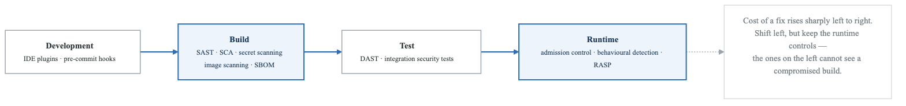

# Module 06: Security Scanning (SAST, DAST, SCA)

## Learning Objectives

By the end of this module, you will be able to:
- Implement Static Application Security Testing (SAST)
- Configure Dynamic Application Security Testing (DAST)
- Use Software Composition Analysis (SCA) for dependencies
- Integrate security scanning into CI/CD pipelines
- Interpret and prioritize security findings

## Security Testing Overview

```mermaid
%%{init: {'theme':'base','themeVariables':{'fontFamily':'Helvetica, Arial, sans-serif','fontSize':'13px','primaryColor':'#ffffff','primaryTextColor':'#2d3436','primaryBorderColor':'#9aa3ab','lineColor':'#9aa3ab','textColor':'#2d3436','clusterBkg':'#fbfcfd','clusterBorder':'#d4dae0','edgeLabelBackground':'#ffffff','tertiaryColor':'#eef4fb'},'flowchart':{'curve':'basis','padding':14,'nodeSpacing':42,'rankSpacing':58}}}%%
flowchart LR
  classDef default fill:#ffffff,stroke:#9aa3ab,stroke-width:1.3px,color:#2d3436
  classDef n    fill:#ffffff,stroke:#9aa3ab,stroke-width:1.3px,color:#2d3436
  classDef crit fill:#eef4fb,stroke:#2f6fb8,stroke-width:1.8px,color:#1b3a5c
  classDef data fill:#f4f7fa,stroke:#9aa3ab,stroke-width:1.3px,color:#2d3436
  classDef mut  fill:#ffffff,stroke:#cfd6dc,stroke-width:1.1px,color:#7a8288
  classDef warn fill:#fdf0ec,stroke:#c0522d,stroke-width:1.6px,color:#8a3a1e
  D["<b>Development</b><br/><small>IDE plugins · pre-commit hooks</small>"]:::n
  B["<b>Build</b><br/><small>SAST · SCA · secret scanning<br/>image scanning · SBOM</small>"]:::crit
  T["<b>Test</b><br/><small>DAST · integration security tests</small>"]:::n
  R["<b>Runtime</b><br/><small>admission control · behavioural detection · RASP</small>"]:::crit

  D --> B --> T --> R

  NOTE["Cost of a fix rises sharply left to right.<br/>Shift left, but keep the runtime controls —<br/>the ones on the left cannot see a compromised build."]:::mut
  R -.-> NOTE

  linkStyle 0,1,2 stroke:#2f6fb8,stroke-width:2px
```

<!-- figure: generated from the Mermaid below by _shared/diagrams/embed-figures.py — do not edit the image -->


<details>
<summary>Diagram source (Mermaid)</summary>



</details>

## Static Application Security Testing (SAST)

### Semgrep Configuration

```yaml
# .semgrep.yaml
rules:
  - id: hardcoded-secret
    patterns:
      - pattern-either:
          - pattern: password = "..."
          - pattern: api_key = "..."
          - pattern: secret = "..."
    message: Hardcoded secret detected
    languages: [python, javascript, go]
    severity: ERROR

  - id: sql-injection
    patterns:
      - pattern: |
          cursor.execute($QUERY % ...)
      - pattern: |
          cursor.execute($QUERY.format(...))
      - pattern: |
          cursor.execute(f"... {$VAR} ...")
    message: Potential SQL injection vulnerability
    languages: [python]
    severity: ERROR
    metadata:
      cwe: "CWE-89"
      owasp: "A03:2021"

  - id: xss-vulnerability
    patterns:
      - pattern: |
          dangerouslySetInnerHTML={{__html: $VAR}}
    message: Potential XSS vulnerability via dangerouslySetInnerHTML
    languages: [javascript, typescript]
    severity: WARNING
    metadata:
      cwe: "CWE-79"

  - id: insecure-random
    pattern: |
      import random
      ...
      random.$FUNC(...)
    message: Use secrets module for security-sensitive randomness
    languages: [python]
    severity: WARNING
```

### CodeQL Analysis

```yaml
# .github/workflows/codeql.yml
name: CodeQL Analysis
on:
  push:
    branches: [main, develop]
  pull_request:
    branches: [main]
  schedule:
    - cron: '0 2 * * 1'  # Weekly Monday 2am

jobs:
  analyze:
    name: Analyze
    runs-on: ubuntu-latest
    permissions:
      security-events: write

    strategy:
      fail-fast: false
      matrix:
        language: ['javascript', 'python', 'go']

    steps:
      - name: Checkout repository
        uses: actions/checkout@v4

      - name: Initialize CodeQL
        uses: github/codeql-action/init@v2
        with:
          languages: ${{ matrix.language }}
          queries: +security-extended,security-and-quality

      - name: Autobuild
        uses: github/codeql-action/autobuild@v2

      - name: Perform CodeQL Analysis
        uses: github/codeql-action/analyze@v2
        with:
          category: "/language:${{ matrix.language }}"
```

### Custom CodeQL Queries

```ql
// queries/InsecureDeserialization.ql
/**
 * @name Insecure deserialization
 * @description Detects use of pickle with untrusted data
 * @kind path-problem
 * @problem.severity error
 * @security-severity 9.8
 * @precision high
 * @id py/insecure-deserialization
 * @tags security
 *       external/cwe/cwe-502
 */

import python
import semmle.python.dataflow.new.DataFlow
import semmle.python.dataflow.new.TaintTracking
import semmle.python.Concepts

class PickleLoadCall extends DataFlow::CallCfgNode {
  PickleLoadCall() {
    this.getFunction().toString() = "pickle.load" or
    this.getFunction().toString() = "pickle.loads"
  }
}

class InsecureDeserializationConfig extends TaintTracking::Configuration {
  InsecureDeserializationConfig() { this = "InsecureDeserializationConfig" }

  override predicate isSource(DataFlow::Node source) {
    source instanceof RemoteFlowSource
  }

  override predicate isSink(DataFlow::Node sink) {
    exists(PickleLoadCall call |
      sink = call.getArg(0)
    )
  }
}

from InsecureDeserializationConfig config, DataFlow::PathNode source, DataFlow::PathNode sink
where config.hasFlowPath(source, sink)
select sink.getNode(), source, sink,
  "Insecure deserialization of $@.", source.getNode(), "user-controlled data"
```

## Software Composition Analysis (SCA)

### Dependency Scanning with Trivy

```yaml
# GitHub Actions SCA scanning
name: Dependency Security Scan
on:
  push:
    branches: [main]
  pull_request:
  schedule:
    - cron: '0 0 * * *'  # Daily

jobs:
  sca-scan:
    runs-on: ubuntu-latest
    steps:
      - uses: actions/checkout@v4

      - name: Run Trivy vulnerability scanner
        uses: aquasecurity/trivy-action@master
        with:
          scan-type: 'fs'
          scan-ref: '.'
          severity: 'CRITICAL,HIGH'
          format: 'sarif'
          output: 'trivy-sca-results.sarif'
          exit-code: '1'
          ignore-unfixed: true

      - name: Upload Trivy scan results
        uses: github/codeql-action/upload-sarif@v2
        if: always()
        with:
          sarif_file: 'trivy-sca-results.sarif'
```

### Snyk Integration

```yaml
# .snyk policy file
version: v1.25.0
ignore:
  SNYK-JS-LODASH-1040724:
    - '*':
        reason: 'Risk accepted - not exploitable in our usage'
        expires: '2024-06-01T00:00:00.000Z'

patch: {}

# snyk.config.json
{
  "severity-threshold": "high",
  "fail-on": "upgradable",
  "exclude": [
    "test/**",
    "docs/**"
  ]
}
```

```yaml
# GitHub Actions Snyk integration
name: Snyk Security Scan
on:
  push:
    branches: [main]
  pull_request:

jobs:
  snyk:
    runs-on: ubuntu-latest
    steps:
      - uses: actions/checkout@v4

      - name: Run Snyk to check for vulnerabilities
        uses: snyk/actions/node@master
        env:
          SNYK_TOKEN: ${{ secrets.SNYK_TOKEN }}
        with:
          args: --severity-threshold=high

      - name: Run Snyk to check Docker image
        uses: snyk/actions/docker@master
        env:
          SNYK_TOKEN: ${{ secrets.SNYK_TOKEN }}
        with:
          image: myapp:${{ github.sha }}
          args: --severity-threshold=high
```

### SBOM Generation

```yaml
# Generate Software Bill of Materials
name: Generate SBOM
on:
  release:
    types: [published]

jobs:
  sbom:
    runs-on: ubuntu-latest
    steps:
      - uses: actions/checkout@v4

      - name: Generate SBOM with Syft
        uses: anchore/sbom-action@v0
        with:
          format: spdx-json
          output-file: sbom.spdx.json

      - name: Generate CycloneDX SBOM
        uses: CycloneDX/gh-node-module-generatebom@v1
        with:
          output: sbom.cyclonedx.json

      - name: Upload SBOMs
        uses: actions/upload-artifact@v4
        with:
          name: sbom
          path: |
            sbom.spdx.json
            sbom.cyclonedx.json

      - name: Attest SBOM
        uses: actions/attest-sbom@v1
        with:
          subject-name: ghcr.io/${{ github.repository }}
          subject-digest: ${{ steps.build.outputs.digest }}
          sbom-path: 'sbom.spdx.json'
```

## Dynamic Application Security Testing (DAST)

### OWASP ZAP Configuration

```yaml
# zap-config.yaml
env:
  contexts:
    - name: "Default Context"
      urls:
        - "https://app.example.com"
      includePaths:
        - "https://app.example.com/.*"
      excludePaths:
        - "https://app.example.com/logout"
        - "https://app.example.com/static/.*"
      authentication:
        method: "form"
        parameters:
          loginUrl: "https://app.example.com/login"
          loginRequestData: "username=&password="
        verification:
          method: "response"
          loggedInRegex: "\\QWelcome\\E"
          loggedOutRegex: "\\QLogin\\E"
      users:
        - name: "test-user"
          credentials:
            username: "testuser"
            password: "${ZAP_AUTH_PASSWORD}"

jobs:
  - type: spider
    parameters:
      context: "Default Context"
      maxDuration: 10
      maxDepth: 5

  - type: spiderAjax
    parameters:
      context: "Default Context"
      maxDuration: 10

  - type: passiveScan-wait
    parameters:
      maxDuration: 5

  - type: activeScan
    parameters:
      context: "Default Context"
      policy: "API-Scan"
      maxRuleDurationInMins: 5
      maxScanDurationInMins: 30

  - type: report
    parameters:
      template: "sarif-json"
      reportDir: "/zap/reports"
      reportFile: "zap-report.sarif"
    risks:
      - high
      - medium
```

### DAST in CI/CD

```yaml
# GitHub Actions DAST scanning
name: DAST Scan
on:
  workflow_run:
    workflows: ["Deploy to Staging"]
    types: [completed]

jobs:
  dast:
    runs-on: ubuntu-latest
    if: ${{ github.event.workflow_run.conclusion == 'success' }}

    steps:
      - uses: actions/checkout@v4

      - name: Wait for application to be ready
        run: |
          for i in {1..30}; do
            if curl -s -o /dev/null -w "%{http_code}" https://staging.example.com/health | grep -q "200"; then
              echo "Application is ready"
              break
            fi
            echo "Waiting for application..."
            sleep 10
          done

      - name: Run ZAP Scan
        uses: zaproxy/action-full-scan@v0.8.0
        with:
          target: 'https://staging.example.com'
          rules_file_name: 'zap-rules.tsv'
          cmd_options: '-a -j -l WARN'

      - name: Upload ZAP report
        uses: actions/upload-artifact@v4
        if: always()
        with:
          name: zap-report
          path: report_html.html
```

### Nuclei Scanner

```yaml
# nuclei-templates/custom/api-security.yaml
id: api-security-check
info:
  name: API Security Configuration Check
  author: security-team
  severity: medium
  tags: api,security

requests:
  - method: GET
    path:
      - "{{BaseURL}}/api/v1/users"
    headers:
      Authorization: ""  # No auth header
    matchers-condition: and
    matchers:
      - type: status
        status:
          - 200
      - type: word
        words:
          - "email"
          - "username"
        condition: or
    extractors:
      - type: regex
        regex:
          - '"email":"([^"]+)"'

---
id: cors-misconfiguration
info:
  name: CORS Misconfiguration
  severity: high

requests:
  - method: GET
    path:
      - "{{BaseURL}}"
    headers:
      Origin: "https://evil.com"
    matchers:
      - type: word
        part: header
        words:
          - "Access-Control-Allow-Origin: https://evil.com"
          - "Access-Control-Allow-Origin: *"
        condition: or
```

## Vulnerability Management

### Vulnerability Tracking Dashboard

```yaml
# DefectDojo configuration
apiVersion: apps/v1
kind: Deployment
metadata:
  name: defectdojo
spec:
  template:
    spec:
      containers:
        - name: defectdojo
          image: defectdojo/defectdojo-django:latest
          env:
            - name: DD_DEBUG
              value: "False"
            - name: DD_ALLOWED_HOSTS
              value: "*"
            - name: DD_DATABASE_URL
              valueFrom:
                secretKeyRef:
                  name: defectdojo-secrets
                  key: database-url
```

### Automated Vulnerability Import

```python
# Import scan results to DefectDojo
import requests
from datetime import datetime

class DefectDojoClient:
    def __init__(self, url: str, api_key: str):
        self.url = url
        self.headers = {
            'Authorization': f'Token {api_key}',
            'Content-Type': 'application/json'
        }

    def import_scan(self, scan_type: str, file_path: str,
                    product_id: int, engagement_id: int):
        """Import scan results to DefectDojo."""

        with open(file_path, 'rb') as f:
            response = requests.post(
                f'{self.url}/api/v2/import-scan/',
                headers={'Authorization': f'Token {self.api_key}'},
                data={
                    'scan_type': scan_type,
                    'product': product_id,
                    'engagement': engagement_id,
                    'verified': False,
                    'active': True,
                    'minimum_severity': 'Info',
                    'close_old_findings': True,
                    'push_to_jira': False,
                    'scan_date': datetime.now().strftime('%Y-%m-%d')
                },
                files={'file': f}
            )

        return response.json()

# Usage in CI/CD
client = DefectDojoClient(
    url='https://defectdojo.example.com',
    api_key=os.environ['DEFECTDOJO_API_KEY']
)

# Import Trivy results
client.import_scan(
    scan_type='Trivy Scan',
    file_path='trivy-results.json',
    product_id=1,
    engagement_id=1
)

# Import ZAP results
client.import_scan(
    scan_type='ZAP Scan',
    file_path='zap-report.json',
    product_id=1,
    engagement_id=1
)
```

## Integrated Security Pipeline

```yaml
# Complete security scanning pipeline
name: Security Pipeline
on:
  push:
    branches: [main, develop]
  pull_request:

jobs:
  # Stage 1: Pre-commit checks
  secrets-scan:
    runs-on: ubuntu-latest
    steps:
      - uses: actions/checkout@v4
        with:
          fetch-depth: 0

      - name: Detect secrets
        uses: trufflesecurity/trufflehog@main
        with:
          extra_args: --only-verified

  # Stage 2: SAST
  sast:
    runs-on: ubuntu-latest
    needs: secrets-scan
    steps:
      - uses: actions/checkout@v4

      - name: Semgrep scan
        uses: returntocorp/semgrep-action@v1
        with:
          config: >-
            p/security-audit
            p/owasp-top-ten
            p/r2c-security-audit

      - name: CodeQL Analysis
        uses: github/codeql-action/analyze@v2

  # Stage 3: SCA
  sca:
    runs-on: ubuntu-latest
    needs: secrets-scan
    steps:
      - uses: actions/checkout@v4

      - name: Dependency scan
        uses: aquasecurity/trivy-action@master
        with:
          scan-type: 'fs'
          severity: 'CRITICAL,HIGH'
          exit-code: '1'

      - name: License check
        run: |
          pip install pip-licenses
          pip-licenses --fail-on="GPL;AGPL"

  # Stage 4: Container scan
  container-scan:
    runs-on: ubuntu-latest
    needs: [sast, sca]
    steps:
      - uses: actions/checkout@v4

      - name: Build image
        run: docker build -t app:${{ github.sha }} .

      - name: Scan image
        uses: aquasecurity/trivy-action@master
        with:
          image-ref: 'app:${{ github.sha }}'
          severity: 'CRITICAL,HIGH'
          exit-code: '1'

  # Stage 5: IaC scan
  iac-scan:
    runs-on: ubuntu-latest
    needs: secrets-scan
    steps:
      - uses: actions/checkout@v4

      - name: Checkov scan
        uses: bridgecrewio/checkov-action@master
        with:
          directory: terraform/
          framework: terraform

  # Stage 6: Security gate
  security-gate:
    runs-on: ubuntu-latest
    needs: [sast, sca, container-scan, iac-scan]
    steps:
      - name: Check all scans passed
        run: echo "All security scans passed"
```

## Summary

Security scanning provides multiple layers of protection:

1. **SAST** - Find vulnerabilities in source code during development
2. **SCA** - Identify vulnerable dependencies
3. **DAST** - Test running applications for vulnerabilities
4. **Container Scanning** - Check images for CVEs
5. **IaC Scanning** - Validate infrastructure configurations

## Additional Resources

- [OWASP Testing Guide](https://owasp.org/www-project-web-security-testing-guide/)
- [Semgrep Rules](https://semgrep.dev/explore)
- [Trivy Documentation](https://aquasecurity.github.io/trivy/)
- [DefectDojo Documentation](https://defectdojo.github.io/django-DefectDojo/)

## Next Module

Continue to [Module 07: Identity and Access Management](content-module-07-identity-access-management.md) to learn about authentication and authorization.

<!-- feynman-check -->

---

## Feynman check

Close the file. Blank page, no notes. Explain each of these to a competent engineer who has never
used this tool — **under five minutes, no jargon you can't define on the spot:**

- Security Testing Overview
- Static Application Security Testing (SAST)
- Software Composition Analysis (SCA)
- Dynamic Application Security Testing (DAST)

**The gap is not what you forgot. It is where you used a word instead of a mechanism.**

| | |
|---|---|
| ✗ | *"We scan for vulnerabilities in the pipeline."* |
| ✓ | *"SAST reads source without running it, SCA resolves the dependency tree against an advisory database, and image scanning compares installed package versions to that same database. All three report what was known at build time — which is why the registry is re-scanned: the image does not change, the database does."* |

**Trace it:** A CVE published today against your base image → a blocked deploy. Name every component between the advisory and the refused `apply`.

Stop at the first component you cannot name. Reopen this file and read **only** that.

**Go deeper — only once the gap has a name:** the [SLSA threat model](https://slsa.dev/spec/v1.2/threats) — it names every point at which a build can be subverted, and most teams defend three of them.
Full list per domain: [`SOURCES.md`](../SOURCES.md#devsecops)

→ Protocol, the three levels of knowing, and worked examples: [`MASTERY.md`](../MASTERY.md)

<!-- /feynman-check -->
