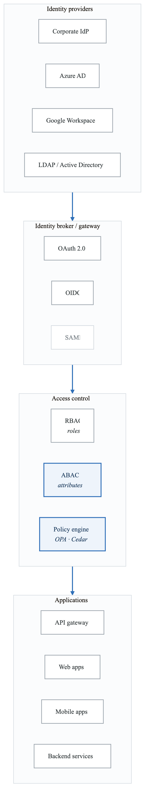
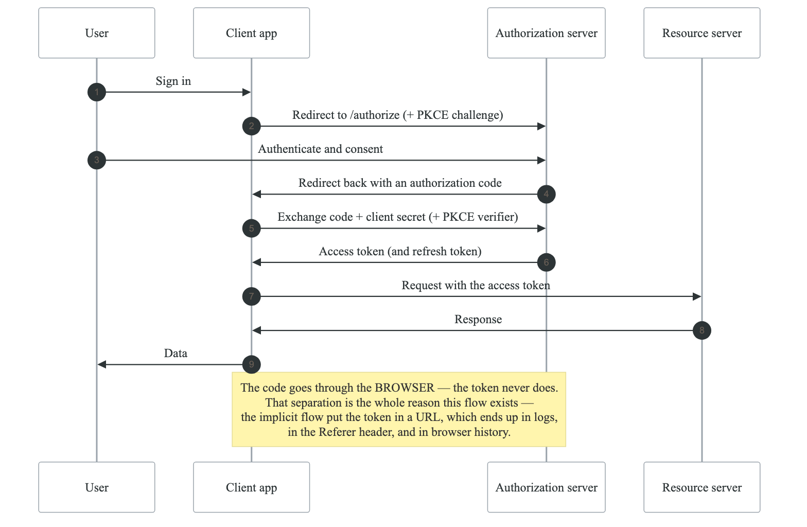
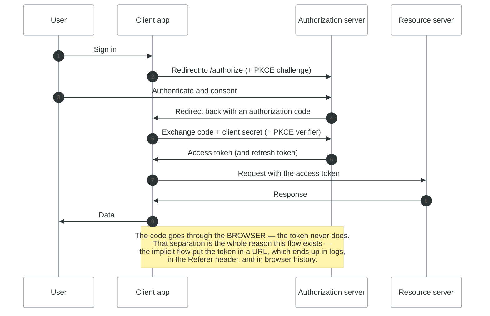
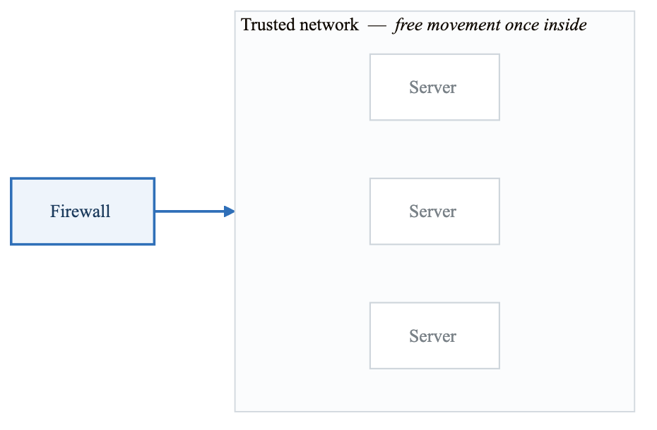
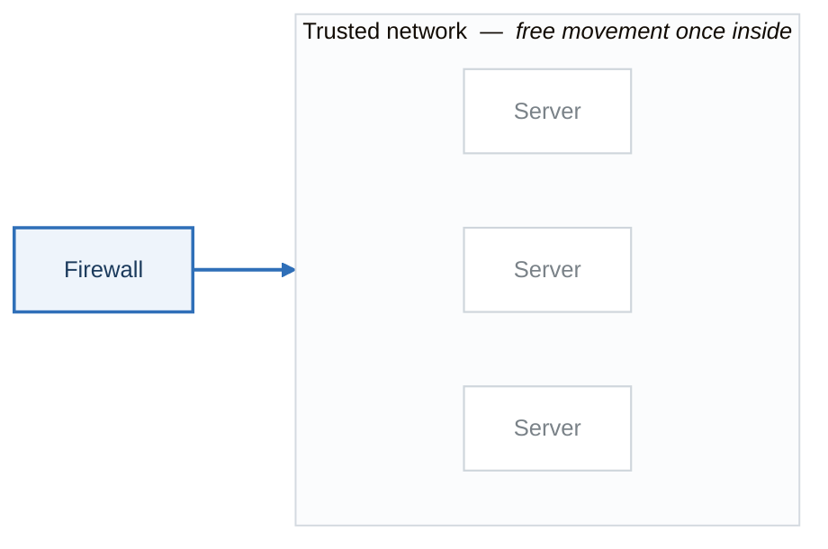
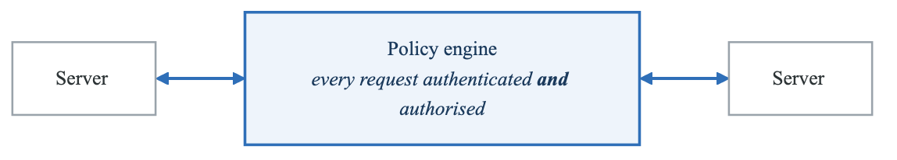
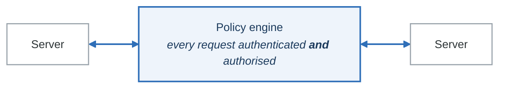

# Module 07: Identity and Access Management (IAM)

## Learning Objectives

By the end of this module, you will be able to:
- Implement OAuth 2.0 and OpenID Connect authentication
- Configure identity providers and federation
- Apply zero-trust security principles
- Implement role-based and attribute-based access control
- Set up multi-factor authentication

## Identity Management Fundamentals

### Identity Architecture

```mermaid
%%{init: {'theme':'base','themeVariables':{'fontFamily':'Helvetica, Arial, sans-serif','fontSize':'13px','primaryColor':'#ffffff','primaryTextColor':'#2d3436','primaryBorderColor':'#9aa3ab','lineColor':'#9aa3ab','textColor':'#2d3436','clusterBkg':'#fbfcfd','clusterBorder':'#d4dae0','edgeLabelBackground':'#ffffff','tertiaryColor':'#eef4fb'},'flowchart':{'curve':'basis','padding':14,'nodeSpacing':42,'rankSpacing':58}}}%%
flowchart TB
  classDef default fill:#ffffff,stroke:#9aa3ab,stroke-width:1.3px,color:#2d3436
  classDef n    fill:#ffffff,stroke:#9aa3ab,stroke-width:1.3px,color:#2d3436
  classDef crit fill:#eef4fb,stroke:#2f6fb8,stroke-width:1.8px,color:#1b3a5c
  classDef data fill:#f4f7fa,stroke:#9aa3ab,stroke-width:1.3px,color:#2d3436
  classDef mut  fill:#ffffff,stroke:#cfd6dc,stroke-width:1.1px,color:#7a8288
  classDef warn fill:#fdf0ec,stroke:#c0522d,stroke-width:1.6px,color:#8a3a1e
  subgraph IDP["Identity providers"]
    direction LR
    P1["Corporate IdP"]
    P2["Azure AD"]
    P3["Google Workspace"]
    P4["LDAP / Active Directory"]
  end
  subgraph BR["Identity broker / gateway"]
    direction LR
    OA["OAuth 2.0"]
    OI["OIDC"]
    SA["SAML"]
  end
  subgraph AC["Access control"]
    direction LR
    RB["RBAC<br/><i>roles</i>"]
    AB["ABAC<br/><i>attributes</i>"]
    PE["Policy engine<br/><i>OPA · Cedar</i>"]
  end
  subgraph AP["Applications"]
    direction LR
    AG["API gateway"]
    WA["Web apps"]
    MA["Mobile apps"]
    BS["Backend services"]
  end
  IDP ==> BR ==> AC ==> AP
  class P1,P2,P3,P4 n
  class OA,OI n
  class SA mut
  class RB n
  class AB,PE crit
  class AG,WA,MA,BS n
  linkStyle 0,1,2 stroke:#2f6fb8,stroke-width:2px

%% The broker exists so applications never integrate with providers directly.
%% Add a provider and nothing downstream changes; without it, onboarding an
%% acquisition means touching every application that needs to trust its users.
```

<!-- figure: generated from the Mermaid below by _shared/diagrams/embed-figures.py — do not edit the image -->


<details>
<summary>Diagram source (Mermaid)</summary>



</details>

## OAuth 2.0 and OpenID Connect

### OAuth 2.0 Flows

<!-- figure: generated from the Mermaid below by _shared/diagrams/embed-figures.py — do not edit the image -->


<details>
<summary>Diagram source (Mermaid)</summary>



</details>

### OIDC Token Validation

```python
# JWT Token validation
import jwt
from jwt import PyJWKClient
from functools import wraps
from flask import request, jsonify

class TokenValidator:
    def __init__(self, issuer: str, audience: str, jwks_uri: str):
        self.issuer = issuer
        self.audience = audience
        self.jwks_client = PyJWKClient(jwks_uri)

    def validate_token(self, token: str) -> dict:
        """Validate JWT token and return claims."""
        try:
            # Get signing key from JWKS
            signing_key = self.jwks_client.get_signing_key_from_jwt(token)

            # Decode and validate token
            claims = jwt.decode(
                token,
                signing_key.key,
                algorithms=["RS256"],
                audience=self.audience,
                issuer=self.issuer,
                options={
                    "verify_exp": True,
                    "verify_iat": True,
                    "verify_nbf": True,
                    "require": ["exp", "iat", "sub", "aud", "iss"]
                }
            )
            return claims

        except jwt.ExpiredSignatureError:
            raise AuthError("Token has expired")
        except jwt.InvalidAudienceError:
            raise AuthError("Invalid audience")
        except jwt.InvalidIssuerError:
            raise AuthError("Invalid issuer")
        except jwt.InvalidTokenError as e:
            raise AuthError(f"Invalid token: {str(e)}")

# Initialize validator
validator = TokenValidator(
    issuer="https://auth.example.com",
    audience="https://api.example.com",
    jwks_uri="https://auth.example.com/.well-known/jwks.json"
)

def require_auth(f):
    """Decorator to require authentication."""
    @wraps(f)
    def decorated(*args, **kwargs):
        auth_header = request.headers.get('Authorization', '')

        if not auth_header.startswith('Bearer '):
            return jsonify({"error": "Missing or invalid authorization header"}), 401

        token = auth_header.split(' ')[1]

        try:
            claims = validator.validate_token(token)
            request.user = claims
            return f(*args, **kwargs)
        except AuthError as e:
            return jsonify({"error": str(e)}), 401

    return decorated

@app.route('/api/protected')
@require_auth
def protected_endpoint():
    return jsonify({"user": request.user['sub']})
```

### Keycloak Configuration

```yaml
# Keycloak Realm Configuration
realm: production
enabled: true
sslRequired: external
registrationAllowed: false
loginWithEmailAllowed: true
duplicateEmailsAllowed: false
resetPasswordAllowed: true
editUsernameAllowed: false
bruteForceProtected: true
permanentLockout: false
maxFailureWaitSeconds: 900
minimumQuickLoginWaitSeconds: 60
waitIncrementSeconds: 60
quickLoginCheckMilliSeconds: 1000
maxDeltaTimeSeconds: 43200
failureFactor: 5

passwordPolicy: >
  length(12) and
  upperCase(1) and
  lowerCase(1) and
  digits(1) and
  specialChars(1) and
  notUsername and
  passwordHistory(5)

clients:
  - clientId: web-app
    enabled: true
    publicClient: false
    secret: "${WEB_APP_SECRET}"
    redirectUris:
      - "https://app.example.com/*"
    webOrigins:
      - "https://app.example.com"
    standardFlowEnabled: true
    directAccessGrantsEnabled: false
    serviceAccountsEnabled: false
    defaultClientScopes:
      - openid
      - profile
      - email
    optionalClientScopes:
      - roles
      - groups

  - clientId: api-service
    enabled: true
    bearerOnly: true
    publicClient: false
    secret: "${API_SERVICE_SECRET}"

roles:
  realm:
    - name: admin
      description: Administrator role
    - name: user
      description: Standard user role
    - name: readonly
      description: Read-only access

groups:
  - name: administrators
    realmRoles:
      - admin
  - name: users
    realmRoles:
      - user

identityProviders:
  - alias: google
    providerId: google
    enabled: true
    config:
      clientId: "${GOOGLE_CLIENT_ID}"
      clientSecret: "${GOOGLE_CLIENT_SECRET}"
      defaultScope: "openid email profile"
```

## Zero Trust Architecture

### Zero Trust Principles

**Traditional — castle and moat**

<!-- figure: generated from the Mermaid below by _shared/diagrams/embed-figures.py — do not edit the image -->


<details>
<summary>Diagram source (Mermaid)</summary>



</details>

**Zero trust — never trust, always verify**

<!-- figure: generated from the Mermaid below by _shared/diagrams/embed-figures.py — do not edit the image -->


<details>
<summary>Diagram source (Mermaid)</summary>



</details>

**Principles**

1. **Verify explicitly** — authenticate and authorise every request, on identity *and* context
2. **Least privilege** — just enough access, just in time
3. **Assume breach** — segment, encrypt, and limit the blast radius as though the attacker is
   already inside

The third is the one that changes designs. If you genuinely assume breach, a flat internal network
and a shared service account stop being acceptable, and the argument moves from "can they get in?"
to "what can they reach once they have?".

### Service Mesh Authentication (Istio)

```yaml
# Istio mTLS configuration
apiVersion: security.istio.io/v1beta1
kind: PeerAuthentication
metadata:
  name: default
  namespace: production
spec:
  mtls:
    mode: STRICT

---
# Authorization Policy - Default deny
apiVersion: security.istio.io/v1beta1
kind: AuthorizationPolicy
metadata:
  name: default-deny
  namespace: production
spec:
  {}  # Empty spec = deny all

---
# Allow specific service communication
apiVersion: security.istio.io/v1beta1
kind: AuthorizationPolicy
metadata:
  name: allow-web-to-api
  namespace: production
spec:
  selector:
    matchLabels:
      app: api-service
  action: ALLOW
  rules:
    - from:
        - source:
            principals:
              - "cluster.local/ns/production/sa/web-service"
      to:
        - operation:
            methods: ["GET", "POST"]
            paths: ["/api/*"]

---
# JWT validation at ingress
apiVersion: security.istio.io/v1beta1
kind: RequestAuthentication
metadata:
  name: jwt-auth
  namespace: production
spec:
  selector:
    matchLabels:
      app: api-gateway
  jwtRules:
    - issuer: "https://auth.example.com"
      jwksUri: "https://auth.example.com/.well-known/jwks.json"
      audiences:
        - "https://api.example.com"
      forwardOriginalToken: true

---
# Require JWT for external requests
apiVersion: security.istio.io/v1beta1
kind: AuthorizationPolicy
metadata:
  name: require-jwt
  namespace: production
spec:
  selector:
    matchLabels:
      app: api-gateway
  action: ALLOW
  rules:
    - from:
        - source:
            requestPrincipals: ["*"]
      when:
        - key: request.auth.claims[iss]
          values: ["https://auth.example.com"]
```

## Role-Based Access Control (RBAC)

### RBAC Implementation

```python
# RBAC implementation
from enum import Enum
from dataclasses import dataclass
from typing import Set, List, Optional
from functools import wraps

class Permission(Enum):
    READ = "read"
    WRITE = "write"
    DELETE = "delete"
    ADMIN = "admin"

class Resource(Enum):
    USERS = "users"
    ORDERS = "orders"
    PRODUCTS = "products"
    REPORTS = "reports"

@dataclass
class Role:
    name: str
    permissions: dict[Resource, Set[Permission]]

# Define roles
ROLES = {
    "admin": Role(
        name="admin",
        permissions={
            Resource.USERS: {Permission.READ, Permission.WRITE, Permission.DELETE, Permission.ADMIN},
            Resource.ORDERS: {Permission.READ, Permission.WRITE, Permission.DELETE},
            Resource.PRODUCTS: {Permission.READ, Permission.WRITE, Permission.DELETE},
            Resource.REPORTS: {Permission.READ},
        }
    ),
    "manager": Role(
        name="manager",
        permissions={
            Resource.USERS: {Permission.READ},
            Resource.ORDERS: {Permission.READ, Permission.WRITE},
            Resource.PRODUCTS: {Permission.READ, Permission.WRITE},
            Resource.REPORTS: {Permission.READ},
        }
    ),
    "user": Role(
        name="user",
        permissions={
            Resource.ORDERS: {Permission.READ},
            Resource.PRODUCTS: {Permission.READ},
        }
    ),
}

class RBACEnforcer:
    def __init__(self):
        self.roles = ROLES

    def check_permission(self, user_roles: List[str],
                         resource: Resource,
                         permission: Permission) -> bool:
        """Check if user has required permission."""
        for role_name in user_roles:
            role = self.roles.get(role_name)
            if role:
                resource_permissions = role.permissions.get(resource, set())
                if permission in resource_permissions:
                    return True
        return False

    def get_allowed_resources(self, user_roles: List[str]) -> dict:
        """Get all resources and permissions for user."""
        allowed = {}
        for role_name in user_roles:
            role = self.roles.get(role_name)
            if role:
                for resource, permissions in role.permissions.items():
                    if resource not in allowed:
                        allowed[resource] = set()
                    allowed[resource].update(permissions)
        return allowed

# RBAC decorator
rbac = RBACEnforcer()

def require_permission(resource: Resource, permission: Permission):
    def decorator(f):
        @wraps(f)
        def decorated(*args, **kwargs):
            user_roles = request.user.get('roles', [])

            if not rbac.check_permission(user_roles, resource, permission):
                return jsonify({
                    "error": "Permission denied",
                    "required": f"{permission.value} on {resource.value}"
                }), 403

            return f(*args, **kwargs)
        return decorated
    return decorator

# Usage
@app.route('/api/users', methods=['GET'])
@require_auth
@require_permission(Resource.USERS, Permission.READ)
def list_users():
    return jsonify(get_all_users())

@app.route('/api/users', methods=['POST'])
@require_auth
@require_permission(Resource.USERS, Permission.WRITE)
def create_user():
    return jsonify(create_new_user(request.json))
```

## Attribute-Based Access Control (ABAC)

### Open Policy Agent (OPA)

```rego
# policy/authz.rego
package authz

import future.keywords.in

default allow := false

# Allow admins to do anything
allow {
    input.user.roles[_] == "admin"
}

# Allow users to read their own data
allow {
    input.action == "read"
    input.resource.type == "user"
    input.resource.id == input.user.id
}

# Allow managers to read users in their department
allow {
    input.action == "read"
    input.resource.type == "user"
    input.user.roles[_] == "manager"
    input.resource.department == input.user.department
}

# Time-based access - only allow during business hours
allow {
    input.action in ["read", "write"]
    input.resource.type == "reports"
    is_business_hours
}

is_business_hours {
    time.now_ns() > time.parse_rfc3339_ns(sprintf("%sT09:00:00Z", [today]))
    time.now_ns() < time.parse_rfc3339_ns(sprintf("%sT17:00:00Z", [today]))
}

today := format_date(time.now_ns())

format_date(ns) = date {
    t := time.date(ns)
    date := sprintf("%d-%02d-%02d", [t[0], t[1], t[2]])
}

# Location-based access
allow {
    input.action == "read"
    input.resource.type == "sensitive_data"
    input.context.ip_address in data.allowed_ips
}

# Resource owner can always read/write
allow {
    input.action in ["read", "write"]
    input.resource.owner == input.user.id
}
```

### OPA Integration

```python
# OPA client integration
import requests
from dataclasses import dataclass
from typing import Any, Dict

@dataclass
class AuthzRequest:
    user: Dict[str, Any]
    action: str
    resource: Dict[str, Any]
    context: Dict[str, Any]

class OPAClient:
    def __init__(self, opa_url: str = "http://localhost:8181"):
        self.opa_url = opa_url

    def check_authorization(self, request: AuthzRequest) -> bool:
        """Check authorization with OPA."""
        response = requests.post(
            f"{self.opa_url}/v1/data/authz/allow",
            json={"input": {
                "user": request.user,
                "action": request.action,
                "resource": request.resource,
                "context": request.context
            }}
        )
        result = response.json()
        return result.get("result", False)

# Decorator for ABAC
opa = OPAClient()

def require_authorization(action: str, resource_type: str):
    def decorator(f):
        @wraps(f)
        def decorated(*args, **kwargs):
            # Build resource from request
            resource = {
                "type": resource_type,
                "id": kwargs.get('id'),
                # Add other resource attributes
            }

            # Build context
            context = {
                "ip_address": request.remote_addr,
                "timestamp": datetime.utcnow().isoformat(),
            }

            authz_request = AuthzRequest(
                user=request.user,
                action=action,
                resource=resource,
                context=context
            )

            if not opa.check_authorization(authz_request):
                return jsonify({"error": "Authorization denied"}), 403

            return f(*args, **kwargs)
        return decorated
    return decorator
```

## Multi-Factor Authentication

### MFA Implementation

```python
# TOTP-based MFA
import pyotp
import qrcode
from io import BytesIO
import base64

class MFAManager:
    def __init__(self, issuer: str = "MyApp"):
        self.issuer = issuer

    def generate_secret(self) -> str:
        """Generate new TOTP secret."""
        return pyotp.random_base32()

    def generate_qr_code(self, secret: str, user_email: str) -> str:
        """Generate QR code for authenticator app."""
        totp = pyotp.TOTP(secret)
        uri = totp.provisioning_uri(
            name=user_email,
            issuer_name=self.issuer
        )

        qr = qrcode.make(uri)
        buffer = BytesIO()
        qr.save(buffer, format='PNG')
        qr_base64 = base64.b64encode(buffer.getvalue()).decode()

        return f"data:image/png;base64,{qr_base64}"

    def verify_token(self, secret: str, token: str) -> bool:
        """Verify TOTP token."""
        totp = pyotp.TOTP(secret)
        return totp.verify(token, valid_window=1)

    def generate_backup_codes(self, count: int = 10) -> list:
        """Generate backup codes."""
        import secrets
        return [secrets.token_hex(4).upper() for _ in range(count)]

# MFA enrollment endpoint
mfa = MFAManager()

@app.route('/api/mfa/enroll', methods=['POST'])
@require_auth
def enroll_mfa():
    user_id = request.user['sub']
    secret = mfa.generate_secret()

    # Store secret (encrypted) for user
    store_mfa_secret(user_id, secret)

    qr_code = mfa.generate_qr_code(secret, request.user['email'])
    backup_codes = mfa.generate_backup_codes()

    # Store backup codes (hashed)
    store_backup_codes(user_id, backup_codes)

    return jsonify({
        "qr_code": qr_code,
        "backup_codes": backup_codes,
        "message": "Scan QR code with authenticator app"
    })

@app.route('/api/mfa/verify', methods=['POST'])
@require_auth
def verify_mfa():
    user_id = request.user['sub']
    token = request.json.get('token')

    secret = get_mfa_secret(user_id)

    if mfa.verify_token(secret, token):
        # Mark MFA as verified in session
        session['mfa_verified'] = True
        return jsonify({"success": True})
    else:
        return jsonify({"error": "Invalid token"}), 401
```

## Summary

Identity and Access Management is fundamental to security:

1. **Authentication** - Verify identity using OAuth 2.0/OIDC
2. **Authorization** - Control access with RBAC/ABAC
3. **Zero Trust** - Verify every request, assume breach
4. **MFA** - Add additional authentication factors
5. **Federation** - Centralize identity management

## Additional Resources

- [OAuth 2.0 Security Best Practices](https://datatracker.ietf.org/doc/html/draft-ietf-oauth-security-topics)
- [OpenID Connect Specification](https://openid.net/specs/openid-connect-core-1_0.html)
- [NIST Zero Trust Architecture](https://csrc.nist.gov/publications/detail/sp/800-207/final)
- [OPA Documentation](https://www.openpolicyagent.org/docs/latest/)

## Next Module

Continue to [Module 08: Compliance Frameworks](content-module-08-compliance-frameworks.md) to learn about SOC 2, ISO 27001, and other compliance requirements.

<!-- feynman-check -->

---

## Feynman check

Close the file. Blank page, no notes. Explain each of these to a competent engineer who has never
used this tool — **under five minutes, no jargon you can't define on the spot:**

- Identity Management Fundamentals
- OAuth 2.0 and OpenID Connect
- Zero Trust Architecture
- Role-Based Access Control (RBAC)

**The gap is not what you forgot. It is where you used a word instead of a mechanism.**

| | |
|---|---|
| ✗ | *"We scan for vulnerabilities in the pipeline."* |
| ✓ | *"SAST reads source without running it, SCA resolves the dependency tree against an advisory database, and image scanning compares installed package versions to that same database. All three report what was known at build time — which is why the registry is re-scanned: the image does not change, the database does."* |

**Trace it:** A CVE published today against your base image → a blocked deploy. Name every component between the advisory and the refused `apply`.

Stop at the first component you cannot name. Reopen this file and read **only** that.

**Go deeper — only once the gap has a name:** the [SLSA threat model](https://slsa.dev/spec/v1.2/threats) — it names every point at which a build can be subverted, and most teams defend three of them.
Full list per domain: [`SOURCES.md`](../SOURCES.md#devsecops)

→ Protocol, the three levels of knowing, and worked examples: [`MASTERY.md`](../MASTERY.md)

<!-- /feynman-check -->
