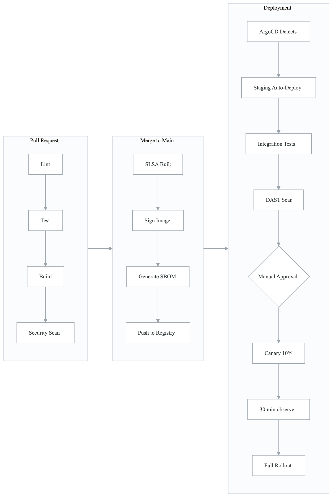
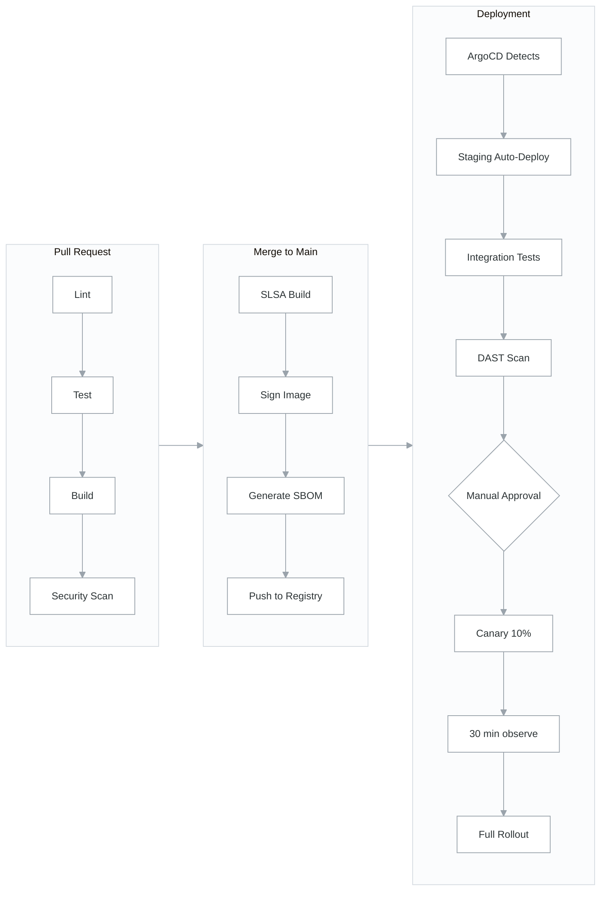
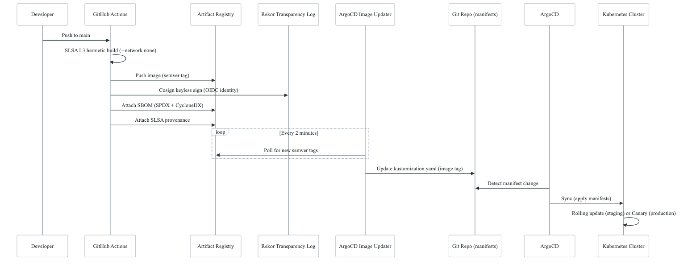
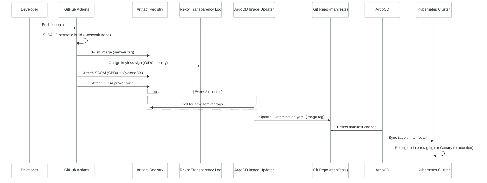
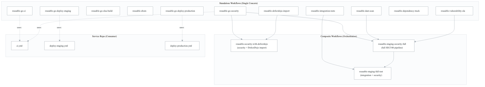
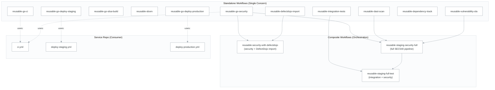
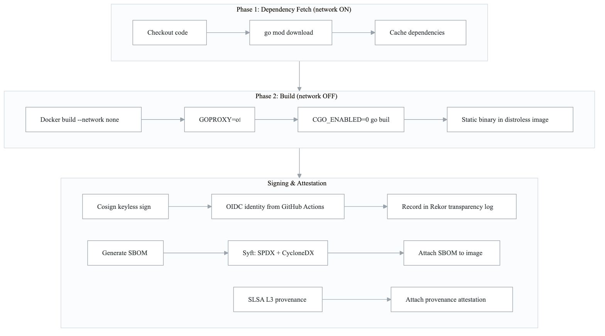
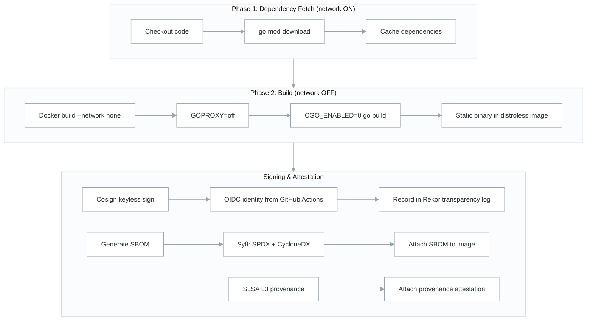

# CI/CD Pipelines — Architecture

## Overview

The CI/CD system is built on **GitHub Actions reusable workflows**, organized into a two-tier architecture: standalone workflows for fine-grained single-concern operations, and composite workflows that orchestrate multiple standalone workflows into opinionated pipelines.

The system supports two language runtimes (Go and Node.js) with parallel but distinct pipeline stages, unified by a common deployment strategy (ArgoCD GitOps with canary rollouts).

**Source**: `northwind-workflows/.github/workflows/` (26 reusable workflows)
**Source**: `northwind-infrastructure/.github/workflows/` (17 infrastructure-specific workflows)

## Pipeline Flow

### High-Level CI/CD Flow

<!-- figure: generated from the Mermaid below by _shared/diagrams/embed-figures.py — do not edit the image -->


<details>
<summary>Diagram source (Mermaid)</summary>



</details>

### Build-Sign-Deploy Sequence

<!-- figure: generated from the Mermaid below by _shared/diagrams/embed-figures.py — do not edit the image -->


<details>
<summary>Diagram source (Mermaid)</summary>



</details>

## Workflow Architecture

### Standalone vs Composite Pattern

<!-- figure: generated from the Mermaid below by _shared/diagrams/embed-figures.py — do not edit the image -->


<details>
<summary>Diagram source (Mermaid)</summary>



</details>

**Design rationale**: Standalone workflows enable per-service customization (e.g., service A needs PostgreSQL for tests, service B does not). Composite workflows reduce boilerplate for common scenarios (e.g., "run all security scans and import results").

### Workflow Versioning Strategy

Two versioning approaches coexist in the source:

| Strategy | Used By | Reference | Trade-off |
|----------|---------|-----------|-----------|
| `@main` (rolling) | Go workflows | `uses: {{ORG_NAME}}/{{APP_NAME}}-workflows/.github/workflows/reusable-go-ci.yml@main` | Always latest; risk of breaking changes |
| `@v1` (semver tag) | Node.js workflows | `uses: {{ORG_NAME}}/{{APP_NAME}}-workflows/.github/workflows/reusable-ci.yml@v1` | Stable; requires explicit version bumps |

**Recommendation**: Use `@v1` (semver) for production stability. Use `@main` only for workflows under active development. The source's split approach reflects the Go workflows being newer and still stabilizing.

## Go Pipeline Detail

**Source**: `northwind-workflows/.github/workflows/reusable-go-ci.yml`

### Pipeline Jobs

| Job | Purpose | Key Configuration |
|-----|---------|-------------------|
| `lint` | Code quality | gofmt check, go vet, golangci-lint v1.55.2 |
| `test` | Correctness + coverage | `go test -race -coverprofile`, coverage threshold gate, optional PostgreSQL/Redis service containers |
| `build` | Container image | Docker Buildx (no push in CI), BuildKit cache |
| `security-scan` | Vulnerability detection | Gosec (SARIF output), Trivy filesystem scan (CRITICAL,HIGH → SARIF) — [see cross-cutting/sarif-integration.md](cross-cutting-sarif-integration.md) |
| `govulncheck` | Go-specific vulnerabilities | Official Go vulnerability database scan |

### Inputs

| Input | Type | Default | Purpose |
|-------|------|---------|---------|
| `service-name` | string | required | Identifies the service |
| `go-version` | string | `'1.22'` | Go version for build matrix |
| `needs-postgres` | boolean | `false` | Spin up PostgreSQL service container |
| `needs-redis` | boolean | `false` | Spin up Redis service container |
| `coverage-threshold` | number | `60` | Minimum test coverage percentage |

## Node.js Pipeline Detail

**Source**: `northwind-workflows/.github/workflows/reusable-ci.yml`

### Pipeline Jobs

| Job | Purpose | Key Configuration |
|-----|---------|-------------------|
| `lint` | Code quality | ESLint |
| `test` | Correctness + coverage | Jest/Vitest with coverage, threshold gate, optional service containers |
| `build` | Container image | Docker Buildx, `ARG NPM_TOKEN` for private packages (`@{{ORG_NAME}}` scope) |
| `security-scan` | Vulnerability detection | Snyk Code SAST, Snyk SCA |

### Inputs

| Input | Type | Default | Purpose |
|-------|------|---------|---------|
| `service-name` | string | required | Identifies the service |
| `node-version` | string | `'18'` | Node.js version |
| `needs-postgres` | boolean | `false` | PostgreSQL service container |
| `needs-redis` | boolean | `false` | Redis service container |
| `coverage-threshold` | number | `80` | Minimum test coverage (higher than Go default) |

## SLSA Level 3 Hermetic Build

**Source**: `northwind-workflows/.github/workflows/reusable-go-slsa-build.yml`

The hermetic build is a 2-phase process ensuring reproducibility:

<!-- figure: generated from the Mermaid below by _shared/diagrams/embed-figures.py — do not edit the image -->


<details>
<summary>Diagram source (Mermaid)</summary>



</details>

**Key properties**:
- **Hermetic**: No network access during build (`--network none`, `GOPROXY=off`)
- **Keyless signing**: Uses GitHub Actions OIDC identity via Sigstore/Fulcio — no key management
- **Transparency**: All signatures recorded in Rekor public transparency log
- **Dual SBOM**: Both SPDX and CycloneDX formats attached to the image in the registry

## Deployment Strategy

### Staging (Automatic)

Triggered automatically on merge to `main` via ArgoCD Image Updater:

1. CI pushes semver-tagged image to Artifact Registry
2. ArgoCD Image Updater polls every 2 minutes for new semver tags
3. Image Updater commits updated `kustomization.yaml` (image tag) to Git
4. ArgoCD detects manifest change and syncs to cluster
5. Smoke tests run against `/health/live`, `/health/ready`, `/health`
6. Integration tests + DAST scan execute post-deployment
7. Results imported into DefectDojo

### Production (Manual with Canary)

**Source**: `northwind-workflows/.github/workflows/reusable-go-deploy-production.yml`

1. Manual workflow trigger (or specific version input)
2. OPA Gatekeeper admission check (image must be signed, have SBOM, meet SLSA L3)
3. Canary deployment: 10% of traffic routed to new version
4. 30-minute observation window (Prometheus metrics monitoring)
5. Smoke tests against canary pods
6. If healthy: full rollout to 100%
7. If unhealthy: automatic rollback

Rollback is also available as a manual trigger:
```yaml
gh workflow run deploy-production.yml \
  --repo {{ORG_NAME}}/{{REPO_NAME}} \
  -f rollback=true
```

## Caching Strategy

| Cache Type | Key | Scope | Impact |
|-----------|-----|-------|--------|
| npm dependencies | `package-lock.json` hash | Per-repo | Eliminates `npm install` on unchanged deps |
| Docker layers | BuildKit inline cache | Per-repo | Skips unchanged build stages |
| GitHub Actions Cache | Workflow-specific | Per-repo, 10GB limit, 7-day retention | Shared across workflow runs |
| Go modules | `go.sum` hash | Per-repo | Eliminates `go mod download` on unchanged deps |

**Measured impact**: Build times reduced from 8-12 minutes to 3-5 minutes (~60% savings).

## Infrastructure Workflows

In addition to the 26 shared reusable workflows, the source has 17 infrastructure-specific workflows in `northwind-infrastructure/.github/workflows/`:

| Category | Workflows | Domain |
|----------|-----------|--------|
| Terraform | `terraform-plan.yml`, `terraform-apply.yml`, `terraform-drift.yml` | Domain 03 |
| Cluster lifecycle | `bootstrap-staging.yml`, `bootstrap-production.yml`, `gitops-bootstrap.yml`, `cluster-health-check.yml`, `staging-scheduler.yml` | Domain 04 |
| Build | `packer-build.yml`, `container-build.yml` | Domain 03 |
| Deployment | `infrastructure-deploy.yml`, `infrastructure-destroy-recreate.yml`, `k8s-deploy.yml` | Domain 04 |
| Security | `security-checks.yml`, `security-review-schedule.yml`, `threagile-analysis.yml` | Domain 05 |
| Recovery | `cluster-recover.yml` | Domain 09 |

These are extracted as `platform-workflows/` templates in their respective domain directories.

## Consumer Integration Pattern

Services consume the shared workflows via their own `.github/workflows/` files:

**Go service example** (`northwind-api-gateway-go/.github/workflows/ci.yml`):
```yaml
jobs:
  ci:
    uses: {{ORG_NAME}}/{{APP_NAME}}-workflows/.github/workflows/reusable-go-ci.yml@main
    with:
      service-name: {{SERVICE_NAME}}
      go-version: '{{GO_VERSION}}'
      needs-postgres: false
      needs-redis: true
      coverage-threshold: {{COVERAGE_THRESHOLD}}

  security:
    uses: {{ORG_NAME}}/{{APP_NAME}}-workflows/.github/workflows/reusable-go-security.yml@main
    with:
      enable-codeql: true
      enable-secret-scanning: true
      fail-on-severity: high
```

**Node.js service example** (`northwind-auth-service/.github/workflows/ci.yml`):
```yaml
jobs:
  ci:
    uses: {{ORG_NAME}}/{{APP_NAME}}-workflows/.github/workflows/reusable-ci.yml@v1
    with:
      service-name: {{SERVICE_NAME}}
      node-version: '{{NODE_VERSION}}'
      needs-postgres: true
      needs-redis: true
      coverage-threshold: {{COVERAGE_THRESHOLD}}
    secrets:
      NPM_TOKEN: ${{ secrets.NPM_TOKEN }}
      CODECOV_TOKEN: ${{ secrets.CODECOV_TOKEN }}

  security:
    uses: {{ORG_NAME}}/{{APP_NAME}}-workflows/.github/workflows/reusable-security.yml@v1
    with:
      snyk-severity-threshold: high
    secrets:
      NPM_TOKEN: ${{ secrets.NPM_TOKEN }}
      SNYK_TOKEN: ${{ secrets.SNYK_TOKEN }}

  sonarqube:
    uses: {{ORG_NAME}}/{{APP_NAME}}-workflows/.github/workflows/reusable-sonarqube.yml@v1
    with:
      quality-gate-wait: true
    secrets:
      SONAR_TOKEN: ${{ secrets.SONAR_TOKEN }}
      SONAR_HOST_URL: ${{ secrets.SONAR_HOST_URL }}
```

**Key difference**: Node.js pipelines additionally run SonarQube quality gates; Go pipelines do not (CodeQL + Gosec cover the same ground at $0 cost).

## Required Secrets

| Secret | Used By | Purpose |
|--------|---------|---------|
| `NPM_TOKEN` | Node.js CI | Private GitHub Packages (`@{{ORG_NAME}}` scope) |
| `CODECOV_TOKEN` | CI (both) | Coverage reporting |
| `SNYK_TOKEN` | Node.js security | Snyk SAST/SCA/Container scanning |
| `SONAR_TOKEN` | Node.js quality | SonarQube analysis |
| `SONAR_HOST_URL` | Node.js quality | SonarQube server URL |
| GCP Workload Identity | Deploy workflows | **[GCP-SPECIFIC]** OIDC-based auth (no stored keys) |

> **Cross-cutting references**: For the unified secret management architecture spanning CI/CD, Kubernetes, and cloud providers, see [cross-cutting/secret-management.md](cross-cutting-secret-management.md). For the OIDC/Workload Identity Federation trust chain used by deployment workflows, see [cross-cutting/oidc-workload-identity.md](cross-cutting-oidc-workload-identity.md). For how DefectDojo and Dependency-Track aggregate scan results from these pipelines, see [cross-cutting/vulnerability-sinks.md](cross-cutting-vulnerability-sinks.md).

## Source File References

| Component | Source Path |
|-----------|------------|
| Shared workflows (26) | `northwind-workflows/.github/workflows/` |
| Infrastructure workflows (17) | `northwind-infrastructure/.github/workflows/` |
| Workflow documentation | `northwind-workflows/docs/` (9 docs) |
| Integration guide | `northwind-workflows/WORKFLOW-GUIDE.md` |
| Design rationale | `northwind-workflows/docs/01-DESIGN-RATIONALE.md` |
| Go service CI example | `northwind-api-gateway-go/.github/workflows/ci.yml` |
| Node.js service CI example | `northwind-auth-service/.github/workflows/ci.yml` |
| Go staging deploy example | `northwind-api-gateway-go/.github/workflows/deploy-staging.yml` |

<!-- feynman-check -->

---

## Feynman check

Close the file. Blank page, no notes. Explain each of these to a competent engineer who has never
used this tool — **under five minutes, no jargon you can't define on the spot:**

- Pipeline Flow
- Workflow Architecture
- Go Pipeline Detail
- Node.js Pipeline Detail

**The gap is not what you forgot. It is where you used a word instead of a mechanism.**

| | |
|---|---|
| ✗ | *"We scan for vulnerabilities in the pipeline."* |
| ✓ | *"SAST reads source without running it, SCA resolves the dependency tree against an advisory database, and image scanning compares installed package versions to that same database. All three report what was known at build time — which is why the registry is re-scanned: the image does not change, the database does."* |

**Trace it:** A CVE published today against your base image → a blocked deploy. Name every component between the advisory and the refused `apply`.

Stop at the first component you cannot name. Reopen this file and read **only** that.

**Go deeper — only once the gap has a name:** the [SLSA threat model](https://slsa.dev/spec/v1.2/threats) — it names every point at which a build can be subverted, and most teams defend three of them.
Full list per domain: [`SOURCES.md`](../../SOURCES.md#devsecops)

→ Protocol, the three levels of knowing, and worked examples: [`MASTERY.md`](../../MASTERY.md)

<!-- /feynman-check -->
