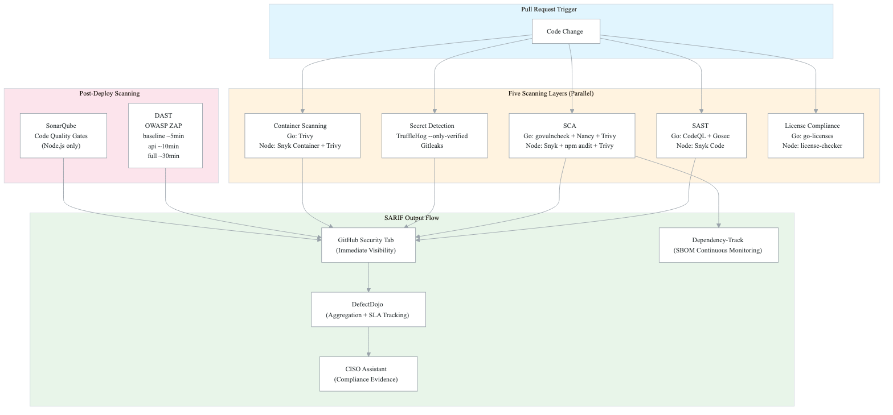
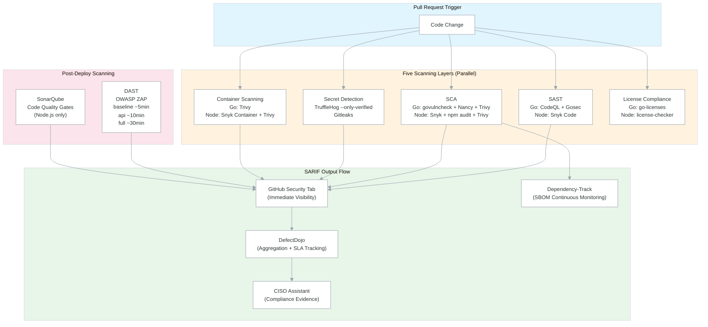
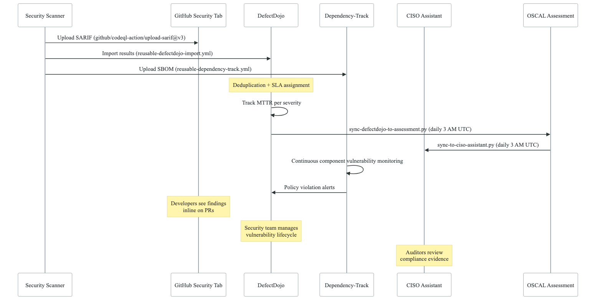
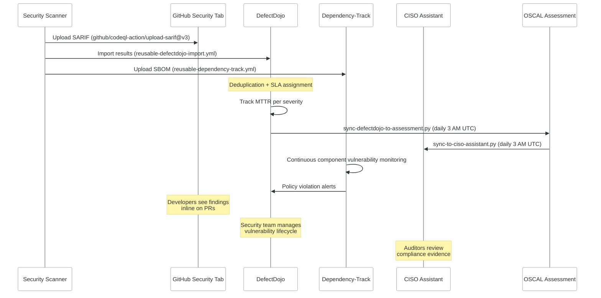
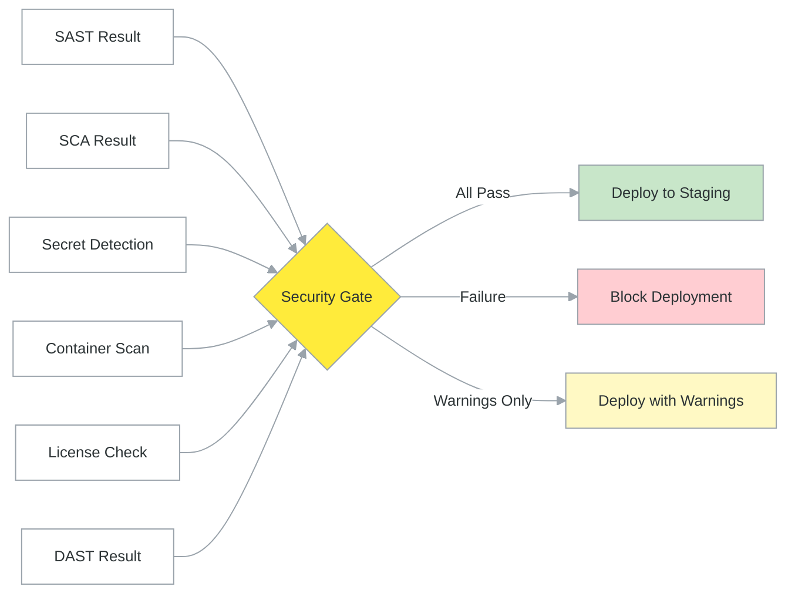

# Security Pipeline Architecture

## Overview

The security pipeline implements a **shift-left DevSecOps** strategy with five scanning layers applied at PR time. All scanners emit SARIF format for unified reporting through GitHub Security tab, DefectDojo (centralized vulnerability aggregation), and Dependency-Track (SBOM-based continuous monitoring). For the complete SARIF data flow architecture, see [cross-cutting/sarif-integration.md](../cross-cutting/sarif-integration.md).

This architecture achieves **SEC540 compliance** and **SLSA Level 3 supply chain security** using entirely open-source tooling at $0/month security tool cost.

## High-Level Security Scanning Flow

<!-- figure: generated from the Mermaid below by _shared/diagrams/embed-figures.py — do not edit the image -->

Diagram source (Mermaid)

## SARIF Data Flow (Scanner → GitHub → DefectDojo → CISO Assistant)

<!-- figure: generated from the Mermaid below by _shared/diagrams/embed-figures.py — do not edit the image -->

Diagram source (Mermaid)

## Five Scanning Layers

### Layer 1: SAST (Static Application Security Testing)

| Language | Tool | Configuration |
|----------|------|---------------|
| Go | CodeQL | `security-extended,security-and-quality` query suites |
| Go | Gosec v2.18.2 | SARIF output, all rules enabled |
| Node.js | Snyk Code | `--severity-threshold=high`, SARIF output |

**Source workflows**: `reusable-go-security.yml` (Go), `reusable-security.yml` (Node.js)

### Layer 2: SCA (Software Composition Analysis)

| Language | Tool | Purpose |
|----------|------|---------|
| Go | govulncheck | Go advisory database (call-graph analysis) |
| Go | Nancy (Sonatype OSS Index) | Transitive dependency vulnerabilities |
| Go | Trivy fs | Broad vulnerability database |
| Node.js | Snyk | Commercial vulnerability database |
| Node.js | npm audit | npm advisory database |
| Node.js | Trivy fs | Broad vulnerability database |

**Rationale for NOT using Snyk/SonarQube for Go**: govulncheck + Nancy + CodeQL + Gosec provide equal or better coverage at $0 cost. govulncheck's call-graph analysis is more precise than pattern matching.

### Layer 3: Secret Detection

| Tool | Mode | Notes |
|------|------|-------|
| TruffleHog | `--only-verified` | Only flags secrets confirmed active against provider APIs |
| Gitleaks v8.18.1 | Full history scan | Pattern-based detection, catches more but with higher false positive rate |

**Source workflow**: Both tools run in `reusable-go-security.yml` and `reusable-security.yml`

### Layer 4: Container Scanning

| Language | Tool | Severity |
|----------|------|----------|
| Go | Trivy | CRITICAL,HIGH |
| Node.js | Snyk Container + Trivy | CRITICAL,HIGH |

Container scanning runs against built images after the build phase, before deployment.

### Layer 5: License Compliance

| Language | Tool | Blocked Licenses |
|----------|------|-----------------|
| Go | go-licenses | GPL-3.0, AGPL, SSPL, CC-BY-NC |
| Node.js | license-checker | GPL-3.0, AGPL, SSPL, CC-BY-NC, UNLICENSED |

## DAST (Dynamic Application Security Testing)

OWASP ZAP runs against the staging environment after deployment:

| Scan Type | Duration | Use Case |
|-----------|----------|----------|
| Baseline | ~5 min | Quick passive scan, every deployment |
| API | ~10 min | OpenAPI-aware scan for API services |
| Full | ~30 min | Comprehensive active scan, scheduled |

**Source workflow**: `reusable-dast-scan.yml`

DAST is triggered via port-forward to the staging K8s service, avoiding the need for public exposure.

## Vulnerability Management

> For the full integration architecture of DefectDojo + Dependency-Track as central vulnerability sinks, see [cross-cutting/vulnerability-sinks.md](../cross-cutting/vulnerability-sinks.md).

### DefectDojo Integration

DefectDojo serves as the central vulnerability aggregation platform:

- **Import**: `reusable-defectdojo-import.yml` pushes scan results from CI/CD
- **Deduplication**: Automatic deduplication across scanner outputs
- **SLA Management**: Vulnerability SLA enforcement via `reusable-vulnerability-sla.yml`
- **MTTR Tracking**: Mean Time To Remediation metrics per severity level
- **Port**: 30080, namespace `defectdojo`
- **Resources**: 1.05 CPU / 2.3 GB memory / 10 GB storage

### Dependency-Track Integration

Dependency-Track provides SBOM-based continuous vulnerability monitoring:

- **Import**: `reusable-dependency-track.yml` uploads CycloneDX SBOMs
- **Continuous Analysis**: Re-evaluates components as new CVEs are published
- **Policy Evaluation**: Enforces license and vulnerability policies
- **Port**: 30082, namespace `dependency-track`

### SonarQube (Node.js Only)

SonarQube provides code quality gates for Node.js services:

- **Source workflow**: `reusable-sonarqube.yml`
- **Configuration**: `sonar-project.properties` per service
- **Quality Gates**: Coverage, duplication, maintainability rating, security hotspots

## Threat Modeling

Automated threat modeling using Threagile:

- **Model**: `threagile-model.yaml` — defines system architecture, trust boundaries, data flows, and assets
- **Workflow**: `threagile-analysis.yml` — runs Threagile analysis on model changes and on schedule
- **Documentation**: `THREAT-MODEL.md` — human-readable threat model summary, `THREAT-LIBRARY.md` — threat catalog

**Source files**:
- `northwind-infrastructure/docs/security/threagile-model.yaml`
- `northwind-infrastructure/.github/workflows/threagile-analysis.yml`
- `northwind-infrastructure/docs/security/THREAT-MODEL.md`
- `northwind-infrastructure/docs/security/THREAT-LIBRARY.md`

## Standalone vs Composite Pattern

Security workflows follow the same standalone-vs-composite architecture as CI/CD:

**Standalone workflows** (single concern):
- `reusable-go-security.yml` — Go-specific security scanning
- `reusable-security.yml` — Node.js-specific security scanning (named `reusable-security.yml` in source, template renamed to `reusable-node-security.yml` for clarity)
- `reusable-terraform-security.yml` — IaC security scanning
- `reusable-dast-scan.yml` — OWASP ZAP DAST
- `reusable-sonarqube.yml` — SonarQube quality gates
- `reusable-defectdojo-import.yml` — DefectDojo result import
- `reusable-dependency-track.yml` — Dependency-Track SBOM upload
- `reusable-vulnerability-sla.yml` — Vulnerability SLA enforcement

**Composite workflow** (orchestration):
- `reusable-security-with-defectdojo.yml` — runs security scanning + auto-imports results into DefectDojo

## Security Gate

The security gate aggregates all scan results and makes a pass/fail decision:

<!-- figure: generated from the Mermaid below by _shared/diagrams/embed-figures.py — do not edit the image -->

Diagram source (Mermaid)

**Gate behavior**:
- **Staging**: Warnings allowed (deploy continues, issues flagged for review)
- **Production**: Stricter thresholds (medium+ blocking for Snyk, CRITICAL blocking for Trivy)
- **Secret detection**: Verified secrets (TruffleHog `--only-verified`) always block

## Key Reference Files

| File | Source Path |
|------|------------|
| Go security workflow | `northwind-workflows/.github/workflows/reusable-go-security.yml` |
| Node.js security workflow | `northwind-workflows/.github/workflows/reusable-security.yml` |
| Terraform security workflow | `northwind-workflows/.github/workflows/reusable-terraform-security.yml` |
| DAST scan workflow | `northwind-workflows/.github/workflows/reusable-dast-scan.yml` |
| SonarQube workflow | `northwind-workflows/.github/workflows/reusable-sonarqube.yml` |
| DefectDojo import workflow | `northwind-workflows/.github/workflows/reusable-defectdojo-import.yml` |
| Dependency-Track workflow | `northwind-workflows/.github/workflows/reusable-dependency-track.yml` |
| Vulnerability SLA workflow | `northwind-workflows/.github/workflows/reusable-vulnerability-sla.yml` |
| Security + DefectDojo composite | `northwind-workflows/.github/workflows/reusable-security-with-defectdojo.yml` |
| Staging security full composite | `northwind-workflows/.github/workflows/reusable-staging-security-full.yml` |
| Threagile model | `northwind-infrastructure/docs/security/threagile-model.yaml` |
| Threagile analysis workflow | `northwind-infrastructure/.github/workflows/threagile-analysis.yml` |
| Threat model documentation | `northwind-infrastructure/docs/security/THREAT-MODEL.md` |
| Threat library | `northwind-infrastructure/docs/security/THREAT-LIBRARY.md` |
| Security tooling reference | `northwind-infrastructure/docs/DEVSECOPS-TOOLING.md` |
| Enterprise DevSecOps architecture | `northwind-infrastructure/docs/ENTERPRISE-DEVSECOPS.md` |

<!-- feynman-check -->

---

## Feynman check

Close the file. Blank page, no notes. Explain each of these to a competent engineer who has never
used this tool — **under five minutes, no jargon you can't define on the spot:**

- High-Level Security Scanning Flow
- SARIF Data Flow (Scanner → GitHub → DefectDojo → CISO Assistant)
- Five Scanning Layers
- DAST (Dynamic Application Security Testing)

**The gap is not what you forgot. It is where you used a word instead of a mechanism.**

| | |
|---|---|
| ✗ | *"We scan for vulnerabilities in the pipeline."* |
| ✓ | *"SAST reads source without running it, SCA resolves the dependency tree against an advisory database, and image scanning compares installed package versions to that same database. All three report what was known at build time — which is why the registry is re-scanned: the image does not change, the database does."* |

**Trace it:** A CVE published today against your base image → a blocked deploy. Name every component between the advisory and the refused `apply`.

Stop at the first component you cannot name. Reopen this file and read **only** that.

**Go deeper — only once the gap has a name:** the [SLSA threat model](https://slsa.dev/spec/v1.2/threats) — it names every point at which a build can be subverted, and most teams defend three of them.
Full list per domain: [`SOURCES.md`](../../SOURCES.md#devsecops)

→ Protocol, the three levels of knowing, and worked examples: [`MASTERY.md`](../../MASTERY.md)

<!-- /feynman-check -->
