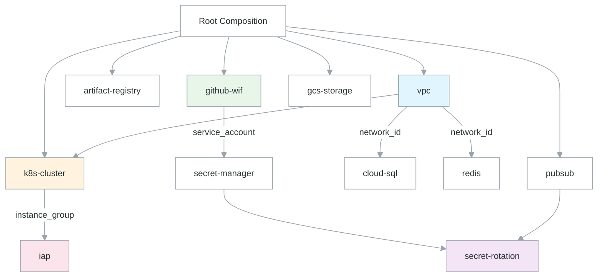
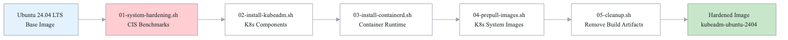

# Domain 3: Infrastructure as Code -- Architecture

## Overview

This domain documents the Infrastructure as Code (IaC) architecture for a production-grade platform using Terraform module composition, Packer hardened images, and OPA policy enforcement. The design targets a cost-optimized kubeadm-based Kubernetes cluster on Google Cloud Platform.

**Source Repository:** `northwind-cleaning/northwind-infrastructure/`

---

## Terraform Module Composition

The infrastructure follows a **layered module composition** pattern where environment-specific root modules (`environments/staging/main.tf`, `environments/production/main.tf`) compose reusable child modules from `modules/`.

### Root Composition Pattern

```
environments/
  staging/
    main.tf          # Composes modules for staging
    variables.tf     # Staging-specific defaults
  production/
    main.tf          # Composes modules for production
    variables.tf     # Production-specific defaults
modules/
  vpc/               # Network foundation
  k8s-cluster/       # [KUBEADM-SPECIFIC] Kubernetes cluster on GCE VMs
  artifact-registry/ # [GCP-SPECIFIC] Container image registry
  cloud-sql/         # [GCP-SPECIFIC] Managed PostgreSQL
  secret-manager/    # [GCP-SPECIFIC] Secrets management
  gcs-storage/       # [GCP-SPECIFIC] Object storage with lifecycle policies
  pubsub/            # [GCP-SPECIFIC] Event messaging
  github-wif/        # [GCP-SPECIFIC] GitHub Workload Identity Federation
  github-repository/ # GitHub branch protection (SLSA L4)
  iap/               # [GCP-SPECIFIC] Identity-Aware Proxy (zero-trust)
  redis/             # [GCP-SPECIFIC] Managed Redis (Memorystore)
  secret-rotation/   # [GCP-SPECIFIC] Automated secret rotation via Cloud Functions
```

### State Management

- **Backend:** [GCP-SPECIFIC] GCS bucket (`{{TERRAFORM_STATE_BUCKET}}`)
- **State Isolation:** Each environment uses a separate prefix (`infrastructure/staging`, `infrastructure/production`)
- **Locking:** GCS-native state locking (no DynamoDB equivalent needed)
- **Provider Pinning:** Exact version pinning (`= 5.10.0`) for reproducibility

```hcl
# Source: environments/staging/main.tf
terraform {
  backend "gcs" {
    bucket = "{{TERRAFORM_STATE_BUCKET}}"
    prefix = "infrastructure/staging"
  }
}
```

---

## Module Dependency Graph

<!-- figure: generated from the Mermaid below by _shared/diagrams/embed-figures.py — do not edit the image -->


<details>
<summary>Diagram source (Mermaid)</summary>



</details>

**Key Dependencies:**
- `k8s-cluster` depends on `vpc` for network_id, subnet_id, and network_name
- `cloud-sql` depends on `vpc` for private VPC connection (service networking)
- `redis` depends on `vpc` for authorized_network
- `iap` depends on `k8s-cluster` for instance_group
- `secret-rotation` depends on `pubsub` for notification topics and `secret-manager` for secret IDs

---

## Packer Hardened Images Pipeline

The platform uses Packer to build hardened Kubernetes node images. These images are pre-configured with kubeadm, containerd, and CIS hardening.

**Source:** `northwind-cleaning/northwind-infrastructure/packer/`

### Packer Pipeline

```mermaid
%%{init: {'theme':'base','themeVariables':{'fontFamily':'Helvetica, Arial, sans-serif','fontSize':'13px','primaryColor':'#ffffff','primaryTextColor':'#2d3436','primaryBorderColor':'#9aa3ab','lineColor':'#9aa3ab','textColor':'#2d3436','clusterBkg':'#fbfcfd','clusterBorder':'#d4dae0','edgeLabelBackground':'#ffffff','tertiaryColor':'#eef4fb'},'flowchart':{'curve':'basis','padding':14,'nodeSpacing':42,'rankSpacing':58}}}%%
flowchart LR
    A[Ubuntu 24.04 LTS<br/>Base Image] --> B[01-system-hardening.sh<br/>CIS Benchmarks]
    B --> C[02-install-kubeadm.sh<br/>K8s Components]
    C --> D[03-install-containerd.sh<br/>Container Runtime]
    D --> E[04-prepull-images.sh<br/>K8s System Images]
    E --> F[05-cleanup.sh<br/>Remove Build Artifacts]
    F --> G[Hardened Image<br/>kubeadm-ubuntu-2404]

    style A fill:#e3f2fd
    style G fill:#c8e6c9
    style B fill:#ffcdd2
```

<!-- figure: generated from the Mermaid below by _shared/diagrams/embed-figures.py — do not edit the image -->


<details>
<summary>Diagram source (Mermaid)</summary>



</details>

### Image Build Steps

| Step | Script | Purpose |
|------|--------|---------|
| 1 | `01-system-hardening.sh` | CIS benchmark hardening, sysctl tuning, audit rules |
| 2 | `02-install-kubeadm.sh` | **[KUBEADM-SPECIFIC]** Install kubeadm, kubelet, kubectl |
| 3 | `03-install-containerd.sh` | Install containerd runtime with proper cgroup config |
| 4 | `04-prepull-images.sh` | **[KUBEADM-SPECIFIC]** Pre-pull K8s system images to speed init |
| 5 | `05-cleanup.sh` | Remove temporary files, apt cache, build artifacts |

### Image Configuration

- **[GCP-SPECIFIC]** Source: `googlecompute` builder
- **Base OS:** Ubuntu 24.04 LTS (ubuntu-os-cloud)
- **Image Family:** `kubeadm-ubuntu-2404` (auto-resolves to latest)
- **Shielded VM:** Secure boot, vTPM, integrity monitoring enabled
- **[GCP-SPECIFIC]** Storage: pd-ssd during build, images stored in project

---

## Kubernetes Cluster Architecture

**[KUBEADM-SPECIFIC]** The cluster uses kubeadm on GCE VMs rather than GKE for cost optimization.

### Node Layout

| Node | Role | Machine Type | Purpose |
|------|------|-------------|---------|
| Control Plane | `k8s-control` | e2-custom-4-16384 (prod) | K8s control + enterprise + data workloads |
| Worker | `k8s-worker` | e2-custom-4-20480 (prod) | Application workloads |

### Networking

- **[GCP-SPECIFIC]** VPC with custom subnet, private Google access
- **Pod CIDR:** `10.244.0.0/16` (Flannel/Calico)
- **Service CIDR:** `10.96.0.0/12`
- **Load Balancer:** [GCP-SPECIFIC] Network LB with target pool (single forwarding rule)
- **[GCP-SPECIFIC]** IAP tunnel for SSH access (no public SSH)
- **[GCP-SPECIFIC]** Firewall rules for K8s API, ingress, health checks, NodePort

---

## Security Architecture

### Identity and Access

> For the complete OIDC/Workload Identity Federation trust chain (GitHub Actions → GCP/AWS/Azure), see [cross-cutting/oidc-workload-identity.md](../cross-cutting/oidc-workload-identity.md).

- **[GCP-SPECIFIC]** GitHub Actions authenticates via Workload Identity Federation (no static keys)
- **[GCP-SPECIFIC]** Per-node service accounts with least-privilege IAM roles
- **[GCP-SPECIFIC]** Identity-Aware Proxy for admin interface access
- **[GCP-SPECIFIC]** VPC Service Controls for sensitive data perimeters

### Policy Enforcement

- **OPA/Conftest:** Terraform plan validation against security policies
- **tfsec:** Static analysis for Terraform misconfigurations
- **Trivy:** IaC scanning for known vulnerabilities
- **Checkov:** GCP-specific security policy checks
- **tflint:** Terraform linting and best practices

### Multi-Cloud Portability

> Many modules in this domain carry `[GCP-SPECIFIC]` markers and have AWS/Azure variants under `modules/{name}/{aws,azure}`. For cloud-specific service equivalents when adapting these modules, see [Cloud Equivalence Mapping](../cross-cutting/cloud-equivalence-mapping.md).

### Secret Management

> For the unified secret management architecture spanning CI/CD, IaC, and Kubernetes, see [cross-cutting/secret-management.md](../cross-cutting/secret-management.md).

- **[GCP-SPECIFIC]** Secret Manager for all secrets with automatic rotation
- **[GCP-SPECIFIC]** Cloud Functions for rotation logic
- **[GCP-SPECIFIC]** Pub/Sub notifications on rotation events
- **[GCP-SPECIFIC]** Cloud Monitoring alerts on rotation failures

---

## Source File Reference

| Component | Source Path |
|-----------|------------|
| Root composition | `northwind-infrastructure/modules/main.tf` |
| VPC module | `northwind-infrastructure/modules/vpc/` |
| K8s cluster module | `northwind-infrastructure/modules/k8s-cluster/` |
| Artifact registry | `northwind-infrastructure/modules/artifact-registry/` |
| Cloud SQL module | `northwind-infrastructure/modules/cloud-sql/` |
| Secret manager | `northwind-infrastructure/modules/secret-manager/` |
| GCS storage | `northwind-infrastructure/modules/gcs-storage/` |
| Pub/Sub module | `northwind-infrastructure/modules/pubsub/` |
| GitHub WIF | `northwind-infrastructure/modules/github-wif/` |
| GitHub repos | `northwind-infrastructure/modules/github-repository/` |
| IAP module | `northwind-infrastructure/modules/iap/` |
| Redis module | `northwind-infrastructure/modules/redis/` |
| Secret rotation | `northwind-infrastructure/modules/secret-rotation/` |
| Packer template | `northwind-infrastructure/packer/kubeadm-node.pkr.hcl` |
| OPA policies | `northwind-infrastructure/policies/terraform/security.rego` |
| K8s policies | `northwind-infrastructure/policies/kubernetes/` |
| Staging env | `northwind-infrastructure/environments/staging/` |
| Production env | `northwind-infrastructure/environments/production/` |
| Workflows | `northwind-infrastructure/.github/workflows/` |

<!-- feynman-check -->

---

## Feynman check

Close the file. Blank page, no notes. Explain each of these to a competent engineer who has never
used this tool — **under five minutes, no jargon you can't define on the spot:**

- Terraform Module Composition
- Module Dependency Graph
- Packer Hardened Images Pipeline
- Kubernetes Cluster Architecture

**The gap is not what you forgot. It is where you used a word instead of a mechanism.**

| | |
|---|---|
| ✗ | *"We scan for vulnerabilities in the pipeline."* |
| ✓ | *"SAST reads source without running it, SCA resolves the dependency tree against an advisory database, and image scanning compares installed package versions to that same database. All three report what was known at build time — which is why the registry is re-scanned: the image does not change, the database does."* |

**Trace it:** A CVE published today against your base image → a blocked deploy. Name every component between the advisory and the refused `apply`.

Stop at the first component you cannot name. Reopen this file and read **only** that.

**Go deeper — only once the gap has a name:** the [SLSA threat model](https://slsa.dev/spec/v1.2/threats) — it names every point at which a build can be subverted, and most teams defend three of them.
Full list per domain: [`SOURCES.md`](../../SOURCES.md#devsecops)

→ Protocol, the three levels of knowing, and worked examples: [`MASTERY.md`](../../MASTERY.md)

<!-- /feynman-check -->
