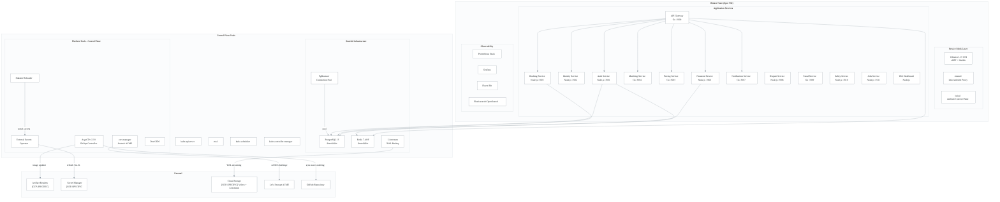
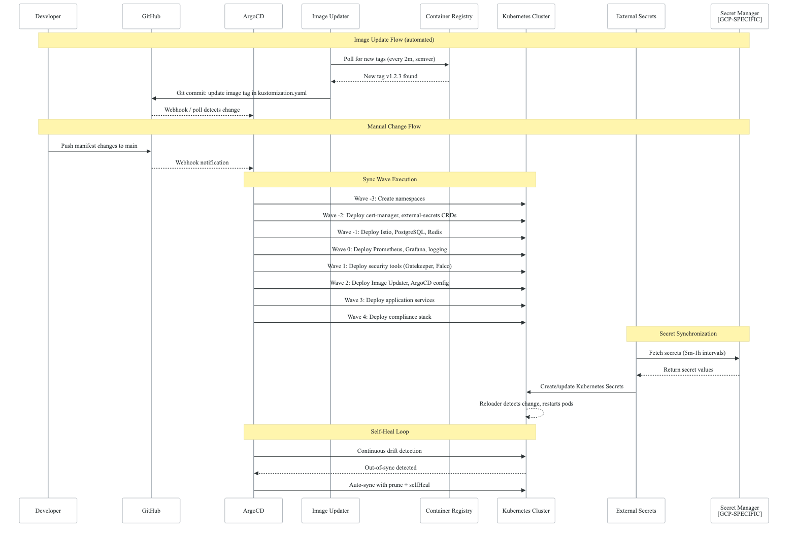
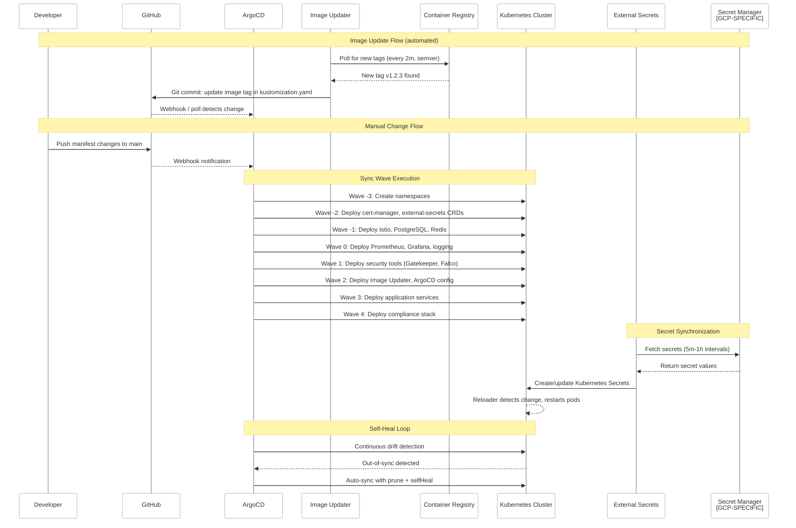

# Domain 4: Kubernetes Platform Architecture

> Reference implementation derived from `northwind-infrastructure/k8s-manifests/`

## Table of Contents

- [Cluster Architecture](#cluster-architecture)
- [Component Topology](#component-topology)
- [Networking: Cilium CNI + Istio Ambient](#networking-cilium-cni--istio-ambient)
- [GitOps: ArgoCD with Sync-Wave Ordering](#gitops-argocd-with-sync-wave-ordering)
- [ArgoCD Image Updater](#argocd-image-updater)
- [Secrets Management: External Secrets Operator](#secrets-management-external-secrets-operator)
- [Automatic Pod Restart: Stakater Reloader](#automatic-pod-restart-stakater-reloader)
- [TLS: cert-manager](#tls-cert-manager)
- [Authentication: Dex OIDC](#authentication-dex-oidc)
- [Data Layer: PostgreSQL 15 + PgBouncer + Litestream](#data-layer-postgresql-15--pgbouncer--litestream)
- [Caching: Redis 7 (AOF)](#caching-redis-7-aof)
- [Backup: Velero + Litestream](#backup-velero--litestream)
- [GitOps Deploy Flow](#gitops-deploy-flow)
- [Source Reference](#source-reference)

---

## Cluster Architecture

**[KUBEADM-SPECIFIC]** The platform runs on a self-managed kubeadm cluster provisioned on GCE VMs (not GKE). This is a deliberate architecture choice that trades managed-service convenience for full control over the Kubernetes control plane, CNI selection, and cost optimization.

### Node Layout

| Node Role | VM Type | Purpose | Scheduling Strategy |
|---|---|---|---|
| Control Plane | `e2-standard-4` | API server, etcd, scheduler, controller-manager | Runs stateful infra (PostgreSQL, Redis, ArgoCD) via tolerations |
| Worker (App) | `e2-standard-4` (Spot) | Application workloads | `node-type: app` label; preemptible for cost savings |

**[KUBEADM-SPECIFIC]** Key design decisions:
- **Control plane tolerations**: Critical stateful workloads (PostgreSQL, Redis, ArgoCD, cert-manager, external-secrets) are scheduled on the control plane node to survive Spot VM preemption on worker nodes.
- **Local-path-provisioner**: Provides dynamic PersistentVolume provisioning on bare-metal / self-managed clusters (deployed at sync wave 0).
- **CoreDNS affinity patch**: CoreDNS is pinned to the control plane to ensure DNS resolution works even when worker nodes are preempted.

### Kubernetes Version

- Kubernetes **1.30.x** via kubeadm
- Cilium **v1.15** as CNI (replaces kube-proxy with eBPF)
- Pod Security Standards enforced at namespace level (`restricted` for app namespaces, `baseline` for system namespaces)

---

## Component Topology

```mermaid
%%{init: {'theme':'base','themeVariables':{'fontFamily':'Helvetica, Arial, sans-serif','fontSize':'13px','primaryColor':'#ffffff','primaryTextColor':'#2d3436','primaryBorderColor':'#9aa3ab','lineColor':'#9aa3ab','textColor':'#2d3436','clusterBkg':'#fbfcfd','clusterBorder':'#d4dae0','edgeLabelBackground':'#ffffff','tertiaryColor':'#eef4fb'},'flowchart':{'curve':'basis','padding':14,'nodeSpacing':42,'rankSpacing':58}}}%%
graph TB
    subgraph "Control Plane Node"
        API[kube-apiserver]
        ETCD[etcd]
        SCHED[kube-scheduler]
        CM[kube-controller-manager]

        subgraph "Stateful Infrastructure"
            PG[PostgreSQL 15<br/>StatefulSet]
            PGB[PgBouncer<br/>Connection Pool]
            RD[Redis 7 AOF<br/>StatefulSet]
            LS[Litestream<br/>WAL Backup]
        end

        subgraph "Platform Tools - Control Plane"
            ARGO[ArgoCD v2.10<br/>GitOps Controller]
            CERTM[cert-manager<br/>Jetstack ACME]
            ESO[External Secrets<br/>Operator]
            RELOAD[Stakater Reloader]
            DEX_SVC[Dex OIDC]
        end
    end

    subgraph "Worker Node (Spot VM)"
        subgraph "Service Mesh Layer"
            CILIUM[Cilium v1.15 CNI<br/>eBPF + Hubble]
            ZTUNNEL[ztunnel<br/>Istio Ambient Proxy]
            ISTIOD[istiod<br/>Ambient Control Plane]
        end

        subgraph "Application Services"
            GW[API Gateway<br/>Go :3000]
            AUTH[Auth Service<br/>Node.js :3001]
            IDENT[Identity Service<br/>Node.js :3002]
            BOOK[Booking Service<br/>Node.js :3003]
            MATCH[Matching Service<br/>Go :3004]
            PRICE[Pricing Service<br/>Go :3005]
            FIN[Financial Service<br/>Node.js :3006]
            NOTIF[Notification Service<br/>Go :3007]
            DISP[Dispute Service<br/>Node.js :3008]
            FRAUD[Fraud Service<br/>Go :3009]
            SAFE[Safety Service<br/>Node.js :3010]
            JOBS[Jobs Service<br/>Node.js :3011]
            WEB[Web Dashboard<br/>Node.js]
        end

        subgraph "Observability"
            PROM[Prometheus Stack]
            GRAF[Grafana]
            FBIT[Fluent Bit]
            ELASTIC[Elasticsearch/OpenSearch]
        end
    end

    subgraph "External"
        GCR["Artifact Registry<br/>[GCP-SPECIFIC]"]
        GSM["Secret Manager<br/>[GCP-SPECIFIC]"]
        GCS["Cloud Storage<br/>[GCP-SPECIFIC] Velero + Litestream"]
        ACME[Let's Encrypt ACME]
        GITHUB[GitHub Repository]
    end

    ARGO -->|sync-wave ordering| GITHUB
    ARGO -->|image updater| GCR
    ESO -->|refresh 5m-1h| GSM
    LS -->|WAL streaming| GCS
    CERTM -->|ACME challenge| ACME
    PGB -->|pool| PG
    RELOAD -->|watch secrets| ESO

    GW --> AUTH
    GW --> IDENT
    GW --> BOOK
    GW --> MATCH
    GW --> PRICE
    GW --> FIN
    GW --> NOTIF

    AUTH --> PG
    BOOK --> PG
    FIN --> PG
    AUTH --> RD
    GW --> RD
```

<!-- figure: generated from the Mermaid below by _shared/diagrams/embed-figures.py — do not edit the image -->


<details>
<summary>Diagram source (Mermaid)</summary>



</details>

---

## Networking: Cilium CNI + Istio Ambient

### Cilium v1.15 with eBPF

**[KUBEADM-SPECIFIC]** Cilium is deployed as the CNI plugin during kubeadm init, replacing kube-proxy entirely with eBPF-based routing.

- **eBPF dataplane**: Kernel-level packet processing bypasses iptables for lower latency
- **Hubble**: Observability layer providing real-time network flow visibility
- **Network Policies**: L3/L4/L7 enforcement via CiliumNetworkPolicy CRDs
- **kube-proxy replacement**: `kubeProxyReplacement: strict` eliminates iptables overhead

### Istio Ambient Mode

Istio is deployed in **ambient mode** (sidecar-less), which provides mTLS and traffic management without per-pod sidecar injection:

| Component | Purpose | Resource Budget |
|---|---|---|
| `istio-base` | CRDs and base resources | Minimal |
| `istiod` | Control plane (ambient profile, `PILOT_ENABLE_AMBIENT: true`) | 256Mi-512Mi / 100m-500m |
| `istio-cni` | CNI plugin integration | DaemonSet |
| `ztunnel` | Per-node transparent proxy (replaces sidecars) | 128Mi-256Mi / 50m-200m |
| `istio-ingress` | Gateway (NodePort 30080/30443) | 128Mi-256Mi / 50m-200m |

**mTLS enforcement** is strict mesh-wide via PeerAuthentication:

```yaml
# Source: k8s-manifests/infrastructure/istio/mtls-strict.yaml
apiVersion: security.istio.io/v1beta1
kind: PeerAuthentication
metadata:
  name: default
  namespace: istio-system
spec:
  mtls:
    mode: STRICT
```

**Traffic management features**:
- Per-service AuthorizationPolicy with principal-based access control
- DestinationRule with connection pooling and circuit breaker (outlierDetection)
- ServiceEntry for controlled egress to external APIs (Stripe, SendGrid)
- RequestAuthentication for JWT validation at the API Gateway
- Gateway API (v1) for HTTP/HTTPS routing

**Namespace enrollment**: App namespaces opt in to ambient mode via label:
```yaml
metadata:
  labels:
    istio.io/dataplane-mode: ambient
```

Source: `k8s-manifests/infrastructure/istio/`

---

## GitOps: ArgoCD with Sync-Wave Ordering

ArgoCD implements the **App-of-Apps** pattern where a single root Application manages all child Applications. Sync waves ensure correct deployment ordering:

### Sync Wave Order

| Wave | Category | Components | Rationale |
|---|---|---|---|
| **-3** | Namespaces | All namespace definitions | Must exist before any resources |
| **-2** | CRD Providers | cert-manager, external-secrets | CRDs must be registered before dependents |
| **-1** | Core Infrastructure | Istio, PostgreSQL, Redis, CoreDNS patch | Databases and networking before apps |
| **0** | Storage + Observability | local-path-provisioner, Prometheus, Grafana, Fluent Bit, Elastic | PV provisioning, monitoring stack |
| **1** | Security Tools | Gatekeeper, Falco, KubeArmor, Kyverno | Policy enforcement before app deploy |
| **2** | GitOps Tooling | ArgoCD Image Updater, ArgoCD self-config | Image automation before services |
| **3** | Application Services | All microservices (Go + Node.js) via ApplicationSets | Business logic |
| **4** | Compliance | Compliance stack, DevSecOps tools | Optional post-deployment |

### ArgoCD Configuration

```yaml
# Source: k8s-manifests/bootstrap/argocd-config.yaml
argocd-cm:
  statusbadge.enabled: "true"
  application.resourceTrackingMethod: annotation
  kustomize.buildOptions: --enable-helm
  resource.exclusions: |
    - apiGroups: [cilium.io]
      kinds: [CiliumIdentity]

argocd-rbac-cm:
  policy.default: role:readonly
  policy.csv: |
    g, admins, role:admin
    p, role:developer, applications, get, */*, allow
    p, role:developer, applications, sync, */*, allow
    g, developers, role:developer
```

### AppProject Isolation

Three AppProjects provide RBAC boundaries:

| Project | Scope | Allowed Destinations |
|---|---|---|
| `bootstrap` | Initial infrastructure tooling | All namespaces, all cluster resources |
| `platform` | Platform infrastructure tools | All namespaces, all cluster resources |
| `applications` | Application services | `{{APP_NAMESPACE}}`, `{{APP_NAMESPACE}}-system`, `argocd` namespaces |

### ApplicationSets

Services are deployed via matrix-generator ApplicationSets that combine environment x service:
- `{{APP_NAME}}-gateway-services` (api-gateway, web-dashboard)
- `{{APP_NAME}}-core-services` (matching, pricing, auth, identity, booking, safety, jobs)
- `{{APP_NAME}}-financial-services` (financial, fraud, dispute -- PCI isolation)
- `{{APP_NAME}}-notification-services` (notification)

Each ApplicationSet uses:
- `automated.prune: true` and `selfHeal: true`
- Retry with exponential backoff (5s base, factor 2, max 3m)
- `ApplyOutOfSyncOnly=true` to minimize unnecessary syncs
- Kustomize overlays per environment (`k8s-manifests/overlays/{staging,production}/{service}`)

Source: `k8s-manifests/gitops-apps/`, `k8s-manifests/bootstrap/`

---

## ArgoCD Image Updater

ArgoCD Image Updater automates container image tag updates by polling the container registry and committing tag changes back to Git.

### Configuration

```yaml
# Source: k8s-manifests/infrastructure/argocd-image-updater/config.yaml
applications.conf: |
  check-interval: 2m          # Poll registry every 2 minutes
  max-concurrency: 10         # Up to 10 parallel image checks

registries.conf: |
  registries:
    - name: Google Artifact Registry    # [GCP-SPECIFIC]
      prefix: us-east1-docker.pkg.dev
      api_url: https://us-east1-docker.pkg.dev
      default: true
      # Uses Workload Identity - no explicit credentials

git.commit-message-template: |
  build: update image {{ .AppName }} to {{ .NewImage }}
```

### Update Strategy

- **Semver constraint**: Image tags follow semantic versioning; updater selects the latest matching tag
- **Polling interval**: 2 minutes
- **Write-back method**: Git commit to the infrastructure repository
- **Authentication**: GitHub App token fetched from Secret Manager via ExternalSecret

### Resource Limits

```yaml
resources:
  limits:
    memory: 256Mi
    cpu: 250m
  requests:
    memory: 128Mi
    cpu: 50m
```

Source: `k8s-manifests/infrastructure/argocd-image-updater/`

---

## Secrets Management: External Secrets Operator

> For the unified secret management architecture spanning CI/CD, IaC, and Kubernetes layers, see [cross-cutting/secret-management.md](../cross-cutting/secret-management.md).

> Several components in this domain (Secret Manager, Velero/GCS backups, Artifact Registry, Litestream) carry `[GCP-SPECIFIC]` markers. For equivalent services on AWS and Azure, see [Cloud Equivalence Mapping](../cross-cutting/cloud-equivalence-mapping.md).

External Secrets Operator (ESO) synchronizes secrets from **GCP Secret Manager** [GCP-SPECIFIC] into Kubernetes Secrets.

### ClusterSecretStore

```yaml
# Source: k8s-manifests/infrastructure/external-secrets/cluster-secret-store.yaml
apiVersion: external-secrets.io/v1beta1
kind: ClusterSecretStore
metadata:
  name: gcp-secret-manager
spec:
  provider:
    gcpsm:
      projectID: PROJECT_ID                    # [GCP-SPECIFIC]
      auth:
        workloadIdentity:                      # [GCP-SPECIFIC]
          clusterLocation: us-central1
          clusterName: {{APP_NAME}}-cluster
          serviceAccountRef:
            name: external-secrets
            namespace: external-secrets
```

### Rotation Intervals

| Secret Category | Refresh Interval | Use Case |
|---|---|---|
| Service-to-service tokens | `5m` | High-frequency rotation for internal auth |
| Database credentials | `15m` | Dynamic rotation for DB access |
| Application secrets (JWT, encryption) | `30m` | Moderate rotation |
| Third-party API keys | `1h` | External service credentials |
| General secrets | `1h` | Default refresh |

### Reloader Integration

All ExternalSecret targets include the Stakater Reloader annotation:
```yaml
template:
  metadata:
    annotations:
      reloader.stakater.com/match: "true"
```

This ensures pods are automatically restarted when secrets change.

Source: `k8s-manifests/infrastructure/external-secrets/`

---

## Automatic Pod Restart: Stakater Reloader

Stakater Reloader watches for changes to ConfigMaps and Secrets, and triggers rolling restarts of pods that reference them.

- **Deployment**: Helm chart v1.0.52 in the `external-secrets` namespace
- **Mode**: Global watch, opt-in via annotation (`reloader.stakater.com/match: "true"`)
- **Integration**: Works with External Secrets Operator to achieve true dynamic secret rotation
- **Resources**: 64Mi-128Mi memory, 25m-100m CPU

Source: `k8s-manifests/infrastructure/external-secrets/cluster-secret-store.yaml` (bottom section)

---

## TLS: cert-manager

cert-manager (Jetstack) manages TLS certificates via ACME protocol.

### ClusterIssuers

| Issuer | Purpose | Solver |
|---|---|---|
| `letsencrypt-staging` | Testing certificate issuance | HTTP-01 via Istio ingress |
| `letsencrypt-prod` | Production TLS certificates | HTTP-01 via Istio ingress |
| `selfsigned` | Bootstrap CA creation | Self-signed |
| `{{APP_NAME}}-ca` | Internal service certificates | CA (ECDSA P-256) |

### Deployment

- Helm chart from `charts.jetstack.io`, version v1.14.x
- `installCRDs: true`
- **[KUBEADM-SPECIFIC]** All components (controller, webhook, cainjector) scheduled on control plane with tolerations
- Prometheus ServiceMonitor enabled

Source: `k8s-manifests/infrastructure/cert-manager/`

---

## Authentication: Dex OIDC

Dex provides centralized OIDC authentication for platform tools.

### Static Clients

| Client | Redirect URI | Purpose |
|---|---|---|
| ArgoCD | `https://argocd.{{DOMAIN}}/auth/callback` | GitOps UI SSO |
| Grafana | `https://grafana.{{DOMAIN}}/login/generic_oauth` | Monitoring SSO |
| API | `https://api.{{DOMAIN}}/auth/callback` | Application auth |

### Configuration

- **Connector**: Google OAuth (configurable for GitHub, LDAP)
- **Storage**: Kubernetes CRDs (in-cluster)
- **Token expiry**: ID tokens 24h, refresh tokens 90d unused / 165d absolute
- **Routing**: HTTPRoute via Gateway API through Istio gateway

Source: `k8s-manifests/infrastructure/dex/`

---

## Data Layer: PostgreSQL 15 + PgBouncer + Litestream

### PostgreSQL 15

Deployed as a StatefulSet with a single replica on the control plane node.

**Key configuration** (`postgresql.conf`):
- `max_connections = 100`
- `shared_buffers = 256MB`, `effective_cache_size = 768MB`
- `wal_level = replica`, `archive_mode = on`
- `max_wal_size = 1GB`
- Slow query logging at 1000ms threshold

**Security**:
- `runAsUser: 999`, non-root, read-only rootfs
- scram-sha-256 authentication
- Credentials from ExternalSecret (15m refresh)
- PodDisruptionBudget `minAvailable: 1`

### PgBouncer (Connection Pooling)

- **Pool mode**: `transaction` (connections returned after each transaction)
- **Max client connections**: 200
- **Default pool size**: 20 per database
- **Reserve pool**: 5 connections with 3s timeout
- Listens on port 6432, proxies to PostgreSQL on 5432

### Litestream (WAL Backup)

Litestream streams PostgreSQL WAL files to **GCS** [GCP-SPECIFIC]:
- **Sync interval**: 10 seconds
- **Snapshot interval**: 1 hour
- **Destination**: `gs://${GCS_BACKUP_BUCKET}/postgres/wal`

Source: `k8s-manifests/infrastructure/postgres/`

---

## Caching: Redis 7 (AOF)

Redis 7 Alpine, deployed as a StatefulSet on the control plane node.

**Persistence**:
- **AOF enabled**: `appendonly yes`, `appendfsync everysec`
- **RDB snapshots**: `save 900 1`, `save 300 10`, `save 60 10000`
- **AOF rewrite**: auto at 100% growth, min 64MB

**Resource management**:
- `maxmemory 256mb`, `maxmemory-policy allkeys-lru`
- 5Gi PersistentVolume for data

**Security**:
- `requirepass` from ExternalSecret (15m refresh)
- `runAsUser: 999`, read-only rootfs, drop ALL caps
- PodDisruptionBudget `minAvailable: 1`

Source: `k8s-manifests/infrastructure/redis/`

---

## Backup: Velero + Litestream

### Velero

| Schedule | Frequency | Scope | TTL |
|---|---|---|---|
| `daily-full-backup` | 2:00 AM daily | `{{APP_NAMESPACE}}` + `{{APP_NAMESPACE}}-system`, cluster resources, volume snapshots | 30 days |
| `hourly-app-backup` | Hourly | `{{APP_NAMESPACE}}` namespace, no PVCs/PVs | 7 days |
| `pre-deployment` | Manual / CI trigger | Full namespaces + volumes | 7 days |

**Configuration** [GCP-SPECIFIC]:
- Backup storage: GCS bucket `{{APP_NAME}}-velero-backups`
- Volume snapshots: GCE persistent disk snapshots
- Plugin: `velero-plugin-for-gcp:v1.8.0`
- CSI feature enabled
- Node agent for filesystem-level backups

### Litestream (Complementary)

Provides continuous WAL-level backup for PostgreSQL (see Data Layer section). This is complementary to Velero -- Litestream provides point-in-time recovery for the database, while Velero provides full cluster state backup.

Source: `k8s-manifests/infrastructure/velero/`

---

## GitOps Deploy Flow

<!-- figure: generated from the Mermaid below by _shared/diagrams/embed-figures.py — do not edit the image -->


<details>
<summary>Diagram source (Mermaid)</summary>



</details>

---

## Source Reference

| Component | Source Path |
|---|---|
| Base namespace + labels | `k8s-manifests/base/` |
| Bootstrap (ArgoCD install) | `k8s-manifests/bootstrap/` |
| Go services (api-gateway, matching, pricing, fraud, notification) | `k8s-manifests/apps/go-services/` |
| Node.js services (auth, identity, booking, financial, dispute, safety, jobs) | `k8s-manifests/apps/nodejs-services/` |
| Frontend (web-dashboard) | `k8s-manifests/apps/frontend-services/` |
| Infrastructure (cert-manager, external-secrets, istio, postgres, redis, velero, dex) | `k8s-manifests/infrastructure/` |
| GitOps Applications (ArgoCD Apps, ApplicationSets, sync waves) | `k8s-manifests/gitops-apps/` |
| Kustomize overlays (staging, production) | `k8s-manifests/overlays/` |
| Platform tools (local-path-provisioner, argocd-install, kyverno policies) | `k8s-manifests/platform/` |
| Security stack (gatekeeper, falco, kubearmor, modsecurity, rbac) | `k8s-manifests/security/` |
| GitHub Actions workflows | `.github/workflows/` |

<!-- feynman-check -->

---

## Feynman check

Close the file. Blank page, no notes. Explain each of these to a competent engineer who has never
used this tool — **under five minutes, no jargon you can't define on the spot:**

- Cluster Architecture
- Component Topology
- Networking: Cilium CNI + Istio Ambient
- GitOps: ArgoCD with Sync-Wave Ordering

**The gap is not what you forgot. It is where you used a word instead of a mechanism.**

| | |
|---|---|
| ✗ | *"We scan for vulnerabilities in the pipeline."* |
| ✓ | *"SAST reads source without running it, SCA resolves the dependency tree against an advisory database, and image scanning compares installed package versions to that same database. All three report what was known at build time — which is why the registry is re-scanned: the image does not change, the database does."* |

**Trace it:** A CVE published today against your base image → a blocked deploy. Name every component between the advisory and the refused `apply`.

Stop at the first component you cannot name. Reopen this file and read **only** that.

**Go deeper — only once the gap has a name:** the [SLSA threat model](https://slsa.dev/spec/v1.2/threats) — it names every point at which a build can be subverted, and most teams defend three of them.
Full list per domain: [`SOURCES.md`](../../SOURCES.md#devsecops)

→ Protocol, the three levels of knowing, and worked examples: [`MASTERY.md`](../../MASTERY.md)

<!-- /feynman-check -->
