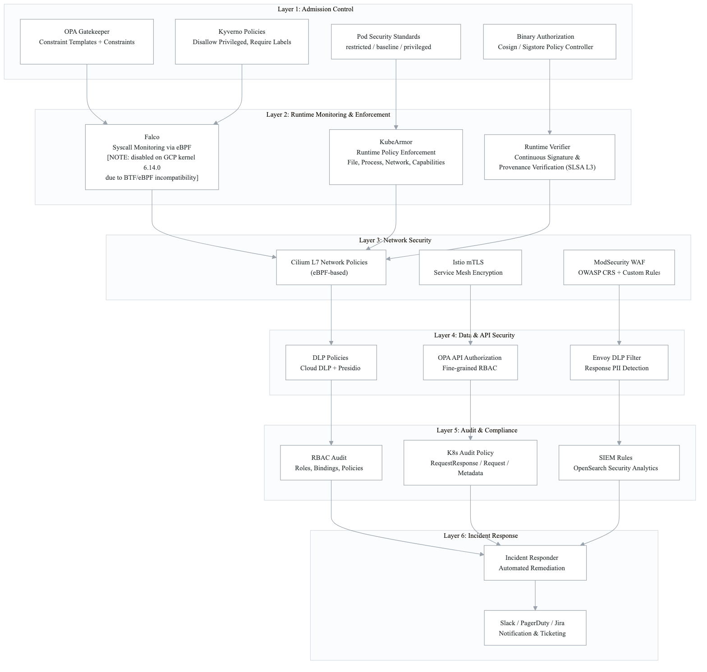
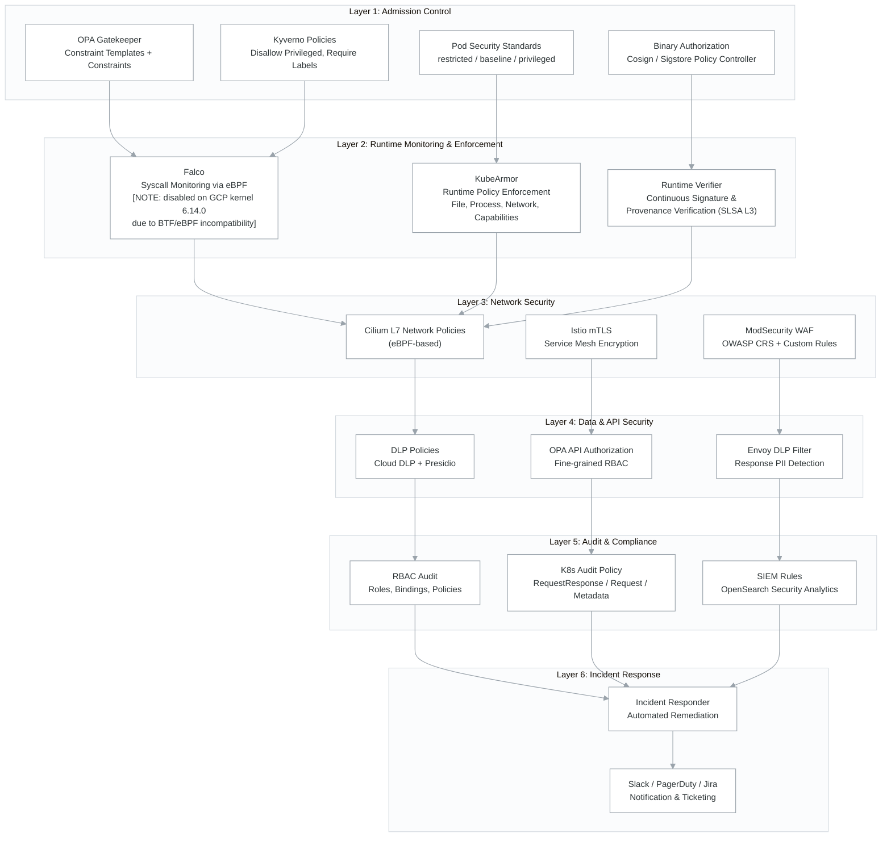
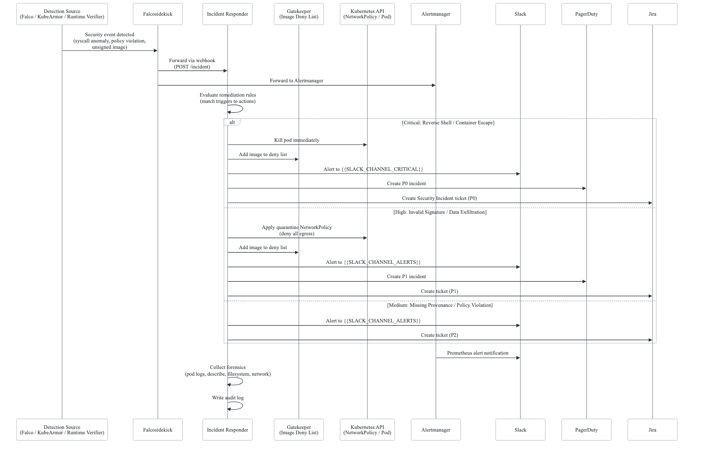
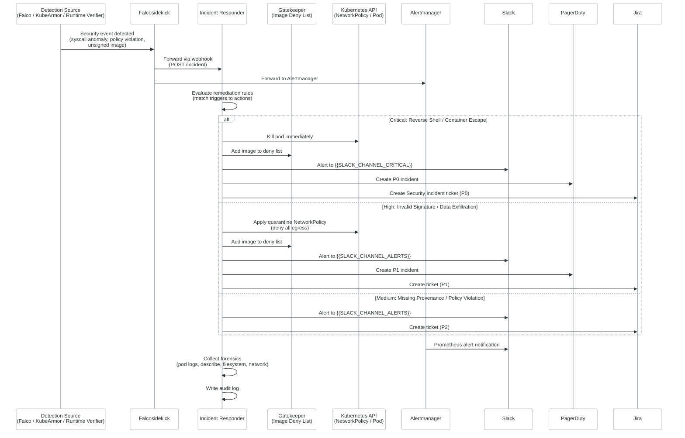

# Domain 5: Runtime Security & Network Security -- Architecture

## Overview

This domain implements a **defense-in-depth** strategy for runtime security and network security
in a Kubernetes environment. Multiple overlapping layers ensure that if one control is bypassed,
others continue to provide protection. The architecture covers syscall monitoring, runtime policy
enforcement, continuous image verification, admission control, network segmentation, WAF
protection, data loss prevention, API authorization, and automated incident response.

**Source reference:** `northwind-infrastructure/k8s-manifests/security/`

---

## Defense-in-Depth Layers

<!-- figure: generated from the Mermaid below by _shared/diagrams/embed-figures.py — do not edit the image -->

Diagram source (Mermaid)

---

## Incident Detection, Response, and Notification Flow

<!-- figure: generated from the Mermaid below by _shared/diagrams/embed-figures.py — do not edit the image -->

Diagram source (Mermaid)

---

## Component Details

### 1. Falco -- Syscall Monitoring

**Source:** `security/falco/falco.yaml`, `security/falco/custom-rules.yaml`, `security/falco/falcosidekick.yaml`

- **Driver:** `modern_ebpf` for kernel-level syscall interception
- **Known limitation:** Disabled on GCP kernel 6.14.0 due to BTF/eBPF incompatibility. The modern eBPF driver requires a kernel with BTF (BPF Type Format) support. GCP nodes running kernel 6.14.0 lack the required BTF data, causing Falco to fail to load its eBPF probe.
- **Custom rules** detect:
  - Application-specific unexpected processes
  - Database connections from unauthorized namespaces
  - Crypto mining processes and mining pool connections
  - Container escape attempts (nsenter, docker.sock)
  - Kubernetes service account token theft
  - K8s API server connections from unexpected namespaces
  - Large outbound data transfers (potential exfiltration)
  - Reverse shells (bash, nc, python, perl, ruby)
  - DNS exfiltration (large DNS queries)
- **Falcosidekick** forwards alerts to:
  - Alertmanager (for Prometheus alerting pipeline)
  - Slack (formatted messages)
  - Incident Responder webhook
  - [GCP-SPECIFIC] Google Cloud Pub/Sub (optional)

### 2. KubeArmor -- Runtime Policy Enforcement

**Source:** `security/kubearmor/kubearmor.yaml`, `security/kubearmor/policies.yaml`

- Enforces security policies at the process, file, network, and capability level
- Policies include:
  - **Block sensitive files:** `/etc/shadow`, `/etc/passwd`, `/etc/sudoers`, `/etc/ssh/`, `/root/`
  - **Block package managers:** apt, apt-get, dpkg, yum, rpm, apk
  - **Block shell execution:** bash, sh, dash, zsh
  - **Restrict network egress:** Block raw sockets, audit ICMP
  - **Restrict capabilities:** Block net_raw, sys_admin, sys_ptrace, sys_module, dac_override, setuid, setgid
  - **Audit file writes:** Monitor writes to `/tmp/` and `/var/`
  - **Block crypto miners:** Cluster-wide policy against xmrig, minerd, miner patterns
  - **Database-specific policies:** PostgreSQL and Redis allow-list policies

### 3. Runtime Verifier -- Continuous Signature/Provenance Verification

**Source:** `security/runtime-verifier/runtime-verifier.yaml`

- Runs as a DaemonSet on every node
- Continuously verifies running container images against:
  - **Cosign signatures** (keyless OIDC via GitHub Actions)
  - **SLSA L3 provenance attestations**
  - **SBOM presence** (SPDX/CycloneDX)
- On verification failure:
  - Sends alert to Alertmanager
  - Notifies Incident Responder
  - Auto-blocks unsigned images via Gatekeeper deny list
- Verification interval: 60 seconds
- Exempt images: third-party (postgres, redis, bitnami, grafana, etc.)

### 4. OPA Gatekeeper -- Admission Control Constraints

**Source:** `security/gatekeeper/`

#### Workload Constraints
| Constraint | Enforcement | Purpose |
|---|---|---|
| K8sRequiredLabels | Enforce | Require `app.kubernetes.io/name` and `version` labels |
| K8sContainerLimits | Enforce | Require CPU and memory limits on all containers |
| K8sBlockPrivilegedContainer | Enforce | Block privileged containers (exemptions for system images) |
| K8sBlockHostNamespace | Enforce | Block hostNetwork, hostPID, hostIPC |
| K8sAllowedRepos | Deny | Restrict images to approved registries |
| K8sBlockNodePort | Enforce | Block NodePort services in production |
| K8sRequireNonRootUser | Deny | Require runAsNonRoot: true |
| K8sBlockLatest | Enforce | Block `:latest` tag and untagged images |

#### Supply Chain Constraints

> Supply chain admission relies on OIDC-based Cosign signatures — see [cross-cutting/oidc-workload-identity.md](../cross-cutting/oidc-workload-identity.md) for the trust chain. Runtime vulnerability findings feed into centralized tracking — see [cross-cutting/vulnerability-sinks.md](../cross-cutting/vulnerability-sinks.md).

| Constraint | Enforcement | Purpose |
|---|---|---|
| K8sRequireImageDigest | Deny | Require `@sha256:` digest references |
| K8sRequireImageSignature | Deny | Require Cosign signature from trusted OIDC issuers |
| K8sSLSALevelRequirement | Deny | Require SLSA L3 provenance attestation |
| K8sRequireSBOM | Deny | Require attached SBOM (SPDX or CycloneDX) |
| K8sImageDenyList | Deny | Block images flagged by incident response |
| K8sTrustedBuilder | Deny | Require images built by trusted CI/CD builders |

#### Binary Authorization
- K8sCosignSignature constraint template with external data provider integration
- Sigstore Policy Controller (ClusterImagePolicy) as alternative
- Verified images tracked in ConfigMap (updated by CI/CD pipeline)

### 5. Kyverno Policies

**Source:** `platform/kyverno-policies/`

| Policy | Action | Scope |
|---|---|---|
| disallow-privileged-containers | Enforce | Block privileged containers and host namespaces |
| require-labels | Audit | Require `app` and `app.kubernetes.io/part-of` labels |
| require-resource-limits | Audit | Require CPU/memory limits and requests |
| restrict-image-registries | Audit | Restrict to approved registries |

### 6. Cilium L7 Network Policies (eBPF)

- eBPF-based network policy enforcement at Layer 3/4 and Layer 7
- Provides identity-based network segmentation (not just IP-based)
- L7 visibility: HTTP, gRPC, Kafka, DNS protocol-aware policies
- Per-service network policies restrict pod-to-pod communication

### 7. Istio mTLS

- Automatic mutual TLS encryption for all service-to-service communication
- PeerAuthentication policies enforce STRICT mTLS mode
- Combined with Envoy filters for DLP and API authorization integration

### 8. ModSecurity WAF

**Source:** `security/modsecurity/`

- OWASP Core Rule Set (CRS) with Paranoia Level 2
- Custom rules for:
  - Content-Type validation, API version header enforcement
  - JSON payload size limits, NoSQL injection detection
  - Rate limiting (100 requests/minute per IP)
  - SQL injection and XSS detection
  - Booking ID format validation (UUID)
  - Financial endpoint authorization
  - Login rate limiting (5 attempts/5 minutes)
  - Response filtering (sensitive data detection, stack trace blocking)
  - Geo-blocking (configurable country allowlist)
- Fluent Bit sidecar exports WAF audit logs to Elasticsearch
- HPA for auto-scaling (2-10 replicas)

### 9. DLP Policies

> This domain uses cloud-specific security services (Cloud DLP, GuardDuty, Security Hub, Defender for Cloud, etc.). For the full cross-cloud security feature matrix and service equivalents, see [Cloud Equivalence Mapping](../cross-cutting/cloud-equivalence-mapping.md).

**Source:** `security/dlp/`

- **[GCP-SPECIFIC] Google Cloud DLP:** Batch scanning of GCS buckets, BigQuery tables
  - Daily GCS scans, weekly BigQuery scans
  - Custom info types for application-specific PII
  - De-identification templates for PII masking
- **Microsoft Presidio:** Runtime PII detection and anonymization
  - Analyzer (detects PII) and Anonymizer (redacts/masks)
  - Custom recognizers for application-specific identifiers
  - Envoy external processing filter for real-time response scanning
- **Envoy DLP Filter:** Istio EnvoyFilter for response body inspection
  - Routes responses through Presidio for PII detection
  - Audit logging of PII detections
  - VirtualService routes with DLP scan headers (strict/standard)

### 10. API Authorization

**Source:** `security/api-authorization/`

- OPA (Open Policy Agent) with Envoy gRPC integration
- Fine-grained RBAC policies:
  - **Public endpoints:** health, ready, login, register, refresh
  - **Customer:** own profile, bookings, services, payment methods
  - **Provider:** own profile, assigned bookings, availability, earnings
  - **Admin:** all users, providers, bookings, financial, analytics, disputes
  - **Super Admin:** system configuration, audit logs
- Rate limiting per role (60-1000 requests/minute)
- Mandatory audit logging for write operations and sensitive endpoints

### 11. Pod Security Standards

**Source:** `security/pod-security-standards/`

| Namespace | Enforce Level | Audit Level | Purpose |
|---|---|---|---|
| Application (production) | restricted | restricted | Strictest for app workloads |
| Staging | baseline | restricted | More permissive for testing |
| Monitoring | baseline | restricted | Prometheus/Grafana needs |
| Logging | baseline | restricted | Elastic Stack needs |
| Security | privileged | baseline | Falco/KubeArmor need host access |
| DLP | restricted | restricted | Presidio runs unprivileged |

- ValidatingAdmissionPolicy (K8s 1.30+) provides additional CEL-based enforcement
- ResourceQuota limits privileged namespace to 20 pods, 4 CPU, 8Gi memory

### 12. Incident Response Automation

**Source:** `security/incident-responder/`

- Central webhook receiver for Falco, KubeArmor, Runtime Verifier, and Gatekeeper events
- Remediation actions by incident type:
  - **Invalid signature:** Block image, P1 alert + ticket
  - **Malicious process:** Quarantine pod (deny-all-egress), block image, P0 alert + ticket
  - **Container escape:** Full quarantine (deny-all), P0 alert + ticket, collect forensics
  - **Reverse shell:** Kill pod, block image, P0 alert + ticket
  - **Data exfiltration:** Quarantine (deny-egress), P1 alert + ticket
  - **Runtime drift:** Restart pod, P2 alert + ticket
- Notification channels: Slack (severity-based channels), PagerDuty, OpsGenie
- Ticketing: Jira (with priority mapping), GitHub Issues, ServiceNow
- Forensics collection: pod logs, describe, container filesystem, network connections
- Secrets managed via External Secrets Operator from [GCP-SPECIFIC] GCP Secret Manager

### 13. RBAC Audit

**Source:** `security/rbac-audit/`

- **Roles:** Platform Admin, DevOps Engineer, Developer, Security Auditor, On-Call Engineer, CI/CD Deployer
- **Principle of least privilege:**
  - Developers get read-only cluster-wide, exec only in staging
  - Platform Admin requires approval (break-glass), max 4h duration
  - CI/CD service account scoped to deploy workloads only
  - Security Auditor gets read-only on all security resources
- **Audit Policy:**
  - Full RequestResponse for secrets, RBAC changes, pod exec/attach
  - Request-level for deployment changes, Gatekeeper constraints
  - Metadata for pod lifecycle, namespaces, events
  - Exclusions for system service accounts, health checks, node status
- **Audit Sink:** Fluent Bit ships audit logs to Elasticsearch and [GCP-SPECIFIC] GCS for long-term storage
  - Hot (7d) -> Warm (30d) -> Cold (365d) -> Delete lifecycle policy
  - [GCP-SPECIFIC] GCS archive with Coldline after 1 year, delete after 7 years

### 14. SIEM Rules

**Source:** `platform/siem-rules/`, `platform/security/opensearch-siem-rules.yaml`

- OpenSearch Security Analytics rules covering:
  - **Authentication:** Credential stuffing, account takeover, brute force
  - **Payment fraud:** Velocity checks, refund abuse
  - **Data exfiltration:** Bulk data access detection
  - **Infrastructure:** Privileged container detection, shell-in-container
  - **API security:** Rate limit bypass attempts
- Alert destinations: Slack, PagerDuty, email
- Index templates for structured log storage (application logs, security events)

### 15. Security Workflows

**Source:** `northwind-infrastructure/.github/workflows/`

- **security-checks.yml:** Automated security scanning on push/PR/schedule
  - Terraform security (Checkov, tfsec)
  - Kubernetes manifest security (kubesec, Checkov)
  - Container image scanning (Trivy)
  - Secret detection (Gitleaks, TruffleHog)
  - Dependency vulnerability scanning
  - Network policy validation
  - Threat model validation
  - Security documentation freshness
- **security-review-schedule.yml:** Automated security review scheduling
  - Monthly: Vulnerability assessment, security metrics
  - Quarterly: Access review, vendor assessment, threat model review
  - Annual: Penetration test, risk assessment, compliance audit, DR test

---

## Network Architecture

Traffic flows through the following security layers:

1. **External traffic** -> Cloud Load Balancer -> Istio Gateway
2. **Istio Gateway** -> ModSecurity WAF (OWASP CRS filtering)
3. **WAF** -> Istio sidecar proxy (mTLS encryption)
4. **Sidecar** -> OPA ext_authz (API authorization check)
5. **OPA** -> Application container
6. **Response** -> DLP Envoy filter (PII detection/masking)
7. **All traffic** -> Cilium eBPF network policies (L3-L7 enforcement)

---

## Source File Reference

| Component | Source Path |
|---|---|
| Falco | `security/falco/falco.yaml`, `custom-rules.yaml`, `falcosidekick.yaml` |
| KubeArmor | `security/kubearmor/kubearmor.yaml`, `policies.yaml` |
| Gatekeeper | `security/gatekeeper/gatekeeper.yaml`, `constraint-templates.yaml`, `constraints.yaml`, `supply-chain-templates.yaml`, `supply-chain-constraints.yaml`, `binary-authorization.yaml` |
| Kyverno | `platform/kyverno-policies/disallow-privileged.yaml`, `require-labels.yaml`, `require-resource-limits.yaml`, `restrict-image-registries.yaml` |
| Runtime Verifier | `security/runtime-verifier/runtime-verifier.yaml` |
| ModSecurity | `security/modsecurity/modsecurity-waf.yaml`, `owasp-crs-rules.yaml` |
| DLP | `security/dlp/cloud-dlp.yaml`, `presidio.yaml`, `envoy-filter.yaml`, `namespace.yaml` |
| API Authorization | `security/api-authorization/api-policies.yaml`, `opa-deployment.yaml` |
| Pod Security Standards | `security/pod-security-standards/namespace-policies.yaml`, `exemptions.yaml` |
| Incident Responder | `security/incident-responder/incident-responder.yaml`, `secrets.yaml` |
| RBAC Audit | `security/rbac-audit/audit-policy.yaml`, `rbac-roles.yaml`, `rbac-bindings.yaml`, `audit-sink.yaml` |
| SIEM Rules | `platform/siem-rules/alert-rules.yaml`, `index-templates.yaml`, `platform/security/opensearch-siem-rules.yaml` |
| Workflows | `.github/workflows/security-checks.yml`, `security-review-schedule.yml` |

<!-- feynman-check -->

---

## Feynman check

Close the file. Blank page, no notes. Explain each of these to a competent engineer who has never
used this tool — **under five minutes, no jargon you can't define on the spot:**

- Defense-in-Depth Layers
- Incident Detection, Response, and Notification Flow
- Component Details
- Network Architecture

**The gap is not what you forgot. It is where you used a word instead of a mechanism.**

| | |
|---|---|
| ✗ | *"We scan for vulnerabilities in the pipeline."* |
| ✓ | *"SAST reads source without running it, SCA resolves the dependency tree against an advisory database, and image scanning compares installed package versions to that same database. All three report what was known at build time — which is why the registry is re-scanned: the image does not change, the database does."* |

**Trace it:** A CVE published today against your base image → a blocked deploy. Name every component between the advisory and the refused `apply`.

Stop at the first component you cannot name. Reopen this file and read **only** that.

**Go deeper — only once the gap has a name:** the [SLSA threat model](https://slsa.dev/spec/v1.2/threats) — it names every point at which a build can be subverted, and most teams defend three of them.
Full list per domain: [`SOURCES.md`](../../SOURCES.md#devsecops)

→ Protocol, the three levels of knowing, and worked examples: [`MASTERY.md`](../../MASTERY.md)

<!-- /feynman-check -->
