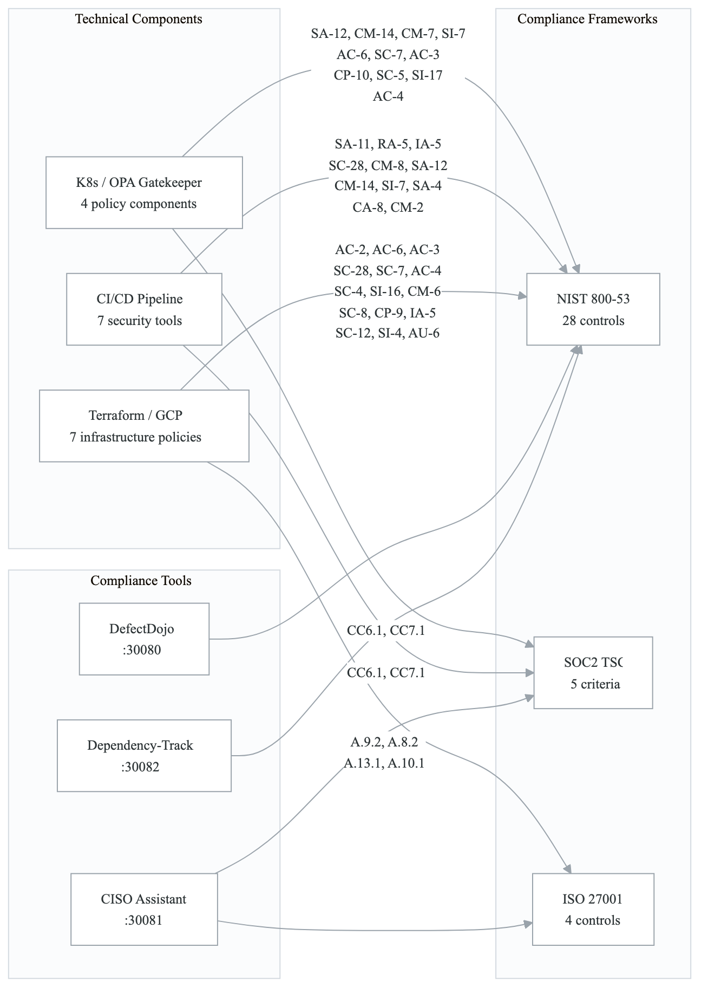
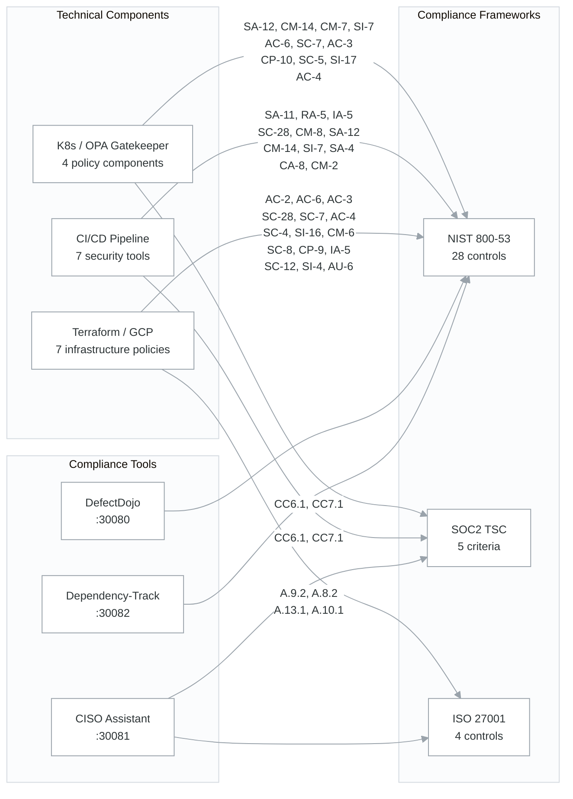
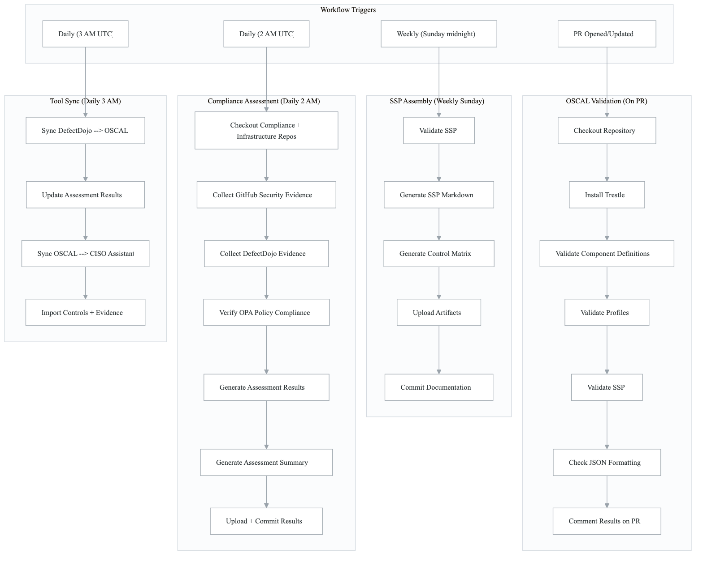
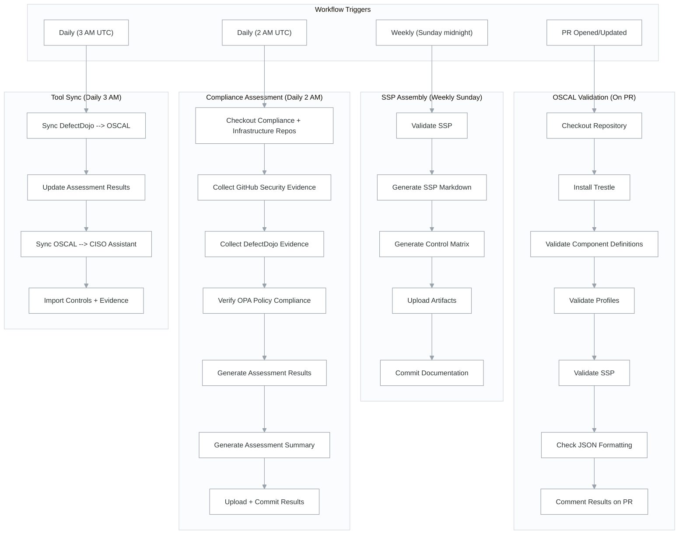
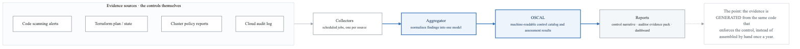

# Compliance as Code -- Architecture

## Overview

The compliance-as-code system implements continuous compliance using **NIST OSCAL** (Open Security Controls Assessment Language) with **IBM Trestle** tooling. It maps security controls across three frameworks (NIST 800-53, SOC2 TSC, ISO 27001) to technical implementations, and synchronizes compliance data between OSCAL documents, DefectDojo vulnerability management, Dependency-Track SBOM analysis, and CISO Assistant compliance UI.

The architecture achieves **100% coverage** across all selected controls: 28/28 NIST 800-53, 5/5 SOC2 TSC, and 4/4 ISO 27001.

**Source**: `northwind-compliance/` (OSCAL documents, scripts, workflows)
**Source**: `northwind-infrastructure/k8s-manifests/defectdojo/` (vulnerability management deployment)
**Source**: `northwind-infrastructure/k8s-manifests/ciso-assistant/` (compliance UI deployment)
**Source**: `northwind-infrastructure/k8s-manifests/security/dependency-track/` (SBOM analysis deployment)
**Source**: `northwind-workflows/.github/workflows/location-archival-cron.yml` (GDPR data lifecycle)

---

## OSCAL / Trestle Document Structure

The compliance repository follows the NIST OSCAL standard structure, managed by IBM Trestle:

**`compliance-repo/`**

- `catalogs/` — Security control catalogs (NIST, SOC2, ISO)
- `profiles/` — Organization-tailored control baselines
  - {{APP_NAME}}-soc2/ — SOC2 Type II profile (28 NIST controls)
  - {{APP_NAME}}-production/ — Production security baseline (extends SOC2)
- `component-definitions/` — OSCAL component definitions
  - `kubernetes-policies/` — K8s/OPA policy controls
  - `cicd-security/` — CI/CD pipeline security controls
  - `infrastructure-security/` — Terraform/GCP infrastructure controls
- `system-security-plans/` — System Security Plans
  - {{APP_NAME}}-ssp/ — Main SSP document
- `assessment-results/` — Automated assessment outputs
  - `latest/` — Most recent assessment
  - `evidence/` — Collected evidence artifacts
- `assessment-plans/` — Assessment methodology documents
- `scripts/` — 8 compliance automation scripts

### OSCAL Document Types

| Document Type | Purpose | Location | Format |
|---------------|---------|----------|--------|
| **Catalogs** | Reference control definitions (NIST 800-53 Rev 5) | `catalogs/` | JSON |
| **Profiles** | Tailored control baselines for the organization | `profiles/` | JSON |
| **Component Definitions** | Maps technical implementations to controls | `component-definitions/` | JSON |
| **System Security Plans** | Comprehensive system security documentation | `system-security-plans/` | JSON |
| **Assessment Results** | Automated assessment findings and observations | `assessment-results/` | JSON |
| **Assessment Plans** | Methodology for conducting assessments | `assessment-plans/` | JSON |

---

## Framework Coverage

### Control Coverage Summary

| Framework | Total Controls | Implemented | Coverage |
|-----------|---------------|-------------|----------|
| NIST 800-53 Rev 5 | 28 selected | 28 | **100%** |
| SOC2 TSC | 5 criteria | 5 | **100%** |
| ISO 27001:2022 | 4 controls | 4 | **100%** |

### NIST 800-53 Controls by Category

| Category | Count | Control IDs |
|----------|-------|-------------|
| Access Control | 5 | AC-2, AC-3, AC-4, AC-6, AC-17 |
| Audit & Accountability | 1 | AU-6 |
| Security Assessment | 1 | CA-8 |
| Configuration Management | 4 | CM-2, CM-6, CM-7, CM-8, CM-14 |
| Contingency Planning | 2 | CP-9, CP-10 |
| Identification & Auth | 1 | IA-5 |
| Risk Assessment | 1 | RA-5 |
| System Acquisition | 3 | SA-4, SA-11, SA-12 |
| System & Comms Protection | 6 | SC-4, SC-5, SC-7, SC-8, SC-12, SC-28 |
| System & Info Integrity | 4 | SI-4, SI-7, SI-16, SI-17 |

### SOC2 Trust Services Criteria

| Criteria | Description | Mapped NIST Controls |
|----------|-------------|---------------------|
| CC6.1 | Logical Access Controls | AC-2, AC-3, AC-6, IA-5, RA-5, SA-11 |
| CC6.6 | Boundary Protection | SC-7, SC-8, AC-4 |
| CC7.1 | System Operations | SA-12, CM-14, SI-7 |
| CC7.2 | Monitoring | SI-4, AU-6 |
| CC8.1 | Configuration Management | CM-2, CM-6 |

### ISO 27001:2022 Controls

| Control | Description | Implementation Component |
|---------|-------------|--------------------------|
| A.9.2 | Access Management | IAM Security Policy (Terraform/GCP) |
| A.8.2 | Information Classification | Storage Security Policy (GCS) |
| A.13.1 | Network Security | Network Security Policy (VPC/Firewall) |
| A.10.1 | Cryptographic Controls | Secrets Management Policy (Secret Manager) — [see cross-cutting/secret-management.md](../cross-cutting/secret-management.md) |

---

## Component-to-Framework Mapping

### Framework-to-Component Mapping

<!-- figure: generated from the Mermaid below by _shared/diagrams/embed-figures.py — do not edit the image -->

Diagram source (Mermaid)

### Kubernetes / OPA Policies --> NIST 800-53

| Rego Policy | NIST Control | Description |
|-------------|--------------|-------------|
| supply-chain.rego | SA-12 | Supply Chain Protection: image digest pinning |
| supply-chain.rego | CM-14 | Signed Components: SLSA L3 provenance |
| supply-chain.rego | CM-7 | Least Functionality: hostPID/hostNetwork denied |
| supply-chain.rego | SI-7 | Software Integrity: latest tag prohibition |
| pod.rego | AC-6 | Least Privilege: hostPath and socket mount denied |
| pod.rego | SC-7 | Boundary Protection: container escape prevention |
| pod.rego | AC-3 | Access Enforcement: service account restrictions |
| deployment.rego | CP-10 | System Recovery: minimum replicas, PDB |
| deployment.rego | SC-5 | DoS Protection: resource limits |
| deployment.rego | SI-17 | Fail-Safe: liveness/readiness probes |
| network.rego | SC-7 | Boundary Protection: default deny network policies |
| network.rego | AC-4 | Information Flow: egress/ingress control |

### CI/CD Security --> SOC2

| Security Control | SOC2 Criteria | Implementation |
|-----------------|---------------|----------------|
| SAST Scanning | CC6.1 | Snyk Code, CodeQL, Gosec |
| SCA Scanning | CC6.1 | Trivy, govulncheck |
| Secret Detection | CC6.1 | Gitleaks, TruffleHog |
| Container Scanning | CC6.1 | Trivy, Snyk Container |
| SBOM Analysis | CC6.1 | Dependency-Track (CycloneDX, SPDX) |
| SLSA L3 Builds | CC7.1 | Cosign, two-party review, signed commits |
| Incident Response | CC7.4 | Slack, PagerDuty, Jira integration |
| Secret Rotation | CC6.1 | External Secrets Operator + Reloader |

### Terraform / GCP --> ISO 27001

| Terraform Policy | ISO 27001 Control | Description |
|-----------------|-------------------|-------------|
| IAM Security | A.9.2 | Access Management: deny overly permissive roles |
| Storage Security | A.8.2 | Information Classification: public access prevention |
| Network Security | A.13.1 | Network Security: firewall rules, IAP tunnel |
| Secrets Management | A.10.1 | Cryptographic Controls: Secret Manager enforcement |

---

## Compliance Tools Architecture

> For the full DefectDojo + Dependency-Track integration architecture and data flow, see [cross-cutting/vulnerability-sinks.md](../cross-cutting/vulnerability-sinks.md).

### DefectDojo (Port 30080)

**Purpose**: Centralized vulnerability aggregation, scan deduplication, MTTR tracking, SLA management.

**Resource Requirements**: 1.05 CPU / 2.3 GB RAM / 10 GB storage

| Component | CPU Request | CPU Limit | Memory Request | Memory Limit |
|-----------|------------|-----------|----------------|-------------|
| Django (uwsgi) | 500m | 2000m | 1 Gi | 2 Gi |
| Celery Beat | 100m | 500m | 256 Mi | 512 Mi |
| Celery Worker | 200m | 1000m | 512 Mi | 1 Gi |
| Redis | 50m | 200m | 64 Mi | 128 Mi |
| PostgreSQL DB | 200m | 1000m | 512 Mi | 1 Gi |
| **Total Requests** | **1050m** | -- | **2.3 Gi** | -- |

**Deployment Architecture**:
- Django application (uwsgi) with init containers for DB migration and admin creation
- Celery beat + worker for asynchronous task processing
- Redis for Celery message broker and result backend
- PostgreSQL 15 with PVC-backed persistent storage (10 Gi)
- NetworkPolicy restricting ingress to namespace and NodePort, egress to DNS and HTTPS
- Non-root security context (UID 1001), privilege escalation disabled

**Key Features**:
- Vulnerability deduplication across scan types (SAST, SCA, DAST, container)
- MTTR (Mean Time to Remediation) tracking per severity level
- SLA enforcement with configurable remediation windows
- API-first design for CI/CD integration (`/api/v2/`)
- SARIF import support for GitHub Security tab findings

### Dependency-Track (Port 30082)

**Purpose**: SBOM-based continuous vulnerability analysis using CycloneDX and SPDX formats.

**Deployment**: Helm chart via Flux HelmRelease (`evryfs-oss/dependency-track:1.7.3`)

| Component | CPU Request | CPU Limit | Memory Request | Memory Limit |
|-----------|------------|-----------|----------------|-------------|
| API Server | 500m | 2000m | 2 Gi | 4 Gi |
| Frontend | 50m | 200m | 128 Mi | 256 Mi |
| PostgreSQL | 100m | 500m | 256 Mi | 512 Mi |

**Key Features**:
- Continuous SBOM analysis against NVD, OSS Index, and other data sources
- CycloneDX and SPDX format support
- Policy engine for automated vulnerability thresholds
- [GCP-SPECIFIC] External Secrets for database credentials via GCP Secret Manager
- ServiceMonitor for Prometheus metrics collection
- NetworkPolicy allowing NVD/OSS Index HTTPS egress for vulnerability feed updates

### CISO Assistant (Port 30081)

**Purpose**: Compliance UI for control tracking, evidence management, and framework mapping.

**Resource Requirements**: 0.4 CPU / 0.9 GB RAM / 5 GB storage

| Component | CPU Request | CPU Limit | Memory Request | Memory Limit |
|-----------|------------|-----------|----------------|-------------|
| Backend (Django) | 200m | 1000m | 512 Mi | 1 Gi |
| Frontend (SvelteKit) | 100m | 500m | 128 Mi | 256 Mi |
| PostgreSQL DB | 100m | 500m | 256 Mi | 512 Mi |
| **Total Requests** | **400m** | -- | **896 Mi** | -- |

**Deployment Architecture**:
- Backend: Django REST API with init containers for migration and static file collection
- Frontend: SvelteKit application connecting to backend API
- PostgreSQL 15 with PVC-backed storage (5 Gi)
- Three services: backend (8000), frontend (3000), NodePort (30081)
- Non-root security context (UID 1000), privilege escalation disabled

**Key Features**:
- Multi-framework compliance tracking (NIST, SOC2, ISO 27001, GDPR, etc.)
- Control implementation mapping with evidence attachments
- OSCAL import/export for interoperability
- Role-based access for compliance officers and auditors
- Folder/project hierarchy for organizing compliance data

---

## Assessment Automation Flow

<!-- figure: generated from the Mermaid below by _shared/diagrams/embed-figures.py — do not edit the image -->

Diagram source (Mermaid)

### Workflow Schedule

| Workflow | Trigger | Schedule | Purpose |
|----------|---------|----------|---------|
| `trestle-validate.yml` | On PR to main | On every PR | Validates OSCAL document schema and format |
| `trestle-assemble.yml` | Weekly | Sunday midnight UTC | Generates SSP documentation and control matrix |
| `trestle-assess.yml` | Daily | 2:00 AM UTC | Runs automated compliance assessment |
| `trestle-sync-tools.yml` | Daily | 3:00 AM UTC | Syncs with DefectDojo and CISO Assistant |

---

## GDPR Data Lifecycle

### Location Archival Cron (`location-archival-cron.yml`)

**Schedule**: Daily at 2:00 AM UTC
**Retention**: 30-day default (configurable via workflow dispatch)

**Purpose**: Archives GPS location session data from PostgreSQL to cloud storage for GDPR compliance, ensuring personal location data is not retained beyond the required period.

**Process**:
1. Authenticates to cloud provider (GCP) [GCP-SPECIFIC]
2. Configures kubectl for cluster access
3. Verifies archive storage bucket accessibility
4. Creates a one-off Kubernetes Job for archival:
   - Runs the archival script with configurable retention period
   - Supports dry-run mode for testing
   - Backs off up to 2 times on failure
   - TTL of 24 hours for completed job cleanup
5. Waits for job completion (30-minute timeout)
6. Generates archival report in GitHub Step Summary
7. Notifies Slack on failure (production only)

**Environments**: Runs separately for staging and production with environment-specific secrets and configurations.

---

## Compliance Scripts

The system includes 8 Python scripts for compliance automation:

| Script | Purpose | Key Parameters |
|--------|---------|----------------|
| `collect-defectdojo-evidence.py` | Fetches vulnerability findings summary from DefectDojo API | `--url`, `--output` |
| `collect-github-evidence.py` | Collects security alerts (Dependabot, code scanning, secret scanning) from GitHub repos | `--org`, `--output` |
| `generate-assessment-results.py` | Generates OSCAL assessment results from collected evidence | `--ssp`, `--evidence`, `--output`, `--timestamp` |
| `generate-assessment-summary.py` | Creates human-readable markdown summary from assessment results | `--results`, `--output` |
| `generate-control-matrix.py` | Builds control-to-implementation matrix from component definitions | `--components`, `--output` |
| `generate-ssp-markdown.py` | Converts OSCAL SSP JSON to human-readable markdown documentation | `--input`, `--output` |
| `sync-defectdojo-to-assessment.py` | Maps DefectDojo vulnerability findings to OSCAL control assessments | `--defectdojo-url`, `--output`, `--existing` |
| `sync-to-ciso-assistant.py` | Exports OSCAL components and assessment results to CISO Assistant | `--url`, `--components`, `--assessment`, `--project` |

### Environment Variables

| Variable | Required By | Purpose |
|----------|-------------|---------|
| `DEFECTDOJO_TOKEN` | DefectDojo scripts | API authentication token |
| `CISO_ASSISTANT_TOKEN` | CISO Assistant sync | API authentication token |
| `GITHUB_TOKEN` | GitHub evidence collection | GitHub API access |

---

## Data Flow Summary

```mermaid
%%{init: {'theme':'base','themeVariables':{'fontFamily':'Helvetica, Arial, sans-serif','fontSize':'13px','primaryColor':'#ffffff','primaryTextColor':'#2d3436','primaryBorderColor':'#9aa3ab','lineColor':'#9aa3ab','textColor':'#2d3436','clusterBkg':'#fbfcfd','clusterBorder':'#d4dae0','edgeLabelBackground':'#ffffff','tertiaryColor':'#eef4fb'},'flowchart':{'curve':'basis','padding':14,'nodeSpacing':42,'rankSpacing':58}}}%%
flowchart LR
  classDef default fill:#ffffff,stroke:#9aa3ab,stroke-width:1.3px,color:#2d3436
  classDef n    fill:#ffffff,stroke:#9aa3ab,stroke-width:1.3px,color:#2d3436
  classDef crit fill:#eef4fb,stroke:#2f6fb8,stroke-width:1.8px,color:#1b3a5c
  classDef data fill:#f4f7fa,stroke:#9aa3ab,stroke-width:1.3px,color:#2d3436
  classDef mut  fill:#ffffff,stroke:#cfd6dc,stroke-width:1.1px,color:#7a8288
  classDef warn fill:#fdf0ec,stroke:#c0522d,stroke-width:1.6px,color:#8a3a1e
  subgraph SRC["Evidence sources · the controls themselves"]
    direction TB
    GH["Code scanning alerts"]:::n
    TF["Terraform plan / state"]:::n
    K8["Cluster policy reports"]:::n
    CT["Cloud audit log"]:::n
  end
  COL["Collectors<br/><small>scheduled jobs, one per source</small>"]:::n
  AGG["Aggregator<br/><small>normalises findings into one model</small>"]:::crit
  OSCAL["OSCAL<br/><small>machine-readable control catalog and assessment results</small>"]:::crit
  OUT["Reports<br/><small>control narrative · auditor evidence pack · dashboard</small>"]:::data

  SRC --> COL --> AGG --> OSCAL --> OUT

  NOTE["The point: the evidence is GENERATED from the same code that<br/>enforces the control, instead of assembled by hand once a year."]:::mut
  OUT -.-> NOTE

  linkStyle 1,2,3 stroke:#2f6fb8,stroke-width:2px
```

<!-- figure: generated from the Mermaid below by _shared/diagrams/embed-figures.py — do not edit the image -->

Diagram source (Mermaid)

---

## References

- NIST OSCAL: https://pages.nist.gov/OSCAL/
- IBM Trestle: https://ibm.github.io/compliance-trestle/
- DefectDojo: https://www.defectdojo.com/
- Dependency-Track: https://dependencytrack.org/
- CISO Assistant: https://github.com/intuitem/ciso-assistant-community

<!-- feynman-check -->

---

## Feynman check

Close the file. Blank page, no notes. Explain each of these to a competent engineer who has never
used this tool — **under five minutes, no jargon you can't define on the spot:**

- OSCAL / Trestle Document Structure
- Framework Coverage
- Component-to-Framework Mapping
- Compliance Tools Architecture

**The gap is not what you forgot. It is where you used a word instead of a mechanism.**

| | |
|---|---|
| ✗ | *"We scan for vulnerabilities in the pipeline."* |
| ✓ | *"SAST reads source without running it, SCA resolves the dependency tree against an advisory database, and image scanning compares installed package versions to that same database. All three report what was known at build time — which is why the registry is re-scanned: the image does not change, the database does."* |

**Trace it:** A CVE published today against your base image → a blocked deploy. Name every component between the advisory and the refused `apply`.

Stop at the first component you cannot name. Reopen this file and read **only** that.

**Go deeper — only once the gap has a name:** the [SLSA threat model](https://slsa.dev/spec/v1.2/threats) — it names every point at which a build can be subverted, and most teams defend three of them.
Full list per domain: [`SOURCES.md`](../../SOURCES.md#devsecops)

→ Protocol, the three levels of knowing, and worked examples: [`MASTERY.md`](../../MASTERY.md)

<!-- /feynman-check -->
