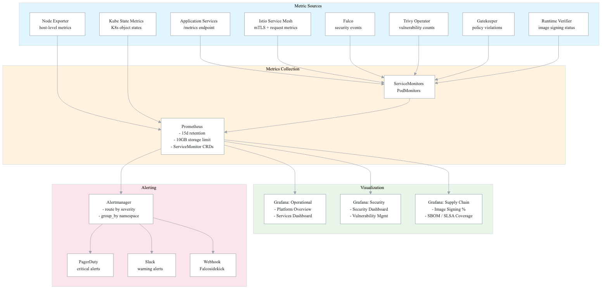
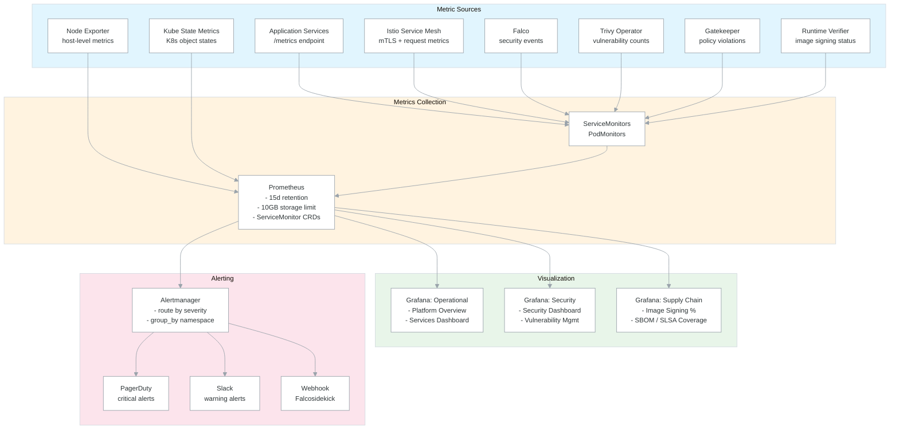
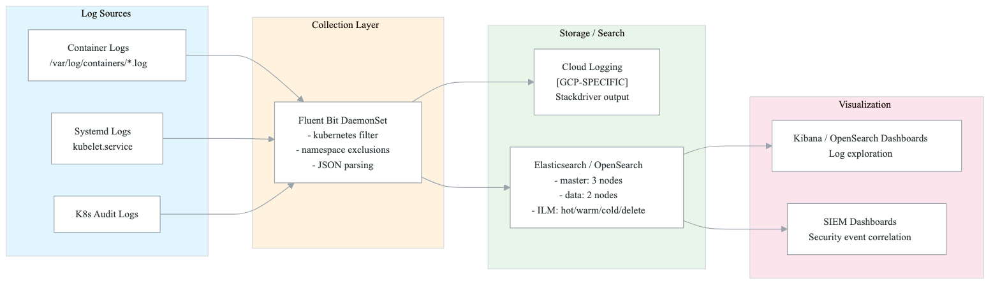
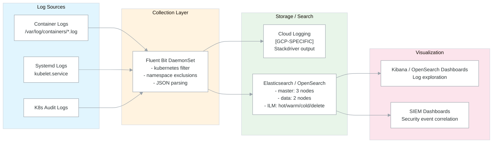
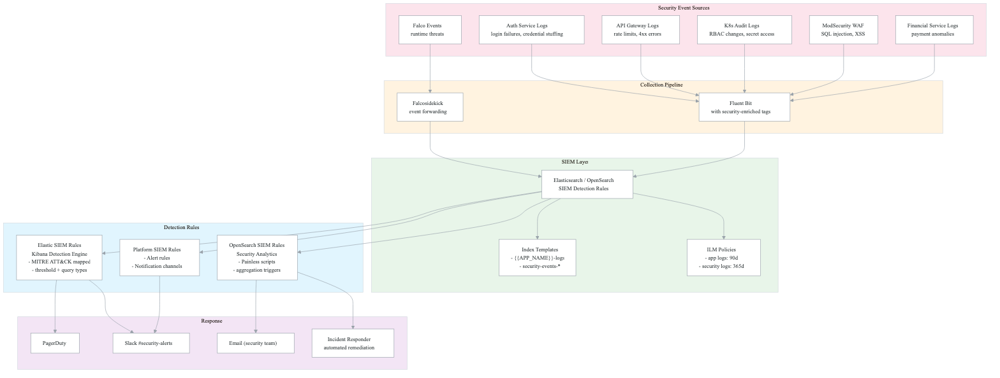
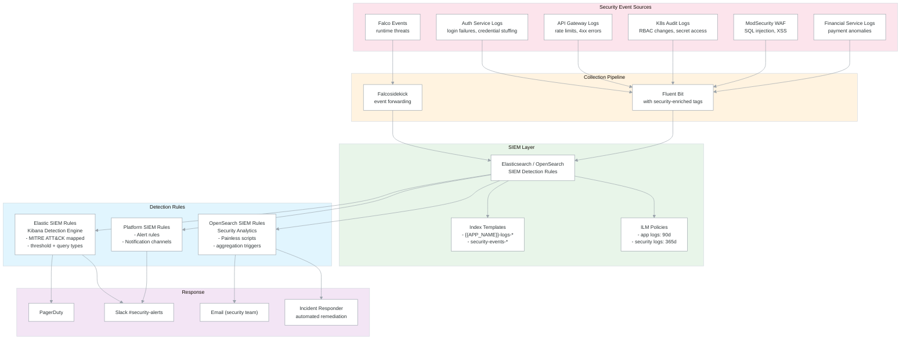

# Observability Architecture

## Overview

The observability stack implements a **three-pillar approach** (metrics, logs, traces) with dedicated **security observability** and **supply-chain security dashboards**. All telemetry flows through a unified platform built on Prometheus, Grafana, Fluent Bit, and OpenSearch/Elasticsearch, with SIEM integration for security event correlation.

This architecture provides:
- **Operational visibility**: request rates, latency percentiles, error rates, resource utilization
- **Security monitoring**: vulnerability tracking, Falco events, authentication failures, policy compliance
- **Supply-chain security**: image signing coverage, SBOM coverage, SLSA provenance, Gatekeeper violations
- **Incident response**: automated alerting via PagerDuty, Slack, and SIEM-driven correlation rules

## Metrics Data Flow

<!-- figure: generated from the Mermaid below by _shared/diagrams/embed-figures.py — do not edit the image -->

Diagram source (Mermaid)

## Logging Data Flow

<!-- figure: generated from the Mermaid below by _shared/diagrams/embed-figures.py — do not edit the image -->

Diagram source (Mermaid)

## Tracing Architecture

Distributed tracing is implemented using **Cloud Trace** [GCP-SPECIFIC]. For non-GCP environments, Jaeger or Grafana Tempo serve as drop-in alternatives.

| Component | GCP-SPECIFIC | Alternative |
|-----------|-------------|-------------|
| Trace Collection | Cloud Trace | Jaeger Collector / Tempo |
| Trace Storage | Cloud Trace backend | Jaeger (Cassandra/ES) / Tempo (S3/GCS) |
| Trace Visualization | Cloud Console | Jaeger UI / Grafana |
| SDK | OpenTelemetry | OpenTelemetry (same SDK) |

Tracing integrates with the metrics pipeline through exemplar correlation -- Prometheus metrics can link to trace IDs, enabling drill-down from Grafana dashboards to individual traces.

## SIEM Integration Architecture

<!-- figure: generated from the Mermaid below by _shared/diagrams/embed-figures.py — do not edit the image -->

Diagram source (Mermaid)

## Prometheus Stack Components

The monitoring stack is deployed via the `kube-prometheus-stack` Helm chart (v56.0.0) which bundles:

| Component | Purpose | Resource Limits |
|-----------|---------|----------------|
| Prometheus | Metric scraping + storage | 2Gi RAM, 1 CPU, 20Gi PVC |
| Alertmanager | Alert routing + deduplication | 256Mi RAM, 100m CPU, 5Gi PVC |
| Grafana | Dashboard visualization | 512Mi RAM, 500m CPU, 5Gi PVC |
| Node Exporter | Host-level metrics (DaemonSet) | 64Mi RAM, 100m CPU |
| Kube State Metrics | Kubernetes object metrics | 128Mi RAM, 100m CPU |
| Prometheus Operator | CRD management (ServiceMonitor, PrometheusRule) | 256Mi RAM, 200m CPU |

### ServiceMonitor Targets

ServiceMonitors are the primary mechanism for configuring scrape targets:

| ServiceMonitor | Namespace Selector | Scrape Interval | Label Selector |
|---------------|-------------------|-----------------|----------------|
| Application API | `{{APP_NAMESPACE}}` | 30s | `app.kubernetes.io/name: {{APP_NAME}}-api` |
| Go Services | `{{APP_NAMESPACE}}` | 15s | `runtime: go` |
| PostgreSQL | `{{APP_NAMESPACE}}-system` | 30s | `app.kubernetes.io/name: postgres` |
| Redis | `{{APP_NAMESPACE}}-system` | 30s | `app.kubernetes.io/name: redis` |
| ArgoCD (PodMonitor) | `argocd` | 30s | `app.kubernetes.io/part-of: argocd` |
| Fluent Bit | `monitoring` | (via Helm) | `release: kube-prometheus-stack` |

## Grafana Dashboard Catalog

### Operational Dashboards

| Dashboard | UID | Key Panels | Source |
|-----------|-----|------------|--------|
| Platform Overview | `{{APP_NAME}}-overview` | CPU gauge, Memory gauge, Service availability | `platform/grafana-dashboards/{{APP_NAME}}-overview.yaml` |
| Services Dashboard | `{{APP_NAME}}-services` | Request rate by service, P95 latency, success rate, memory | `platform/grafana-dashboards/{{APP_NAME}}-services.yaml` |
| Kubernetes Cluster | gnetId: 7249 | Node-level metrics | Built-in (Grafana.com) |
| Node Exporter | gnetId: 1860 | Detailed host metrics | Built-in (Grafana.com) |
| Istio Mesh | gnetId: 7639 | Service mesh traffic | Built-in (Grafana.com) |

### Security Dashboards

| Dashboard | UID | Key Panels | Source |
|-----------|-----|------------|--------|
| Security Overview | `security-overview` | Critical vulns, Falco alerts, policy compliance | `platform/grafana-dashboards/security-overview.yaml` |
| Security Dashboard | `security-dashboard` | Auth failures, network drops, vuln pie chart, mTLS coverage | `platform/security/grafana-security-dashboard.yaml` |

### Supply Chain Security Dashboard

> Supply chain metrics are sourced from the vulnerability sinks — see [cross-cutting/vulnerability-sinks.md](cross-cutting-vulnerability-sinks.md). Scanner results arrive via SARIF — see [cross-cutting/sarif-integration.md](cross-cutting-sarif-integration.md).

| Dashboard | UID | Key Panels | Source |
|-----------|-----|------------|--------|
| Supply Chain Security | `supply-chain-security` | Signed image %, SBOM coverage, SLSA L3 %, violations, incidents, quarantined pods, vulnerability distribution, Gatekeeper latency, remediation actions | `infrastructure/grafana/supply-chain-dashboard.yaml` |

## Alert Rule Groups

### Operational Alerts (from `infrastructure/prometheus/alertmanager-config.yaml`)

| Alert | Expression | Severity | Threshold |
|-------|-----------|----------|-----------|
| APIHighLatency | `histogram_quantile(0.99, ...) > 1` | warning | P99 > 1s for 5m |
| APIHighErrorRate | `rate(5xx) / rate(total) > 0.05` | critical | >5% error rate for 5m |
| PodRestarting | `increase(restarts[1h]) > 3` | warning | >3 restarts/hour |
| DatabaseConnectionHigh | `pg_stat_activity_count > 80` | warning | >80 connections for 5m |
| RedisMemoryHigh | `used / max > 0.8` | warning | >80% memory for 5m |

### Supply Chain Alerts (from `infrastructure/prometheus/supply-chain-alerts.yaml`)

8 alert groups with 22 rules covering:
- **Image Signing**: UnsignedImageDeployed, UnsignedImageRunning, SignatureVerificationFailure
- **SLSA Provenance**: MissingSLSAProvenance, InsufficientSLSALevel, ProvenanceVerificationFailure
- **SBOM**: MissingSBOM
- **Vulnerabilities**: CriticalVulnerabilityDetected, HighVulnerabilityCount, VulnerabilityCountIncreasing
- **Registry**: UnauthorizedRegistry, ImageWithoutDigest, BlockedImageAttempt
- **Runtime Verifier Health**: RuntimeVerifierDown, RuntimeVerifierHighLatency, RuntimeVerifierMemoryHigh
- **Incident Response**: IncidentResponderDown, HighIncidentRate, IncidentRemediationFailed, QuarantinedPodsExist
- **Gatekeeper**: GatekeeperWebhookLatencyHigh, GatekeeperViolationsIncreasing, GatekeeperAuditFailing
- **Coverage**: LowSignedImageCoverage, LowSBOMCoverage

## SIEM Detection Rules

### Elastic SIEM Rules (from `infrastructure/elastic/siem-rules.yaml`)

| Rule | Type | Severity | MITRE ATT&CK |
|------|------|----------|---------------|
| Brute Force Login | threshold (5/IP/5m) | high | TA0006/T1110 |
| Privilege Escalation | query (RBAC changes) | critical | TA0004/T1078 |
| Suspicious Secret Access | query (non-system users) | medium | -- |
| Pod Exec Command | query (exec subresource) | medium | TA0002/T1609 |
| WAF Critical Event | query (SQL/XSS/injection) | critical | -- |
| Data Exfiltration | threshold (100MB+) | high | TA0010 |
| Unauthorized API Access | threshold (10x 403/5m) | medium | -- |
| Financial Anomaly | threshold (20x financial API/5m) | high | -- |
| Container Escape | query (Falco alerts) | critical | TA0004/T1611 |

### OpenSearch SIEM Rules (from `platform/security/opensearch-siem-rules.yaml`)

| Rule | Category | Severity |
|------|----------|----------|
| Credential Stuffing Attack | Authentication | high |
| Account Takeover Attempt | Authentication | critical |
| Brute Force Attack | Authentication | high |
| Payment Fraud Velocity | Financial | critical |
| Refund Abuse Detection | Financial | high |
| Bulk Data Access | Data Exfiltration | critical |
| Privileged Container | Infrastructure | high |
| Shell Spawned in Container | Infrastructure | medium |
| SOS Alert Monitoring | Safety System | critical |
| False SOS Abuse | Safety System | medium |
| Rate Limit Bypass | API Security | high |

## Source File References

| Component | Source Path (relative to `k8s-manifests/`) |
|-----------|---------------------------------------------|
| Prometheus Stack | `infrastructure/prometheus/prometheus-stack.yaml` |
| Alertmanager Config | `infrastructure/prometheus/alertmanager-config.yaml` |
| ServiceMonitors | `infrastructure/prometheus/servicemonitors.yaml` |
| Supply Chain Alerts | `infrastructure/prometheus/supply-chain-alerts.yaml` |
| Grafana Dashboards | `infrastructure/grafana/dashboards.yaml` |
| Supply Chain Dashboard | `infrastructure/grafana/supply-chain-dashboard.yaml` |
| Fluent Bit | `infrastructure/fluent-bit/fluent-bit.yaml` |
| Elasticsearch | `infrastructure/elastic/elasticsearch.yaml` |
| Elastic SIEM Rules | `infrastructure/elastic/siem-rules.yaml` |
| Platform Overview Dashboard | `platform/grafana-dashboards/{{APP_NAME}}-overview.yaml` |
| Services Dashboard | `platform/grafana-dashboards/{{APP_NAME}}-services.yaml` |
| Security Overview Dashboard | `platform/grafana-dashboards/security-overview.yaml` |
| Security Dashboard | `platform/security/grafana-security-dashboard.yaml` |
| OpenSearch SIEM Rules | `platform/security/opensearch-siem-rules.yaml` |
| Platform SIEM Alert Rules | `platform/siem-rules/alert-rules.yaml` |
| OpenSearch Index Templates | `platform/siem-rules/index-templates.yaml` |

<!-- feynman-check -->

---

## Feynman check

Close the file. Blank page, no notes. Explain each of these to a competent engineer who has never
used this tool — **under five minutes, no jargon you can't define on the spot:**

- Metrics Data Flow
- Logging Data Flow
- Tracing Architecture
- SIEM Integration Architecture

**The gap is not what you forgot. It is where you used a word instead of a mechanism.**

| | |
|---|---|
| ✗ | *"We scan for vulnerabilities in the pipeline."* |
| ✓ | *"SAST reads source without running it, SCA resolves the dependency tree against an advisory database, and image scanning compares installed package versions to that same database. All three report what was known at build time — which is why the registry is re-scanned: the image does not change, the database does."* |

**Trace it:** A CVE published today against your base image → a blocked deploy. Name every component between the advisory and the refused `apply`.

Stop at the first component you cannot name. Reopen this file and read **only** that.

**Go deeper — only once the gap has a name:** the [SLSA threat model](https://slsa.dev/spec/v1.2/threats) — it names every point at which a build can be subverted, and most teams defend three of them.
Full list per domain: [`SOURCES.md`](../../SOURCES.md#devsecops)

→ Protocol, the three levels of knowing, and worked examples: [`MASTERY.md`](../../MASTERY.md)

<!-- /feynman-check -->
