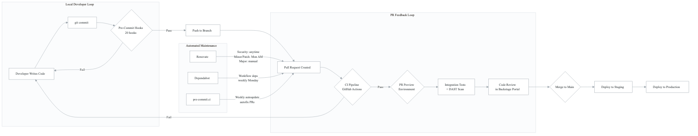
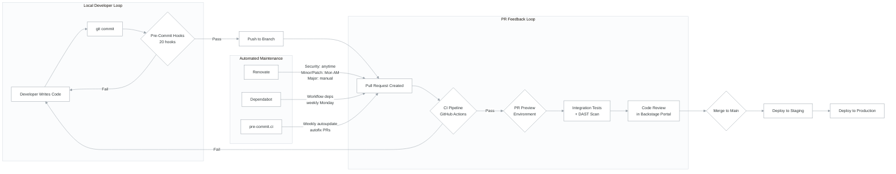
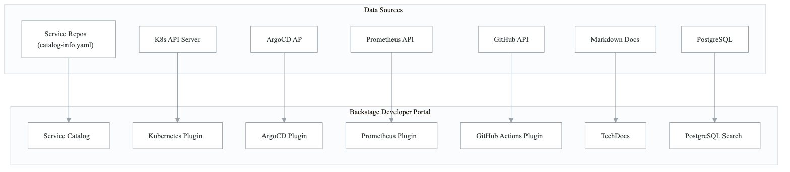
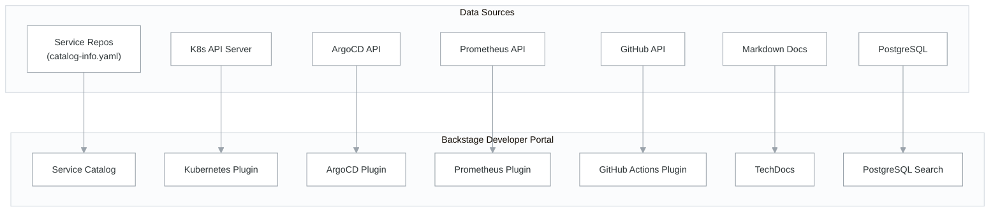

# Domain 8: Developer Experience Architecture

## Overview

Developer Experience (DevEx) encompasses every tool and workflow a developer interacts with from
the moment they write code to the moment it reaches production. This domain covers pre-commit
hooks for local quality gates, a Backstage developer portal for service visibility, automated
dependency management via Renovate and Dependabot, PR preview environments for rapid feedback,
and pre-commit.ci for continuous hook maintenance.

The design philosophy is "shift left and automate": catch issues before they ever reach CI,
surface service health in a single pane of glass, and keep dependencies current without
manual intervention.

---

## Developer Workflow

<!-- figure: generated from the Mermaid below by _shared/diagrams/embed-figures.py — do not edit the image -->


<details>
<summary>Diagram source (Mermaid)</summary>



</details>

---

## 1. Pre-Commit Hooks

### Purpose

Pre-commit hooks enforce code quality, security, and formatting standards at the earliest
possible point -- before code leaves the developer's machine. The configuration includes
20 hooks across 10 repository sources covering secrets, IaC, Go, YAML/JSON, Kubernetes,
Docker, Markdown, and commit message standards.

### Hook Inventory (20 Hooks)

| # | Hook ID | Repository | Category | Purpose |
|---|---------|-----------|----------|---------|
| 1 | `gitleaks` | gitleaks/gitleaks | Secret Detection | Prevent hardcoded secrets from being committed — [see cross-cutting/secret-management.md](../cross-cutting/secret-management.md) |
| 2 | `terraform_fmt` | antonbabenko/pre-commit-terraform | IaC | Rewrite Terraform to canonical format |
| 3 | `terraform_validate` | antonbabenko/pre-commit-terraform | IaC | Validate Terraform configuration |
| 4 | `terraform_tflint` | antonbabenko/pre-commit-terraform | IaC | Lint Terraform for best practices |
| 5 | `terraform_checkov` | antonbabenko/pre-commit-terraform | IaC Security | Scan IaC for security misconfigurations |
| 6 | `terraform_docs` | antonbabenko/pre-commit-terraform | IaC | Auto-generate Terraform module documentation |
| 7 | `golangci-lint` | golangci/golangci-lint | Go Quality | Run comprehensive Go linting (30+ linters) |
| 8 | `gosec` | securego/gosec | Go Security | Scan Go code for security vulnerabilities |
| 9 | `check-yaml` | pre-commit/pre-commit-hooks | Validation | Validate YAML syntax |
| 10 | `check-json` | pre-commit/pre-commit-hooks | Validation | Validate JSON syntax |
| 11 | `check-merge-conflict` | pre-commit/pre-commit-hooks | Git Hygiene | Detect unresolved merge conflict markers |
| 12 | `end-of-file-fixer` | pre-commit/pre-commit-hooks | Formatting | Ensure files end with a newline |
| 13 | `trailing-whitespace` | pre-commit/pre-commit-hooks | Formatting | Remove trailing whitespace |
| 14 | `no-commit-to-branch` | pre-commit/pre-commit-hooks | Git Hygiene | Block direct commits to main/master |
| 15 | `detect-private-key` | pre-commit/pre-commit-hooks | Secret Detection | Detect private key files |
| 16 | `helmlint` | gruntwork-io/pre-commit | Kubernetes | Lint Helm charts for errors |
| 17 | `check-kubernetes-json-schema` | python-jsonschema/check-jsonschema | Kubernetes | Validate K8s manifests against schema |
| 18 | `hadolint-docker` | hadolint/hadolint | Docker | Lint Dockerfiles for best practices |
| 19 | `markdownlint` | igorshubovych/markdownlint-cli | Documentation | Lint and auto-fix Markdown files |
| 20 | `commitizen` | commitizen-tools/commitizen | Git Hygiene | Enforce conventional commit format |

### Hook Categories by Execution Stage

```
Pre-Commit Stage (on git commit):
  Secret Detection:    gitleaks, detect-private-key
  IaC:                 terraform_fmt, terraform_validate, terraform_tflint, terraform_checkov, terraform_docs
  Go:                  golangci-lint, gosec
  Validation:          check-yaml, check-json
  Git Hygiene:         check-merge-conflict, no-commit-to-branch
  Formatting:          end-of-file-fixer, trailing-whitespace
  Kubernetes:          helmlint, check-kubernetes-json-schema
  Docker:              hadolint-docker
  Documentation:       markdownlint

Commit-Msg Stage (on commit message write):
  Standards:           commitizen
```

### Source Reference

- Template: `templates/pre-commit-config.yaml`
- Original: `.pre-commit-config.yaml` in service repositories
- Go linter config: `templates/golangci.yml` (used by golangci-lint hook)
- Markdown config: `templates/markdownlint.json` (used by markdownlint hook)

---

## 2. Backstage Developer Portal

### Purpose

Backstage provides a unified developer portal that aggregates service catalog information,
Kubernetes pod visibility, ArgoCD deployment status, Prometheus metrics, GitHub Actions CI
results, and TechDocs documentation. It serves as the single pane of glass for understanding
the health and ownership of every service in the platform.

### Integrated Plugins

| Plugin | Purpose | Data Source |
|--------|---------|-------------|
| Service Catalog | Component/System/Domain hierarchy | `catalog-info.yaml` in each repo |
| Kubernetes | Pod status, logs, resource usage | K8s API via service account |
| ArgoCD | Deployment sync status, rollback | ArgoCD API via token |
| Prometheus | Service metrics, SLOs, alerts | Prometheus API via proxy |
| GitHub Actions | CI/CD pipeline status, run history | GitHub API via token |
| TechDocs | Auto-generated documentation | Markdown in repos |
| PostgreSQL Search | Full-text search across all entities | PostgreSQL `pg_search` |

### Catalog Entity Hierarchy

```
Domain: {{APP_NAME}}
  |
  +-- System: {{APP_NAME}}-gateway
  |     +-- Component: api-gateway-go (Go service)
  |     +-- Component: customer-portal (Frontend)
  |     +-- Component: web-dashboard (Frontend)
  |
  +-- System: {{APP_NAME}}-core
  |     +-- Component: auth-service (Node.js)
  |     +-- Component: identity-service (Node.js)
  |     +-- Component: booking-service (Node.js)
  |     +-- Component: matching-service-go (Go)
  |     +-- Component: pricing-service-go (Go)
  |     +-- Component: safety-service (Node.js)
  |     +-- Component: background-job-orchestrator (Node.js)
  |
  +-- System: {{APP_NAME}}-financial
  |     +-- Component: financial-service (Node.js)
  |     +-- Component: fraud-service-go (Go)
  |     +-- Component: dispute-service (Node.js)
  |
  +-- System: {{APP_NAME}}-notifications
  |     +-- Component: notification-service-go (Go)
  |
  +-- System: platform
        +-- Component: {{APP_NAME}}-workflows (CI/CD library)
        +-- Component: {{APP_NAME}}-infrastructure (Terraform)
        +-- Component: {{APP_NAME}}-common (Shared library)
        +-- Component: {{APP_NAME}}-database (DB migrations)
        +-- Resource: PostgreSQL
        +-- Resource: Redis
```

### Key Annotations for Backstage Integration

Every `catalog-info.yaml` must include these annotations to activate plugins:

```yaml
annotations:
  # TechDocs - auto-generate docs from repo Markdown
  backstage.io/techdocs-ref: dir:.

  # GitHub Actions - link CI pipelines
  github.com/project-slug: {{ORG_NAME}}/{{SERVICE_NAME}}

  # ArgoCD - show deployment status
  argocd/app-selector: app.kubernetes.io/name={{SERVICE_NAME}}

  # Prometheus - surface metrics dashboards
  prometheus.io/rule: {{SERVICE_NAME}}

  # Kubernetes - show pod visibility in correct namespace
  kubernetes.io/namespace: {{APP_NAME}}-{{SYSTEM}}
```

### Backstage Configuration Architecture

| Config File | Purpose | Environment |
|-------------|---------|-------------|
| `app-config.yaml` | Base configuration (plugins, catalog, integrations) | All |
| `app-config.staging.yaml` | Staging cluster URLs, relaxed SSL | Staging |
| `app-config.production.yaml` | Production cluster URLs, strict SSL | Production |

### Backstage Integration Architecture

<!-- figure: generated from the Mermaid below by _shared/diagrams/embed-figures.py — do not edit the image -->


<details>
<summary>Diagram source (Mermaid)</summary>



</details>

### Source Reference

- Templates: `templates/backstage/`
- Original: `northwind-backstage/` repository

---

## 3. Renovate (Primary Dependency Management)

### Purpose

Renovate is the primary automated dependency update tool. It manages updates for Go modules,
Docker base images, GitHub Actions versions, Terraform providers, Helm charts, and npm packages.
It applies a tiered schedule based on risk level.

### Update Strategy

| Update Type | Schedule | Auto-Merge | Labels |
|-------------|----------|------------|--------|
| Security vulnerabilities | **Any time** (24/7) | Yes | `security`, `vulnerability` |
| Minor/Patch (Go, Docker, npm) | **Monday before 6 AM** | Yes (after CI passes) | `dependencies`, `renovate` |
| Major updates | On schedule, **requires manual review** | No | `major-update`, `needs-review` |
| Go version updates | On schedule, **requires manual review** | No | `go-version`, `needs-review` |
| GitHub Actions patches | On schedule | Yes | `github-actions` |
| GitHub Actions minor/major | On schedule, **requires manual review** | No | `github-actions`, `needs-review` |
| Security-critical packages | On schedule, **requires manual review** | No | `security-critical`, `needs-review` |

### Configuration Hierarchy

```
northwind-workflows/templates/renovate-go.json    <-- Shared preset for Go services
  ^
  |  extends via "local>"
  |
service-repo/renovate.json                      <-- Per-service minimal config
```

### Key Configuration

- **Stability days**: 3 (wait 3 days after release before creating PR)
- **PR hourly limit**: 4
- **PR concurrent limit**: 10
- **Go post-update options**: `gomodTidy`, `gomodUpdateImportPaths`
- **OpenSSF Scorecard**: Enabled for supply chain security

### Source Reference

- Go preset template: `templates/renovate/renovate-go.json`
- Consumer example: `consumer-templates/go-service/renovate.json`
- Original preset: `northwind-workflows/templates/renovate-go.json`
- Original consumer: `northwind-api-gateway-go/renovate.json`

---

## 4. Dependabot (Backup for Workflow Dependencies)

### Purpose

Dependabot serves as a backup dependency management tool, primarily for GitHub Actions
workflow file updates and npm package ecosystems where Renovate may have blind spots.
Both tools coexist with Dependabot focusing on areas Renovate handles less effectively.

### Managed Ecosystems

| Ecosystem | Directory | Schedule | Grouping |
|-----------|-----------|----------|----------|
| `github-actions` | `/` | Weekly (Monday) | All actions grouped |
| `npm` | `/` | Weekly (Monday) | Minor/patch, org packages, testing, TypeScript |
| `docker` | `/` | Weekly (Monday) | Per image |

### Key Configuration

- **Commit message prefix**: `ci({{SERVICE_NAME}})` for actions, `deps({{SERVICE_NAME}})` for npm
- **Major version ignore**: `*` (major versions excluded to prevent breaking changes)
- **PR limit**: 10 open pull requests
- **Private registry**: GitHub Packages for scoped `@{{ORG_NAME}}/*` packages

### Source Reference

- Template: `templates/dependabot/dependabot.yml`
- Original: `northwind-workflows/templates/dependabot.yml`

---

## 5. PR Preview Environments

### Purpose

PR preview environments provide an ephemeral deployment for every pull request, enabling
developers and reviewers to test changes in a real Kubernetes environment before merging.
Each PR gets its own namespace, its own deployment, and automatic cleanup on merge/close.

### Workflow Architecture

```
PR Opened/Updated                          PR Merged/Closed
       |                                          |
       v                                          v
reusable-pr-preview.yml                   reusable-pr-cleanup.yml
       |                                          |
       +-- ensure-staging                         +-- check cluster
       |     (start cluster if stopped)           +-- delete namespace
       +-- build-preview                          +-- comment on PR
       |     (build + push image)
       +-- deploy-preview
       |     (create namespace, deploy, comment)
       +-- integration-tests (optional)
       +-- dast-scan (optional)
       +-- update-pr-status
```

### Namespace Convention

Each PR gets a dedicated Kubernetes namespace: `pr-<PR_NUMBER>`

Labels applied:
- `{{APP_NAME}}.io/preview=true`
- `{{APP_NAME}}.io/pr=<PR_NUMBER>`
- `{{APP_NAME}}.io/service=<SERVICE_NAME>`

### Resource Limits

Preview deployments use constrained resources:
- **Requests**: 100m CPU, 256Mi memory
- **Limits**: 500m CPU, 512Mi memory
- **Replicas**: 1

### Health Checks

- **Readiness probe**: `GET /health` on port 3000, initial delay 10s, period 5s
- **Liveness probe**: `GET /health` on port 3000, initial delay 30s, period 10s

### Source Reference

- Preview workflow: `templates/pr-preview/reusable-pr-preview.yml`
- Cleanup workflow: `templates/pr-preview/reusable-pr-cleanup.yml`
- Original: `northwind-workflows/.github/workflows/reusable-pr-preview.yml`
- Original: `northwind-workflows/.github/workflows/reusable-pr-cleanup.yml`

---

## 6. pre-commit.ci

### Purpose

pre-commit.ci is a hosted service that automatically updates pre-commit hook versions weekly
and creates auto-fix PRs when hooks can automatically correct issues (e.g., formatting fixes).
This keeps the hook versions current without manual maintenance.

### Configuration

The `ci:` block at the bottom of `.pre-commit-config.yaml` controls the behavior:

| Setting | Value | Description |
|---------|-------|-------------|
| `autoupdate_schedule` | `weekly` | Check for hook version updates weekly |
| `autofix_prs` | `true` | Create PRs to auto-fix issues found |
| `autofix_commit_msg` | `[pre-commit.ci] auto fixes...` | Commit message for auto-fixes |
| `skip` | `[]` | No hooks skipped in CI |
| `submodules` | `false` | Do not check out submodules |

### Source Reference

- Configuration is embedded in `templates/pre-commit-config.yaml` (the `ci:` block)
- Original: `.pre-commit-config.yaml` in service repositories

---

## Integration Points

### How Components Connect

| Component | Feeds Into | Triggered By |
|-----------|-----------|--------------|
| Pre-commit hooks | Local developer feedback loop | `git commit` |
| pre-commit.ci | PR with hook updates/fixes | Weekly schedule |
| Renovate | PR with dependency updates | Schedule + vulnerability alerts |
| Dependabot | PR with workflow/npm updates | Weekly schedule |
| PR Preview | Ephemeral K8s deployment | PR open/update |
| PR Cleanup | Namespace deletion | PR merge/close |
| Backstage | Unified portal | Always-on (catalog sync) |

### Cloud Provider Dependencies

| Component | Cloud Dependency | Notes |
|-----------|-----------------|-------|
| PR Preview build | [GCP-SPECIFIC] Artifact Registry | Image push to `{{REGISTRY_URL}}` |
| PR Preview deploy | [GCP-SPECIFIC] GKE cluster | Staging cluster for preview namespaces |
| PR Preview auth | [GCP-SPECIFIC] Service Account Key | `GCP_STAGING_SA_KEY` secret |
| Backstage K8s plugin | Kubernetes API | Works with any K8s provider |
| Backstage ArgoCD | ArgoCD API | Cloud-agnostic |
| Backstage Prometheus | Prometheus API | Cloud-agnostic |

---

## Directory Structure

```
08-developer-experience/
  architecture.md                           # This file
  best-practices.md                         # Strengths, limitations, recommendations
  configuration-reference.md                # Detailed config reference for all tools
  implementation-checklist.md               # Step-by-step setup guide
  templates/
    pre-commit-config.yaml                  # Full 20-hook pre-commit config
    golangci.yml                            # Go linter configuration
    markdownlint.json                       # Markdown linter configuration
    backstage/
      app-config.yaml                       # Base Backstage configuration
      app-config.staging.yaml               # Staging overrides
      app-config.production.yaml            # Production overrides
      catalog/
        all.yaml                            # Root catalog location
        resources.yaml                      # Shared resources (PostgreSQL, Redis)
        domains/
          domain.yaml                       # Domain entity template
        systems/
          gateway.yaml                      # Gateway system template
          core.yaml                         # Core system template
          financial.yaml                    # Financial system template
          notifications.yaml                # Notifications system template
          platform.yaml                     # Platform system template
    renovate/
      renovate-go.json                      # Go service Renovate preset
    dependabot/
      dependabot.yml                        # Dependabot config template
    pr-preview/
      reusable-pr-preview.yml               # PR preview deployment workflow
      reusable-pr-cleanup.yml               # PR cleanup workflow
  consumer-templates/
    go-service/
      catalog-info.yaml                     # Backstage component for Go service
      renovate.json                         # Renovate config for Go service
      Dockerfile                            # Production Dockerfile (distroless)
    node-service/
      catalog-info.yaml                     # Backstage component for Node.js service
      renovate.json                         # Renovate config for Node.js service
      sonar-project.properties              # SonarQube configuration
      Dockerfile                            # Production Dockerfile (alpine)
```

<!-- feynman-check -->

---

## Feynman check

Close the file. Blank page, no notes. Explain each of these to a competent engineer who has never
used this tool — **under five minutes, no jargon you can't define on the spot:**

- Developer Workflow
- Pre-Commit Hooks
- Backstage Developer Portal
- Renovate (Primary Dependency Management)

**The gap is not what you forgot. It is where you used a word instead of a mechanism.**

| | |
|---|---|
| ✗ | *"We scan for vulnerabilities in the pipeline."* |
| ✓ | *"SAST reads source without running it, SCA resolves the dependency tree against an advisory database, and image scanning compares installed package versions to that same database. All three report what was known at build time — which is why the registry is re-scanned: the image does not change, the database does."* |

**Trace it:** A CVE published today against your base image → a blocked deploy. Name every component between the advisory and the refused `apply`.

Stop at the first component you cannot name. Reopen this file and read **only** that.

**Go deeper — only once the gap has a name:** the [SLSA threat model](https://slsa.dev/spec/v1.2/threats) — it names every point at which a build can be subverted, and most teams defend three of them.
Full list per domain: [`SOURCES.md`](../../SOURCES.md#devsecops)

→ Protocol, the three levels of knowing, and worked examples: [`MASTERY.md`](../../MASTERY.md)

<!-- /feynman-check -->
