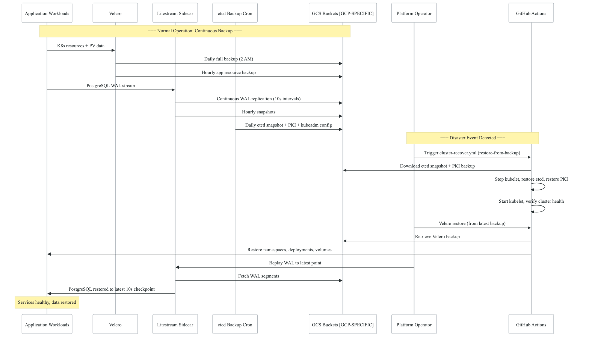
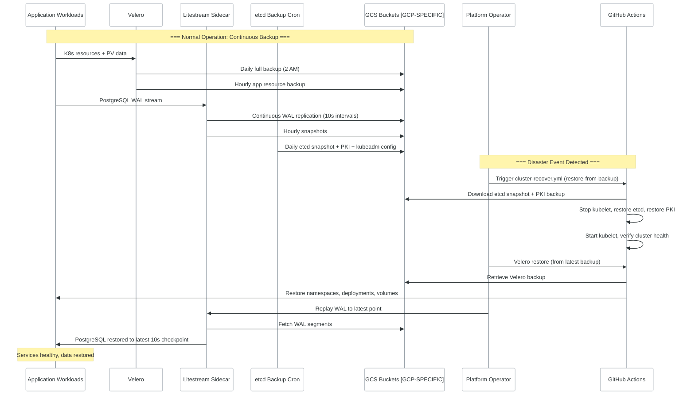
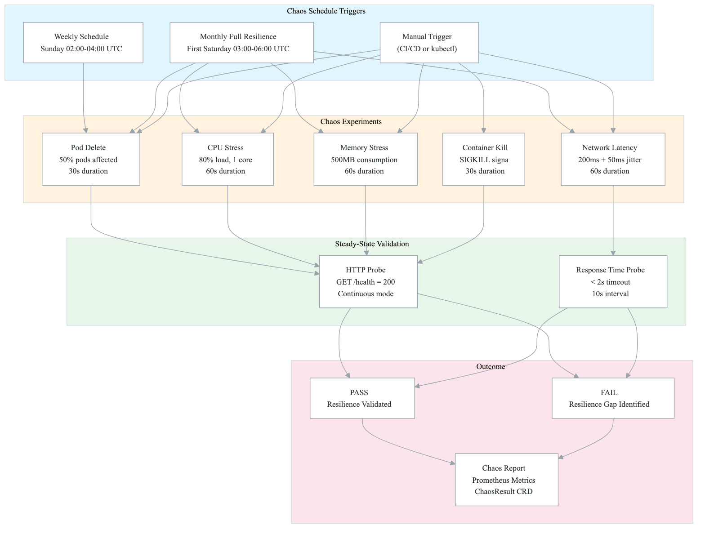
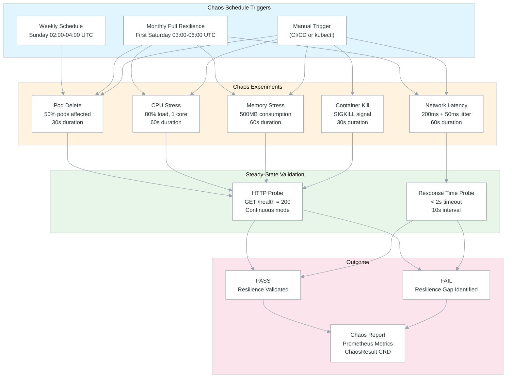

# Resilience & Disaster Recovery Architecture

## Overview

The resilience and disaster recovery (DR) architecture provides a multi-layered strategy for protecting Kubernetes workloads, databases, and cluster state. It combines **automated backups** (Velero, Litestream, etcd snapshots), **chaos engineering** (LitmusChaos), and **orchestrated recovery workflows** (GitHub Actions) to achieve defined RTO/RPO targets.

This architecture is derived from a production kubeadm-based Kubernetes platform running on GCP Compute Engine and is applicable to any self-managed Kubernetes environment with appropriate cloud provider adaptations.

## Backup Strategy

> Backup credentials and encryption keys are managed through the unified secret management architecture — see [cross-cutting/secret-management.md](cross-cutting-secret-management.md). Backup validation relies on vulnerability data from [cross-cutting/vulnerability-sinks.md](cross-cutting-vulnerability-sinks.md) to ensure restored environments are not reintroducing known vulnerabilities.

The backup strategy uses three complementary tools, each covering a different data tier:

| Tier | Tool | What's Protected | Storage Target | Frequency |
|------|------|------------------|----------------|-----------|
| Kubernetes Resources | Velero | Namespaces, Deployments, ConfigMaps, Secrets, CRDs, PV snapshots | GCS bucket [GCP-SPECIFIC] | Daily full + Hourly app-only |
| PostgreSQL Data | Litestream | WAL (Write-Ahead Log) streaming for continuous replication | GCS bucket [GCP-SPECIFIC] | Continuous (10s sync) + Hourly snapshots |
| Cluster State | etcd snapshots | etcd database, PKI certificates, kubeadm config | GCS bucket [GCP-SPECIFIC] | Daily cron + Pre-recovery manual |

### RTO/RPO Targets

| Scenario | RPO (Data Loss) | RTO (Recovery Time) | Method |
|----------|-----------------|---------------------|--------|
| Pod/Deployment failure | 0 | < 2 min | Kubernetes self-healing (ReplicaSets, HPA) |
| Node failure (worker) | 0 | 5-10 min | Pod rescheduling + worker rejoin workflow |
| PostgreSQL data loss | ~10 seconds | 15-30 min | Litestream WAL replay from GCS |
| Namespace deletion | < 1 hour | 15-30 min | Velero restore from hourly backup |
| Full cluster loss | < 24 hours | 45-90 min | etcd restore + Velero restore + Litestream replay |
| Infrastructure destruction | < 24 hours | 2-4 hours | Terraform recreate + full restore pipeline |

## Backup-to-Restore Flow

<!-- figure: generated from the Mermaid below by _shared/diagrams/embed-figures.py — do not edit the image -->


<details>
<summary>Diagram source (Mermaid)</summary>



</details>

## Chaos Engineering

Chaos engineering is implemented via LitmusChaos to proactively validate resilience assumptions. Experiments run on weekly and monthly schedules against application namespaces.

### Chaos Experiment Workflow

<!-- figure: generated from the Mermaid below by _shared/diagrams/embed-figures.py — do not edit the image -->


<details>
<summary>Diagram source (Mermaid)</summary>



</details>

### Experiment Coverage Matrix

| Experiment | Target | Blast Radius | Duration | Probe |
|-----------|--------|-------------|----------|-------|
| Pod Delete | `app=api-gateway` | 30-50% of pods | 30s | HTTP health check (continuous) |
| Network Latency | All `{{APP_NAME}}` services | 20% of pods | 60s | HTTP response time < 2s |
| CPU Stress | Target deployment | 50% of pods | 60s | HTTP health check |
| Memory Stress | Target deployment | 50% of pods | 60s | HTTP health check |
| Container Kill | Target container | Single container | 30s | HTTP health check |

## Restore Procedures

### 1. Velero Restore (Kubernetes Resources + PV Snapshots)

```bash
# List available backups
velero backup get

# Restore a specific namespace from latest daily backup
velero restore create --from-backup daily-full-backup-YYYYMMDD-020000 \
  --include-namespaces {{APP_NAMESPACE}}

# Restore entire cluster state
velero restore create --from-backup daily-full-backup-YYYYMMDD-020000

# Monitor restore progress
velero restore describe <restore-name>
velero restore logs <restore-name>
```

### 2. Litestream WAL Replay (PostgreSQL)

```bash
# Stop PostgreSQL pod
kubectl scale statefulset postgres -n {{APP_NAMESPACE}}-system --replicas=0

# Run Litestream restore to replay WAL from GCS [GCP-SPECIFIC]
litestream restore -config /etc/litestream.yml /var/lib/postgresql/data/pgdata

# Restart PostgreSQL
kubectl scale statefulset postgres -n {{APP_NAMESPACE}}-system --replicas=1

# Verify data integrity
kubectl exec -it postgres-0 -n {{APP_NAMESPACE}}-system -- psql -U postgres -c "SELECT count(*) FROM pg_stat_activity;"
```

### 3. etcd Restore [KUBEADM-SPECIFIC]

```bash
# Stop kubelet on control plane
sudo systemctl stop kubelet

# Move existing etcd data
sudo mv /var/lib/etcd /var/lib/etcd.bak

# Restore from snapshot
ETCDCTL_API=3 sudo etcdutl snapshot restore /tmp/restore/etcd.db \
  --data-dir=/var/lib/etcd \
  --skip-hash-check

# Fix ownership
sudo chown -R root:root /var/lib/etcd

# Restore PKI certificates (if needed)
sudo tar -xzf /tmp/restore/pki.tar.gz -C /etc/kubernetes/

# Restart kubelet
sudo systemctl start kubelet
```

## Cluster Lifecycle Workflows

### cluster-recover.yml

Orchestrated recovery workflow with four actions:

| Action | Use Case | Impact |
|--------|----------|--------|
| `restart-vms` | Unresponsive nodes | Stops/starts VMs, verifies cluster health, applies CoreDNS patches |
| `rejoin-worker` | Worker node detached | Generates new join token, resets worker, rejoins to control plane [KUBEADM-SPECIFIC] |
| `reset-cluster` | Corrupted cluster state | Full kubeadm reset on all nodes, reinitializes cluster [KUBEADM-SPECIFIC] |
| `restore-from-backup` | Data loss / disaster | Downloads etcd + PKI + config from GCS, restores etcd, restarts services [GCP-SPECIFIC] |

### infrastructure-destroy-recreate.yml

Full infrastructure lifecycle for staging environments:

1. **Validation** -- Requires explicit confirmation string to prevent accidental destruction
2. **Destroy** -- Terraform destroy of all infrastructure resources
3. **Recreate** -- Terraform plan + apply to provision fresh infrastructure
4. **Verify** -- Wait for kubeadm initialization, check cluster health

### cluster-health-check.yml

Scheduled health monitoring (every 6 hours) covering:

- VM status (running vs. stopped vs. not deployed)
- Kubernetes node readiness (minimum 2 Ready nodes)
- System pod health (kube-system namespace)
- CNI status (Cilium connectivity)
- Resource usage (CPU, memory, disk)
- Application pod health (target namespace)

## Source File References

| Component | Source Path |
|-----------|------------|
| Velero HelmRelease + config | `k8s-manifests/infrastructure/velero/velero.yaml` |
| Velero backup schedules | `k8s-manifests/infrastructure/velero/schedules.yaml` |
| Litestream config + PostgreSQL | `k8s-manifests/infrastructure/postgres/postgres.yaml` |
| LitmusChaos HelmRelease + RBAC | `k8s-manifests/infrastructure/litmus/litmus.yaml` |
| Chaos experiments | `k8s-manifests/infrastructure/litmus/chaos-experiments.yaml` |
| Chaos schedules | `k8s-manifests/infrastructure/litmus/chaos-schedules.yaml` |
| Cluster recovery workflow | `.github/workflows/cluster-recover.yml` |
| Infrastructure destroy/recreate | `.github/workflows/infrastructure-destroy-recreate.yml` |
| Cluster health check | `.github/workflows/cluster-health-check.yml` |
| etcd backup script | `modules/k8s-cluster/scripts/control-plane-init.sh` (embedded) |

<!-- feynman-check -->

---

## Feynman check

Close the file. Blank page, no notes. Explain each of these to a competent engineer who has never
used this tool — **under five minutes, no jargon you can't define on the spot:**

- Backup Strategy
- Backup-to-Restore Flow
- Chaos Engineering
- Restore Procedures

**The gap is not what you forgot. It is where you used a word instead of a mechanism.**

| | |
|---|---|
| ✗ | *"We scan for vulnerabilities in the pipeline."* |
| ✓ | *"SAST reads source without running it, SCA resolves the dependency tree against an advisory database, and image scanning compares installed package versions to that same database. All three report what was known at build time — which is why the registry is re-scanned: the image does not change, the database does."* |

**Trace it:** A CVE published today against your base image → a blocked deploy. Name every component between the advisory and the refused `apply`.

Stop at the first component you cannot name. Reopen this file and read **only** that.

**Go deeper — only once the gap has a name:** the [SLSA threat model](https://slsa.dev/spec/v1.2/threats) — it names every point at which a build can be subverted, and most teams defend three of them.
Full list per domain: [`SOURCES.md`](../../SOURCES.md#devsecops)

→ Protocol, the three levels of knowing, and worked examples: [`MASTERY.md`](../../MASTERY.md)

<!-- /feynman-check -->
