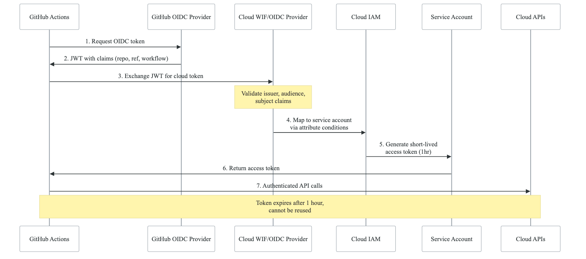
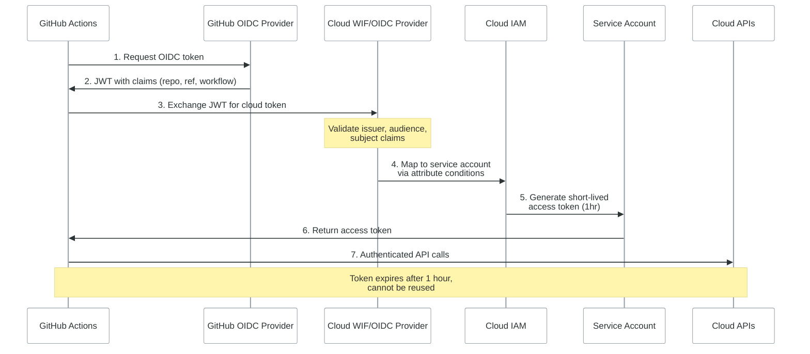

# OIDC / Workload Identity Federation

This document describes the full trust chain for keyless authentication from GitHub Actions to cloud providers. It is referenced from CI/CD (Domain 1), Infrastructure (Domain 3), and Kubernetes (Domain 4) architecture docs.

> **Source files**: `northwind-infrastructure/modules/github-wif/`, `northwind-infrastructure/docs/INFRASTRUCTURE.md`

---

## Overview

Workload Identity Federation eliminates long-lived service account keys by allowing GitHub Actions to authenticate via short-lived OIDC tokens. This is a critical security pattern — stored keys are the #1 cause of cloud credential breaches.

## Trust Chain

<!-- figure: generated from the Mermaid below by _shared/diagrams/embed-figures.py — do not edit the image -->


<details>
<summary>Diagram source (Mermaid)</summary>



</details>

## GCP Implementation **[GCP-SPECIFIC]**

### Terraform Module: `github-wif`

```hcl
# modules/github-wif/main.tf
resource "google_iam_workload_identity_pool" "github" {
  project                   = var.project_id
  workload_identity_pool_id = "{{APP_NAME}}-github-pool"
  display_name              = "GitHub Actions Pool"
  description               = "Identity pool for GitHub Actions OIDC"
}

resource "google_iam_workload_identity_pool_provider" "github" {
  project                            = var.project_id
  workload_identity_pool_id          = google_iam_workload_identity_pool.github.workload_identity_pool_id
  workload_identity_pool_provider_id = "github-provider"
  display_name                       = "GitHub Provider"

  # Map GitHub OIDC claims to Google attributes
  attribute_mapping = {
    "google.subject"             = "assertion.sub"
    "attribute.actor"            = "assertion.actor"
    "attribute.repository"       = "assertion.repository"
    "attribute.repository_owner" = "assertion.repository_owner"
    "attribute.ref"              = "assertion.ref"
  }

  # Only allow tokens from our organization
  attribute_condition = "assertion.repository_owner == '{{ORG_NAME}}'"

  oidc {
    issuer_uri = "https://token.actions.githubusercontent.com"
  }
}

# Service account binding
resource "google_service_account_iam_member" "github_actions" {
  service_account_id = google_service_account.github_actions.name
  role               = "roles/iam.workloadIdentityUser"
  member             = "principalSet://iam.googleapis.com/${google_iam_workload_identity_pool.github.name}/attribute.repository/${var.allowed_repository}"
}
```

### GitHub Actions Usage

```yaml
# In deployment workflows
- name: Authenticate to Google Cloud
  uses: google-github-actions/auth@v2
  with:
    workload_identity_provider: 'projects/{{GCP_PROJECT_ID}}/locations/global/workloadIdentityPools/{{APP_NAME}}-github-pool/providers/github-provider'
    service_account: 'github-actions@{{GCP_PROJECT_ID}}.iam.gserviceaccount.com'
```

### Attribute Conditions (Security)

| Condition | Purpose |
|-----------|---------|
| `repository_owner == '{{ORG_NAME}}'` | Only our GitHub org |
| `repository == '{{ORG_NAME}}/{{REPO_NAME}}'` | Specific repo only |
| `ref == 'refs/heads/main'` | Production: main branch only |

## AWS Alternative **[AWS-SPECIFIC]**

```hcl
# AWS OIDC Provider
resource "aws_iam_openid_connect_provider" "github" {
  url             = "https://token.actions.githubusercontent.com"
  client_id_list  = ["sts.amazonaws.com"]
  thumbprint_list = ["6938fd4d98bab03faadb97b34396831e3780aea1"]
}

# IAM Role with trust policy
resource "aws_iam_role" "github_actions" {
  name = "{{APP_NAME}}-github-actions"

  assume_role_policy = jsonencode({
    Version = "2012-10-17"
    Statement = [{
      Effect = "Allow"
      Principal = {
        Federated = aws_iam_openid_connect_provider.github.arn
      }
      Action = "sts:AssumeRoleWithWebIdentity"
      Condition = {
        StringEquals = {
          "token.actions.githubusercontent.com:aud" = "sts.amazonaws.com"
        }
        StringLike = {
          "token.actions.githubusercontent.com:sub" = "repo:{{ORG_NAME}}/*:*"
        }
      }
    }]
  })
}
```

GitHub Actions usage:
```yaml
- name: Configure AWS Credentials
  uses: aws-actions/configure-aws-credentials@v4
  with:
    role-to-assume: arn:aws:iam::${{ secrets.AWS_ACCOUNT_ID }}:role/{{APP_NAME}}-github-actions
    aws-region: us-east-1
```

## Azure Alternative **[AZURE-SPECIFIC]**

```hcl
# Azure Federated Credential
resource "azurerm_federated_identity_credential" "github" {
  name                = "{{APP_NAME}}-github"
  resource_group_name = var.resource_group_name
  parent_id           = azurerm_user_assigned_identity.github.id
  audience            = ["api://AzureADTokenExchange"]
  issuer              = "https://token.actions.githubusercontent.com"
  subject             = "repo:{{ORG_NAME}}/{{REPO_NAME}}:ref:refs/heads/main"
}
```

GitHub Actions usage:
```yaml
- name: Azure Login
  uses: azure/login@v2
  with:
    client-id: ${{ secrets.AZURE_CLIENT_ID }}
    tenant-id: ${{ secrets.AZURE_TENANT_ID }}
    subscription-id: ${{ secrets.AZURE_SUBSCRIPTION_ID }}
```

## Security Considerations

1. **Short-lived tokens**: OIDC tokens expire after 1 hour, preventing long-term credential exposure
2. **Audience validation**: Tokens are scoped to specific cloud providers
3. **Subject claim filtering**: Restrict which repos/branches can assume which roles
4. **No stored secrets**: The authentication mechanism itself requires zero stored credentials
5. **Audit logging**: All token exchanges are logged by both GitHub and the cloud provider
6. **Revocation**: Disable the WIF pool/provider to immediately revoke all access

## Kubernetes Pod Identity

The same WIF pattern extends to Kubernetes workloads:

```yaml
# ServiceAccount with GCP Workload Identity [GCP-SPECIFIC]
apiVersion: v1
kind: ServiceAccount
metadata:
  name: {{SERVICE_NAME}}
  namespace: {{APP_NAMESPACE}}
  annotations:
    iam.gke.io/gcp-service-account: {{SERVICE_NAME}}@{{GCP_PROJECT_ID}}.iam.gserviceaccount.com
```

For AWS: use IAM Roles for Service Accounts (IRSA).
For Azure: use Azure AD Workload Identity.

<!-- feynman-check -->

---

## Feynman check

Close the file. Blank page, no notes. Explain each of these to a competent engineer who has never
used this tool — **under five minutes, no jargon you can't define on the spot:**

- Trust Chain
- GCP Implementation [GCP-SPECIFIC]
- AWS Alternative [AWS-SPECIFIC]
- Azure Alternative [AZURE-SPECIFIC]

**The gap is not what you forgot. It is where you used a word instead of a mechanism.**

| | |
|---|---|
| ✗ | *"We scan for vulnerabilities in the pipeline."* |
| ✓ | *"SAST reads source without running it, SCA resolves the dependency tree against an advisory database, and image scanning compares installed package versions to that same database. All three report what was known at build time — which is why the registry is re-scanned: the image does not change, the database does."* |

**Trace it:** A CVE published today against your base image → a blocked deploy. Name every component between the advisory and the refused `apply`.

Stop at the first component you cannot name. Reopen this file and read **only** that.

**Go deeper — only once the gap has a name:** the [SLSA threat model](https://slsa.dev/spec/v1.2/threats) — it names every point at which a build can be subverted, and most teams defend three of them.
Full list per domain: [`SOURCES.md`](../../SOURCES.md#devsecops)

→ Protocol, the three levels of knowing, and worked examples: [`MASTERY.md`](../../MASTERY.md)

<!-- /feynman-check -->
