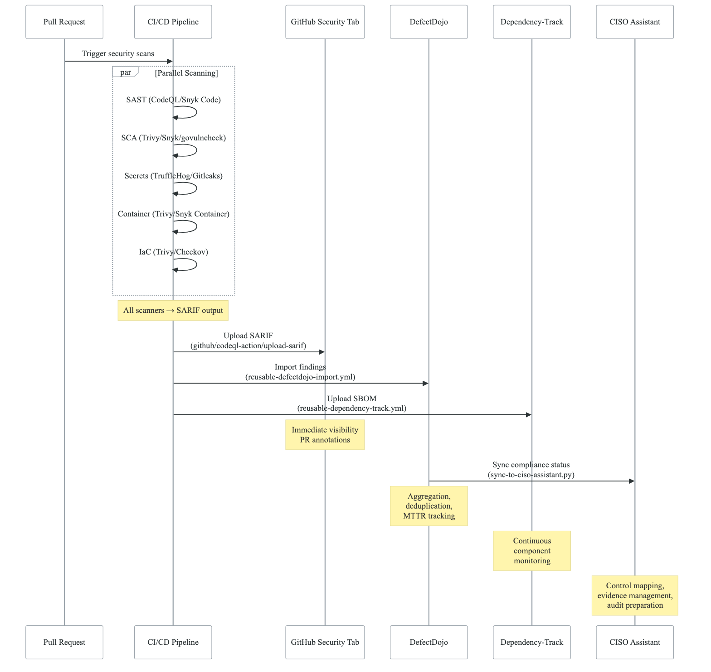
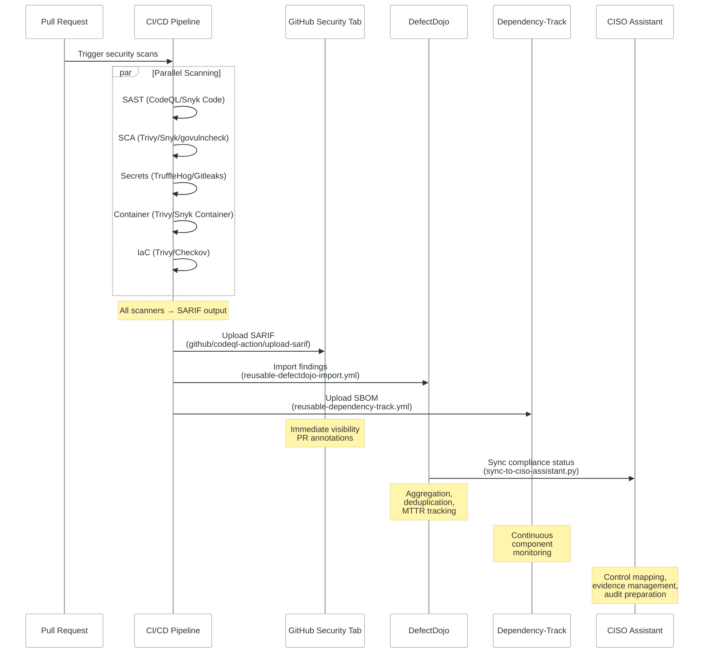

# SARIF as Universal Scanner Output

This document describes how SARIF (Static Analysis Results Interchange Format) serves as the universal output format across all security scanners, enabling centralized visibility and tracking. Referenced from Security Pipeline (Domain 2), Compliance (Domain 6), and Observability (Domain 7) architecture docs.

> **Source files**: All `reusable-*-security.yml` workflows in `northwind-workflows/.github/workflows/`

---

## Overview

Every security scanner in the pipeline emits SARIF format results, creating a unified data flow from code scanning through vulnerability management to compliance evidence.

## Data Flow

<!-- figure: generated from the Mermaid below by _shared/diagrams/embed-figures.py — do not edit the image -->


<details>
<summary>Diagram source (Mermaid)</summary>



</details>

## Scanner → SARIF Mapping

### Go Services

| Scanner | SARIF Category | Upload Action |
|---------|---------------|---------------|
| CodeQL (security-extended) | `codeql-go` | `github/codeql-action/analyze@v3` (built-in) |
| Gosec | `gosec-{{SERVICE_NAME}}` | `github/codeql-action/upload-sarif@v3` |
| Trivy (filesystem) | `trivy-dependencies-{{SERVICE_NAME}}` | `github/codeql-action/upload-sarif@v3` |
| Trivy (container) | `trivy-container-{{SERVICE_NAME}}` | `github/codeql-action/upload-sarif@v3` |

### Node.js Services

| Scanner | SARIF Category | Upload Action |
|---------|---------------|---------------|
| Snyk Code (SAST) | `snyk-code` | `github/codeql-action/upload-sarif@v3` |
| Snyk (SCA) | `snyk-dependencies` | `github/codeql-action/upload-sarif@v3` |
| Snyk Container | `snyk-container` | `github/codeql-action/upload-sarif@v3` |
| Trivy (filesystem) | `trivy-deps` | `github/codeql-action/upload-sarif@v3` |

### Infrastructure

| Scanner | SARIF Category | Upload Action |
|---------|---------------|---------------|
| Trivy (IaC config) | `trivy-iac` | `github/codeql-action/upload-sarif@v3` |
| Checkov | `checkov` | `github/codeql-action/upload-sarif@v3` |
| tflint | `tflint` | `github/codeql-action/upload-sarif@v3` |

## SARIF Upload Pattern

All scanners follow this consistent pattern:

```yaml
# 1. Run scanner with SARIF output
- name: Run Trivy vulnerability scanner
  uses: aquasecurity/trivy-action@0.28.0
  with:
    scan-type: 'fs'
    format: 'sarif'
    output: 'trivy-results.sarif'
    severity: 'CRITICAL,HIGH,MEDIUM'

# 2. Upload to GitHub Security tab
- name: Upload SARIF to GitHub
  uses: github/codeql-action/upload-sarif@v3
  if: always()  # Upload even if scanner found issues
  with:
    sarif_file: 'trivy-results.sarif'
    category: 'trivy-deps-{{SERVICE_NAME}}'  # Unique per scanner+service

# 3. Archive for DefectDojo import
- name: Upload scan artifact
  uses: actions/upload-artifact@v4
  with:
    name: security-scans
    path: trivy-results.sarif
    retention-days: 30
```

## Key Design Decisions

1. **Category namespacing**: Each SARIF upload uses a unique `category` to prevent overwriting results from different scanners. Format: `{scanner}-{service-name}`.

2. **`if: always()`**: SARIF uploads always execute, even when scanners report findings. This ensures the Security tab shows current state regardless of pipeline outcome.

3. **`continue-on-error: true`**: Scanner steps use this to prevent one failing scanner from blocking the entire pipeline. Each scanner's results are independently valuable.

4. **Artifact retention**: Scan results are stored as artifacts for 30 days to support DefectDojo import and audit trails.

## DefectDojo Import

SARIF results flow to DefectDojo via `reusable-defectdojo-import.yml`:

```yaml
# Import SARIF to DefectDojo
- name: Import scan results
  run: |
    curl -X POST "${DEFECTDOJO_URL}/api/v2/import-scan/" \
      -H "Authorization: Token ${DEFECTDOJO_TOKEN}" \
      -F "scan_type=SARIF" \
      -F "file=@scans/trivy-results.sarif" \
      -F "product_name={{SERVICE_NAME}}" \
      -F "engagement_name=CI/CD Security Scan" \
      -F "minimum_severity=Info" \
      -F "active=true" \
      -F "verified=false" \
      -F "close_old_findings=true"
```

DefectDojo's `close_old_findings=true` ensures findings not present in the latest scan are automatically marked as resolved, providing accurate MTTR metrics.

## Benefits of SARIF Standardization

1. **Single format**: All scanners produce the same output regardless of language or scanner type
2. **GitHub native**: SARIF is GitHub's native security format — automatic PR annotations, Security tab integration
3. **Tool agnostic**: Swap scanners without changing downstream integrations
4. **Compliance evidence**: SARIF files serve as audit evidence for SOC2, ISO 27001
5. **Deduplication**: DefectDojo can deduplicate findings across scanners and time

<!-- feynman-check -->

---

## Feynman check

Close the file. Blank page, no notes. Explain each of these to a competent engineer who has never
used this tool — **under five minutes, no jargon you can't define on the spot:**

- Data Flow
- Scanner → SARIF Mapping
- SARIF Upload Pattern
- Key Design Decisions

**The gap is not what you forgot. It is where you used a word instead of a mechanism.**

| | |
|---|---|
| ✗ | *"We scan for vulnerabilities in the pipeline."* |
| ✓ | *"SAST reads source without running it, SCA resolves the dependency tree against an advisory database, and image scanning compares installed package versions to that same database. All three report what was known at build time — which is why the registry is re-scanned: the image does not change, the database does."* |

**Trace it:** A CVE published today against your base image → a blocked deploy. Name every component between the advisory and the refused `apply`.

Stop at the first component you cannot name. Reopen this file and read **only** that.

**Go deeper — only once the gap has a name:** the [SLSA threat model](https://slsa.dev/spec/v1.2/threats) — it names every point at which a build can be subverted, and most teams defend three of them.
Full list per domain: [`SOURCES.md`](../../SOURCES.md#devsecops)

→ Protocol, the three levels of knowing, and worked examples: [`MASTERY.md`](../../MASTERY.md)

<!-- /feynman-check -->
