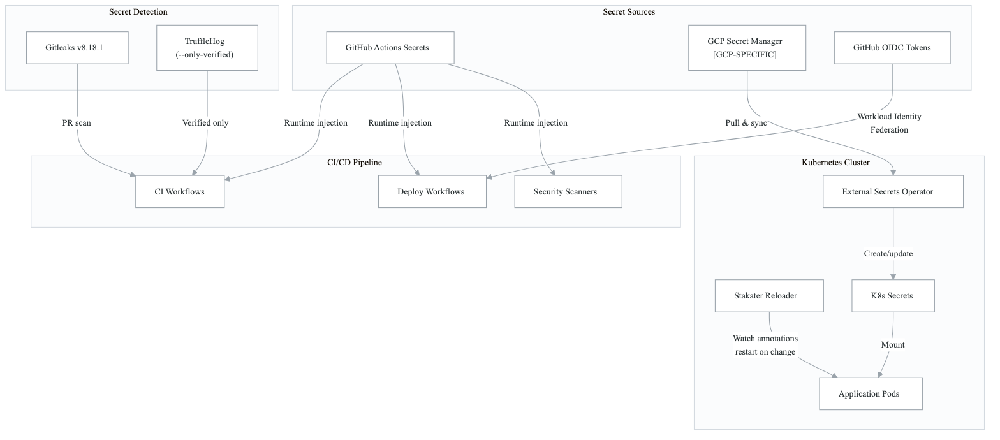
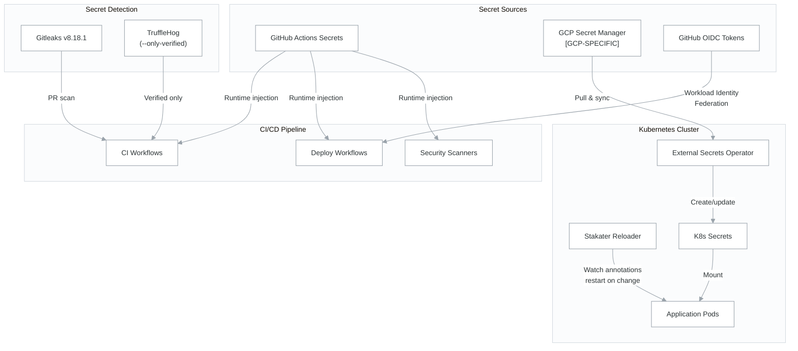

# Secret Management Architecture

This document describes the unified secret management strategy spanning CI/CD, Infrastructure, Kubernetes, and Security scanning. It is referenced from each relevant domain's architecture doc.

> **Source files**: `northwind-infrastructure/modules/secret-manager/`, `northwind-infrastructure/k8s-manifests/infrastructure/external-secrets/`, `northwind-infrastructure/modules/github-wif/`

---

## Architecture Overview

<!-- figure: generated from the Mermaid below by _shared/diagrams/embed-figures.py — do not edit the image -->


<details>
<summary>Diagram source (Mermaid)</summary>



</details>

## Secret Categories

### 1. CI/CD Pipeline Secrets (GitHub Actions)

Stored as GitHub organization or repository secrets, injected at workflow runtime.

| Secret | Purpose | Domain |
|--------|---------|--------|
| `NPM_TOKEN` | Private npm package access | CI/CD |
| `SNYK_TOKEN` | Snyk vulnerability scanning | Security |
| `SONAR_TOKEN` | SonarQube code quality | Security |
| `SONAR_HOST_URL` | SonarQube server URL | Security |
| `GCP_STAGING_SA_KEY` | GCP staging access **[GCP-SPECIFIC]** | Deploy |
| `GCP_STAGING_PROJECT_ID` | GCP staging project **[GCP-SPECIFIC]** | Deploy |
| `GCP_PROD_SA_KEY` | GCP production access **[GCP-SPECIFIC]** | Deploy |
| `GCP_PROD_PROJECT_ID` | GCP production project **[GCP-SPECIFIC]** | Deploy |
| `K8S_KUBECONFIG` | Kubernetes cluster access | Deploy |

### 2. OIDC / Workload Identity Federation

See [oidc-workload-identity.md](cross-cutting-oidc-workload-identity.md) for the full trust chain.

GitHub Actions authenticates to cloud providers via OIDC tokens — no long-lived service account keys stored in GitHub. **[GCP-SPECIFIC]** uses Workload Identity Federation; alternatives exist for AWS (OIDC Provider) and Azure (Federated Credentials).

### 3. Enterprise Security Secrets

| Secret | Purpose | Domain |
|--------|---------|--------|
| `DEFECTDOJO_URL` | DefectDojo instance URL | Compliance |
| `DEFECTDOJO_TOKEN` | DefectDojo API access | Compliance |
| `CISO_ASSISTANT_URL` | CISO Assistant instance URL | Compliance |
| `CISO_ASSISTANT_TOKEN` | CISO Assistant API access | Compliance |
| `DEPENDENCY_TRACK_URL` | Dependency-Track instance URL | Security |
| `DEPENDENCY_TRACK_API_KEY` | Dependency-Track API access | Security |
| `SLACK_WEBHOOK_URL` | Security alert notifications | Incident Response |

### 4. Kubernetes Secrets (Runtime)

Managed via External Secrets Operator pulling from GCP Secret Manager **[GCP-SPECIFIC]**.

| Secret Type | Rotation Interval | Rationale |
|-------------|-------------------|-----------|
| Service tokens | 5 minutes | Short-lived, high-value |
| Database credentials | 15 minutes | Balance between security and connection pool stability |
| Application secrets | 30 minutes | JWT secrets, API keys |
| Third-party API keys | 1 hour | External service rate limits |

## External Secrets Operator Pattern

```yaml
# ExternalSecret resource (per-service)
apiVersion: external-secrets.io/v1beta1
kind: ExternalSecret
metadata:
  name: {{SERVICE_NAME}}-secrets
  namespace: {{APP_NAMESPACE}}
spec:
  refreshInterval: 15m  # Rotation interval
  secretStoreRef:
    name: gcp-secret-store  # [GCP-SPECIFIC]
    kind: ClusterSecretStore
  target:
    name: {{SERVICE_NAME}}-secrets
    creationPolicy: Owner
  data:
    - secretKey: DATABASE_URL
      remoteRef:
        key: {{SERVICE_NAME}}-db-url  # Key in Secret Manager
    - secretKey: JWT_SECRET
      remoteRef:
        key: {{APP_NAME}}-jwt-secret
```

## Stakater Reloader

Pods annotated with `reloader.stakater.com/match: "true"` are automatically restarted when their mounted secrets change. This ensures applications pick up rotated credentials without manual intervention.

```yaml
# Deployment annotation
metadata:
  annotations:
    reloader.stakater.com/match: "true"
```

## Secret Detection in CI/CD

Two complementary tools provide defense-in-depth:

1. **TruffleHog** (`--only-verified`): Scans git history for secrets that are confirmed active against their respective services. Eliminates false positives by only alerting on verified secrets.

2. **Gitleaks v8.18.1**: Pattern-based detection across the full repository. Catches potential secrets that may not be verifiable (internal tokens, custom patterns).

Both run on every PR and push to main. Results flow to the GitHub Security tab via SARIF.

## Security Best Practices

1. **No long-lived service account keys** — use OIDC/WIF for all cloud authentication
2. **Secret rotation** — automated via External Secrets Operator with configurable intervals
3. **Least privilege** — each service gets only the secrets it needs
4. **Audit trail** — GCP Secret Manager provides access logging **[GCP-SPECIFIC]**
5. **Detection** — dual-tool scanning catches both verified and pattern-matched secrets
6. **No secrets in code** — pre-commit hooks (Gitleaks) prevent accidental commits
7. **Encryption at rest** — Kubernetes secrets encrypted via KMS **[GCP-SPECIFIC]**

## Cloud-Agnostic Alternatives

| GCP Component | AWS Alternative | Azure Alternative |
|---------------|-----------------|-------------------|
| GCP Secret Manager | AWS Secrets Manager | Azure Key Vault |
| Workload Identity Federation | IAM OIDC Provider | Federated Credentials |
| KMS encryption | AWS KMS | Azure Key Vault HSM |

The External Secrets Operator supports all three cloud providers natively — only the `SecretStore` or `ClusterSecretStore` configuration changes.

<!-- feynman-check -->

---

## Feynman check

Close the file. Blank page, no notes. Explain each of these to a competent engineer who has never
used this tool — **under five minutes, no jargon you can't define on the spot:**

- Secret Categories
- External Secrets Operator Pattern
- Stakater Reloader
- Secret Detection in CI/CD

**The gap is not what you forgot. It is where you used a word instead of a mechanism.**

| | |
|---|---|
| ✗ | *"We scan for vulnerabilities in the pipeline."* |
| ✓ | *"SAST reads source without running it, SCA resolves the dependency tree against an advisory database, and image scanning compares installed package versions to that same database. All three report what was known at build time — which is why the registry is re-scanned: the image does not change, the database does."* |

**Trace it:** A CVE published today against your base image → a blocked deploy. Name every component between the advisory and the refused `apply`.

Stop at the first component you cannot name. Reopen this file and read **only** that.

**Go deeper — only once the gap has a name:** the [SLSA threat model](https://slsa.dev/spec/v1.2/threats) — it names every point at which a build can be subverted, and most teams defend three of them.
Full list per domain: [`SOURCES.md`](../../SOURCES.md#devsecops)

→ Protocol, the three levels of knowing, and worked examples: [`MASTERY.md`](../../MASTERY.md)

<!-- /feynman-check -->
