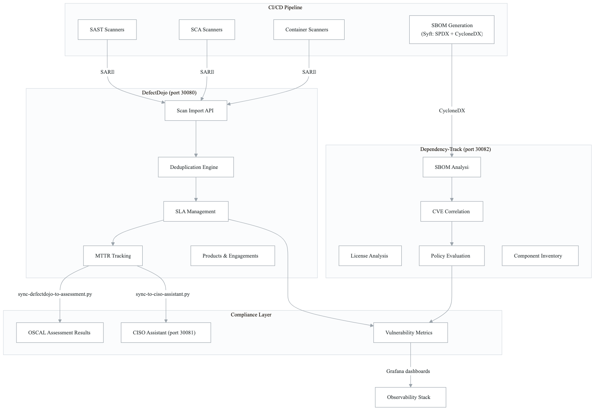
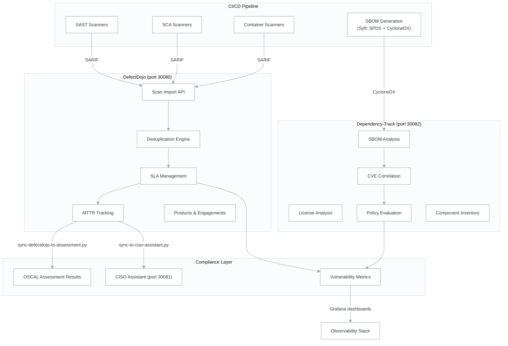

# DefectDojo + Dependency-Track as Central Vulnerability Sinks

This document describes how DefectDojo and Dependency-Track complement each other as centralized vulnerability management platforms. Referenced from Security Pipeline (Domain 2), Compliance (Domain 6), and Observability (Domain 7) architecture docs.

> **Source files**: `northwind-workflows/.github/workflows/reusable-defectdojo-import.yml`, `northwind-workflows/.github/workflows/reusable-dependency-track.yml`, `northwind-infrastructure/k8s-manifests/defectdojo/`, `northwind-infrastructure/k8s-manifests/security/dependency-track/`

---

## Overview

Two complementary tools serve distinct but related purposes:

| Aspect | DefectDojo | Dependency-Track |
|--------|-----------|-----------------|
| **Purpose** | Scan result aggregation | SBOM-based component monitoring |
| **Input** | SARIF/scan reports | SBOMs (CycloneDX/SPDX) |
| **Trigger** | Every CI/CD scan | Every build (SBOM upload) |
| **Strength** | Deduplication, MTTR tracking | Continuous component vulnerability monitoring |
| **Port** | 30080 | 30082 |
| **Namespace** | `defectdojo` | `dependency-track` |

## Integration Architecture

<!-- figure: generated from the Mermaid below by _shared/diagrams/embed-figures.py — do not edit the image -->


<details>
<summary>Diagram source (Mermaid)</summary>



</details>

## DefectDojo Integration

### How It Works

1. **CI/CD pipelines** run security scanners that produce SARIF output
2. **`reusable-defectdojo-import.yml`** uploads SARIF to DefectDojo via its REST API
3. DefectDojo creates **products** (one per service) and **engagements** (per scan run)
4. The **deduplication engine** prevents duplicate findings across scanners and runs
5. **SLA management** tracks remediation deadlines per severity
6. **MTTR metrics** measure mean-time-to-remediate across the portfolio

### Supported Scan Types

DefectDojo accepts results from all scanner types via SARIF:

| Scanner | DefectDojo Scan Type | Import Source |
|---------|---------------------|---------------|
| CodeQL | SARIF | Direct upload |
| Gosec | SARIF | Direct upload |
| Snyk Code | SARIF | Direct upload |
| Snyk SCA | SARIF | Direct upload |
| Trivy | SARIF | Direct upload |
| Checkov | SARIF | Direct upload |
| ZAP | ZAP Scan | Native format |

### API Usage

```bash
# Import scan results
curl -X POST "{{DEFECTDOJO_URL}}/api/v2/import-scan/" \
  -H "Authorization: Token ${DEFECTDOJO_TOKEN}" \
  -F "scan_type=SARIF" \
  -F "file=@scan-results.sarif" \
  -F "product_name={{SERVICE_NAME}}" \
  -F "engagement_name=CI/CD Security Scan" \
  -F "close_old_findings=true"

# Query SLA breaches
curl -s "{{DEFECTDOJO_URL}}/api/v2/findings/?active=true&sla_start_date__isnull=false" \
  -H "Authorization: Token ${DEFECTDOJO_TOKEN}"
```

### Resource Requirements

| Component | CPU | Memory | Storage |
|-----------|-----|--------|---------|
| DefectDojo (total) | 1.05 | 2.3 GB | 10 GB |

## Dependency-Track Integration

### How It Works

1. **CI/CD pipelines** generate SBOMs using Syft (both SPDX and CycloneDX formats)
2. **`reusable-dependency-track.yml`** uploads CycloneDX SBOMs to Dependency-Track
3. Dependency-Track creates **projects** (one per service, with version tracking)
4. The **CVE correlation engine** continuously monitors components against the NVD
5. **Policy evaluation** checks license compliance and component bans
6. **Inherited risk scores** aggregate vulnerability severity across the component tree

### API Usage

```bash
# Upload SBOM
SBOM_CONTENT=$(base64 -w 0 sbom.cyclonedx.json)
curl -X PUT "{{DEPENDENCY_TRACK_URL}}/api/v1/bom" \
  -H "X-Api-Key: ${DEPENDENCY_TRACK_API_KEY}" \
  -H "Content-Type: application/json" \
  -d "{\"project\": \"${PROJECT_UUID}\", \"bom\": \"${SBOM_CONTENT}\"}"

# Get project metrics
curl -s "{{DEPENDENCY_TRACK_URL}}/api/v1/metrics/project/${PROJECT_UUID}/current" \
  -H "X-Api-Key: ${DEPENDENCY_TRACK_API_KEY}"
```

### Severity Threshold Enforcement

The workflow supports failing builds based on vulnerability severity:

| Threshold | Blocks On |
|-----------|-----------|
| `CRITICAL` | Critical vulns only |
| `HIGH` | Critical + High |
| `MEDIUM` | Critical + High + Medium |
| `LOW` | Any vulnerability |
| `none` | Never blocks |

## How They Complement Each Other

| Scenario | DefectDojo | Dependency-Track |
|----------|-----------|-----------------|
| New CVE discovered in a dependency | Shows when scanner next detects it | Alerts immediately (continuous monitoring) |
| Vulnerability fixed in code | Closes finding when scanner confirms | N/A (code findings not tracked) |
| License violation | N/A | Detects via SBOM analysis |
| MTTR metrics for compliance | Tracks from detection to resolution | N/A |
| Component inventory | N/A | Complete bill of materials per service |
| Cross-scanner deduplication | Merges findings from multiple scanners | N/A (single SBOM source per version) |

## Compliance Integration

Both tools feed into the compliance automation:

1. **DefectDojo → OSCAL**: `sync-defectdojo-to-assessment.py` imports DefectDojo findings into OSCAL assessment results, mapping vulnerability categories to NIST 800-53 controls
2. **DefectDojo → CISO Assistant**: `sync-to-ciso-assistant.py` syncs compliance status for audit preparation
3. **Dependency-Track → OSCAL**: Component inventory and license data feed into supply chain compliance evidence
4. **Both → Grafana**: Vulnerability metrics (counts by severity, MTTR, SLA compliance) displayed on the security Grafana dashboard

<!-- feynman-check -->

---

## Feynman check

Close the file. Blank page, no notes. Explain each of these to a competent engineer who has never
used this tool — **under five minutes, no jargon you can't define on the spot:**

- Integration Architecture
- DefectDojo Integration
- Dependency-Track Integration
- How They Complement Each Other

**The gap is not what you forgot. It is where you used a word instead of a mechanism.**

| | |
|---|---|
| ✗ | *"We scan for vulnerabilities in the pipeline."* |
| ✓ | *"SAST reads source without running it, SCA resolves the dependency tree against an advisory database, and image scanning compares installed package versions to that same database. All three report what was known at build time — which is why the registry is re-scanned: the image does not change, the database does."* |

**Trace it:** A CVE published today against your base image → a blocked deploy. Name every component between the advisory and the refused `apply`.

Stop at the first component you cannot name. Reopen this file and read **only** that.

**Go deeper — only once the gap has a name:** the [SLSA threat model](https://slsa.dev/spec/v1.2/threats) — it names every point at which a build can be subverted, and most teams defend three of them.
Full list per domain: [`SOURCES.md`](../../SOURCES.md#devsecops)

→ Protocol, the three levels of knowing, and worked examples: [`MASTERY.md`](../../MASTERY.md)

<!-- /feynman-check -->
