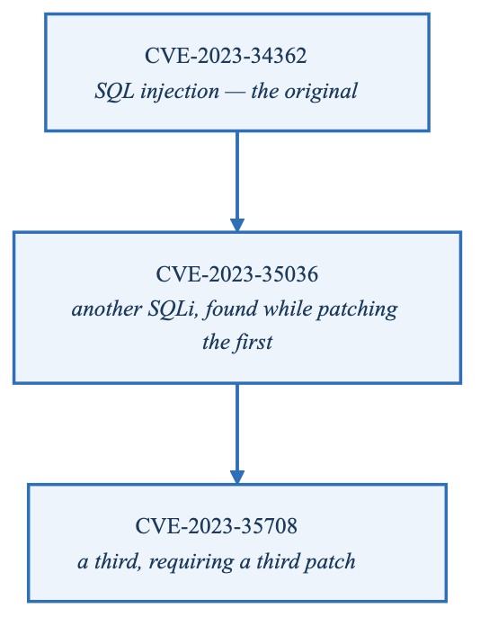
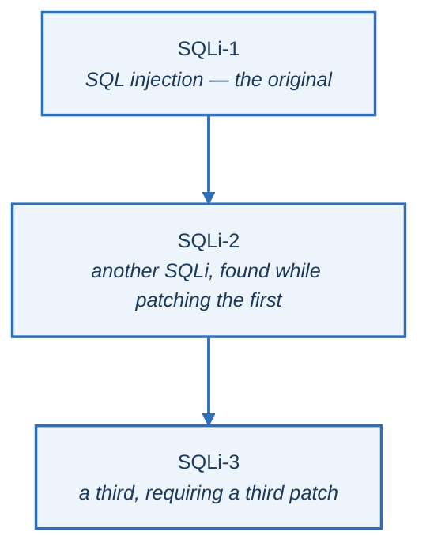
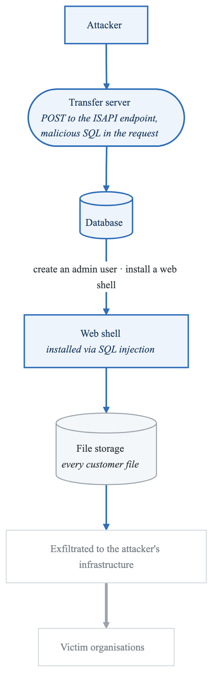
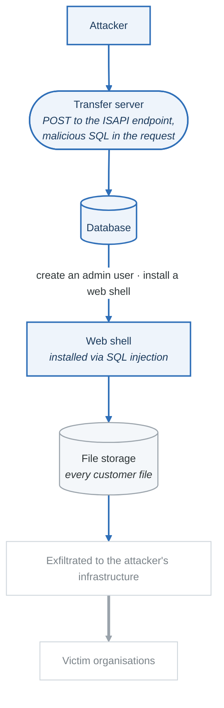
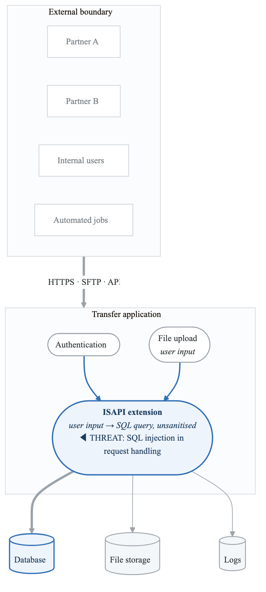
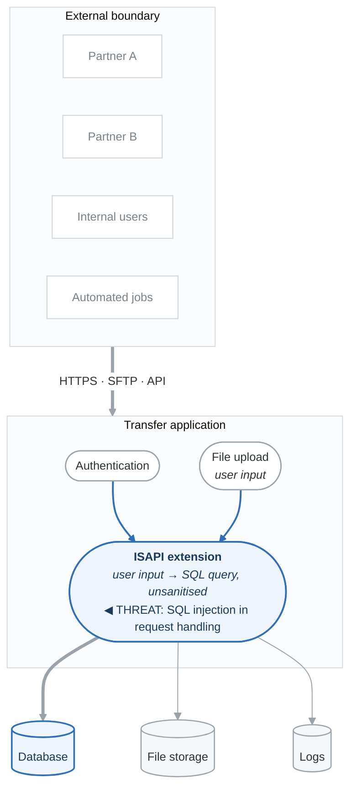
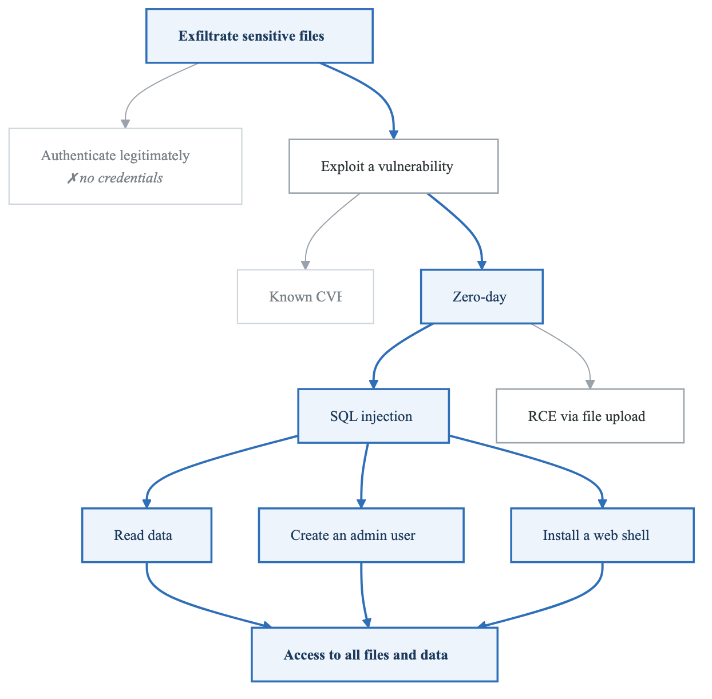
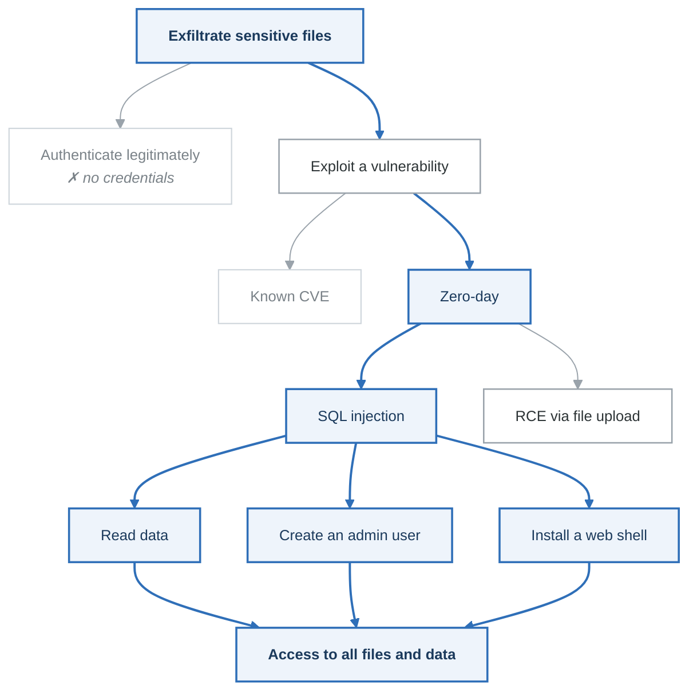

# Case Study: FileTransferApp Transfer Attack (2023)

## Executive Summary

In May 2023, the ThreatGroup-B ransomware group exploited a zero-day SQL injection vulnerability in FileTransferApp Transfer, a managed file transfer (MFT) solution. This attack demonstrates the catastrophic impact of vulnerabilities in file transfer infrastructure and the importance of threat modeling data movement systems.

**Key Facts:**
- Attacker: ThreatGroup-B ransomware group
- Vulnerability: SQL injection, a zero-day; two more SQLi flaws surfaced while patching it
- Attack Window: May 27-31, 2023 (mass exploitation)
- Victims: 2,500+ organizations
- Data Exposed: 66+ million individuals
- Notable Victims: Shell, BBC, British Airways, US government agencies

---

## Technical Background

### What is FileTransferApp Transfer?

FileTransferApp Transfer is an enterprise managed file transfer (MFT) solution used for:
- Secure file sharing between organizations
- Automated B2B data transfers
- Compliance-driven file exchanges (PCI, HIPAA)
- Large file transfers

**Why It's a High-Value Target:**
- Contains sensitive files from multiple organizations
- Often holds PII, financial data, healthcare records
- Internet-facing by design
- Trusted pipeline for critical data

### The Vulnerability Chain

**Three CVEs in three weeks, each found while patching the last**

<!-- figure: generated from the Mermaid below by _shared/diagrams/embed-figures.py — do not edit the image -->


<details>
<summary>Diagram source (Mermaid)</summary>



</details>

**Impact of each** — unauthenticated access · database manipulation · file exfiltration · web shell
installation.

Three CVEs in the same component in three weeks is the finding, not any one of them. It says the
injection was systemic rather than a single missed parameter — which means "we patched it" was not a
safe conclusion after the first fix, and customers who took the first patch and stopped watching
were exposed twice more.

---

## Attack Flow

**Attack timeline**

| Date | Event |
|---|---|
| **27–31 May** | Mass exploitation, before anyone knew the vulnerability existed |
| **1 June** | Public disclosure |
| **6 June** | Extortion begins |
| **15 June onward** | Data leaked publicly |

**How the exploitation worked**

<!-- figure: generated from the Mermaid below by _shared/diagrams/embed-figures.py — do not edit the image -->


<details>
<summary>Diagram source (Mermaid)</summary>



</details>

Four days of exploitation before disclosure. The lesson is not about the CVE — it is that a
managed-file-transfer appliance is a *category* that concentrates every partner's data behind one
internet-facing application, which makes it worth a zero-day to somebody.

### Exploitation Details

```http
# Malicious request (simplified)
POST /fta-api/fta-api.dll?action=m2 HTTP/1.1
Host: target-filetransferapp.com
Content-Type: application/x-www-form-urlencoded

# SQL injection payload
query='; INSERT INTO users (username, password, admin)
       VALUES ('threatgroup', 'password', 1);--
```

```aspx
# Installed web shell (human2.aspx)
# Allowed attackers to:
# - Execute commands
# - Browse file system
# - Download files
# - Maintain persistence
```

---

## What Threat Modeling Would Have Found

### Data Flow Diagram: File Transfer System

<!-- figure: generated from the Mermaid below by _shared/diagrams/embed-figures.py — do not edit the image -->


<details>
<summary>Diagram source (Mermaid)</summary>



</details>

### STRIDE Analysis: FileTransferApp Transfer

| Component | S | T | R | I | D | E | Critical Findings |
|-----------|---|---|---|---|---|---|-------------------|
| Web interface | ✓ | ✓ | | | | | Authentication bypass |
| ISAPI handler | | ✓ | | | | ✓ | **SQL injection** |
| Database | | ✓ | ✓ | ✓ | | ✓ | Data manipulation |
| File storage | | | | ✓ | | ✓ | File exfiltration |
| User accounts | ✓ | | ✓ | | | ✓ | Account creation |

### Attack Tree: Exfiltrate Files via MFT

<!-- figure: generated from the Mermaid below by _shared/diagrams/embed-figures.py — do not edit the image -->


<details>
<summary>Diagram source (Mermaid)</summary>



</details>

---

## Lessons for File Transfer System Threat Modeling

### 1. Internet-Facing File Transfer is Critical Infrastructure

```yaml
asset_classification:
  filetransferapp_transfer:
    data_types:
      - Customer PII
      - Financial records
      - Healthcare data (PHI)
      - Legal documents
      - Trade secrets

    criticality: CRITICAL

    exposure: INTERNET-FACING

    regulatory_requirements:
      - PCI DSS (financial data)
      - HIPAA (healthcare)
      - GDPR (EU data)
      - SOX (financial reporting)

    threat_model_priority: P0
```

### 2. File Transfer Systems Are Aggregation Points

**Single FileTransferApp Server Contains:**

- Data from Partner A (financial)
- Data from Partner B (healthcare)
- Data from Partner C (legal)
- Internal HR documents
- Automated transfer data

Breach Impact = Sum of All Data Sources

Threat Model Implications:
□ Data classification for all flows
□ Segmentation by sensitivity
□ Retention policies
□ Encryption at rest
□ Access logging for all files


### 3. Web Application Security Fundamentals Apply

| Vulnerability Class | FileTransferApp Relevance | Prevention |
|---------------------|------------------|------------|
| SQL Injection | SQLi-1, the zero-day | Parameterized queries |
| Command Injection | Potential via file processing | Input validation |
| Path Traversal | File download/upload | Path sanitization |
| Authentication Bypass | Admin creation | Strong auth controls |
| File Upload | Web shell installation | File type validation |

### 4. Defense in Depth for File Transfer

**Layer 1: Network**

- WAF (block SQLi patterns)
- `IDS/IPS`
- Network segmentation
- Egress filtering

**Layer 2: Application**

- Input validation
- Parameterized queries
- Strong authentication
- Rate limiting

**Layer 3: Data**

- Encryption at rest
- File integrity monitoring
- Access controls
- DLP

**Layer 4: Monitoring**

- SQL query logging
- File access auditing
- Anomaly detection
- SIEM integration


---

## Detection Strategies

### Indicators of Compromise

```yaml
file_indicators:
  - human2.aspx (web shell)
  - _human2.aspx (variant)
  - Any .aspx files in unexpected locations

sql_patterns:
  - Unusual INSERT INTO users
  - Database user creation
  - xp_cmdshell execution
  - Bulk data SELECT

network_indicators:
  - Large data exfiltration (unusual upload patterns)
  - Connections to ThreatGroup-B infrastructure
  - Tor exit node connections
  - New outbound connections from file server
```

### Detection Rules

```sql
-- SQL query anomaly detection
SELECT * FROM query_log
WHERE query_text LIKE '%INSERT INTO users%'
   OR query_text LIKE '%xp_cmdshell%'
   OR query_text LIKE '%INTO OUTFILE%'
   AND source = 'web_application';

-- File system monitoring
SELECT * FROM file_changes
WHERE file_extension = '.aspx'
  AND file_path NOT IN (approved_paths)
  AND change_type = 'CREATE';
```

---

## Remediation Framework

### Immediate Actions (Day 0-1)

| Action | Priority | Description |
|--------|----------|-------------|
| Take offline | P0 | Disconnect FileTransferApp from network |
| Preserve evidence | P0 | Snapshot servers, logs |
| Check for IOCs | P0 | Look for web shells, new users |
| Apply patches | P0 | All three SQLi advisories |
| Reset credentials | P0 | All FileTransferApp users and service accounts |

### Short-Term (Week 1-2)

| Action | Priority | Description |
|--------|----------|-------------|
| Forensic analysis | P1 | Determine data accessed |
| Notify affected | P1 | Customers, partners, regulators |
| Deploy WAF rules | P1 | Block SQLi patterns |
| Enhanced logging | P1 | Full query logging |
| Network segmentation | P1 | Isolate file transfer systems |

### Long-Term

| Action | Priority | Description |
|--------|----------|-------------|
| Alternative solutions | P2 | Evaluate more secure options |
| Code audit | P2 | Review for other vulnerabilities |
| Penetration testing | P2 | Regular security assessments |
| Incident response plan | P2 | MFT-specific procedures |
| Zero trust for file access | P2 | Verify every access |

---

## Threat Model Checklist: File Transfer Systems

```
Architecture:
□ Is the system internet-facing?
□ What data types are transferred?
□ Who are the senders and receivers?
□ What regulatory requirements apply?
□ Is there network segmentation?

Application Security:
□ Is input validation implemented?
□ Are queries parameterized?
□ Is authentication strong (MFA)?
□ Are sessions properly managed?
□ Is file upload validated?

Data Protection:
□ Is data encrypted at rest?
□ Is data encrypted in transit?
□ Are access controls enforced?
□ Is data classified and labeled?
□ Are retention policies enforced?

Monitoring & Detection:
□ Are all file accesses logged?
□ Are SQL queries logged?
□ Is file integrity monitored?
□ Are anomalies detected?
□ Is SIEM integration in place?

Patching & Maintenance:
□ Is patching process defined?
□ Are critical patches applied promptly?
□ Is vendor communication monitored?
□ Are security advisories tracked?
□ Is vulnerability scanning regular?

Incident Response:
□ Is there an MFT-specific IR plan?
□ Can the system be isolated quickly?
□ Are backups available and tested?
□ Is forensic capability available?
□ Are notification procedures defined?
```

---

## Supply Chain Impact

### Cascading Effects

**FileTransferApp Compromise**

  - Direct Victims (2,500+ orgs)
    - Government agencies
    - Financial institutions
    - Healthcare providers
    - Corporations
  - Third-Party Victims
    - Employees of direct victims
    - Customers of direct victims
    - Partners of direct victims
  - Fourth-Party Victims
    - 66+ million individuals

**Data Exposed:**

- Social Security Numbers
- Healthcare records
- Financial information
- Driver's license numbers
- Personal identifiable information


### Threat Modeling Implication

```yaml
third_party_risk_assessment:
  file_transfer_vendors:
    questions:
      - What data do they process?
      - What is their security posture?
      - How quickly do they patch?
      - What is their breach history?
      - What are notification procedures?

    requirements:
      - SOC 2 Type II
      - Regular penetration testing
      - Vulnerability disclosure program
      - SLA for critical patches
      - Incident notification < 24 hours
```

---

## Key Takeaways

1. **File transfer systems are high-value targets** - They aggregate sensitive data from multiple sources
2. **SQL injection is still a critical threat** - Basic web security applies to enterprise software
3. **Internet-facing systems need extra scrutiny** - Assume they will be attacked
4. **Patch management is critical** - Zero-days require rapid response
5. **Defense in depth matters** - WAF, network controls, and monitoring could have limited impact
6. **Supply chain risk is real** - Your vendor's vulnerability is your vulnerability

---

## References

- [Vendor Security Advisory](https://www.filetransferapp.example/security/advisory)
- [CISA FileTransferApp Alert](https://www.cisa.gov/news-events/cybersecurity-advisories/filetransferapp-exploitation)
- [Mandiant Analysis](https://www.mandiant.com/resources/blog/zero-day-filetransferapp-data-theft)
- [ThreatGroup-B Ransomware Profile](https://www.cisa.gov/news-events/cybersecurity-advisories/threatgroup-b-profile)

---

## Next Case Study

→ [ThreatGroup-B Microsoft Cloud Breach](case-studies-threatgroup-b.md)

<!-- feynman-check -->

---

## Feynman check

Close the file. Blank page, no notes. Explain each of these to a competent engineer who has never
used this tool — **under five minutes, no jargon you can't define on the spot:**

- Technical Background
- Attack Flow
- What Threat Modeling Would Have Found
- Lessons for File Transfer System Threat Modeling

**The gap is not what you forgot. It is where you used a word instead of a mechanism.**

| | |
|---|---|
| ✗ | *"We scan for vulnerabilities in the pipeline."* |
| ✓ | *"SAST reads source without running it, SCA resolves the dependency tree against an advisory database, and image scanning compares installed package versions to that same database. All three report what was known at build time — which is why the registry is re-scanned: the image does not change, the database does."* |

**Trace it:** A CVE published today against your base image → a blocked deploy. Name every component between the advisory and the refused `apply`.

Stop at the first component you cannot name. Reopen this file and read **only** that.

**Go deeper — only once the gap has a name:** the [SLSA threat model](https://slsa.dev/spec/v1.2/threats) — it names every point at which a build can be subverted, and most teams defend three of them.
Full list per domain: [`SOURCES.md`](../../SOURCES.md#devsecops)

→ Protocol, the three levels of knowing, and worked examples: [`MASTERY.md`](../../MASTERY.md)

<!-- /feynman-check -->
